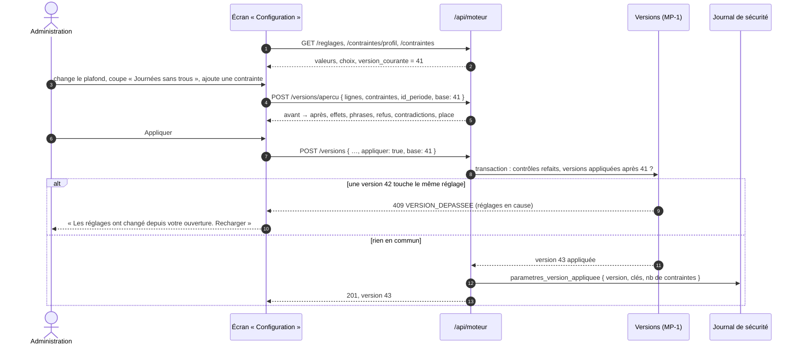
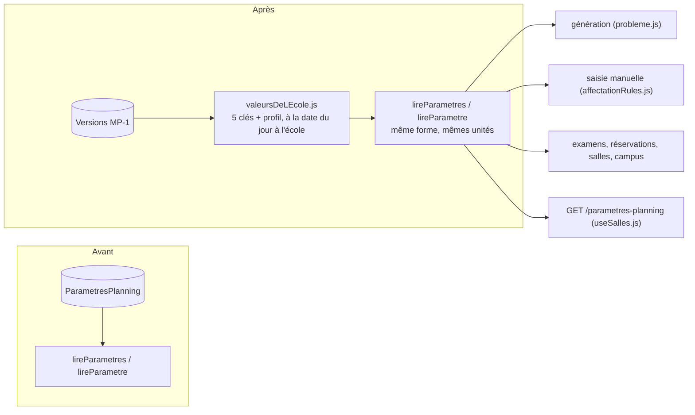

# ADM-02 · Panneau de configuration de l'école, avec MOT-13c (« Règles de génération ») — conception

| | |
|---|---|
| Module | [ADM](../../plan/modules/ADM-administration.md) · chantier ouvert le 2026-11-21 (à la fusion de #239, à la place de MOT) ; MOT-13c vient de [MOT](../../plan/modules/MOT-moteur.md) |
| Branche | `feat/adm-02-configuration` |
| Fiche de mission | `docs/plan/missions/adm-02.md` (branche du coordinateur) |
| Rédigé par | Claude Code (Opus 5.5), le 2026-11-22 |
| Questions | réponses 1 à 15 du chef, le 2026-11-22, par l'outil de questions (§ 4) |
| **Validé** | par Claude20022002 le 2026-11-22, avec le critère de « terminé » du § 1 ; numéro de migration à réserver par le coordinateur |
| Amendé | à la relecture du coordinateur, le 2026-11-22 : réponses 16 et 17 (concordance avec le solveur, raison « sans effet » en données) |

## 1. Objet et critère de « terminé »

**Le besoin** (module ADM, ligne ADM-02) : un panneau où l'administration de l'école règle ce que le moteur la laisse régler, avec un aperçu avant d'appliquer ; le reste reste au profil. **MOT-13c** en est la section « Règles de génération » : la liste « Déjà pris en compte » du profil et les contraintes déclarées à partir des six modèles ([MOT-13](../moteur-planification/mot-13-contraintes-declarees.md)).

**Le principe qui commande tout** : *ce qui est montré est tenu* (MOT-13, principe 2). Le relevé du § 2 montre que la génération ne lit, des réglages versionnés de MP-1, que les six règles souples réglables et les contraintes déclarées ; les plafonds, le trajet et les réglages d'examen sont lus dans l'ancienne table. ADM-02 fait donc **basculer ces réglages vers MP-1** (réponse 1), puis montre une **liste courte** de ce qui est vraiment lu (réponse 2).

**Livré en trois étapes** (réponse 10), une PR chacune, relue par le coordinateur :

| Étape | Contenu |
|---|---|
| **ADM-02a** | Serveur : réglages de l'école (R-1), aperçu à blanc, création et application en une requête avec contrôle de version (R-2, R-4), liste et détail des versions (R-3), journal de sécurité (R-6), bascule de `ParametresPlanning` vers MP-1 avec la migration de reprise |
| **ADM-02b** | La page « Configuration » : onglets « Réglages » et « Historique », aperçu, parcours |
| **ADM-02c** (= MOT-13c) | L'onglet « Règles de génération » : profil, liste « Déjà pris en compte » avec ses six règles réglables, contraintes déclarées (création à partir des six modèles, retrait), contrôle de place, parcours |

**Critère de « terminé » proposé** (le fichier du module n'en a pas encore pour ADM-02 ; à y recopier une fois validé) :

1. Une personne de l'administration d'une école du supérieur règle seule, depuis le panneau, **chaque réglage que le calcul ou les contrôles lisent et que l'école peut changer** : les cinq réglages du § 5.2, les six règles souples du profil, ses contraintes déclarées. Aucune copie du catalogue dans le site.
2. **Une seule source** : la génération, la saisie manuelle, les examens et les réservations lisent ces réglages dans MP-1. Les anciennes routes d'écriture refusent. Un test prouve que le problème envoyé au solveur pour la base d'essai est **identique** avant et après la bascule.
3. Chaque refus s'affiche **sous son champ**, traduit par son code (EP-4, R-7). L'aperçu dit ce qui change avant « Appliquer », et si cela vaut tout de suite ou à la prochaine génération (R-10). Deux personnes qui appliquent en même temps : la seconde reçoit « Les réglages ont changé depuis votre ouverture » et recharge (R-4).
4. L'historique se lit (liste allégée, détail à la demande) ; une version appliquée s'annule ; une version future s'annule avant sa date.
5. Appliquer, abandonner et annuler une version s'écrivent dans le journal de sécurité, avec l'auteur et les clés touchées, sans les valeurs (R-6).
6. L'onglet « Règles de génération » crée une contrainte à partir des six modèles, montre sa phrase **dans la langue de la personne**, le contrôle de place pour la période proposée, et la liste « Déjà pris en compte » avec l'état de chaque règle (active, coupée, sans effet et pourquoi, verrouillée).
7. Réglage atteint en **trois clics au plus** depuis le menu (EP-2) ; axe-core sans violation ; parcours Playwright verts (EP-9), en français et en anglais (EP-11) ; charte d'UIX-10b ; aucun texte propre au supérieur là où un mot neutre existe.
8. EP-19 : la page est chargée à la demande ; le premier chargement de l'application web est mesuré avant et après, et le chiffre est écrit dans la PR de 02b et de 02c.
9. Suites du serveur et du site vertes, lint, `verifier-neutre`.

## 2. Ce qui existe

| Quoi | Où | Constat |
|---|---|---|
| Routes de MP-1 | `backend/routes/moteurValeursRoutes.js`, `controllers/moteurValeursController.js` (69 lignes) | `GET /valeurs`, `GET` et `POST /versions`, `appliquer`, `abandonner`, `annuler`. Aucune route de catalogue (R-1), de modification de brouillon (R-2), de détail (R-3) ; aucun contrôle de version de base (R-4) ; rien au journal (R-6) |
| Versions | `services/moteur/valeurs/versions.js` (163 lignes) | `listerVersions()` rend les 100 dernières **avec toutes leurs lignes et contraintes**. Le contrôle `controler()` et `normaliser()` sont internes au fichier |
| Contrôle d'écriture | `valeurs/ecriture.js` | refus codés : `non_modifiable`, `droit_insuffisant`, `portee_non_tenue`, `borne_depassee`… ; une école ne rend jamais une règle stricte |
| Routes de MOT-13 | `routes/moteurContraintesRoutes.js`, `controllers/moteurContraintesController.js` (41 lignes) | `GET /gabarits`, `GET /contraintes`, `GET /contraintes/profil`, `POST /contraintes/verifier`. **Les phrases et les messages sont en français**, écrits par `contraintes/phrases.js` (hors du périmètre) |
| Liste « Déjà pris en compte » | `contraintes/profil.js` | **23 règles** : 14 strictes (12 verrouillées, plus les deux plafonds d'heures), 6 souples réglables par l'école (`MAT.REGLE.JOURS_DIFFERENTS` 20, `SAL.REGLE.TAILLE_ADAPTEE` 1, `HOR.REGLE.TROUS` 5, `HOR.REGLE.CHANGEMENT_SALLE` 2, `HOR.REGLE.UN_CAMPUS_PAR_JOUR` 10, `PED.PROG.CM_AVANT_TD` 5 : poids de départ), `SAL.REGLE.DISTANCIEL_SANS_SALLE` (verrouillée) et les 2 vœux des enseignants (niveau « personne ») |
| Ce que la génération lit de MP-1 | `valeurs/poidsDuSolveur.js`, `contraintes/compilation.js` | **seulement** les poids et la coupure des 6 règles souples, et les contraintes déclarées |
| Ancienne table | `config/parametresPlanning.js`, `services/planning/referentiel.js` (`lireParametres`, `lireParametre`), `parametrePlanningController.js` | **E-1** : la génération (`timefold/probleme.js:252`) lit les plafonds par jour et le trajet ici ; la saisie manuelle (`affectationRules.js:329`) aussi ; les examens, les réservations et les salles y lisent la capacité d'examen et les surveillants. La migration 0061 a copié ces valeurs dans MP-1 le 10 nov. ; l'ancienne page a pu les changer depuis : **deux sources qui divergent** |
| Catalogue | `services/moteur/catalogue/` | **E-2** : 402 paramètres sur 498 sont « modifiables par l'établissement » (c'est la valeur par défaut du chargeur), mais presque tous sont des données saisies dans le référentiel (salles, groupes…) ou ne sont lus par rien |
| Page actuelle | `frontend/src/pages/gestion/ParametresPlanning.jsx` (153 lignes) | 5 réglages en liste recopiée dans le site. **E-3** : « Durée d'une séance par défaut » n'est lue par **aucun** code, serveur ou site |
| Autres lecteurs | `components/salles/useSalles.js:42` | lit `GET /parametres-planning` (capacité d'examen) : la forme de cette route ne doit pas changer |
| Journal de sécurité | `services/journalSecurite.js` (liste des événements), `routes/etablissementRoutes.js:38` | modèle à suivre : `journaliser(contexteDe(req), { evenement, acteur, id_user, details })` |
| Site | `services/api.js` (808 lignes : **ne doit pas grossir**, § 5 du README), `App.jsx` (462), `navigation.jsx` (232) ; `request` est exporté par `api.js` | le client de la configuration vit dans son propre fichier |

## 3. Ce que disent les études

Registre : [14-reprendre-et-depasser.md](../../etude-marche/14-reprendre-et-depasser.md) ; aussi [09-failles-erp-scolaires.md](../../etude-marche/09-failles-erp-scolaires.md), [10-comparatif-openeducat-planner.md](../../etude-marche/10-comparatif-openeducat-planner.md) et [01-concurrents.md](../../etude-marche/01-concurrents.md), § 5.

**Public servi d'abord : le supérieur** (décision du 21 nov.). Les réglages montrés sont ceux d'une école du supérieur : plafonds par jour d'un groupe et d'un enseignant (vacataires compris), trajet entre campus, examens, « CM avant TD et TP », « un seul campus par jour ». **Ce qui reste neutre** : les textes disent « groupe », « enseignant », « séance », « période », jamais « semestre », « classe » ou « module » seuls ; une règle propre au supérieur garde son nom du catalogue mais l'écran ne la suppose pas (elle est « sans effet » s'il n'y a qu'un campus, comme le dit déjà `profil.js`).

| Ligne | Étude | Appliquée ou écartée | Comment, ou pourquoi |
|---|---|---|---|
| M2 / EP-4 | les refus ne s'expliquent pas (aSc, OpenEduCat) | appliquée | chaque refus sous son champ, par son code ; contradictions et contrôle de place nommés dans l'aperçu |
| M3 / EP-14 | contrôles de conflit qu'on peut éteindre (OpenEduCat, [CODE]) | appliquée | les 12 règles strictes non réglables sont montrées **verrouillées** ; l'école ne coupe que des règles souples, et un plafond se règle mais ne s'éteint pas |
| M7 / EP-1 | mise en route lourde, intégrateur payant (Classter, Odoo : « 250 $ de l'heure pour configurer ») | appliquée | cinq réglages et six règles, jamais les 498 paramètres ; le reste vient du profil. La mesure EP-1 reste à ADM-04 |
| M10 / EP-2 | réglages qui submergent (aSc, Classter : « options qui submergent ») | appliquée | une page, trois onglets ; trois clics au plus jusqu'à un réglage ; poids en mots (« peu », « beaucoup »), jamais en chiffres |
| M8 / EP-9 | mises à jour qui cassent (Frappe, OpenEduCat) | appliquée | bascule « étendre puis contracter » : l'ancienne table reste ; test « problème du solveur identique » ; migration avec son retour arrière |
| M9 / EP-16 | textes non traduisibles (OpenEduCat) | appliquée | tout dans `configuration.{fr,en}.js` ; les phrases des contraintes composées par le site dans la langue de la personne (réponse 6) |
| M17 / EP-5, EP-18 | un pays écrit dans le produit | appliquée | aucun pays, aucune devise, aucun férié dans le panneau ; le plafond légal vient du catalogue par pays, pas de l'écran ; les fériés par pays sont ADM-10 |
| M18 | le supérieur oublié (produits marocains, Go4School) | appliquée | les réglages et les règles du supérieur sont tous là (CM avant TD, campus, vacataires par le plafond enseignant) |
| N1 / EP-19 | sobre et mesuré | appliquée | page chargée à la demande, sans dépendance nouvelle ; premier chargement mesuré dans les PR de 02b et 02c |
| M1 | l'emploi du temps n'est pas calculé, ou on ne sait pas comment (OpenEduCat, Frappe, Go4School) | appliquée | la liste « Déjà pris en compte » dit, en une phrase par règle, ce que le calcul tient déjà ; c'est l'argument n° 1 du § 4 de la synthèse, rendu visible dans le produit |
| « configuration accompagnée » | Skoolly, Go4School (« 24 à 48 heures, formation incluse ») | écartée ici | c'est l'assistant de démarrage (ADM-04, R8) ; ADM-02 est le panneau qu'il parcourt |
| Suggestions par profil (« alignez les langues ») | MOT-13, § 11 | écartée | après ADM-02c ; rien dans les études ne l'exige pour le supérieur |

## 4. Questions et réponses

Réponses du chef le 22 nov. 2026, par l'outil de questions.

| N° | Question | Réponse du chef | Bloque |
|---|---|---|---|
| 1 | Source unique des plafonds, du trajet et des réglages d'examen (E-1) | **Bascule vers MP-1** : `lireParametres()` lit MP-1, une migration de reprise, les anciennes routes PUT et DELETE refusent | 02a |
| 2 | R-1 : que montre « Réglages » ? | **Liste courte tenue**, servie par `GET /api/moteur/reglages` ; « Durée de séance par défaut » retirée (E-3) | 02a |
| 3 | R-2 et R-4 : le brouillon, et deux personnes en même temps | **Le brouillon vit dans l'écran** ; `POST /versions/apercu` à blanc ; « Appliquer » crée et applique en une requête avec la dernière version vue ; 409 `VERSION_DEPASSEE` ; pas de migration | 02a |
| 4 | Forme de la page | **Une page, trois onglets** (Règles de génération, Réglages, Historique) ; même ligne du menu, renommée ; l'ancienne adresse redirige ; Identité, Calendrier, Créneaux restent à part | 02b |
| 5 | R-6 : journal de sécurité | **Oui, trois événements** : appliquée, abandonnée, annulée | 02a |
| 6 | EP-11 : phrases des contraintes en anglais | **Le site compose la phrase** à partir des codes ; la phrase du serveur reste l'aide en français et celle du bilan | 02c |
| 7 | R-10 et l'aperçu | **Ce qui change, plus les contrôles** ; sous chaque réglage, « tout de suite » ou « à la prochaine génération » ; pas de classes D-07 dans le catalogue | 02a, 02b |
| 8 | Fichiers hors de la fiche | **Bascule** (`referentiel.js`, `parametrePlanningController.js`, `parametrePlanningRoutes.js`, la migration), **traductions** (`i18n/index.js`), **journal** (`journalSecurite.js`, libellés dans `fr.js` et `en.js`). L'ancienne page **n'est pas supprimée** | — |
| 9 | Le fichier `ParametresPlanning.jsx` | **Réécrit sur place** : il devient la page qui assemble les onglets ; les textes `ref.settings.*` restent | 02b |
| 10 | Découpage | **Trois étapes**, une PR chacune | — |
| 11 | Le profil de l'école | **Affiché, non modifiable** ; le changer reste à ADM-04 ou à l'équipe Planner | 02c |
| 12 | Régler une règle souple du profil | **Quatre choix** : Coupée, Peu, Normal, Beaucoup, sans chiffre ; un poids qui ne tombe sur aucun choix s'affiche « Réglage particulier » | 02a, 02c |
| 13 | Date d'effet | **Aujourd'hui, ou plus tard** : champ « À partir du », date du jour à l'école ; une date passée est refusée | 02a, 02b |
| 14 | Contrôle de place dans l'aperçu | **Période proposée** (en cours, sinon la suivante), modifiable ; avertissement, jamais refus | 02c |
| 15 | Migration de reprise | **Seulement les écarts**, dans une version appliquée datée du jour ; aucune sur une base neuve ; l'ancienne table reste | 02a |
| 16 | *(coordinateur, relecture du 22 nov.)* Comment garantir que les règles réglables du panneau sont celles que le solveur lit ? | **Un test, profil par profil**, compare les règles réglables du panneau à celles que `poidsDesRegles` envoie au solveur. Le critère « réglable » vient de `activeeParLEcole` d'`ecriture.js`, **exportée et partagée, pas recopiée** (§ 5.2) | 02a |
| 17 | *(coordinateur, relecture du 22 nov.)* La raison « sans effet » de `profil.js` est une phrase française : comment l'écran la dit-il en anglais ? | **`raison_code` et ses conditions en données** dans la réponse de `GET /contraintes/profil` ; le site traduit ; la phrase `raison` reste l'aide en français (§ 5.3). Touche `contraintes/profil.js`, hors de la fiche : extension demandée par le coordinateur | 02a, 02c |
| 18 | *(au code, 22 nov.)* Les deux réglages d'examen ne sont réglables que par épreuve dans le catalogue (niveaux « PI ») : MP-1 refuse de les écrire pour toute l'école | **Ajouter « école »** : niveaux « GPI » pour `EXA.EPREUVE.RATIO_CAPACITE` et `EXA.EPREUVE.SURVEILLANTS_PAR_SALLE` (`13-examens.json`), une valeur pour toute l'école comme aujourd'hui, par épreuve plus tard. Aucune règle ne change ; la page générée `EXA.md` suit | 02a |

**Points de la relecture de MP-1** ([R-1 à R-10](../moteur-planification/relecture-mp1-contrat.md), question Q-04 de `decisions.md`, § 3) :

| N° | Suite donnée |
|---|---|
| R-1 | `GET /api/moteur/reglages` : la liste courte, pas le catalogue entier (réponse 2) |
| R-2 | pas de `PUT` : le brouillon vit dans l'écran, écrit dans le contrat (réponse 3). Les brouillons créés par l'API restent lisibles et s'abandonnent |
| R-3 | `GET /versions` allégée, `GET /versions/:id` pour le détail |
| R-4 | `base` envoyée avec « Appliquer », 409 `VERSION_DEPASSEE` |
| R-5 | formes de `actives` et `alertes` écrites au § 5.3 ; l'écran n'en a pas besoin (il lit `/reglages` et `/contraintes/profil`) |
| R-6 | trois événements (réponse 5) |
| R-7 | codes stables traduits par le site ; `message` reste l'aide en français |
| R-8 | l'écran ne propose que des cibles existantes (listes du référentiel) ; les contraintes contrôlent déjà leurs cibles côté serveur |
| R-9 | inchangé : `requireAdmin` ; le responsable de filière viendra avec ADM-01 |
| R-10 | l'effet est porté par la liste courte (réponse 7), pas par le catalogue |

**Q-04 est donc tranchée par ce plan** une fois validé : le coordinateur l'inscrit dans `decisions.md`.

## 5. Solution

### 5.1 Le principe

L'école voit trois choses, et rien d'autre :

| Onglet | Ce qu'il montre | Source |
|---|---|---|
| **Règles de génération** (02c) | le profil (lecture seule) ; la liste « Déjà pris en compte » : 23 règles, dont 6 réglables en quatre choix ; les contraintes déclarées en vigueur et un bouton « Ajouter une contrainte » | `GET /contraintes/profil`, `GET /reglages` (choix des 6 règles), `GET /contraintes`, `GET /gabarits` |
| **Réglages** (02b) | les cinq réglages du § 5.2, chacun avec sa valeur, sa valeur de départ, son effet | `GET /reglages` |
| **Historique** (02b) | les versions : libellé, date d'effet, état (appliquée, prévue le…, abandonnée, annulée), auteur, nombre de changements ; le détail à la demande ; « Annuler » ou « Abandonner » | `GET /versions`, `GET /versions/:id` |

Les changements des deux premiers onglets s'accumulent dans **un seul brouillon tenu par l'écran**, affiché dans une barre en bas de page (« 3 changements · Voir l'aperçu »). L'aperçu est demandé au serveur, qui ne stocke rien ; « Appliquer » envoie le tout en une requête.

### 5.2 La liste courte (`services/moteur/valeurs/reglagesEcole.js`, des données)

| Réglage (identifiant du catalogue) | Ancienne clé | Saisie à l'écran | Bornes de l'écran | Effet (R-10) |
|---|---|---|---|---|
| `HOR.REGLE.MAX_H_JOUR_GROUPE` | `max_heures_jour_groupe` | heures entières (stocké en minutes) | 1 à 12 h | **tout de suite** pour les séances placées à la main ; à la prochaine génération |
| `ENS.CHARGE.MAX_H_JOUR` | `max_heures_jour_enseignant` | heures entières | 1 à 12 h, et la borne légale du catalogue | idem |
| `LOG.TRAJET.CAMPUS_DEFAUT` | `trajet_inter_campus_defaut_minutes` | minutes | 0 à 240 | idem (un trajet saisi entre deux campus reste prioritaire) |
| `EXA.EPREUVE.RATIO_CAPACITE` | `ratio_capacite_examen` | pourcentage | 1 à 100 % | **tout de suite** (capacité d'examen des salles qui n'en ont pas) |
| `EXA.EPREUVE.SURVEILLANTS_PAR_SALLE` | `surveillants_par_salle` | nombre | 1 à 6 | tout de suite |

Les bornes sont celles de l'ancienne table, **contrôlées par le serveur** (code `hors_bornes`), en plus des bornes du catalogue (`borne_depassee`). « Durée d'une séance par défaut » n'est pas montrée (E-3) : sa ligne MP-1 reste, et `lireParametres()` la rend toujours pour garder la forme de l'ancienne route.

Pour les six règles souples, `GET /reglages` rend aussi le **choix** en cours, calculé par le serveur (réponse 12) :

| Choix | Ligne écrite | Note |
|---|---|---|
| Coupée | `valeur: false` | |
| Peu | `poids = max(1, arrondi(poids du profil ÷ 3))` | non proposé quand il vaut le poids du profil (règle de poids 1 : « Salle à la taille du groupe ») |
| Normal | la ligne de l'école est retirée (`retiree: true`) : le profil s'applique de nouveau | |
| Beaucoup | `poids = poids du profil × 3` | |
| Réglage particulier | (lecture seule) un poids posé par l'API qui ne tombe sur aucun choix | l'écran l'affiche ; choisir un autre choix le remplace |

« Indispensable » n'existe pas pour une règle du profil : une école ne la rend pas stricte (`force_interdite`, D-09).

**Quelles règles sont réglables** (réponse 16) : aucune liste recopiée. Une règle de la liste du profil est réglable quand `activeeParLEcole(p, force résolue)` est vraie (règle souple que le solveur applique, réglable à la portée de l'école) et que l'école a le droit de la modifier (`modifiable` au rang « établissement » ou en dessous). Les deux tests sont **exportés par `ecriture.js`** (`activeeParLEcole`, `modifiableParLEcole`) et utilisés par `ecriture.js` lui-même, par `reglagesEcole.js` et par le test ; aucun autre fichier ne les réécrit. Aujourd'hui, cela donne les six règles du § 2 pour le profil université.

Le test de concordance, **pour chacun des cinq profils** du catalogue (sans ligne d'école) :
- chaque règle réglable du panneau a son nom de règle du solveur parmi les clés de `poidsDesRegles` : ce que le panneau laisse régler est lu par le calcul ;
- chaque règle envoyée au solveur qui n'est pas réglable est montrée « verrouillée » par la liste du profil, ou bien c'est un vœu réglé par chaque enseignant (`modifiable: personne`) : rien n'est envoyé sans être montré. *Précisé au code* : les deux vœux des enseignants partent au solveur, ne sont pas réglables par l'école, et `profil.js` ne les marque pas verrouillés.

### 5.3 Les routes (ADM-02a)

Toutes sous `/api/moteur`, `requireAdmin`, au format d'erreur commun `{ message, code, violations: [{ cle | index, champ, code, message }] }`.

| Route | Nouvelle ou changée | Rôle |
|---|---|---|
| `GET /reglages?date=` | nouvelle | `{ date, profil, version_courante, reglages: [{ id, valeur, defaut, min, max, unite, effet, origine }], regles: [{ id, choix, poids, poids_du_profil, choix_possibles }] }`. `version_courante` : le plus grand numéro de version appliquée, à renvoyer comme `base` |
| `POST /versions/apercu` | nouvelle | corps : `{ date_effet, lignes, regles, contraintes, retirer, id_periode?, base? }`. Rend `{ date_effet, changements: [{ id, nom, avant, apres, effet }], contraintes: <réponse de /contraintes/verifier> ou null, retirees: [{ id_contrainte, phrase }], violations, conflits, peut_appliquer }` ; `avant` et `apres` portent `choix` pour une règle souple. **Rien n'est écrit** |
| `POST /versions` | changée | accepte `regles: [{ id, choix }]`, changés en lignes **par le serveur** (`ligneDuChoix` ; refus `regle_non_reglable`, `choix_invalide`) ; et `appliquer: true` avec `base` : crée et applique dans la même transaction ; 409 `VERSION_DEPASSEE` (§ 5.4) ; 400 `BASE_INVALIDE` si la base manque ou n'a jamais été lue. Sans `appliquer`, un brouillon comme avant. Les bornes des cinq réglages (`hors_bornes`) valent aussi pour un brouillon |
| `GET /versions` | changée | liste allégée : `id_version, libelle, date_effet, statut, appliquee_le, auteur { id_user, nom }, nb_reglages, nb_contraintes, nb_retraits, annule_version, annulee_par` (100 dernières) |
| `GET /versions/:id` | nouvelle | détail : lignes (avec le nom du réglage) et contraintes (avec leur phrase en français) ; 404 sinon |
| `GET /contraintes/profil` | changée (réponse 17) | chaque règle gagne `raison_code` (`aucune_valeur` ou `condition_non_remplie`, `null` sinon) et `conditions: [{ parametre, op, attendu, actuelle }]` (les conditions `active_si` non remplies, en données : par exemple `{ parametre: "ETA.TAILLE.CAMPUS", op: ">=", attendu: 2, actuelle: 1 }`). `raison` reste la phrase française. Le site traduit l'opérateur et le nom du paramètre (deux paramètres servent de condition aujourd'hui : `ETA.TAILLE.CAMPUS`, `MAT.VOL.MODALITE`) |
| `POST /versions/:id/appliquer`, `abandonner`, `annuler` | changées | **journalisées** (R-6) ; forme de réponse inchangée |
| `PUT` et `DELETE /api/parametres-planning/:cle` | changées | **410** `REGLAGE_DEPLACE` : « Ce réglage se change dans Configuration. » `GET` inchangé (lu par `useSalles.js`) |

**Formes écrites pour R-5** : `actives` est la liste des identifiants des règles actives pour la cible ; `alertes` est `[{ cle, portee, code, message }]`.

### 5.4 Appliquer, sans écraser le voisin (R-4)

Deux versions se gênent si la plus récente, appliquée après la `base`, **touche le même réglage** (même clé, même portée, même cible) ou **retire la même contrainte**. Deux ajouts de contraintes ne se gênent pas : leurs contradictions sont déjà signalées par l'aperçu.

### 5.5 La bascule (réponse 1)

- `referentiel.js` garde ses deux fonctions et leur forme ; seul leur corps change. **Aucun appelant ne change.**
- `valeursDeLEcole.js` ne lit que les lignes des clés demandées et de `ETA.ID.PROFIL`, puis appelle la résolution de MP-1 : pas de lecture de toute la table à chaque salle (`placesExamen` est appelé par salle).
- Les conversions d'unités sont celles de `anciensParametres.js`, dans les deux sens.
- Une version datée du futur prend effet seule à sa date : la lecture se fait toujours à la date du jour à l'école.

### 5.6 L'écran (ADM-02b, ADM-02c)

- **Adresse** : `/gestion/configuration` ; `/gestion/parametres-planning` redirige. La ligne du menu « Paramètres de planification » devient « Configuration » (même place, section Établissement).
- **Trois clics** (EP-2) : menu « Configuration », onglet, champ. L'onglet est dans l'adresse (`?onglet=regles`), pour qu'un lien mène au bon endroit.
- **Brouillon dans l'écran** : un état unique (`useBrouillon`), une barre en bas « N changements · Voir l'aperçu · Tout effacer ». Quitter la page avec un brouillon demande confirmation. Le brouillon n'est **pas** gardé dans le navigateur (rien à nettoyer, pas de reste d'une autre session).
- **Aperçu** : une fenêtre qui liste avant → après, l'effet, les phrases, les refus sous leur ligne, les contradictions, le contrôle de place ; le champ « À partir du » (date du jour à l'école, lue dans `GET /reglages`, jamais celle du navigateur) ; un libellé facultatif ; « Appliquer ».
- **Ajouter une contrainte** (02c) : on choisit un modèle (six cartes, une phrase d'exemple chacune), puis qui (cibles du référentiel : école, rythme, filière, groupe, matière, enseignant, salle, selon le modèle), quand ou combien, et l'insistance pour un souhait. La phrase se compose en direct dans la langue de la personne. « Vérifier » appelle `/contraintes/verifier` ; « Ajouter au brouillon » l'ajoute.
- **Vœux des enseignants** (2 règles de niveau « personne ») : montrés « réglés par chaque enseignant », avec un lien vers les disponibilités et les vœux ; rien à régler ici (EP-5).
- **Les deux plafonds** apparaissent aussi dans la liste des règles (stricts, réglables par leur valeur) avec un lien « Régler dans Réglages ».
- **Phrases composées par le site** (réponse 6) : `composerPhrase(contrainte, noms, t)` dans `components/configuration/phrases.js`, une clé de traduction par modèle et par variante. Un test compare la sortie française à des exemples recopiés des tests du serveur (`contraintesDeclarees.test.js`).
- **Charte** : composants d'UIX-10b (`PageHeader`, `StateChip`, `EmptyState`) ; aucune couleur en dur.

## 6. Fichiers créés ou modifiés

**ADM-02a, serveur**

| Fichier | Créé / modifié | Rôle | Taille visée |
|---|---|---|---|
| `backend/services/moteur/valeurs/reglagesEcole.js` | créé | les cinq réglages en données (§ 5.2) ; les règles réglables, tirées du catalogue par `activeeParLEcole` et `modifiableParLEcole` ; leurs choix | 90 |
| `backend/services/moteur/valeurs/ecriture.js` | modifié (réponse 16) | exporte `activeeParLEcole` et `modifiableParLEcole` (le test du rang, sorti de `controlerEcriture`), sans changer un refus | 67 → 75 |
| `backend/services/moteur/contraintes/profil.js` | modifié (réponse 17, extension du coordinateur) | `raison_code` et `conditions` en données ; `raison` inchangée | 64 → 80 |
| `backend/services/moteur/valeurs/valeursDeLEcole.js` | créé | lecture ciblée de quelques clés à la date du jour à l'école ; valeurs, choix, version courante (pour `GET /reglages`) | 110 |
| `backend/services/moteur/valeurs/apercu.js` | créé | aperçu à blanc : contrôles, avant → après, effets, appel de la vérification des contraintes | 120 |
| `backend/services/moteur/valeurs/concurrence.js` | créé | `VERSION_DEPASSEE` : versions appliquées après la base qui touchent les mêmes réglages ou contraintes ; verrou sur la dernière version appliquée, et reprise d'une transaction victime d'un interblocage | 90 |
| `backend/services/moteur/catalogue/parametres/13-examens.json`, `docs/conception/moteur-planification/catalogue/EXA.md` | modifiés (réponse 18) | niveaux « GPI » des deux réglages d'examen ; page régénérée par `scripts/catalogue-moteur-doc.mjs` | 2 lignes |
| `backend/services/moteur/valeurs/historique.js` | créé | liste allégée et détail d'une version | 90 |
| `backend/services/moteur/valeurs/versions.js` | modifié | exporte `controler` et `normaliser` ; `creerVersion` accepte `appliquer` et `base` ; `listerVersions` passe à `historique.js` | 163 → 175 |
| `backend/services/moteur/valeurs/anciensParametres.js` | modifié | conversions dans les deux sens | 20 → 35 |
| `backend/controllers/moteurValeursController.js` | modifié | routes nouvelles, journal | 69 → 130 |
| `backend/routes/moteurValeursRoutes.js` | modifié | `GET /reglages`, `POST /versions/apercu`, `GET /versions/:id` | +3 |
| `backend/services/planning/referentiel.js` | modifié (accord, réponse 8) | `lireParametres`, `lireParametre` lisent MP-1 | 49 → 55 |
| `backend/controllers/parametrePlanningController.js`, `routes/parametrePlanningRoutes.js` | modifiés (accord) | PUT et DELETE : 410 `REGLAGE_DEPLACE` | −10 |
| `backend/services/journalSecurite.js` | modifié (accord) | trois événements | +3 |
| `backend/migrations/0088-reprise-parametres-planning.js` | créé (accord ; **numéro à réserver**) | reprise des écarts (§ 7) | 60 |
| `backend/tests/utils/reglagesEcole.test.js` | créé | choix des règles, bornes, conversions, concurrence (fonctions pures) | 150 |
| `backend/tests/utils/reglablesEtSolveur.test.js` | créé (réponse 16) | concordance, profil par profil, entre règles réglables et `poidsDesRegles` | 70 |
| `backend/tests/utils/profilRaisons.test.js` | créé (réponse 17) | `raison_code` et `conditions` : un seul campus, modalité à distance, aucune valeur, règle active sans raison | 80 |
| `backend/tests/integration/configurationEcole.test.js` | créé | routes nouvelles, 409, journal, 410, bascule, migration | 250 |
| `backend/tests/integration/valeursMoteur.test.js` | modifié | forme allégée de `GET /versions` ; rejoue 0088 | +20 |

**ADM-02b, page, Réglages et Historique**

| Fichier | Créé / modifié | Rôle | Taille visée |
|---|---|---|---|
| `frontend/src/pages/gestion/ParametresPlanning.jsx` | réécrit (réponse 9) | la page : en-tête, trois onglets, barre du brouillon | 153 → 110 |
| `frontend/src/components/configuration/configurationApi.js` | créé | appels de `/api/moteur`, avec `request` d'`api.js` (qui ne grossit pas) | 50 |
| `…/configuration/useConfiguration.js` | créé | charge réglages, profil, contraintes, version courante | 90 |
| `…/configuration/useBrouillon.js` | créé | le brouillon de l'écran : ajouter, retirer, vider, compter, corps envoyé | 90 |
| `…/configuration/OngletReglages.jsx` | créé | les cinq réglages, l'effet, la valeur de départ | 140 |
| `…/configuration/OngletHistorique.jsx` | créé | liste, détail dépliable, annuler, abandonner | 160 |
| `…/configuration/FenetreApercu.jsx` | créé | l'aperçu, la date d'effet, « Appliquer », le 409 | 180 |
| `…/configuration/BarreBrouillon.jsx` | créé | la barre en bas de page | 60 |
| `…/configuration/refus.js` | créé | traduction d'un refus par son code, avec repli sur `message` | 40 |
| `frontend/src/i18n/ressources/configuration.fr.js`, `.en.js` | créés | textes de la page, des réglages, des codes de refus | 200 chacun |
| `frontend/src/i18n/index.js` | modifié (accord) | deux imports et leur enregistrement | +4 |
| `frontend/src/i18n/fr.js`, `en.js` | modifiés (accord) | libellés des trois événements du journal ; libellé du menu « Configuration » | +4 chacun |
| `frontend/src/App.jsx` | modifié (lignes de la configuration) | route `/gestion/configuration`, redirection de l'ancienne | +5 |
| `frontend/src/components/layouts/navigation.jsx` | modifié (lignes de la configuration) | la ligne du menu et son titre | 2 lignes changées |
| `frontend/tests/parcours/configuration.spec.cjs` | créé | changer un plafond, aperçu, appliquer, historique, annuler ; refus sous le champ ; 409 ; anglais ; axe-core | 220 |
| `frontend/src/components/configuration/__tests__/useBrouillon.test.js` | créé | brouillon et corps envoyé | 100 |

**ADM-02c (MOT-13c), Règles de génération**

| Fichier | Créé / modifié | Rôle | Taille visée |
|---|---|---|---|
| `…/configuration/OngletRegles.jsx` | créé | profil, liste du profil, contraintes en vigueur | 170 |
| `…/configuration/ListeDuProfil.jsx` | créé | 23 règles, état et raison, quatre choix pour les six | 150 |
| `…/configuration/ListeContraintes.jsx` | créé | contraintes en vigueur, retrait vers le brouillon | 120 |
| `…/configuration/AssistantContrainte.jsx` | créé | modèle, cibles, champs, insistance, vérification | 220 |
| `…/configuration/ChampsDuModele.jsx` | créé | les champs typés d'un modèle (jours, heures, seuil, moment, listes de matières) | 180 |
| `…/configuration/useCibles.js` | créé | listes du référentiel (groupes, filières, matières, salles, enseignants, rythmes, périodes) | 90 |
| `…/configuration/phrases.js` | créé | `composerPhrase` dans la langue de la personne | 140 |
| `…/configuration/__tests__/phrases.test.js` | créé | chaque modèle et variante, en français et en anglais | 160 |
| `configuration.fr.js`, `.en.js` | modifiés | textes des modèles, des règles, des phrases | +150 chacun |
| `frontend/tests/parcours/configurationRegles.spec.cjs` | créé | couper une règle, ajouter une plage interdite, contrôle de place, retrait, anglais, axe-core | 220 |

**Documents** : `docs/conception/README.md` (ligne du dossier `administration/`), `docs/plan/modules/ADM-administration.md` (critère de « terminé » d'ADM-02, ce qui existe), `docs/plan/modules/MOT-moteur.md` (MOT-13c, ligne MP-1 : ce que la génération lit), fiches de session. `docs/plan/suivi.md` n'est pas touché.

## 7. Données et migration

- **Aucune table nouvelle, aucune colonne nouvelle.** Le brouillon vit dans l'écran (réponse 3) ; la base de comparaison passe dans la requête.
- **Tables touchées** : `VersionsParametres`, `ValeursParametres` (MOT), lues et écrites par leurs services ; `ParametresPlanning` (MOT) n'est plus lue ni écrite ; `JournalSecurite` (ADM), par `journaliser`.
- **Migration de reprise**, numéro **0088 proposé, à réserver par le coordinateur** avant d'écrire le fichier (réponse 15) :
  - pour chaque ligne de `ParametresPlanning` des cinq clés et de `duree_seance_defaut_minutes`, la valeur convertie est comparée à la valeur MP-1 en vigueur à la portée de l'école ;
  - les écarts vont dans **une** version appliquée « Reprise des paramètres de planification », datée du jour à l'école, sans auteur ;
  - aucun écart, ou base neuve (PLA-03) : aucune version ;
  - conversions **figées dans la migration**, comme la 0061 ;
  - `down` : supprime cette version et ses lignes, si aucune version plus récente ne touche les mêmes clés ; sinon elle s'arrête avec un message.
- **« Étendre puis contracter »** : la table `ParametresPlanning`, son modèle et `config/parametresPlanning.js` restent. Leur retrait est une fonction à part, après une mise en ligne sans retour arrière.

## 8. Sécurité, isolation et exigences produit

- **Droits** : `requireAdmin` partout (R-9). L'aperçu, bien qu'à blanc, est réservé à l'administration : il lit la grille et les enseignements.
- **Le serveur ne croit pas le client** : bornes, choix des règles, cibles, date d'effet, `base` sont contrôlés côté serveur ; un `base` absent ou plus grand que la dernière version est refusé (400) quand `appliquer` est demandé.
- **Journal** (réponse 5) : `parametres_version_appliquee`, `parametres_version_abandonnee`, `parametres_version_annulee`, avec `details: { id_version, cles, nb_contraintes, nb_retraits }`. Aucune valeur n'est copiée dans le journal.
- **Isolation** : tout vit dans la base de l'école (D-01) ; aucune route ne prend d'identifiant d'école ; aucun canal I-1 à I-16 n'est ouvert. La migration agit dans la base qu'elle migre.
- **Fuseau** : la date du jour est celle de l'école (`aujourdhui()`), rendue par `GET /reglages` ; le site ne calcule aucune date (§ 5 du README).
- **Exigences produit** :
  - **EP-2** : trois clics, axe-core sans violation, jamais les 498 paramètres ;
  - **EP-4** : refus par code sous leur champ ; 409 qui nomme les réglages en cause ; contradictions et place nommées ;
  - **EP-5** : une seule source par réglage ; disponibilités et vœux non doublés ; aucun pays ;
  - **EP-9** : parcours verts ; test « problème identique » ; migration réversible ;
  - **EP-11** : français et anglais, phrases comprises ; la page reste lisible de droite à gauche (directions logiques de MUI, aucune marge gauche ou droite en dur) ;
  - **EP-18** : la page ne suppose ni téléphone ni pays ; elle ne demande rien au réseau tant qu'on remplit le brouillon (une requête à l'aperçu, une à l'application) ;
  - **EP-19** : chargée à la demande (`lazy`), aucune dépendance ; mesure du premier chargement dans les PR ;
  - **EP-12** : l'isolation n'est pas touchée ; les routes nouvelles entrent dans le test « deux écoles » existant s'il couvre `/api/moteur`.

## 9. Tests

- **Concordance avec le solveur** (réponse 16) : pour chacun des cinq profils, règles réglables ⊆ règles envoyées par `poidsDesRegles`, et chaque règle envoyée non réglable est montrée verrouillée ou est un vœu d'enseignant.
- **Raison en données** (réponse 17) : `raison_code` et `conditions` pour chaque cas ; la phrase `raison` ne change pas (les tests existants de `profil.js` restent verts).
- **Unitaires, serveur** : chaque choix des six règles, à partir de poids du profil 1, 2, 5, 10, 20 (« Peu » absent pour 1) ; « Réglage particulier » ; bornes de chaque réglage ; conversions aller et retour ; concurrence (même clé, autre portée, même contrainte retirée, deux ajouts sans conflit).
- **Intégration, serveur** (MySQL) :
  - `GET /reglages` sur une base neuve et sur une base avec une version ;
  - aperçu : rien n'est écrit (compte des tables avant et après) ;
  - `POST /versions` avec `appliquer` : appliquée en une transaction ; 409 `VERSION_DEPASSEE` ; pas de 409 pour deux ajouts ;
  - liste allégée sans lignes ; détail ; 404 ;
  - trois événements au journal, sans valeur ;
  - **bascule** : une valeur posée dans MP-1 est lue par `lireParametre`, la saisie manuelle et la capacité d'examen ; une version future ne compte pas avant sa date ; `PUT /parametres-planning/:cle` rend 410 ;
  - **non-régression** : le problème construit pour la base d'essai est identique avant et après la bascule ;
  - migration 0088 : écart repris, aucune version sans écart, base neuve, `down`.
- **Site** : `useBrouillon`, `refus.js`, `composerPhrase` (chaque modèle, français et anglais ; sortie française égale aux exemples du serveur).
- **Parcours** (CI de la PR) : `configuration.spec.cjs` (02b) et `configurationRegles.spec.cjs` (02c), avec axe-core, en français puis en anglais.
- **Test de régression** : celui de la divergence E-1 (une valeur changée par l'ancienne route n'est plus possible : 410 ; la valeur lue est celle de MP-1).

## 10. Étapes de livraison

1. Ce plan validé par le chef, puis **commité seul**. Le coordinateur réserve le numéro de migration et inscrit Q-04 tranchée.
2. **ADM-02a**, un commit par étape, avec ses tests : liste courte et lecture ciblée ; `GET /reglages` ; historique (R-3) ; aperçu ; créer et appliquer avec concurrence ; journal ; bascule de `referentiel.js` et 410 ; migration 0088. Puis suite du serveur, lint, `verifier-neutre`, fiche de session. Le coordinateur relit, le chef ouvre la PR.
3. **ADM-02b**, depuis `main` à jour : client et hooks ; onglets Réglages et Historique ; aperçu ; menu et route ; parcours ; mesure EP-19. Relecture, PR.
4. **ADM-02c** (MOT-13c) : phrases ; liste du profil ; contraintes et assistant ; parcours ; mesure EP-19. Relecture, PR.
5. Fichiers des modules ADM et MOT mis à jour à chaque étape (« ce qui existe »).

## 11. Risques et retour arrière

| Risque | Parade |
|---|---|
| La bascule change ce que la génération reçoit | test « problème identique » ; migration de reprise des écarts ; lecture à la date du jour à l'école |
| Lecture de MP-1 trop lente dans les boucles d'examen (une lecture par salle) | lecture ciblée de quelques clés ; si la mesure le montre, une lecture par appel du service, passée en paramètre |
| Les phrases du site et du serveur divergent | test du site sur des exemples recopiés des tests du serveur ; la phrase du serveur reste visible en aide |
| Deux « Appliquer » simultanés | verrou sur la dernière version appliquée ; la transaction qu'InnoDB choisit comme victime d'un interblocage est rejouée (3 essais) et rend 409. Limite connue : un brouillon créé par l'API avant l'ouverture de l'écran, puis appliqué par l'API, n'est pas vu comme un conflit (l'écran n'applique jamais de brouillon) |
| Un brouillon perdu en quittant la page | confirmation avant de quitter ; le brouillon est court (quelques changements) |
| Des clients de l'ancienne route `PUT /parametres-planning` | seul l'ancien écran l'appelait (relevé) ; 410 avec un message qui dit où aller |
| `versions.js` grossit | l'historique part dans `historique.js` ; au-delà de 200 lignes, l'annulation part aussi |
| **Retour arrière** | 02b et 02c : retirer la route du site. 02a : rétablir `referentiel.js` (une fonction), puis `down` de la 0088 ; l'ancienne table n'a pas été touchée |

## 12. Hors périmètre

- La grille horaire, les périodes, les fériés (ADM-10), les campus et les salles : leurs pages restent, et l'aperçu d'impact sur les séances placées (classe « structurel » de D-07) n'est pas fait ici.
- Changer le profil de l'école : ADM-04 ou l'équipe Planner (réponse 11).
- Le responsable de filière qui règle sa filière : ADM-01 (R-9).
- Les poids et activations plus fins que l'école (`portee_non_tenue`) : MOT-10.
- Les phrases du serveur en anglais et le bilan de génération traduit : plus tard, avec un outil de traduction côté serveur.
- Les suggestions de contraintes par profil, la phrase libre traduite par l'IA (MOT-13d), les modèles « ordre » et « lieu ».
- Le retrait de la table `ParametresPlanning` et de `config/parametresPlanning.js` (« contracter »).
- L'export et le réimport du panneau en classeur (archive du 25 oct., § 5.5) : ADM-03.
