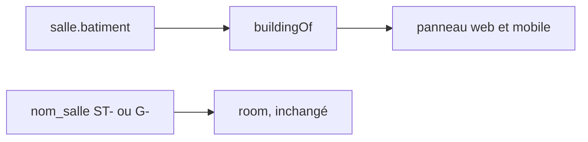

# M-12 · L'application ne porte plus le nom d'une école — plan court

| | |
|---|---|
| Module | [MOB](../../plan/modules/MOB-application.md) · correctif hors chantier (étude EP-18, M-12) |
| Mission | `docs/plan/missions/ep18-correctifs.md` (branche `doc/coordination-equipe`) |
| Branche | `fix/mob-nom-application`, depuis `origin/main` (`b57753e9`) |
| Rédigé par | agent de Cursor (Grok 4.7), le 22 novembre 2026 |
| **Validé** | en attente du coordinateur (S, sans migration) |

Complément du 22 nov. 10 h 20 : `buildingOf` entre dans ce correctif.

## 1. Objet et critère de « terminé »

Trois noms d'école écrits en dur disparaissent de ce que l'application affiche ou garde.

1. `mobile/app.json` : le nom affiché et les deux textes de permission ne contiennent plus « HESTIM ». `slug`, `scheme`, `android.package` et `ios.bundleIdentifier` ne changent pas.
2. `mobile/src/cache.js` : le préfixe n'est plus `hestim.cache.`.
3. `shared/session.js`, fonction `buildingOf` seulement : le bâtiment affiché vient de `salle.batiment`. Sans ce champ, la fonction rend une chaîne vide. Elle ne déduit plus « Stendhal » de `ST-` ni « Gandhi » de `G-`. `combine` n'est pas touchée.

Terminé quand `node scripts/verifier-neutre.mjs` passe, que ses motifs refusent aussi Stendhal et Gandhi, et que les tests de régression ci-dessous échoueraient sur le code d'aujourd'hui.

## 2. Ce qui existe

| Endroit | Aujourd'hui |
|---|---|
| `mobile/app.json` | `name` : « HESTIM Planner » (l. 3). Permissions photo (l. 43) et appareil photo (l. 51) commencent par « HESTIM Planner ». `slug` : `hestim-planner`. `scheme` : `hestim`. Paquets : `com.hestim.planner`. |
| `mobile/src/cache.js:7` | `PREFIXE = 'hestim.cache.'`. Le script neutre ne le voit pas : il ne cherche que `HESTIM` en capitales et `hestim.ma` (`scripts/verifier-neutre.mjs`, l. 8-11 et l. 30). |
| `scripts/verifier-neutre.mjs:24` | `PAGES` ne contient que `frontend/index.html`. `app.json` n'est donc pas lu. |
| `shared/session.js:33-40` | `buildingOf` rend « Stendhal » ou « Gandhi » d'après le préfixe du code salle. Le site et l'application lisent cette fonction (`frontend/src/utils/session.js`, `mobile/src/api/donnees.js`). |
| `mobile/__tests__/donnees.test.js:20-21` | une salle `ST-204` sans `batiment` est attendue avec `building: 'Stendhal'`. Le `campus.nom` du jeu n'est pas lu par `buildingOf`. |
| Ailleurs | Stendhal et Gandhi restent dans `backend/utils/campus.js`, `backend/seed.js` et les migrations, déjà hors du contrôle (exceptions de chemin). Les commentaires de `salleController.js` sont ignorés par le script. |

`shared/dates.js` et `mobile/src/ecole.js` ne sont pas touchés (M-10).

## 3. Questions

| N° | Question | Proposition | Réponse | Bloque |
|---|---|---|---|---|
| 1 | Quel nom affiché, et quels textes de permission ? | `name` devient « Planner ». Les deux phrases gardent leur sens et commencent par « Planner » à la place de « HESTIM Planner ». | | oui |
| 2 | Quel préfixe de cache ? | `planner.cache.` | | oui |

## 4. Solution

Après l'accord : les deux chaînes de la question 1, le préfixe de la question 2, et `buildingOf` réduite à ceci.

```js
export const buildingOf = (salle) => (salle && salle.batiment) ? salle.batiment : '';
```

Le code salle (`ST-204`, `G-…`) continue d'être affiché dans `room`. Seul le nom de bâtiment inventé disparaît.

`PAGES` de `verifier-neutre.mjs` gagne `mobile/app.json`. Le motif gagne `Stendhal` et `Gandhi`. Les exceptions de chemin déjà écrites couvrent la base de l'école pilote : le script reste vert une fois `session.js` corrigé.

Changer le préfixe fait que les semaines déjà gardées sous `hestim.cache.` ne sont plus lues. Elles restent dans le téléphone jusqu'à une désinstallation. La fiche de session le dira. Rien n'est migré.



## 5. Fichiers

| Fichier | Créé / modifié | Rôle |
|---|---|---|
| `docs/conception/application/fix-mob-nom-application.md` | créé | ce plan |
| `mobile/app.json` | modifié | nom et deux permissions |
| `mobile/src/cache.js` | modifié | préfixe ; `PREFIXE` exporté pour le test |
| `shared/session.js` | modifié | `buildingOf` seulement |
| `scripts/verifier-neutre.mjs` | modifié | lit `app.json` ; refuse Stendhal et Gandhi |
| `mobile/__tests__/donnees.test.js` | modifié | sans `batiment`, `building` est vide |
| `mobile/__tests__/session.test.js` | modifié | régression : `ST-` et `G-` ne nomment plus un bâtiment ; avec `batiment`, ce texte est rendu |
| `mobile/__tests__/cache.test.js` | créé | le préfixe ne contient pas `hestim` |
| `docs/plan/modules/MOB-application.md` | modifié | une ligne, à la fin du code |
| fiche de session | créé | le préfixe vide les copies une fois |

Pas de `docs/plan/suivi.md`. Pas de `slug`, de schéma d'adresse, ni d'identifiant de paquet.

## 6. Données et migration

Aucune table. Le cache local change de clé : les anciennes copies ne sont plus lues.

## 7. Sécurité et exigences

EP-5 : aucun nom d'école dans le nom de l'application ni dans un bâtiment déduit d'un code salle. Les identifiants techniques en minuscules (`hestim-planner`, `com.hestim.planner`, schéma `hestim`) restent, comme le script le permet déjà.

## 7 bis. Ce que disent les études

| Ligne | Étude | Appliquée ou écartée | Comment |
|---|---|---|---|
| M-12 | EP-18, § 8 | appliquée | Nom affiché, permissions, préfixe de cache. |
| Complément 10 h 20 | consigne | appliquée | `buildingOf` ne nomme plus les bâtiments de l'école pilote. |
| M-10 | EP-18, § 8 | écartée | `dates.js` et `ecole.js` sont à l'autre session. |
| M17, EP-5 | étude 14, § 3 | appliquée | Pas de pays ajouté. Le public n'est pas le supérieur seul : le nom sert toute école. |

## 7 ter. EP-18 : tous les contextes

| Contexte | Ce que fait la fonction | Preuve ou test |
|---|---|---|
| **A. Au moins un élève sans téléphone ni ordinateur** | Sans objet pour le nom de l'application. Le code salle reste affiché ; le bâtiment n'apparaît que s'il est saisi. | `buildingOf` sans `batiment` rend `''` |
| **B. Connexion lente ou coupée** | Le premier chargement ne change pas de poids. Au prochain lancement hors ligne, la copie sous l'ancien préfixe n'est plus lue : l'écran attend le réseau une fois, puis réécrit le cache. | fiche ; test du préfixe |
| **C. Projecteur, ou rien dans la salle** | Sans objet : aucun écran nouveau. Le panneau projeté montre le bâtiment saisi, pas un nom déduit. | même test |

Aucun pays, aucune devise, aucun fuseau.

## 8. Tests

- `mobile/__tests__/session.test.js` : `buildingOf({ nom_salle: 'ST-204' })` et `buildingOf({ nom_salle: 'G-12' })` valent `''` ; `buildingOf({ nom_salle: 'ST-204', batiment: 'Nord' })` vaut `'Nord'` ; `buildingOf(null)` vaut `''`.
- `donnees.test.js` : la salle sans `batiment` a `building: ''`. Le code salle reste `ST-204`.
- `cache.test.js` : `PREFIXE` ne contient pas `hestim`.
- Un test lit `mobile/app.json` : `name` et les deux permissions ne contiennent pas `HESTIM` ; `slug`, `scheme` et `android.package` sont inchangés.
- `node scripts/verifier-neutre.mjs` vert. Il échoue si l'on remet « HESTIM » dans `app.json` ou « Stendhal » dans `buildingOf`.

## 9. Étapes

1. Ce plan, commité seul. Le coordinateur valide.
2. Code et tests.
3. Ligne du module, fiche (le préfixe vide les copies une fois). Rien n'est poussé.

## 10. Risques et retour arrière

Une école dont les salles n'ont pas de `batiment` ne voit plus de nom de bâtiment à côté du code. C'est le but du complément. Revenir au commit d'avant rend les anciens noms.

## 11. Hors périmètre

- `slug`, schéma `hestim`, `com.hestim.planner`.
- `combine`, `shared/dates.js`, `mobile/src/ecole.js`.
- Les campus de `backend/utils/campus.js` (PLA-03, déjà exceptés).
- M-11 et M-9.
