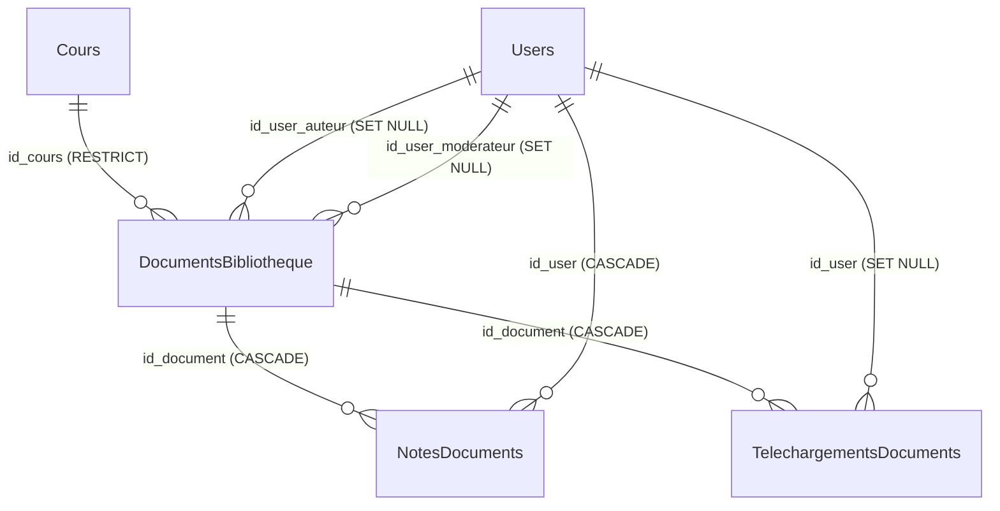

# BIB-05 · Modèle et stockage de la Bibliothèque reconstruite (lots B1, B2) — conception

| | |
|---|---|
| Module | [BIB](../../plan/modules/BIB-bibliotheque.md) · **exception hors chantier** accordée par le chef le 21 nov. (lots B1 à B8, sans quatrième chantier) |
| Branche | `feat/bib-05-modele-stockage`, depuis `origin/main` (`e1858451`) |
| Fiche de mission | [bib-reconstruction](../../plan/missions/bib-reconstruction.md) (branche `doc/coordination-equipe`) |
| Rédigé par | Claude Code (Opus 5.5), session « BIB », le 2026-11-22 |
| **Validé** | par Claude20022002 le 2026-11-22 (outil de questions, « Validé », sans réserve), après les réponses 1 à 12 du § 5 |

## 1. Objet et critère de « terminé »

BIB-05 pose le socle de la Bibliothèque dans Planner : trois tables, un stockage de fichiers dans MinIO rangé par école, et un petit service interne qui dépose, retrouve, signe et supprime un document. Il n'ouvre **aucune route** : l'API vient avec BIB-06, et l'espace de cours avec BIB-07.

Critère du module, recopié puis précisé :

- les tables des documents, des notes et des téléchargements existent (migration 0087), chaque document avec son `uid` (D-15) ;
- les fichiers vont dans MinIO par `@aws-sdk/client-s3`, **dans un seul seau, `planner`, avec un préfixe par école** (réponse 1) ;
- un lien signé dure **5 minutes**, ne vaut que pour son fichier et le sert en pièce jointe (réponse 7) ;
- **un test à deux écoles** prouve qu'une école ne lit ni ne signe le fichier de l'autre (PLA-04) ;
- la suite du serveur, les tests d'intégration et `eslint` restent verts ; `npm audit` ne signale rien de nouveau.

Vérification : les tests du § 10, plus un essai à la main sur un vrai MinIO, en local, noté dans la fiche de session (réponse 11).

## 2. Ce qui existe

**Dans Planner** (`origin/main`, `e1858451`) :

- **Une base par école** (D-01). Le contexte d'école vient de `contexte/etablissement.js` : `{ nom, sequelize, modeles }`. Les modèles de `models/index.js` sont des résolveurs qui suivent ce contexte. L'école d'aujourd'hui s'appelle `defaut`. Le test `tests/integration/contexteEtablissement.test.js` monte une école `b` sur une seconde base, avec `tests/integration/helpers/fabriqueEtablissement.js`. BIB-05 reprend ce montage.
- **Aucun accès à MinIO** : aucune variable S3 dans le service `backend` de `docker-compose.yml`. Seule StudyLib s'en sert, avec la clé root (`docker-compose.yml`, l. 210 à 215). Les liens signés de StudyLib sortent par l'adresse publique des fichiers (`MINIO_TEMPORARY_URL: https://${FICHIERS_ADDRESS}`), servie par Caddy (`deploy/Caddyfile`, l. 32).
- **Fichiers reçus en corps brut et vérifiés par leur signature** : `utils/fichiers.js` (`SIGNATURES`, `verifierFichier`, `nomSur`, `enTetesTelechargement`) contrôle les annonces et les devoirs, qui sont stockés en base (`FichierDevoir`, `AnnoncePieceJointe`). Il reconnaît PDF, DOCX et PPTX, mais pas les anciens formats `.doc` et `.ppt` (OLE).
- **Le « module » de StudyLib est un `Cours` de Planner** : `integrationController.referentiel` envoie `code_cours` comme code de module, et `id_filiere` donne la filière.
- **`SupportCours.id_document`** (`CHAR(36)`) garde l'UUID d'un document de StudyLib, sans clé étrangère.
- **Les rôles de Planner** sont `admin`, `enseignant` et `etudiant` (`models/Users.js`, l. 25), comme ceux que StudyLib accepte.
- **`models/definitions.js` fait 727 lignes**. On ne l'allonge que d'un import, d'un appel et d'un export : les modèles vont dans `models/bibliotheque.js`, comme `studio.js` ou `quizDirect.js`.

**Dans StudyLib** (`..\StudyLib`, `bb3313b`, lu sans modification) :

| Règle | Source | Reprise dans BIB-05 |
|---|---|---|
| Document : `uuid`, module obligatoire, type (`cours`, `examen`, `td`, `tp`, `exercice`, `article`), titre de 200 caractères, description, année concernée, chemin, poids, type MIME, statut (`pending`, `approved`, `rejected`), compteurs de téléchargements et de notes, note moyenne | migration `…000003_create_documents_table.php` | oui, avec des noms français (§ 8) |
| Portée `school` ou `class` (un dépôt de l'espace de cours n'apparaît pas dans la Bibliothèque) | `…2026_10_15_000001_add_visibility…` | oui : `ecole` ou `classe` |
| `source_ref` unique : un import relancé ne crée pas de doublon | `…2026_10_05_000001_add_source_ref…` | oui : `origine`, pour BIB-08 et BIB-11 |
| Note de 1 à 5, une par compte et par document | `…000004_create_document_ratings_table.php` ; `RatingService` | oui (table) ; la règle d'écriture vient avec BIB-06 |
| Journal des téléchargements avec IP et navigateur | `…000005_create_document_downloads_table.php` ; `DownloadService::record` | **sans IP ni navigateur** (réponse 9) |
| Dépôt : PDF, DOC, DOCX, PPT, PPTX, 20 Mo au plus | `StoreDocumentRequest.php`, l. 29 | oui, avec la vérification de la signature, que StudyLib ne fait pas |
| Publication directe pour l'enseignant et l'administration ; attente de modération pour l'étudiant | `UserRole::publishesWithoutModeration` ; `DocumentService::upload` | oui |
| Fichier rangé sous `documents/<nom aléatoire>` ; lien temporaire de 5 minutes | `DocumentService`, l. 80 et 132 | rangement par école ; 5 minutes, en pièce jointe |
| Suppression : fichier effacé, ligne masquée (`deleted_at`) | `DocumentService::delete` ; `SoftDeletes` | **suppression réelle** (réponse 10) |
| Droits : lecture si publié, si l'on est l'auteur ou l'administration ; suppression par l'auteur ou l'administration ; modération par l'administration | `DocumentPolicy.php` | dans BIB-06 ; BIB-05 n'en garde que ce que le service interne exige |
| Débits : 10 dépôts et 20 téléchargements par minute et par compte | `AppServiceProvider::configureRateLimiting` | dans BIB-06 (routes) |

## 3. Ce que disent les études

- **Étude StudyLib** ([etude-studylib-pile.md](etude-studylib-pile.md), PR #249, voie B validée le 21 nov.) : B1 (modèle) et B2 (stockage) forment BIB-05. L'`uid` absorbe BIB-01 : un document garde l'UUID de StudyLib, donc chaque `SupportCours.id_document` reste valable sans réécriture (§ 3.3). Le rangement par école absorbe BIB-02 (§ 4). Le stockage de BIB-05 servira aussi à BIB-03 (médias du Studio) et à COU-02 (rendus de devoirs).
- **Étude 14** (synthèse des concurrents, R10 et N3) : afficher le poids avant le téléchargement, et reprendre après une coupure. BIB-05 garde le poids exact en base. Il signe des liens que MinIO sert avec `Range`, et la reprise en dépend. L'affichage et la reprise sont testés dans BIB-06, BIB-09 et BIB-10.
- **Étude 15** (modules et packs, #242) : la Bibliothèque est un module vendable. L'étape 3 retenue par le chef (Q8) prime, et le coordinateur l'aligne.
- **Audit d'isolation** (`docs/conception/plateforme/18-audit-isolation.md`) : I-5 (une base et un seau communs) disparaît pour la Bibliothèque. Une base par école (D-01), plus un préfixe par école dans le seau, donnent deux barrières (§ 9). I-11 (sauvegarde par école, PLA-07) : un préfixe se sauvegarde et se restaure seul (`mc mirror`, § 12).

## 4. EP-18 : s'adapter à tous les contextes

- **Sans téléphone de l'élève** : rien dans BIB-05 ne suppose un téléphone. Le lien signé s'ouvre dans n'importe quel navigateur, sur le poste de l'école ou celui de l'enseignant qui projette ou imprime.
- **Peu de connexion** : le poids exact est en base avant tout téléchargement, pour être affiché (N3). MinIO sert les liens signés avec `Range` : un téléchargement coupé reprend où il s'était arrêté. Si la coupure dépasse 5 minutes, l'application demande un nouveau lien, qui donne le même fichier, et la reprise continue (réponse 7). MinIO ne contrôle la date d'un lien qu'au début de chaque requête : un fichier de 20 Mo sur une ligne lente peut prendre plus de 5 minutes sans être coupé.
- **Aucun pays supposé** : aucun nom d'école dans le code ni dans les clés (EP-5 du dépôt public) : le préfixe vient du contexte, `ecoles/<nom de l'école>/`.

## 5. Questions et réponses

Réponses du chef le 22 nov., par l'outil de questions. Toutes suivent la proposition.

| N° | Question | Proposition | Réponse du chef | Bloque |
|---|---|---|---|---|
| 1 | Préfixe ou seau par école dans MinIO (fiche, Q1) | un seau `planner`, un préfixe par école | **un seau, un préfixe** | § 6.2, 9 |
| 2 | Redéployer StudyLib sur le nouveau serveur (fiche, Q2 ; EXP-02) | ne pas la redéployer | **ne pas la redéployer** | — |
| 3 | Vidéos YouTube par module (fiche, Q3 ; QUA-09) | ne pas les reprendre dans BIB-05 à BIB-08 | **ne pas les reprendre** | — |
| 4 | Durée de publication de l'image StudyLib (fiche, Q4) | jusqu'à BIB-08 vérifiée, plus un mois | **BIB-08 vérifiée + 1 mois** | — |
| 5 | Retrait du jeton d'intégration, des audiences `studylib` et du JWKS public (fiche, Q5) | une fonction à part, après BIB-08 | **à part, après BIB-08** | — |
| 6 | Accès du serveur de Planner à MinIO | une clé MinIO propre à Planner, limitée au seau `planner` ; j'ajoute les variables `S3_*` à `backend/.env.example` et au service `backend` de `docker-compose.yml` (ajouts seulement) ; le chef crée la clé et le seau | **clé dédiée, variables par l'agent** (sortie de périmètre accordée pour ces deux fichiers) | § 6.4, 7 |
| 7 | Servir un téléchargement | lien MinIO signé de 5 minutes, sur l'adresse publique des fichiers, en pièce jointe ; nouveau lien après une longue coupure | **lien MinIO signé, 5 min** | § 4, 9 |
| 8 | Recevoir un dépôt | par le serveur, en corps brut : type, taille et signature vérifiés, puis envoi à MinIO ; pas de dépendance multipart | **par le serveur, corps brut** | § 6.1 |
| 9 | Contenu du journal des téléchargements | compte, document, date ; ni IP ni navigateur ; lignes effacées après 12 mois (tâche de BIB-06) | **compte, document, date ; 12 mois** | § 8 |
| 10 | Suppression d'un document | réelle : la ligne, ses notes et ses téléchargements, puis le fichier | **suppression réelle** | § 6.1, 8 |
| 11 | Tests du stockage | faux S3 en mémoire ; liens signés vérifiés sans réseau ; essai sur un vrai MinIO en local | **faux S3 en mémoire** | § 10 |
| 12 | Rattachement d'un document | un `Cours` obligatoire, six types, une année concernée facultative ; filière déduite du `Cours` | **`Cours` obligatoire, 6 types** | § 8 |

## 6. Solution

### 6.1 Principe

Trois couches, chacune dans son fichier :

1. **`services/bibliotheque/fichiers.js`** vérifie un fichier reçu en corps brut : type annoncé parmi les cinq formats, 20 Mo au plus, signature du contenu conforme au type (PDF, ZIP pour DOCX et PPTX, OLE pour DOC et PPT), nom nettoyé. Il calcule aussi l'empreinte SHA-256. Il réutilise `SIGNATURES` et `nomSur` de `utils/fichiers.js` sans les modifier, et ajoute la signature OLE (`D0 CF 11 E0 A1 B1 1A E1`).
2. **`services/bibliotheque/stockage.js`** est le seul fichier qui parle à MinIO. Il construit la clé d'un objet à partir du **contexte d'école**, jamais d'une donnée du client. Il dépose, signe et supprime, et **refuse toute clé qui n'est pas sous le préfixe de l'école courante**. Son client S3 est remplaçable dans les tests (`definirClientS3`, comme `definirClientStudyLib`).
3. **`services/bibliotheque/documents.js`** est le service interne que BIB-06 et BIB-07 appelleront. `enregistrer` vérifie le fichier, crée l'`uid`, dépose l'objet, puis écrit la ligne. Si l'écriture échoue, il efface l'objet. Le statut dépend du rôle de l'auteur. `trouverParUid` ne lit que la base de l'école courante. `lienTelechargement` signe un lien et note le téléchargement. `supprimer` retire la ligne (avec ses notes et ses téléchargements, en cascade), puis le fichier.

Les droits complets (qui voit quoi, modération, note) et les routes viennent avec BIB-06. BIB-05 ne garde que deux règles, sans lesquelles le service serait faux : seuls les trois rôles de Planner déposent, et le statut suit le rôle.

### 6.2 Clé d'un objet

```
planner / ecoles/<école>/bibliotheque/<uid>
  seau      préfixe de l'école   domaine     identifiant du document
```

- `<école>` est `contexteCourant().nom` (`defaut` aujourd'hui, `b` dans les tests), contrôlé par `^[a-z0-9][a-z0-9-]{0,62}$`. Hors contexte en mode strict, l'appel échoue (D-03).
- `bibliotheque` est un **domaine**. BIB-03 ajoutera `medias-quiz`, COU-02 `devoirs`, sur le même stockage. Une liste fermée de domaines est écrite dans `stockage.js`.
- Le nom d'origine du fichier n'est pas dans la clé, pour qu'aucune donnée personnelle n'y figure. Il est gardé en base, et le lien signé le rend dans `Content-Disposition`.
- La clé complète est gardée en base (`cle_fichier`). Si l'identifiant d'une école change un jour (PLA-01), il faut déplacer ses objets : c'est noté au § 12.

### 6.3 Diagrammes

```mermaid
sequenceDiagram
    participant R as Route (BIB-06 ou BIB-07)
    participant D as documents.js
    participant F as fichiers.js
    participant S as stockage.js
    participant M as MinIO (seau planner)
    participant B as Base de l'école
    R->>D: enregistrer(auteur, { contenu, type, nom }, { id_cours, type, titre, portee })
    D->>F: verifier(fichier)
    F-->>D: { nom, type_mime, taille, empreinte }
    D->>S: deposer("bibliotheque", uid, contenu, type_mime)
    S->>S: clé = ecoles/<école du contexte>/bibliotheque/<uid>
    S->>M: PutObject(planner, clé)
    D->>B: INSERT DocumentsBibliotheque (statut selon le rôle)
    alt échec de l'écriture
        D->>S: supprimer(clé)
    end
    R->>D: lienTelechargement(document, utilisateur)
    D->>S: signer(clé, nom, type_mime)
    S->>S: clé sous le préfixe de l'école courante ? sinon refus (404)
    S-->>D: lien de 5 min (adresse publique des fichiers)
    D->>B: INSERT TelechargementsDocuments ; compteur + 1
```



### 6.4 Configuration

Variables lues par `stockage.js`, ajoutées à `backend/.env.example` et au service `backend` de `docker-compose.yml` (réponse 6) :

| Variable | Exemple | Rôle |
|---|---|---|
| `S3_ENDPOINT` | `http://minio:9000` | adresse interne de MinIO (dépôt, suppression) |
| `S3_ADRESSE_PUBLIQUE` | `https://${FICHIERS_ADDRESS}` | adresse signée dans les liens, celle que le navigateur ouvre (comme `MINIO_TEMPORARY_URL`) |
| `S3_REGION` | `us-east-1` | exigée par la signature ; MinIO l'ignore |
| `S3_SEAU` | `planner` | le seau unique |
| `S3_CLE_ACCES`, `S3_CLE_SECRETE` | *(secret)* | la clé propre à Planner, **pas** la clé root |

Dans `docker-compose.yml`, les deux clés sont **facultatives** (`${S3_CLE_ACCES:-}`), pour qu'un serveur sans elles démarre comme avant. Dans ce cas, le service répond « La Bibliothèque n'est pas encore configurée sur ce serveur » (503), et n'essaie aucun accès : il échoue fermé. Le client est créé avec `forcePathStyle: true` (MinIO), et avec `requestChecksumCalculation: "WHEN_REQUIRED"` : depuis 2025, le SDK ajoute par défaut des sommes de contrôle que d'anciens MinIO refusent.

## 7. Fichiers créés ou modifiés

| Fichier | Créé / modifié | Rôle | Taille visée |
|---|---|---|---|
| `backend/migrations/0087-bibliotheque.js` | créé | les trois tables et leurs index (§ 8) | 80 lignes |
| `backend/models/bibliotheque.js` | créé | `DocumentBibliotheque`, `NoteDocument`, `TelechargementDocument`, `relierBibliotheque` | 120 |
| `backend/models/definitions.js` | modifié, **ajouts seulement** | un import, l'appel `relierBibliotheque(...)`, trois noms exportés | + 3 lignes |
| `backend/models/index.js` | modifié, ajouts seulement | trois résolveurs | + 3 |
| `backend/services/bibliotheque/fichiers.js` | créé | vérification du fichier, signature OLE, empreinte | 80 |
| `backend/services/bibliotheque/stockage.js` | créé | client S3, clés par école, dépôt, lien signé, suppression | 150 |
| `backend/services/bibliotheque/documents.js` | créé | service interne : enregistrer, trouver, signer, supprimer | 150 |
| `backend/package.json`, `backend/package-lock.json` | modifiés | `@aws-sdk/client-s3`, `@aws-sdk/s3-request-presigner` (versions exactes dans le verrou) | — |
| `backend/.env.example` | modifié, ajouts (réponse 6) | variables `S3_*`, commentées | + 10 |
| `docker-compose.yml` | modifié, ajouts dans le service `backend` (réponse 6) | variables `S3_*` | + 7 |
| `backend/tests/helpers/fauxS3.js` | créé | faux S3 en mémoire (objets, appels reçus) | 60 |
| `backend/tests/utils/bibliothequeFichiers.test.js` | créé | tests unitaires de `fichiers.js` | 100 |
| `backend/tests/utils/bibliothequeStockage.test.js` | créé | tests unitaires de `stockage.js` (clés, refus, lien signé) | 140 |
| `backend/tests/integration/bibliothequeDeuxEcoles.test.js` | créé | migration, service et test à deux écoles | 200 |
| `docs/plan/modules/BIB-bibliotheque.md` | modifié | « Ce qui existe » et état de BIB-05 | — |
| `docs/sessions/2026-11-22-feat-bib-05-modele-stockage.md` | créé | fiche de session et prompt de reprise | — |

Rien d'autre n'est touché : ni `utils/fichiers.js` (réutilisé tel quel), ni `deploy/`, ni `.github/`, ni `frontend/`, ni `mobile/`, ni `docs/plan/suivi.md`.

## 8. Données et migration

**Migration 0087** (réservée par le coordinateur le 22 nov.), propriétaire : **BIB**. Elle **ne fait qu'ajouter** : trois tables neuves, sans toucher une table existante. Une base qui a déjà des données ne change pas. `down` supprime les trois tables, dans l'ordre inverse.

**`DocumentsBibliotheque`**

| Colonne | Type | Règle |
|---|---|---|
| `id_document` | INT, auto, clé primaire | interne ; jamais exposé par l'API |
| `uid` | CHAR(36), unique, non nul | UUID (D-15) ; seul identifiant exposé ; l'UUID de StudyLib à la reprise |
| `id_cours` | INT, non nul, → `Cours`, `RESTRICT` | réponse 12 ; on ne supprime pas un cours qui a des documents |
| `id_user_auteur` | INT, nul permis, → `Users`, `SET NULL` | nul pour un document importé |
| `type` | VARCHAR(10), non nul | `cours`, `td`, `tp`, `examen`, `exercice`, `article` |
| `titre` | VARCHAR(200), non nul | |
| `description` | TEXT, nul permis | |
| `annee_concernee` | SMALLINT UNSIGNED, nul permis | de 2000 à 2100, comme StudyLib |
| `statut` | VARCHAR(12), non nul, `en_attente` | `en_attente`, `publie`, `refuse` |
| `portee` | VARCHAR(8), non nul, `ecole` | `ecole` (Bibliothèque) ou `classe` (espace de cours seulement) |
| `cle_fichier` | VARCHAR(500), non nul | clé complète dans le seau (§ 6.2) |
| `nom_fichier` | VARCHAR(200), non nul | nom d'origine nettoyé, rendu au téléchargement |
| `type_mime` | VARCHAR(120), non nul | |
| `taille` | INT UNSIGNED, non nul | octets ; affiché avant le téléchargement (N3) |
| `empreinte_sha256` | CHAR(64), non nul | vérification de BIB-08 (§ 3.4 de l'étude) |
| `origine` | VARCHAR(191), nul permis, unique | `studylib:<uuid>` (BIB-08), `import:<réf>` (BIB-11) : un import rejoué ne crée pas de doublon |
| `telechargements`, `nombre_notes` | INT UNSIGNED, 0 | compteurs |
| `note_moyenne` | DECIMAL(2,1), 0 | |
| `id_user_moderateur` | INT, nul permis, → `Users`, `SET NULL` | |
| `modere_le` | DATETIME, nul permis | |
| `motif_refus` | VARCHAR(500), nul permis | rendu à l'auteur (BIB-06) |
| `createdAt`, `updatedAt` | DATETIME | |

Index : `(id_cours, type)`, `(statut, portee)`, `id_user_auteur`.

**`NotesDocuments`** : `id_note` (clé), `id_document` (→ document, `CASCADE`), `id_user` (→ `Users`, `CASCADE`), `note` (TINYINT UNSIGNED, de 1 à 5, contrôlé par le modèle), `createdAt`, `updatedAt`. Index unique `(id_user, id_document)`.

**`TelechargementsDocuments`** : `id_telechargement` (clé), `id_document` (→ document, `CASCADE`), `id_user` (→ `Users`, `SET NULL`), `createdAt`. **Ni IP ni navigateur** (réponse 9). Index `id_document` et `createdAt` (pour l'effacement après 12 mois, dans BIB-06).

**Pas de clé étrangère depuis `SupportsCours.id_document`** : ses valeurs désignent aujourd'hui des documents de StudyLib, qui n'arrivent qu'avec BIB-08. Une clé étrangère ferait échouer la migration sur la base de l'école pilote. BIB-07 vérifiera que chaque valeur se résout.

## 9. Sécurité, isolation et exigences produit

- **Deux barrières par école.** (1) La ligne d'un document n'existe que dans la base de son école (D-01) : `trouverParUid` lancé dans l'école B ne trouve pas un `uid` de l'école A. (2) `stockage.js` construit et contrôle chaque clé avec le préfixe de l'école courante. Il refuse de signer ou de supprimer une clé hors de ce préfixe, même si elle lui arrive par une ligne falsifiée ou par une erreur de code : il répond « introuvable » (404 dans BIB-06), sans dire que l'objet existe.
- **Le client ne fournit jamais la clé**, ni l'école, ni le statut : D-02, « le serveur ne croit pas le client ».
- **Lien signé** : 5 minutes, une seule clé, en `GET` seulement, servi en pièce jointe (`ResponseContentDisposition: attachment; filename*=UTF-8''…`, `ResponseContentType` = le type gardé en base). Il ne s'affiche jamais dans la page : un PDF piégé ne s'exécute pas sur l'origine de MinIO.
- **Fichier vérifié par sa signature** : un exécutable renommé en `.pdf` est refusé (415), comme pour les annonces.
- **Clé MinIO de Planner limitée** à `s3:GetObject`, `s3:PutObject`, `s3:DeleteObject` sur `planner/*`, et `s3:ListBucket` sur `planner`. Pas de clé root (réponse 6). Le seau reste privé : aucun accès anonyme.
- **Données personnelles** : ni nom de fichier ni nom d'élève dans les clés ; ni IP ni navigateur dans le journal ; journal effacé après 12 mois (BIB-06). Aucune donnée d'élève ne part vers l'IA : BIB-05 n'appelle pas l'IA.
- **Envois sortants (EP-13)** : aucun. MinIO est un service interne de Planner, et le lien signé pointe vers l'adresse des fichiers de la même installation. La liste de QUA-09 ne change pas.
- **Canaux d'isolation** : I-5 fermé pour la Bibliothèque. I-4 n'est pas touché : il reste ouvert pour StudyLib jusqu'à la fonction de la réponse 5. I-11 : le préfixe par école rend possible la sauvegarde par école de PLA-07.
- **EP-12** : isolation testée (§ 10). L'export complet d'une école (PLA-12) pourra copier son préfixe.

## 10. Tests

**Unitaires** (`npm test`, sans base ni réseau) :

- `bibliothequeFichiers.test.js` : les cinq formats acceptés ; un type hors liste (415) ; un fichier vide ; 20 Mo plus un octet (413) ; un faux PDF (exécutable renommé, 415) ; un `.doc` sans signature OLE (415) ; un nom avec chemin et caractères de contrôle, nettoyé ; l'empreinte SHA-256 d'un contenu connu.
- `bibliothequeStockage.test.js`, avec le faux S3 :
  - la clé est `ecoles/<école>/bibliotheque/<uid>` dans le contexte donné ; un domaine inconnu, un `uid` mal formé ou un nom d'école invalide sont refusés ;
  - `signer` refuse une clé d'une autre école, une clé avec `..`, ou une clé hors domaine ;
  - le lien signé est valable 300 secondes (`X-Amz-Expires=300`), signé pour l'adresse publique, avec la seule clé demandée, `response-content-disposition=attachment` et le type MIME ; il est produit sans réseau, par `@aws-sdk/s3-request-presigner` ;
  - sans configuration, le stockage répond 503 et n'appelle pas le client ;
  - hors contexte, en mode strict, il lève `HorsContexteError`.

**Intégration** (`npm run test:integration`, MySQL de la CI), `bibliothequeDeuxEcoles.test.js`, sur le montage de `contexteEtablissement.test.js` : école A (`defaut`, `hestim_test`) et école B (`b`, base `hestim_test_bib_b`), chacune avec ses migrations, dont la 0087.

- `enregistrer` crée la ligne et l'objet. Le statut est `publie` pour un enseignant ou l'administration, `en_attente` pour un étudiant. Un échec de l'écriture efface l'objet déjà déposé.
- **Isolation** : un document déposé dans A a sa clé sous `ecoles/defaut/` et le document de B sous `ecoles/b/`. Dans B, `trouverParUid(uid de A)` rend `null`. Dans B, signer ou supprimer avec la ligne de A (falsifiée) est refusé, et l'objet de A est intact. La même chose vaut dans l'autre sens.
- `lienTelechargement` note une ligne dans `TelechargementsDocuments` (sans IP) et ajoute 1 au compteur.
- `supprimer` efface la ligne, ses notes et ses téléchargements, puis l'objet. Si l'objet n'existe plus, la suppression aboutit quand même.
- La migration 0087 passe `up`, puis `down`, puis `up`. `baseNeuve.test.js` reste vert : une base neuve n'a aucune ligne dans les trois tables.

**À la main** (fiche de session) : MinIO local de `docker-compose.yml`, avec une clé dédiée, un dépôt de PDF, puis le lien ouvert dans le navigateur. On vérifie aussi la reprise, avec `curl -r 1000- <lien>` qui doit répondre 206.

## 11. Étapes de livraison

1. Ce plan, validé par le chef, **commité seul**.
2. Dépendances `@aws-sdk/client-s3` et `@aws-sdk/s3-request-presigner` (dernières versions stables), puis `npm audit` : rien de nouveau, sinon arrêt et question au chef.
3. Migration 0087 et `models/bibliotheque.js`, avec les ajouts à `definitions.js` et à `index.js`.
4. `fichiers.js` et ses tests unitaires.
5. `stockage.js`, `tests/helpers/fauxS3.js` et les tests unitaires du stockage.
6. `documents.js` et le test d'intégration à deux écoles.
7. Variables dans `backend/.env.example` et `docker-compose.yml`. Essai à la main sur MinIO local.
8. Suite complète du serveur, tests d'intégration, `eslint`. Fichier du module, fiche de session, message au coordinateur pour la relecture.

## 12. Risques et retour arrière

- **Taille du SDK AWS** : `@aws-sdk/client-s3` ajoute environ 3 Mo de modules à l'image du serveur, et rien au navigateur. C'est accepté par le chef (21 nov.).
- **Sommes de contrôle du SDK** : MinIO de `RELEASE.2026-08-04` les accepte. Le réglage `WHEN_REQUIRED` couvre une version plus ancienne.
- **Identifiant d'école** : le préfixe suit `contexteCourant().nom`, qui vaut `defaut` pour l'école pilote. Si PLA-01 lui donne un autre identifiant, il faudra déplacer ses objets (`mc mv --recursive`) et réécrire `cle_fichier`, dans le même lot. Je le signale au coordinateur pour le plan de PLA-01.
- **Adresse publique** : un lien signé ne marche que si Caddy transmet l'hôte tel quel à MinIO. C'est déjà le cas pour StudyLib.
- **Retour arrière** : la migration ne fait qu'ajouter, `down` retire les trois tables, et aucune route n'est ouverte. Retirer la branche ne change donc rien pour les utilisateurs. Les objets déposés pendant un essai restent sous `ecoles/<école>/bibliotheque/` et s'effacent avec `mc rm --recursive --force`.

**À faire par le chef sur le serveur, au moment de déployer BIB-06** (BIB-05 seul ne s'en sert pas) :

```sh
mc alias set planner http://minio:9000 "$MINIO_ROOT_USER" "$MINIO_ROOT_PASSWORD"
mc mb --ignore-existing planner/planner
mc admin user add planner "$S3_CLE_ACCES" "$S3_CLE_SECRETE"
# politique : Get/Put/DeleteObject sur planner/*, ListBucket sur planner (texte complet dans la fiche de session)
mc admin policy create planner planner-fichiers politique-planner.json
mc admin policy attach planner planner-fichiers --user "$S3_CLE_ACCES"
```

Puis on ajoute `S3_CLE_ACCES` et `S3_CLE_SECRETE` à `.env.docker`. La sauvegarde par école (PLA-07) pourra faire `mc mirror planner/planner/ecoles/<école>/ …`.

## 13. Hors périmètre

- Les routes, les droits complets, la modération, la note, la recherche, les débits et l'effacement du journal après 12 mois : **BIB-06**.
- L'espace de cours et la fin de `services/cours/studylib.js` : **BIB-07**.
- La reprise des données de StudyLib : **BIB-08**. L'import générique : **BIB-11**. Les écrans : **BIB-09** et **BIB-10**.
- Les médias du Studio (BIB-03) et les rendus de devoirs (COU-02), qui se poseront plus tard sur ce stockage.
- Le retrait du jeton d'intégration, des audiences `studylib` et du JWKS (réponse 5), et celui de Meilisearch (correctif de l'agent de Cursor).
- Les vidéos YouTube (réponse 3).
