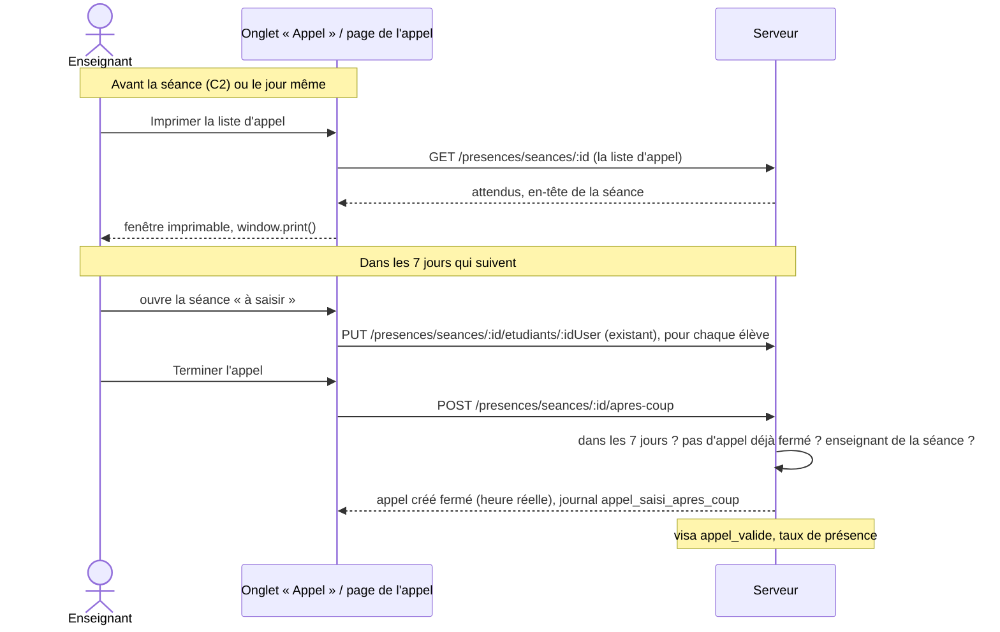

# M-1 · La liste d'appel imprimable, et l'appel saisi après coup — plan court

| | |
|---|---|
| Module | [EDT](../../plan/modules/EDT-emploi-du-temps.md) · correctif hors chantier, décidé par le chef dans l'étude EP-18 (§ 8, M-1 ; réponse 7 ; rang 2 du § 9.1). Fiche : `docs/plan/missions/ep18-correctifs.md` (branche `doc/coordination-equipe`) |
| Branche | `feat/edt-feuille-appel`, depuis `origin/main` (`a4078f87`) |
| Rédigé par | Claude Code (Opus 5.5), le 2026-11-22 |
| Taille | S, sans migration |
| **Validé** | en attente (coordinateur ; au chef si une migration apparaît) |

## 1. Objet et critère de « terminé »

**La décision du chef** (étude EP-18, réponse 7) : un bouton « Imprimer la liste d'appel », avec les attendus de la séance et trois cases (présent, en retard, absent). Ensuite, la saisie après coup, qui existe déjà, peut aussi marquer la séance « réalisée » dans les 7 jours. Le tout en taille S, à l'étape 3, sans migration.

**Une correction de l'étude, relevée en lisant le code.** L'étude disait : « une séance passée ne peut plus être marquée réalisée ». C'est inexact.
- Le statut « réalisée » se pose déjà tout seul : `marquerRealisees` (`backend/services/planning/suivi.js:49-58`) le donne à toute séance planifiée ou confirmée dont l'heure est passée, appel fait ou non.
- **Ce qui manque vraiment, c'est de terminer l'appel d'une séance passée.** L'appel ne s'ouvre que le jour même (`appel.js:110`). Une séance passée sans appel reste « non fait », en lecture seule (`OngletAppel.jsx`, commentaire de tête).
- Or l'appel terminé, c'est ce que lit le **visa** de la séance : `visaSeances.js:34` vaut `appel_valide` si l'appel est fermé, et `a_verifier` sinon. C'est aussi ce que comptent les taux de présence (`historique.js`, commentaire de tête : seules les séances dont l'appel est fermé comptent).

Le plan prend donc la décision du chef dans ce sens : **l'appel fait sur papier se saisit et se termine dans les 7 jours, et la séance compte alors comme un appel fait** (visa `appel_valide`, taux de présence). C'est la question 1, au coordinateur. Au chef s'il juge que le sens a changé.

**Critère de « terminé »** (fixé par la fiche, précisé ici) :
1. L'enseignant de la séance, ou l'administration, imprime la liste d'appel d'une séance du jour, à venir ou passée. La liste porte les attendus, triés par nom, avec trois cases par ligne, et l'en-tête de la séance.
2. Dans les 7 jours qui suivent une séance sans appel, l'enseignant saisit l'appel sur le site, puis le termine. L'appel compte alors comme fait : visa `appel_valide`, taux de présence. Passé ce délai, la séance reste en lecture.
3. **L'heure réelle de la saisie est gardée** : chaque présence garde l'heure où elle a été saisie (`marque_le`, `modifie_le`, déjà le cas). La fin de l'appel après coup s'inscrit au journal de sécurité, avec son heure (question 3).
4. **Sans migration.** Tests verts, dont un test de régression : une séance d'avant-hier sans appel se termine après coup ; une séance d'il y a 8 jours est refusée.

## 2. Ce qui existe

| Quoi | Où | Pour M-1 |
|---|---|---|
| La liste d'appel : attendus (nom, prénom), statuts, état de l'appel | `backend/services/presences/appel.js:132-167` (`listeDAppel`), route `GET /api/presences/seances/:id` | **réutilisée** pour imprimer : droits de l'enseignant de la séance ou de l'administration, et aucun contrôle de date |
| La saisie à la main : présent, en retard, absent, avec motif, à toute date ; correction journalisée après la fermeture | `services/presences/statuts.js:11-45` | **réutilisée** telle quelle pour la saisie après coup |
| Ouvrir l'appel, le jour même seulement ; fermer : séance « réalisée », plus aucun scan | `appel.js:106-116`, `:207-214` | inchangés. La fin après coup est une action à part (§ 4) |
| `AppelSeance` : `secret`, `ouvert_le`, `ferme_le`, `id_user_ouverture` | `backend/models/AppelSeance.js` | **suffit** : un appel saisi après coup est créé déjà fermé. **Pas de migration** |
| `appel.js` fait 369 lignes | — | le code nouveau va dans un fichier à part |
| L'onglet « Appel » d'une classe : séances passées et du jour ; une séance s'ouvre si son appel existe, ou si elle a lieu aujourd'hui | `frontend/src/components/espaceCours/OngletAppel.jsx` ; serveur `services/presences/historique.js:16-29` (`date_seance <= aujourd'hui`) | **étendu** : les 7 prochains jours (pour imprimer à l'avance), et les 7 derniers jours ouvrables après coup |
| La page de l'appel : elle ouvre l'appel en arrivant | `frontend/src/pages/Appel.jsx:88-99` (270 lignes) | **étendue** : en mode « après coup », elle n'ouvre rien. Le bouton d'impression et le bandeau vont dans des composants à part |
| L'impression par une fenêtre et `window.print()` | `frontend/src/utils/exportEmploiDuTemps.js:357-389` | **même méthode** : rien de nouveau à charger (EP-19) |
| Le nom de l'école, pour l'en-tête | `frontend/src/services/etablissement.js` (`identiteEcole`) | réutilisé |
| La date de l'école | `shared/dates.js` (`aujourdhui`, `dansJours`) ; serveur `affectationRules.js` (`aujourdhui`) | réutilisée : aucun fuseau du navigateur |

## 3. Questions et réponses

| N° | Question | Proposition | Réponse | Bloque |
|---|---|---|---|---|
| 1 | Le sens de « marquer réalisée » (§ 1), puisque le statut se pose déjà tout seul | **terminer l'appel après coup** dans les 7 jours, pour que la séance compte comme un appel fait (visa `appel_valide`, taux) ; l'étude est corrigée dans la fiche. *(au coordinateur ; au chef s'il juge que le sens a changé)* | | tout |
| 2 | Où imprimer une séance à venir (contexte C2 : l'enseignant imprime à l'avance) | l'onglet « Appel » de la classe montre aussi les séances des 7 prochains jours, « à venir », imprimables mais pas ouvrables ; et un bouton « Imprimer la liste d'appel » sur la page de l'appel. *(au coordinateur)* | | 2 |
| 3 | Le journal de sécurité | un événement `appel_saisi_apres_coup` (qui, quelle séance, sa date, le nombre de présents) ; une correction après la fin reste `presence_corrigee`. *(au coordinateur ; au chef s'il y voit un enjeu de sécurité)* | | 3 |
| 4 | Le délai de 7 jours | du lendemain de la séance jusqu'au septième jour après elle inclus, à la date de l'école. La séance du jour suit le chemin ordinaire (ouvrir, QR, fermer). *(au coordinateur)* | | 3 |
| 5 | La saisie à la main d'une séance de plus de 7 jours | inchangée : la route l'accepte déjà, l'écran ne la propose plus. Seule la fin de l'appel est bornée. La borner aussi changerait les corrections de l'administration, hors du périmètre. *(au coordinateur)* | | — |
| 6 | Le contenu de la feuille | l'en-tête : l'école, la matière, le groupe, la date, l'horaire, la salle et l'enseignant. Puis une ligne par attendu : n°, nom, prénom, trois cases, une colonne « Motif ». Au pied : « À saisir dans Planner dans les 7 jours », et la date d'impression. En français ou en anglais, selon la langue de l'écran. Rien de plus sur l'élève. *(au coordinateur)* | | 2 |

## 4. Solution

**Le serveur**, dans `services/presences/apresCoup.js` (nouveau) :
- `terminerApresCoup(user, id, maintenant)` fait les contrôles suivants :
  - c'est l'enseignant de la séance ou l'administration (`seanceDeLEnseignant`) ;
  - la date de la séance est passée, et elle date de 7 jours au plus à la date de l'école ; sinon 409, avec un message qui dit quoi faire ;
  - aucun appel n'existe déjà. Si un appel a été ouvert le jour même sans être fermé, c'est `fermerAppel`, existant, qui sert.
- Il crée l'`AppelSeance` déjà fermé : `ouvert_le = ferme_le = maintenant`, un secret au hasard qui ne servira jamais, `id_user_ouverture`. Il passe la séance à « réalisée » si elle ne l'est pas encore (`STATUTS_FERMABLES`), et journalise `appel_saisi_apres_coup`.
- La route est `POST /api/presences/seances/:id/apres-coup`, connectée, avec les droits de l'appel.
- `historique.js` donne aussi les séances des 7 prochains jours, avec `appel: "a_venir"`, et pour chaque séance un champ `saisie_possible_jusqu_au` (la date limite de la saisie après coup). Les taux de présence ne changent pas : ils ne comptent que les appels fermés.

**Le site** :
- `components/appel/feuilleAppel.js` (nouveau, fonction pure) : construit le HTML de la feuille. Chaque nom est échappé, car c'est un texte saisi par l'école. `components/appel/BoutonImprimer.jsx` ouvre la fenêtre et lance `print()`.
- `OngletAppel.jsx` :
  - une séance à venir montre « À venir » et le bouton d'impression ;
  - une séance passée sans appel, dans le délai, montre « À saisir » jusqu'au jour limite et s'ouvre ;
  - au-delà, elle reste « Non fait », en lecture.
- `Appel.jsx` passe en mode « après coup » quand la séance est passée et n'a pas d'appel :
  - il n'ouvre ni QR ni projection ;
  - un bandeau (`components/appel/BandeauApresCoup.jsx`) dit : « Séance du … : saisissez l'appel fait sur papier. L'heure de la saisie est gardée » ;
  - la liste se coche comme aujourd'hui ;
  - « Terminer l'appel » appelle `apres-coup`.

## 5. Fichiers créés ou modifiés

| Fichier | Créé / modifié | Rôle | Taille |
|---|---|---|---|
| `backend/services/presences/apresCoup.js` | créé | `terminerApresCoup` et la borne de 7 jours | 60 |
| `backend/routes/presenceRoutes.js` | modifié | `POST /seances/:id/apres-coup` | +4 |
| `backend/services/presences/historique.js` | modifié | les 7 prochains jours, `a_venir`, `saisie_possible_jusqu_au` | 106 → 125 |
| `backend/services/journalSecurite.js` | modifié | l'événement `appel_saisi_apres_coup` | +1 |
| `backend/tests/integration/appelApresCoup.test.js` | créé | T-1 à T-5 | 150 |
| `frontend/src/components/appel/feuilleAppel.js`, `feuilleAppel.test.js` | créés | la feuille (fonction pure) et son test | 90, 60 |
| `frontend/src/components/appel/BoutonImprimer.jsx`, `BandeauApresCoup.jsx` | créés | l'impression, le bandeau | 50, 40 |
| `frontend/src/pages/Appel.jsx` | modifié | le mode « après coup », le bouton d'impression | 270 → 290 |
| `frontend/src/components/espaceCours/OngletAppel.jsx` | modifié | « À venir », « À saisir », le bouton d'impression | 60 → 90 |
| `frontend/src/services/api.js` | modifié | `presenceAPI.apresCoup` | +1 |
| `frontend/src/i18n/fr.js`, `en.js` | modifiés | **ajouts seulement** : les textes de la feuille, des états et du bandeau, et le libellé de l'événement du journal | +15 chacun |
| `frontend/tests/parcours/appelApresCoup.spec.cjs` | créé | P-1 | 60 |
| `docs/plan/modules/EDT-emploi-du-temps.md`, `docs/conception/README.md` | modifiés | ligne de M-1, ligne du dossier `emploi-du-temps/` | +2 |

## 6. Données et migration

**Aucune migration.** Un appel saisi après coup est une ligne d'`AppelSeance` créée déjà fermée, avec des colonnes qui existent. Les présences sont celles de la saisie à la main, avec leur heure réelle (`marque_le`, `modifie_le`). Une base qui a déjà des données ne change pas.

## 7. Sécurité, isolation et exigences produit

- **Droits** : ceux de l'appel (l'enseignant de la séance, son co-enseignant, ou l'administration). Un étudiant reçoit 403 ou 404. Aucune route publique.
- **Traçabilité** : la fin après coup est journalisée, avec son heure réelle. La saisie garde son heure, et une correction après la fin reste journalisée (`presence_corrigee`).
- **La feuille imprimée ne porte que le nom et le prénom** des attendus, rien d'autre sur l'élève. Les noms sont échappés dans le HTML.
- **Isolation** : tout est dans la base de l'école. Aucun canal I-1 à I-16 n'est ouvert.
- **Pas de fuseau du navigateur** : la borne de 7 jours se calcule au serveur, à la date de l'école. L'écran affiche la date limite reçue du serveur.

## 7 ter. EP-18 : tous les contextes

| Contexte | Ce que fait la fonction | Preuve ou test |
|---|---|---|
| **A. Au moins un élève sans téléphone ni ordinateur** | l'appel se fait sur la feuille, puis se saisit : rien n'est demandé à l'élève | T-1, P-1 |
| **B. Connexion lente ou coupée** | la feuille s'imprime à l'avance, avec le réseau. L'appel se fait sans réseau, sur papier, puis se saisit dans les 7 jours, au retour du réseau. Rien de nouveau à charger : la fenêtre d'impression n'ajoute aucune bibliothèque (EP-19) | T-1 ; poids du premier chargement mesuré dans la PR |
| **C. Ce qu'a l'école** | C1 : la page de l'appel marche comme avant. C2 : la feuille s'imprime au secrétariat, l'appel se fait sur papier, puis se saisit après | T-2, P-1 |

Aucun pays supposé : la feuille ne porte ni format national ni numéro de l'État.

## 8. Tests

- **Intégration** (`appelApresCoup.test.js`) :
  - **T-1, régression** : une séance d'avant-hier sans appel est saisie, puis terminée après coup. Le visa devient `appel_valide`, et elle compte dans les taux.
  - **T-2** : à 8 jours, la fin après coup est refusée (409, avec le message) ; la séance du jour et une séance à venir sont refusées aussi.
  - **T-3** : un étudiant, ou un autre enseignant, est refusé.
  - **T-4** : un appel déjà fermé est refusé (409). Un appel ouvert le jour même et resté ouvert se ferme toujours par `fermer`.
  - **T-5** : le journal porte `appel_saisi_apres_coup` avec l'auteur. L'onglet donne `a_venir` et `saisie_possible_jusqu_au`.
- **Site** (`feuilleAppel.test.js`) : la feuille porte l'en-tête, une ligne par attendu dans l'ordre des noms, et trois cases. Un nom qui contient `<script>` est échappé. Les textes existent en anglais.
- **Parcours** (`appelApresCoup.spec.cjs`, P-1) : l'onglet « Appel » montre « À saisir » pour une séance passée. La page s'ouvre sans QR, on coche, on termine, et l'onglet montre l'appel fait. Le bouton d'impression ouvre la fenêtre de la feuille. Ce parcours ne touche ni au créneau du jour de #210, ni à M-10.

## 9. Étapes de livraison

1. Ce plan, validé, puis commité seul.
2. Le serveur : `apresCoup.js`, la route, `historique.js`, le journal ; T-1 à T-5.
3. Le site : la feuille et son test, le bouton, le bandeau, `Appel.jsx`, `OngletAppel.jsx`, les textes.
4. Le parcours P-1.
5. La vérification (suites, lint, `verifier-neutre`), le fichier du module et la fiche de session.

## 10. Risques et retour arrière

| Risque | Parade |
|---|---|
| Un appel « terminé après coup » sans que l'enseignant ait vraiment fait l'appel | c'est la même confiance que la saisie à la main d'aujourd'hui ; l'action est journalisée et datée, et le visa de l'administration reste possible |
| La fenêtre d'impression bloquée par le navigateur | même méthode que l'emploi du temps imprimé (`exportEmploiDuTemps.js`) ; un message dit d'autoriser les fenêtres si elle ne s'ouvre pas |
| `Appel.jsx` dépasse 300 lignes | le mode « après coup » et l'impression vont dans deux composants à part |
| **Retour arrière** | `git revert` ; aucune migration. Les appels saisis après coup restent des appels fermés ordinaires |

## 11. Hors périmètre

- **L'appel sans réseau dans l'application** : MOB-02, puis MOB-08 (réponse 9 de l'étude).
- **Borner la saisie à la main des séances anciennes** (question 5).
- **Une feuille pour plusieurs séances d'un coup** (toute une journée, toute une semaine) : plus tard, si l'usage le demande.
