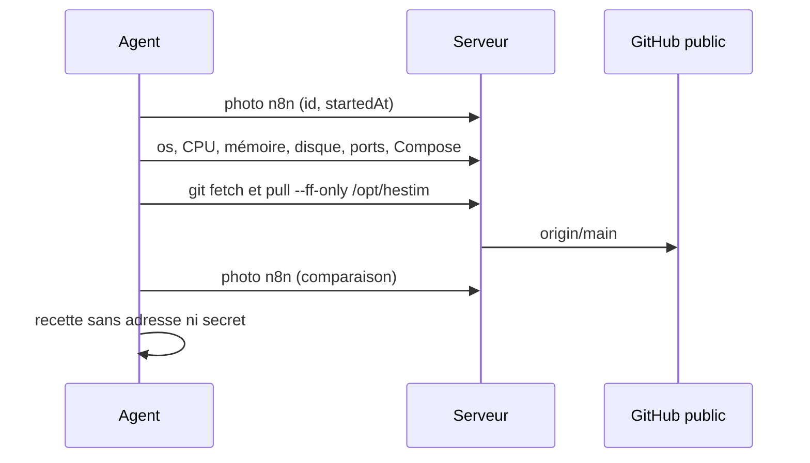

# EXP-01 · Reconnaissance du nouveau serveur — conception

| | |
|---|---|
| Module | [EXP](../../plan/modules/EXP-exploitation.md) · chantier ouvert avant le 9 novembre 2026 |
| Branche | `feat/exp-01-reconnaissance` |
| Rédigé par | Cursor Grok 4.6, le 2026-11-15 |
| **Validé** | par Claude20022002 le 2026-11-15 (commandes serveur autorisées pour cette session) |

## 1. Objet et critère de « terminé »

Reconnaître le serveur Debian partagé avec n8n, poser les prérequis, **sans lancer Planner**.

Vérifié le 15 novembre 2026 :

- la sortie (sans secret, sans adresse) est dans [docs/recette/serveur-2026-11.md](../../recette/serveur-2026-11.md) ;
- `/opt/hestim` est au commit de `origin/main` ; ClassQuiz et StudyLib sont clonés à côté ;
- aucun conteneur Planner ne tourne ;
- les identifiants et heures de démarrage des conteneurs n8n (n8n, postgres, Traefik) sont identiques avant et après.

## 2. Ce qui existe

- Scripts VPS écrits pour l’ancien hôte (nginx FinAdminTech, ports 80/443 déjà pris) : `deploy/vps/docker-compose.vps.yml`.
- Dépôt déjà présent dans `/opt/hestim` depuis le 7 novembre, en retard de 63 commits.
- ClassQuiz (`/opt/ClassQuiz`, branche `hestim`) et StudyLib (`/opt/StudyLib`, `main`) déjà clonés.
- n8n installé via `/home/debian/n8n/docker-compose.yml` : Traefik tient 80 et 443.

## 3. Questions et réponses

| N° | Question | Proposition | Réponse du chef | Bloque |
|---|---|---|---|---|
| 1 | Qui lance les commandes SSH de cette session ? | l’agent, une fois | autorisé le 15 nov. | non |
| 2 | Mettre `main` à jour dans `/opt/hestim` ? | `git pull --ff-only`, sans `compose up` | oui (prérequis EXP-01) | non |
| 3 | Retirer Ollama maintenant ? | non : changerait n8n ; décision du 11 nov. reste pour EXP-02 | non traité ici | EXP-02 |

## 4. Solution

Lecture seule d’abord (photo n8n), puis `git pull` du dépôt public, puis photo n8n de contrôle. Aucun `docker compose up` Planner, aucune mise à jour de Docker.

## 5. Fichiers créés ou modifiés

| Fichier | Créé / modifié | Rôle | Taille visée |
|---|---|---|---|
| `docs/conception/exploitation/conception-exp-01-reconnaissance.md` | créé | ce plan | court |
| `docs/recette/serveur-2026-11.md` | créé | constat sans secret | court |
| `docs/plan/modules/EXP-exploitation.md` | modifié | ce qui existe | — |
| `docs/plan/suivi.md` | modifié | branche EXP-01 | — |
| `docs/conception/README.md` | modifié | index | — |

## 6. Données et migration

Aucune.

## 7. Sécurité, isolation et exigences produit

EP-9 : rien de Planner n’est mis en ligne. Le dépôt public ne reçoit ni IP, ni nom d’hôte, ni secret. n8n n’est pas redémarré. Docker n’est ni réinstallé ni mis à jour.

## 8. Tests

Comparaison des trois identifiants n8n avant/après. `docker ps` sans nom `hestim` ni `planner`. Contrôle `scripts/verifier-neutre.mjs` sur les fichiers ajoutés.

## 9. Étapes de livraison

1. Conception (ce document).
2. Reconnaissance et `git pull` sur le serveur.
3. Recette et suivi.
4. Fiche de session.

## 10. Risques et retour arrière

- Un `compose up` du `docker-compose.yml` de base prendrait 80 et 443 à Traefik. Non fait.
- `git pull` : avance rapide seulement ; pas de fusion locale. Retour : `git -C /opt/hestim reset --hard` vers l’ancien commit (inutile ici : fast-forward propre).

## 11. Hors périmètre

EXP-02 (installation, DNS, secrets, reprise des données). Q-11 (nom de domaine). Retrait d’Ollama. Adaptation de `deployer.sh`.
