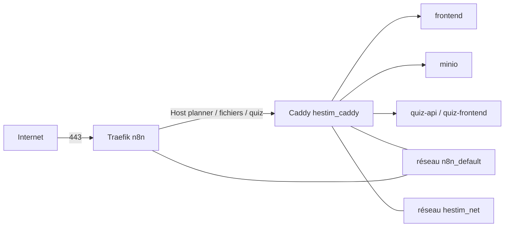

# EXP-02a · Branchement Traefik et procédure, sans lancer Planner — conception

Validé par Claude20022002 le 2026-11-15.

| | |
|---|---|
| Module | [EXP](../../plan/modules/EXP-exploitation.md) · chantier ouvert avant le 9 novembre 2026 |
| Branche | `feat/exp-02a-traefik` (part de `feat/exp-01-reconnaissance`, #172, fusionnée) |
| Rédigé par | Cursor Grok 4.6, le 2026-11-15 ; remarques du coordinateur appliquées le même jour |
| **Validé** | Validé par Claude20022002 le 2026-11-15 |

## 1. Objet et critère de « terminé »

EXP-02 est trop grande pour une PR (L). Cette étape **prépare** l’installation à côté de n8n, **sans démarrer aucun conteneur Planner**.

À la fin de 02a, vérifié ainsi :

- `docker compose … config` accepte la surcharge VPS + Traefik (commande sèche, pas de `up`) ;
- `DEPLOIEMENT.md` décrit Debian, l’utilisateur `debian`, Traefik, et interdit le profil Compose `cpu` (Ollama) ;
- le Caddy de Planner n’a **aucun port public** dans la surcharge ;
- n8n n’est pas redémarré (cette étape ne se connecte pas au serveur pour un `up`).

Le critère complet d’EXP-02 (HTTPS, reprise B2, n8n toujours là) est **EXP-02b**.

## 2. Ce qui existe

- Recette [serveur-2026-11.md](../../recette/serveur-2026-11.md) : Traefik tient 80/443, réseau `n8n_default`, Caddy et nginx d’hôte inactifs, Ollama retiré, ~6,5 Gio disponibles.
- `deploy/vps/docker-compose.vps.yml` : Caddy sur `172.17.0.1:8090`, commentaires encore écrits pour le nginx de FinAdminTech.
- `deploy/vps/Caddyfile.vps` : HTTP interne, `SITE_ADDRESS` / `FICHIERS_ADDRESS` / `QUIZ_ADDRESS`.
- `deploy/vps/nginx-hestim.conf` : ancien pont HTTPS, **inutilisable** ici (pas de nginx d’hôte).
- `docker-compose.yml` de base : Caddy publie 80 et 443 — **ne jamais le lancer seul** sur ce serveur.

## 3. Questions et réponses

| N° | Question | Proposition | Réponse du chef | Bloque |
|---|---|---|---|---|
| Q-11 | Noms publics | garder les trois noms déjà écrits dans `nginx-hestim.conf` et `generer-env.sh` | **oui** (15 nov.) | non (02b fera le DNS) |
| Reprise | Données | sauvegarde B2 de l’ancienne production | **oui** | 02b |
| Proxy | Traefik | labels sur Caddy + réseau `n8n_default` externe ; Caddy sans port public | **oui** | non |
| Découpe | L | 02a fichiers seulement ; 02b mise en ligne | **oui** | non |

## 4. Solution

Traefik voit déjà tous les conteneurs via le socket Docker (`exposedByDefault=false`). On pose des labels sur `hestim_caddy` et on le rattache **aussi** à `n8n_default` (réseau externe déjà créé par n8n). Caddy reste sur `hestim_net` pour parler à frontend, MinIO et quiz. TLS : le résolveur ACME déjà utilisé par n8n (`mytlschallenge`) ; les certificats des trois noms se créent en **02b**, quand le DNS pointera.

On **n’édite pas** `/home/debian/n8n/docker-compose.yml` et on ne relance pas Traefik. `docker network connect` n’est pas utilisé à la main : Compose déclare le réseau externe.

Labels prévus. Les noms publics restent hors des fichiers nouveaux : la surcharge interpole `SITE_ADDRESS`, `FICHIERS_ADDRESS` et `QUIZ_ADDRESS` depuis `.env.docker`. `node scripts/verifier-neutre.mjs` ne parcourt pas `deploy/` : la relecture de la surcharge se fait à la main.

- `traefik.enable=true`
- `traefik.docker.network=n8n_default` : Caddy est aussi sur `hestim_net` ; Traefik doit prendre le réseau qu’il partage déjà
- un routeur `websecure` par rôle (`planner`, `fichiers`, `quiz`), règle `Host(${…})`, entrée `websecure`, `tls.certresolver=mytlschallenge`
- un service commun : port 80 du conteneur Caddy
- `auto_https off` déjà dans `Caddyfile.vps` : Traefik termine le TLS, Caddy reçoit du HTTP

`TRUST_PROXY_HOPS` du backend dans la surcharge VPS reste à 3 (Traefik, Caddy, nginx du frontend).

Limites mémoire du fichier VPS inchangées (~4,1 Gio) : elles tiennent dans les 6,5 Gio libres avec n8n.

## 5. Fichiers créés ou modifiés

| Fichier | Créé / modifié | Rôle | Taille visée |
|---|---|---|---|
| `deploy/vps/docker-compose.vps.yml` | modifié | plus de nginx FinAdminTech ; Caddy sans `ports` publics ; labels Traefik ; réseau externe `n8n_default` | — |
| `DEPLOIEMENT.md` | modifié | procédure Debian + Traefik ; `debian`+`sudo` ; photo n8n avant/après ; interdit `--profile cpu` ; 02a s’arrête avant `up` | — |
| `docs/plan/modules/EXP-exploitation.md` | modifié | EXP-02a / 02b | — |
| `docs/plan/suivi.md` | modifié | EXP-02a en cours | — |
| `docs/plan/decisions.md` | modifié | Q-11 tranchée | — |
| `docs/conception/README.md` | modifié | index | — |

Non touchés en 02a : `Caddyfile.vps` (déjà HTTP interne), secrets, DNS, B2, `deployer.sh`.

## 6. Données et migration

Aucune. Pas de `compose up`, pas de migration.

## 7. Sécurité, isolation et exigences produit

- Aucune adresse IP dans le dépôt. Les noms publics déjà écrits dans l’ancien nginx ne sont pas recopiés : la surcharge les lit dans `.env.docker`.
- Caddy sans 80/443 sur l’hôte : Traefik de n8n les garde.
- `scripts/verifier-neutre.mjs` ne lit pas `deploy/` : la surcharge est relue à la main avant le commit.
- EP-9 : rien n’est mis en ligne dans 02a.
- Ne pas joindre MinIO, MySQL ni Quiz à `n8n_default` : seulement Caddy.

## 8. Tests

- `docker compose --env-file .env.docker.example -f docker-compose.yml -f deploy/vps/docker-compose.vps.yml config` (fichier d’exemple, ou un `.env` de test sans secrets réels) : le YAML interpolé montre Caddy sans ports d’hôte 80/443, labels Traefik, réseau externe.
- `node scripts/verifier-neutre.mjs`
- Aucun test d’intégration serveur : pas de comportement applicatif.

## 9. Étapes de livraison

1. Conception (ce document) validée, commit seul, `suivi.md` à « en cours ».
2. Surcharge Compose + `DEPLOIEMENT.md`.
3. `compose config` en local.
4. Fiche de session. Pas de `up` sur le serveur.

## 10. Risques et retour arrière

- Si Compose refuse le réseau externe `n8n_default` en local (réseau absent) : `config` peut quand même passer ; le `up` réel est 02b. Documenter `docker network inspect n8n_default` dans la procédure.
- Labels mal formés : Traefik ignorerait Caddy ; n8n inchangé. Retour : retirer les labels.
- Un `up` trop tôt prendrait 80/443 si on oublie la surcharge : la procédure commence par rappeler de **toujours** ajouter `-f deploy/vps/docker-compose.vps.yml`.

## 11. Hors périmètre (EXP-02b)

DNS vers le nouveau serveur ; copie des secrets ; `compose up` ; reprise B2 (comptes et documents comptés) ; HTTPS réel ; `deployer.sh` (EXP-03) ; images GHCR (Q-12).
