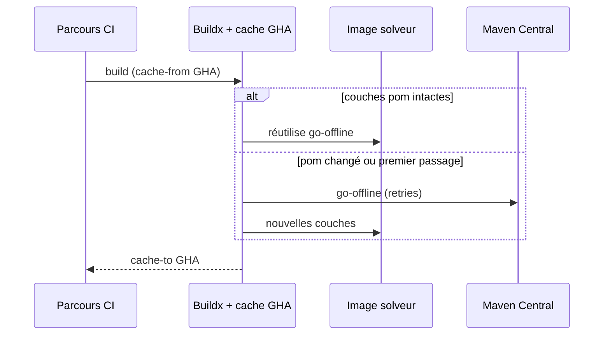

# REL · Cache Maven de l'image du solveur en CI — plan court

| | |
|---|---|
| Module | [EXP](../../plan/modules/EXP-exploitation.md) · correctif hors chantier (CI rouge récurrente, 18–21 nov.) |
| Branche | `fix/ci-cache-maven-solveur` |
| Rédigé par | agent de Cursor (Auto), le 2026-11-21 |
| **Validé** | Validé par Claude20022002 le 21 novembre 2026 |

## 1. Objet et critère de « terminé »

L'étape « Construire l'image du solveur » du job **Parcours de démonstration** ne retélécharge plus tout Maven Central à chaque passage à froid quand `solver/pom.xml` n'a pas changé. Un 429 passager de Central ne fait plus échouer systématiquement une PR de documentation.

Vérifié : la CI de cette branche, job Parcours, étape de construction de l'image **verte**. Spring Boot reste **4.1.2** (MOT-12) ; `pom.xml` inchangé.

## 2. Ce qui existe

- `solver/pom.xml` : parent `spring-boot-starter-parent` **4.1.2** (décision MOT-12).
- `solver/Dockerfile` : `mvn dependency:go-offline` puis `package`, **sans** cache BuildKit.
- Job **Test Solveur** : `actions/setup-java` avec `cache: maven` → vert.
- Job **Parcours** : `docker build -t hestim-solver:parcours ../solver` à froid → Central (souvent 429) ; Maven affiche alors « parent POM introuvable ».
- Constat coordinateur du 18 nov. : proposer un cache Maven pour cette image.

## 3. Questions et réponses

| N° | Question | Proposition | Réponse du chef | Bloque |
|---|---|---|---|---|
| 1 | Branche et dossier à part, pas sur #190 | `fix/ci-cache-maven-solveur` | **oui, le 21 nov.** | — |
| 2 | Cache BuildKit dans le Dockerfile + build CI | `RUN --mount=type=cache` + `docker/build-push-action` avec cache GHA | **oui, le 21 nov.** | — |
| 3 | Critère de vérification | un passage CI Parcours vert | **oui, le 21 nov.** | — |

## 4. Solution

1. Dans `solver/Dockerfile`, monter un cache `/root/.m2` sur les deux `RUN mvn`, avec quelques tentatives HTTP Maven.
2. Dans le job Parcours : `docker/setup-buildx-action`, puis construire avec `docker/build-push-action` (`load: true`, étiquette `hestim-solver:parcours`, `cache-from` / `cache-to` GHA, portée `solver`). Les couches Maven restent réutilisées tant que `pom.xml` est inchangé.

## 5. Fichiers créés ou modifiés

| Fichier | Créé / modifié | Rôle | Taille visée |
|---|---|---|---|
| `docs/conception/exploitation/fix-ci-cache-maven-solveur.md` | créé | ce plan | court |
| `solver/Dockerfile` | modifié | cache `.m2` + retries Maven | ~20 lignes |
| `.github/workflows/ci-cd.yml` | modifié | buildx + cache GHA pour l'image parcours | ~15 lignes |

## 6. Données et migration

Aucune.

## 7. Sécurité, isolation et exigences produit

Pas de secret. Le cache GHA est celui du dépôt. Aucun changement de version Spring Boot / Timefold.

## 8. Plan de tests

1. Push de la branche ; job Parcours : construction de l'image verte.
2. Second push sans toucher `pom.xml` : la construction doit rester verte (couches issues du cache).
3. `node scripts/verifier-neutre.mjs` en local après les commits.
