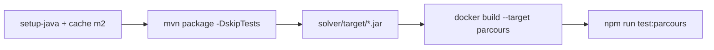

# CI · Paquet du solveur hors Docker (parcours) — plan court

| | |
|---|---|
| Module | EXP / CI (correctif parcours, hors chantier) |
| Branche | `fix/ci-cache-maven-solveur` (déjà ouverte, #244) |
| Rédigé par | agent de Cursor (Auto), le 22 novembre 2026 |
| **Validé** | coordinateur, 22 nov. 1 h 05, avec les précisions 1 et 2 |
| Contexte | Après cache GHA + retries (`26660aa7`), le job Parcours échoue encore : **429 Maven Central** dans l'étape Docker `dependency:go-offline` (parent POM Spring Boot 4.1.2). « Test Solveur » reste vert grâce à `actions/setup-java` + `cache: maven`. |

## 1. Objet

Construire le **JAR du solveur dans le job Parcours** (même cache Maven que « Test Solveur »), puis bâtir une image qui **copie ce JAR** au lieu de lancer Maven dans Docker.

## 2. Solution

Dans `.github/workflows/ci-cd.yml`, job `test-parcours`, **avant** `docker/build-push-action` :

1. `actions/setup-java@v6` (Temurin 21, `cache: maven`) — comme `test-solver`.
2. `mvn -B -ntp -f solver/pom.xml package -DskipTests` (réutilise `~/.m2` du runner).
3. **Un seul** `solver/Dockerfile` :
   - étape commune `FROM eclipse-temurin:21-jre-alpine AS execution` (utilisateur, `HEALTHCHECK`, `ENTRYPOINT`) ;
   - cible `parcours` qui part d'elle et `COPY` `target/hestim-solver.jar` du contexte ;
   - cible de **production en dernier** (défaut) : `COPY --from=build` du JAR Maven.
4. Le job Parcours passe `target: parcours` à `build-push-action`. Tag inchangé : `hestim-solver:parcours`.
5. `solver/.dockerignore` : **ne pas** exclure `target/` (sinon le `COPY` de la cible `parcours` échoue).

## 3. Fichiers

| Fichier | Rôle |
|---|---|
| `.github/workflows/ci-cd.yml` | Java + `mvn` dans `test-parcours` ; `file: solver/Dockerfile`, `target: parcours` |
| `solver/Dockerfile` | cibles `execution` / `parcours` / production (défaut) |
| `solver/.dockerignore` | `target/` non exclu |
| fiche de session | chiffres CI |

`pom.xml` **inchangé** (Spring Boot 4.1.2). Pas de second Dockerfile.

## 4. Vérification

- Job « Test Solveur » inchangé, vert.
- Job « Parcours » : plus de `mvn` dans BuildKit ; vert sur une relance à froid plausible.
- `verifier-neutre` si des docs changent.

## 5. Hors périmètre

- Changer la version Spring Boot / Timefold.
- Miroir Maven alternatif (sauf si le chef l'impose plus tard).
- Modifier la publication Docker Hub hors parcours.

## 6. Étapes

1. Plan validé (ce document) — fait.
2. Code + push (chef) ; critère = Parcours vert.
