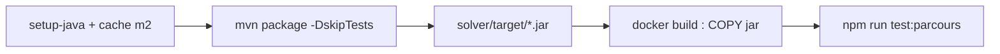

# CI · Paquet du solveur hors Docker (parcours) — plan court

| | |
|---|---|
| Module | EXP / CI (correctif parcours, hors chantier) |
| Branche | `fix/ci-cache-maven-solveur` (déjà ouverte, #244) |
| Rédigé par | agent de Cursor (Auto), le 22 novembre 2026 |
| **Validé** | chef (session Cursor, « allons s'y », 22 nov. 2026) |
| Contexte | Après cache GHA + retries (`26660aa7`), le job Parcours échoue encore : **429 Maven Central** dans l'étape Docker `dependency:go-offline` (parent POM Spring Boot 4.1.2). « Test Solveur » reste vert grâce à `actions/setup-java` + `cache: maven`. |

## 1. Objet

Construire le **JAR du solveur dans le job Parcours** (même cache Maven que « Test Solveur »), puis bâtir une image qui **copie ce JAR** au lieu de lancer Maven dans Docker.

## 2. Solution

Dans `.github/workflows/ci-cd.yml`, job `test-parcours`, **avant** `docker/build-push-action` :

1. `actions/setup-java@v6` (Temurin 21, `cache: maven`) — comme `test-solver`.
2. `mvn -B -ntp -f solver/pom.xml package -DskipTests` (réutilise `~/.m2` du runner).
3. Image : Dockerfile de parcours (ou cible) qui part de `eclipse-temurin:21-jre-alpine`, `COPY` le JAR déjà produit (`solver/target/hestim-solver.jar`), même utilisateur / `HEALTHCHECK` / `ENTRYPOINT` qu'aujourd'hui.
4. Tag inchangé : `hestim-solver:parcours`.

Le Dockerfile de **production** (`solver/Dockerfile` multi-stage Maven) peut rester pour la publication d'images ; seul le chemin Parcours change (évite Maven dans BuildKit, où le cache GHA n'alimente pas `~/.m2` du conteneur Maven au premier froid).

## 3. Fichiers

| Fichier | Rôle |
|---|---|
| `.github/workflows/ci-cd.yml` | étapes Java + `mvn` dans `test-parcours` ; build image sans Maven |
| `solver/Dockerfile.parcours` (créé) ou argument de build | image JRE + COPY du JAR |
| fiche de session | chiffres CI |

`pom.xml` **inchangé** (Spring Boot 4.1.2).

## 4. Vérification

- Job « Test Solveur » inchangé, vert.
- Job « Parcours » : plus de `mvn` dans Docker ; vert sur une relance à froid plausible.
- `verifier-neutre` si des docs changent.

## 5. Hors périmètre

- Changer la version Spring Boot / Timefold.
- Miroir Maven alternatif (sauf si le chef l'impose plus tard).
- Modifier la publication Docker Hub hors parcours.

## 6. Étapes

1. Plan validé (ce document).
2. Code + push (chef) ; critère = Parcours vert.
