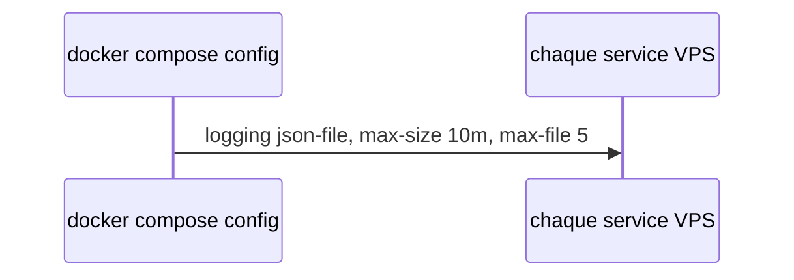

# REL-06 · Journaux Docker bornés — plan court

| | |
|---|---|
| Module | [EXP](../../plan/modules/EXP-exploitation.md) · correctif hors chantier (audit du 15 nov.) |
| Branche | `fix/exp-journaux-docker` |
| Rédigé par | agent de Cursor (Grok 4.7), le 2026-11-18 |
| **Validé** | en attente du chef. Un message du coordinateur n'est pas son accord. Aucun code avant ce « validé ». |

## 1. Objet et critère de « terminé »

Chaque service de `deploy/vps/docker-compose.vps.yml` borne ses journaux : pilote `json-file`, 10 Mo par fichier, 5 fichiers. Le compose de n8n n'est pas modifié.

Vérifié par `docker compose … config` : les 17 services listent ce pilote et ces deux options. Rien n'est démarré.

## 2. Ce qui existe

`deploy/vps/docker-compose.vps.yml` surcharge les 16 services de `docker-compose.yml` (mysql, backend, solver, frontend, caddy, studylib, studylib-queue, studylib-scheduler, redis, minio, meilisearch, quiz-api, quiz-worker, quiz-frontend, quiz-db, quiz-meilisearch) et ajoute `minio-init`. Aucun n'a de clé `logging`. Sans elle, Docker garde les journaux `json-file` sans taille maximale.

Le contrôle sec déjà décrit pour EXP-02a :

```powershell
docker compose --env-file .env.docker.example -f docker-compose.yml -f deploy/vps/docker-compose.vps.yml config
```

## 3. Questions et réponses

| N° | Question | Proposition | Réponse du chef | Bloque |
|---|---|---|---|---|
| 1 | Pilote, taille, nombre de fichiers | `json-file`, 10 Mo, 5 fichiers | **oui, le 18 nov.** | — |
| 2 | Quels services | les 17 de `docker-compose.vps.yml` ; pas le compose de n8n | **oui, le 18 nov.** | — |

## 4. Solution

Une ancre YAML en tête du fichier de surcharge, posée sur chaque service. La définition est unique, l'application est par service. Au prochain `up` avec cette surcharge, Docker recrée les conteneurs concernés pour prendre le pilote. Ce `up` n'est pas lancé par ce correctif.



## 5. Fichiers créés ou modifiés

| Fichier | Créé / modifié | Rôle | Taille visée |
|---|---|---|---|
| `deploy/vps/docker-compose.vps.yml` | modifié | ancre `journaux` et `logging` sur les 17 services | + une vingtaine de lignes |
| `docs/sessions/…-fix-exp-journaux-docker.md` | créé | fiche, au moment du code | — |

## 6. Données et migration

Aucune. Les journaux déjà écrits au-delà de 10 Mo × 5 ne sont pas relus. Docker applique la limite aux nouveaux fichiers.

## 7. Sécurité, isolation et exigences produit

Les journaux peuvent contenir des erreurs du serveur. Les borner évite qu'ils remplissent le disque du serveur partagé avec n8n. Aucun secret ajouté. Le compose de n8n et le réseau `n8n_default` ne changent pas.

## 8. Tests

Pas de test unitaire : le contrôle est la commande sèche. On vérifie que les 17 services ont `driver: json-file`, `max-size: 10m` (ou l'écriture que Compose rend pour `10m`) et `max-file: "5"`. Un service sans ces trois valeurs fait échouer le contrôle.

## 9. Étapes de livraison

1. Ce plan, commité seul. Arrêt : le chef valide.
2. Après le « validé » : le compose, le contrôle `config`, la fiche.

## 10. Risques et retour arrière

Retirer le bloc `logging` et recréer les conteneurs avec la surcharge d'avant. Tant que le `up` n'a pas eu lieu, retirer le commit suffit.

## 11. Hors périmètre

Le compose de n8n. Le `up` de production (EXP-02b). La sauvegarde des journaux MySQL (`sauvegarder-journaux.sh`), qui est un autre canal.
