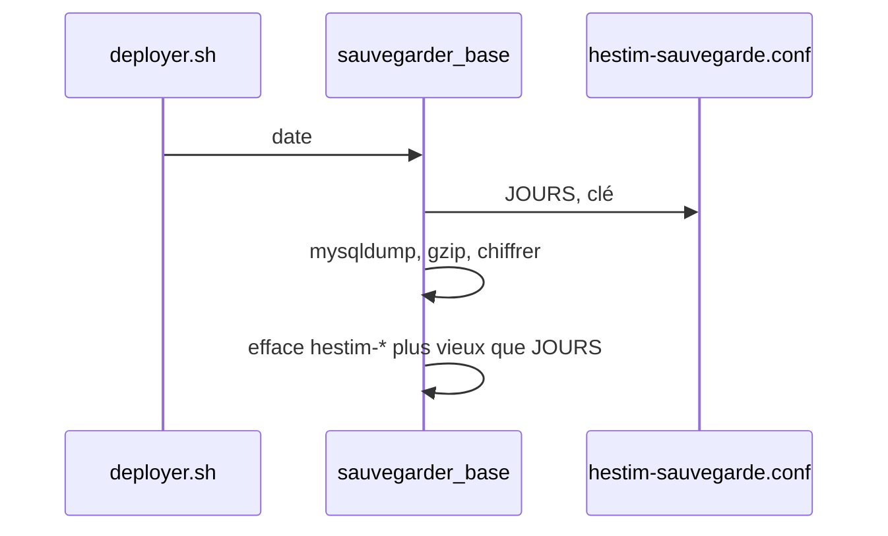

# REL-03 · Dumps d'avant déploiement chiffrés et purgés — plan court

| | |
|---|---|
| Module | [EXP](../../plan/modules/EXP-exploitation.md) · correctif hors chantier (audit du 15 nov.) |
| Branche | `fix/exp-purge-dumps` |
| Rédigé par | agent de Cursor (Grok 4.7), le 2026-11-18 |
| **Validé** | en attente du chef. Un message du coordinateur n'est pas son accord. Aucun code avant ce « validé ». |

## 1. Objet et critère de « terminé »

Le dump écrit par `sauvegarder_base` (appelé par `deployer.sh` avant les migrations) est chiffré avec `chiffrer` de `sauvegarde-commun.sh`, comme la sauvegarde quotidienne. Il est gardé le nombre de jours du réglage `JOURS` (défaut 14, sinon la valeur de `/root/hestim-sauvegarde.conf`). Un fichier plus vieux est effacé. Le test de `tester-deployer.sh` le prouve, sans Docker réel.

## 2. Ce qui existe

`deploy/vps/deploiement-commun.sh`, fonction `sauvegarder_base` (lignes 108 à 140) : `mysqldump | gzip` vers `$SAUVEGARDES_DIR/hestim-<date>.sql.gz`, droits `600`. Un dump raté, illisible ou vide est effacé et le déploiement s'arrête. Rien ne chiffre. Rien ne purge.

`deploy/vps/sauvegarde-commun.sh` : lit `CONF` (défaut `/root/hestim-sauvegarde.conf`), pose `JOURS` (défaut 14) et `chiffrer`. Sans `CLE_PUBLIQUE` ni `PHRASE`, le script s'arrête. `sauvegarder.sh` enchaîne `gzip | chiffrer` vers un `.gz.gpg`, puis `find … -mtime "+$JOURS" -delete`.

`deployer.sh` affiche le retour arrière avec `gunzip -c` sur ce fichier (lignes 35 à 36).

`appliquer-maj.sh` écrit encore, de son côté, `hestim-<date>.sql.gz` et `studylib-<date>.sql.gz` en clair. `deployer.sh` le remplace pour Planner (en-tête de `deployer.sh`).

## 3. Questions et réponses

| N° | Question | Proposition | Réponse du chef | Bloque |
|---|---|---|---|---|
| 1 | Chiffrement et durée | `chiffrer` de `sauvegarde-commun.sh` ; durée lue dans `JOURS` (défaut 14) | **oui, le 18 nov.** | — |
| 2 | `appliquer-maj.sh`, qui écrit encore deux dumps en clair | on n'y touche pas : `deployer.sh` l'a remplacé, et le test demandé est `tester-deployer.sh` | en attente | non |

## 4. Solution

`sauvegarder_base` charge `sauvegarde-commun.sh` au moment du dump, pas au chargement de `deployer.sh` : les autres tests n'ont pas besoin de la clé. Le fichier devient `hestim-<date>.sql.gz.gpg`, par `mysqldump | gzip | chiffrer`. Même contrôle qu'aujourd'hui : un échec de mysqldump, de gzip ou de gpg efface le fichier et arrête le déploiement. Ensuite, dans le même dossier et sans descendre dedans :

- `hestim-*.sql.gz.gpg` plus vieux que `JOURS` sont effacés ;
- les `hestim-*.sql.gz` en clair déjà là, plus vieux que `JOURS`, aussi, pour que les dumps laissés par les mises en ligne d'avant ne restent pas.

Le dossier `quotidien/` n'est pas parcouru. Les dumps `studylib-*.sql.gz` de l'ancien script non plus.

Le texte de retour arrière de `deployer.sh` ne peut plus être un `gunzip` seul. Il devient : déchiffrer avec la clé privée (hors du serveur si `CLE_PUBLIQUE` est réglée, comme pour la sauvegarde quotidienne), puis `gunzip`, puis l'import déjà écrit.

## 5. Fichiers créés ou modifiés

| Fichier | Créé / modifié | Rôle | Taille visée |
|---|---|---|---|
| `deploy/vps/deploiement-commun.sh` | modifié | chiffre, puis purge | la fonction reste sous 80 lignes, coupée s'il le faut |
| `deploy/vps/deployer.sh` | modifié | le retour arrière annonce le déchiffrement | quelques lignes |
| `deploy/vps/tests/tester-deployer.sh` | modifié | faux `gpg`, durée, fichiers vieux | le fichier de test existant |
| `docs/sessions/…-fix-exp-purge-dumps.md` | créé | fiche, au moment du code | — |

## 6. Données et migration

Aucune table. Les dumps déjà en clair dans `/root/sauvegardes` restent lisibles. Ceux dont le nom est `hestim-*.sql.gz` et l'âge dépasse `JOURS` sont effacés au prochain déploiement. Les plus récents restent, en clair, jusqu'à cet âge.

## 7. Sécurité, isolation et exigences produit

Un dump contient les données de l'école. Le chiffrer comme le quotidien évite de le laisser lisible sur le disque. Avec `CLE_PUBLIQUE`, la clé privée n'est pas sur le serveur : le retour arrière de la base se fait depuis la machine qui a cette clé, pas depuis le serveur seul. Sans clé du tout, `sauvegarde-commun.sh` s'arrête et le déploiement ne commence pas. Aucune donnée n'est envoyée hors du serveur par ce correctif : `envoyer` (rclone) n'est pas appelé.

## 8. Tests

Dans `tester-deployer.sh`, un faux `gpg` sur le `PATH` écrit l'entrée standard dans le fichier demandé par `-o`. Un `CONF` de test donne `JOURS=14` et une `CLE_PUBLIQUE` factice, non vide.

- dump réussi : le chemin finit par `.sql.gz.gpg`, droits `600`, contenu gzip lisible à travers le faux gpg, aucun `.sql.gz` à côté ;
- dump raté, vide, ou gpg en échec : aucun fichier laissé, déploiement arrêté ;
- un `hestim-*.sql.gz.gpg` et un `hestim-*.sql.gz` datés de 15 jours disparaissent ; un fichier du même nom daté d'un jour reste ; un fichier dans `quotidien/` reste ;
- sans clé, l'appel s'arrête (sous-shell, pour ne pas couper le banc).

`bash deploy/vps/tests/tester-deployer.sh` doit passer en entier.

## 9. Étapes de livraison

1. Ce plan, commité seul. Arrêt : le chef valide.
2. Après le « validé » : le code, le test, la fiche.

## 10. Risques et retour arrière

Le prochain déploiement échoue si `/root/hestim-sauvegarde.conf` n'a ni clé publique ni phrase : c'est le même arrêt que la sauvegarde quotidienne. Retour arrière du correctif : revenir au commit d'avant. Les fichiers `.gz.gpg` déjà écrits se déchiffrent avec la même clé que les sauvegardes quotidiennes.

## 11. Hors périmètre

`appliquer-maj.sh` (question 2). L'envoi rclone. La sauvegarde quotidienne elle-même. Le dossier `..\travaux-planner\exp-sauvegarde-predeploiement`.
