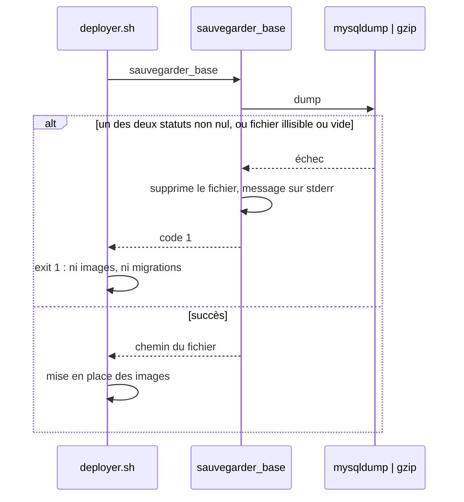

# Correctif · Sauvegarde avant déploiement qui échoue sans bruit : plan court

| | |
|---|---|
| Module | [EXP](../../plan/modules/EXP-exploitation.md), hors liste de fonctions (à ranger par le chef) |
| Branche | `fix/exp-sauvegarde-predeploiement` |
| Rédigé par | Claude Code (Sonnet 5.5), le 2026-11-15, d'après l'audit du même jour (constat REL-01) |
| **Validé** | en attente |

**Aucun code avant la ligne « Validé ».** Ce document ne modifie aucun script.

## 1. Objet et critère de « terminé »

Un déploiement ne doit jamais continuer vers les migrations si la sauvegarde de la base a échoué. Terminé quand : (a) un `mysqldump` ou un `gzip` qui échoue arrête `deployer.sh` avant la mise en place des images ; (b) aucun fichier de sauvegarde vide ou illisible ne reste sur le disque ; (c) un test de régression le prouve ; (d) `shellcheck` de la CI passe.

## 2. Ce qui existe

- `deploy/vps/deploiement-commun.sh:106-113`, fonction `sauvegarder_base` : `docker exec … mysqldump … | gzip > "$fichier"`, puis `chmod 600` et `echo "$fichier"`.
- `deploy/vps/deployer.sh:14` active `set -Eeuo pipefail`, et la ligne 74 appelle `sauvegarde="$(sauvegarder_base "$date")"`.
- **Cause** : dans une substitution de commande `$(…)`, Bash n'applique pas `errexit` (sauf `inherit_errexit`). Le pipe échoué est donc ignoré ; la fonction se termine sur `echo`, qui réussit, et l'affectation reçoit le code 0. Reproduit en Bash pur avec `set -Eeuo pipefail` : `r=ok rc=0` alors que le dump échoue.
- Conséquence : `deployer.sh` continue (`ls -lh`, mise en place des images, redémarrage du serveur, migrations) avec une sauvegarde vide ou tronquée. Contredit l'engagement C-8 de [conception-me0b-deploiement.md](conception-me0b-deploiement.md).
- `deploy/vps/sauvegarder.sh:63` fait déjà le bon geste (le fichier est retiré si la commande échoue) : le correctif s'en inspire.
- Un harnais de test existe : `deploy/vps/tests/tester-deployer.sh`, et `shellcheck` tourne dans `.github/workflows/ci-cd.yml:273`.

## 3. Questions et réponses

| N° | Question | Proposition | Réponse du chef | Bloque |
|---|---|---|---|---|
| 1 | Ranger ce correctif sous EXP comme travail hors liste, ou hors chantier ? | Hors chantier, comme les autres correctifs de `suivi.md` | | le premier commit |
| 2 | Lire `tester-deployer.sh` pour suivre son style ? | Oui | | le test |
| 3 | Traiter dans la même PR la purge des vieux dumps et leur chiffrement (REL-03) ? | Non : un constat, une PR | | — |

## 4. Solution

1. `sauvegarder_base` contrôle **les deux statuts du pipe** (`PIPESTATUS`). Si l'un est non nul : supprimer le fichier, écrire l'erreur sur la sortie d'erreur, renvoyer 1.
2. Elle vérifie ensuite que le fichier est lisible (`gzip -t`) et non vide. Sinon : même sortie en erreur.
3. `deployer.sh:74` : `sauvegarde="$(sauvegarder_base "$date")" || exit 1`, pour que l'échec arrête le déploiement **avant** l'écriture des images et avant les migrations.

## 5. Fichiers créés ou modifiés

| Fichier | Changement |
|---|---|
| `deploy/vps/deploiement-commun.sh` | `sauvegarder_base` : contrôle des statuts, nettoyage, `gzip -t` |
| `deploy/vps/deployer.sh` | ligne 74 : `|| exit 1` |
| `deploy/vps/tests/tester-deployer.sh` | cas de régression (§ 6) |

## 6. Vérification

Test de régression, avec un `docker` factice dans le `PATH` :

1. `mysqldump` échoue : `deployer.sh` sort en erreur, **aucun** fichier dans le dossier de sauvegardes, les étapes suivantes ne sont pas lancées.
2. Le dump réussit mais est vide : même résultat.
3. Le dump réussit : comportement inchangé, le chemin du fichier est renvoyé.

Puis `shellcheck -x` sur les trois scripts (CI).

## 7. Hors de ce correctif

Constats voisins de l'audit, à traiter séparément : un dump en clair laissé à chaque mise en ligne, jamais purgé (REL-03) ; `.env.docker` non sauvegardé (REL-02) ; journaux Docker sans limite (REL-06) ; migrations sans transaction (REL-04).

## 8. Risques

- Un échec de sauvegarde bloquera désormais des mises en ligne qui passaient avant. C'est voulu ; le message doit dire quoi faire.
- Le test dépend de la façon dont le harnais simule `docker` : à confirmer en lisant `tester-deployer.sh` (question 2).
