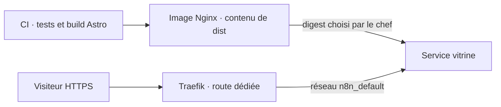

# VIT-06 · Mettre la vitrine en ligne sur un sous-domaine

| | |
|---|---|
| Modules | [Site vitrine](../../plan/modules/VIT-site-vitrine.md) et [exploitation](../../plan/modules/EXP-exploitation.md) |
| Branche | `feat/vit-06-mise-en-ligne` |
| Rédigé par | Codex, le 18 novembre 2026 |
| Validation du chef | En attente |

## Résultat attendu

Le sous-domaine sert en HTTPS la version testée de la vitrine Astro. La page française, les autres langues,
les fichiers statiques et les deux pages légales sont accessibles. Une URL inconnue répond 404.
Le chef peut retirer la vitrine ou restaurer la version précédente indépendamment de Planner.

## Décisions du chef

| Question | Proposition soumise | Réponse |
|---|---|---|
| Quel nom DNS complet utiliser ? | Fournir le nom par `VITRINE_ADDRESS`. | Le chef valide `vitrine.finadmintech.fr` pour la vitrine jusqu’à l’achat du domaine officiel. |
| Quel registre utiliser ? | Versionner l’image par commit et conserver son digest pour le déploiement. | Docker Hub, dépôt `claude20022002/planner-vitrine`, avec une étiquette par commit. |
| Qui rédige et qui valide les deux pages légales ? | L’équipe prépare les textes à partir des informations fournies par le chef. Le chef les valide avant publication. | Confirmé le 18 novembre. |

## Construction et routage proposés



- **Image.** Dans `.github/workflows/vitrine.yml`, conserver les contrôles et l’artéfact existants. Tester l’image
  créée par `vitrine/Dockerfile` à partir du même `dist/`. Après succès sur `main`, le job de publication s’authentifie auprès de Docker Hub avec un jeton conservé dans les secrets de CI.
  Publier `docker.io/claude20022002/planner-vitrine:<SHA complet>` et consigner le digest retourné. Le job de PR utilise des droits de lecture.
- **Service.** Dans `deploy/vps/docker-compose.vps.yml`, ajouter le seul service `vitrine`, sous un profil
  du même nom. Proposition de plafond mémoire de 64 Mio, comme le frontend statique existant.
  Réutiliser `logging: *journaux` (10 Mo, cinq fichiers) et le réseau externe `n8n_default`.
  Nginx écoute sur un port interne proposé de 8080. Traefik associe l’hôte exact à ce port via une route
  dédiée sur `websecure`, avec le résolveur TLS `mytlschallenge`. Aucun port hôte, volume applicatif ou
  accès à la base. Aucun changement dans le Compose de n8n.
- **Compatibilité.** Un déploiement Planner ordinaire doit encore pouvoir lire le Compose avec l’ancien
  `.env.docker`. Prévoir des valeurs de repli inertes pour le service désactivé. Avant son activation,
  le chef vérifie le digest de l’image et les deux routes. `VITRINE_ADDRESS=vitrine.finadmintech.fr` sert la vitrine.
  `SITE_ADDRESS=planner.finadmintech.fr` sert l’application. [Guide de déploiement](../../../DEPLOIEMENT.md)
- **DNS.** Le chef a fait pointer l’entrée `vitrine` de la zone OVH `finadmintech.fr` vers l’adresse publique
  du serveur Debian. Avant la mise en ligne, vérifier la résolution de `vitrine.finadmintech.fr`.
- **Réponses HTTP.** La configuration Nginx sert les répertoires Astro et leur `index.html`.
  Sur les réponses HTTPS, appliquer HSTS au seul hôte, `X-Content-Type-Options: nosniff`,
  `Referrer-Policy: no-referrer` et une CSP limitée aux ressources locales. Interdire les cadres,
  les objets et les soumissions de formulaire. Le gabarit contient un script en ligne et le HTML des
  illustrations contient des attributs de style. Calculer les empreintes sur le HTML compilé, par page
  si nécessaire, avec les règles CSP propres aux attributs. Contrôler le menu, les illustrations et
  les animations sous cette politique. [Spécification CSP](https://www.w3.org/TR/CSP3/)
- **Vidéo de l’accueil.** Nginx sert les fichiers WebM et MP4 de VIT-08 depuis la même origine.
  La CSP autorise leur lecture avec `media-src 'self'`. Pour ces fichiers de quelques Mo, appliquer
  `Cache-Control: public, no-cache` avec un validateur HTTP si le nom est stable. Un nom qui change
  avec le contenu permet un cache de longue durée avec `immutable`.
- **Indexation.** Envoyer `X-Robots-Tag: noindex` sur tout le sous-domaine, y compris les routes de langue.
  Servir `/robots.txt` en texte avec `User-agent: *` et `Allow: /` pour que les moteurs puissent lire
  l’en-tête. La balise actuelle du gabarit ne couvre que les langues non publiées.
  [Documentation sur noindex](https://developers.google.com/search/docs/crawling-indexing/block-indexing)

## Conditions et recette du chef

L’ouverture attend les six éléments de la [fiche de mission](../../plan/missions/vit-06-mise-en-ligne.md) :

1. Audit de `vitrine/` et montée d’Astro le **27 novembre ou après**, avec `node ../scripts/audit.mjs vitrine` vert dans la CI.
2. Mentions légales et confidentialité publiables, textes approuvés par le chef, site sans formulaire ni mesure d’audience.
3. SVG officiels des logos fournis par le chef et intégrés à la version candidate.
4. Non-indexation vérifiée sur l’image candidate.
5. VIT-07 livré par l’agent de Cursor. Le site présente toutes les applications de Planner.
6. VIT-08 livré par Claude de VS Code. La vidéo de présentation se lit depuis l’accueil de la version candidate.

Après validation du plan et des six conditions, le chef note le digest précédent et contrôle le DNS
et le certificat attendu. Depuis le dossier du déploiement, avec le fichier privé de l’installation :

```sh
docker compose --env-file .env.docker -f docker-compose.yml -f deploy/vps/docker-compose.vps.yml --profile vitrine config --quiet
docker compose --env-file .env.docker -f docker-compose.yml -f deploy/vps/docker-compose.vps.yml --profile vitrine pull vitrine
docker compose --env-file .env.docker -f docker-compose.yml -f deploy/vps/docker-compose.vps.yml --profile vitrine up -d --no-deps vitrine
```

Vérifier aussi en CI le rendu Compose avec le profil désactivé et un fichier d’environnement de test
sans les variables de la vitrine. Sur l’image puis sur l’hôte public, tester `/`, `/fr/`, `/en/`,
les pages légales, un fichier statique, `/robots.txt` et une URL inexistante. Lire les en-têtes avec
`curl -sSI "https://${VITRINE_ADDRESS}/fr/"` (variable exportée par le chef). Contrôler le certificat,
la navigation mobile, les refus CSP et les requêtes externes dans le navigateur. Depuis l’accueil,
lancer la vidéo. Vérifier pour les deux formats l’origine, le type MIME (`video/webm` ou `video/mp4`)
et l’en-tête de cache.

**Retour arrière.** Remettre le digest précédent dans l’environnement privé et relancer le seul service
avec les mêmes commandes. Pour une première publication, arrêter uniquement `vitrine` avec le même
projet Compose, puis retirer, si nécessaire, uniquement un enregistrement DNS créé pour cette publication. Vérifier la disparition de
la route ou le retour de la version attendue, puis l’accès aux services voisins.
