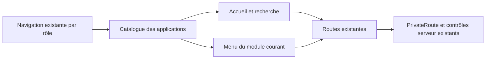

# UIX-01a · Accueil des applications et navigation modulaire

| | |
|---|---|
| Module | UIX, lot limité du socle et de la navigation web |
| Branche | `feat/uix-01a-navigation` |
| Rédigé par | Codex, le 2026-11-15 |
| Validation | **Validé par Claude20022002 le 2026-11-15**, dans cette conversation : « Oui je valide tes proposition » après les trois propositions UIX |
| Chantier | Exception limitée à ce lot, accord du chef le 15 novembre ; EXP, PLA et MOT restent les trois chantiers ouverts |

## 1. Objet et critère de terminé

Organiser l'application web en applications métier, dans l'esprit d'Odoo, avec une identité Planner. Après connexion sans destination explicite, une page Applications présente les fonctions disponibles. Depuis chaque écran, un accès permanent ramène à cette page. Le menu présente les rubriques de l'application courante. Une recherche locale filtre les applications et leurs rubriques traduites.

Critères : navigation opérationnelle pour les trois rôles et le responsable de filière ; liens profonds conservés ; retour navigateur fonctionnel ; aucune fonction future présentée comme disponible ; clavier utilisable, français et anglais, clair et sombre, téléphone sans débordement.

## 2. Ce qui existe

- `frontend/src/components/layouts/navigation.jsx` définit les entrées autorisées par rôle et les alias des routes.
- `DashboardLayout.jsx` assemble le rail, la barre supérieure et les onglets téléphone.
- `SelecteurEspaces.jsx` donne accès à Planner, la Bibliothèque et au Quiz externe selon la configuration.
- `Connexion.jsx` conserve une destination explicite, sinon ouvre le tableau du rôle.
- `PrivateRoute.jsx` impose la connexion, le rôle et les étapes obligatoires de sécurité.
- La conception du socle neutre reste en vigueur. Ce lot ne réalise ni son contrat serveur ni sa migration 0060.

## 3. Questions et réponses

| N° | Question | Proposition | Réponse du chef |
|---|---|---|---|
| 1 | Site vitrine ou gestion ? | application de gestion | Application web de gestion, référence Odoo |
| 2 | Inspiration | organisation et apparence générale, identité propre à Planner | validé le 15 novembre |
| 3 | Premier périmètre | accueil des modules et navigation, avant les écrans métier | validé le 15 novembre |
| 4 | Chantier UIX fermé | exception limitée à ce lot | validé le 15 novembre |

Les regroupements reprennent les rubriques déjà présentes : planning, enseignements, personnes, établissement, annonces, quiz/jeux et Bibliothèque. Ils ne définissent pas de nouveaux modules commerciaux. Les intitulés viennent des traductions existantes quand elles conviennent. Aucun nom d'école fictive ou chiffre métier n'est nécessaire.

## 4. Solution

Un catalogue d'interface pur classe chaque entrée de navigation existante dans un groupe. Il reçoit les entrées déjà filtrées par rôle ; il n'accorde aucun droit. Les alias et les sous-pages retrouvent le même groupe. Une route non classée conserve la navigation complète comme repli, afin de ne masquer aucune entrée existante.

La page Applications est une grille de liens avec icônes, résumés et rubriques disponibles. Une barre de recherche filtre noms et rubriques dans la langue courante. Aucun résultat donne une action pour effacer la recherche. Le sélecteur d'espaces externe est conservé : il ne se confond pas avec le catalogue métier interne.

Une barre commune porte le retour Applications, le module et le titre de page, puis les outils existants. Le rail devient contextuel. Le compte, les langues, le mode et la déconnexion restent accessibles. Sur téléphone, le tiroir reste disponible et les raccourcis existants sont conservés.

Scène d'usage : un gestionnaire ouvre Planner sur son ordinateur au bureau et cherche immédiatement une tâche ; un enseignant consulte son téléphone entre deux séances. Surfaces calmes, typographie lisible en casse normale et hiérarchie compacte ; la marque de l'école et les états existants restent inchangés. Les nouvelles surfaces suivent le mode clair/sombre MUI. Aucun ajout de dépendance.

## 5. Fichiers

- Catalogue, composants Applications et composants du menu : nouveaux fichiers courts sous `frontend/src/components/applications/`.
- Page `frontend/src/pages/Applications.jsx` et traductions dédiées FR/EN.
- Adaptations ciblées de `App.jsx`, `Connexion.jsx`, `VersTableau.jsx`, `DashboardLayout.jsx`, `navigation.jsx`, accueil public, i18n.
- Découpage du rail si nécessaire pour garder chaque fichier sous 300 lignes.
- Tests unitaires du classement/recherche et parcours Applications dans la suite existante.
- Suivi, module UIX, décisions et fiche de session.

## 6. Données et migration

Aucune table, migration, stockage personnel ou API ajouté. Le registre d'activation par école reste VEN-01. Les interruptions de fonctions existantes restent appliquées par les sources existantes.

## 7. Sécurité et exigences

PrivateRoute, liens explicites de connexion, mot de passe initial, MFA et permissions serveur conservés. Le filtre du menu est ergonomique, jamais une autorisation. Aucune donnée d'école supplémentaire n'est lue. EP-2, EP-3 et EP-11 : navigation simple, chargement paresseux, clavier, focus, sens de lecture préparé avec propriétés logiques. Pas d'arabe complet dans ce lot.

## 8. Vérification

Tests unitaires : chaque rubrique reste atteignable une fois ; alias/sous-pages ; recherche accentuée, casse et absence de résultats ; aucune mutation des entrées d'origine. Parcours : connexion vers Applications, choix d'une application puis retour, recherche, accès étudiant limité, lien profond conservé, téléphone et clavier. Lint, tests unitaires frontend, construction de production, contrôle de neutralité. Les parcours avec base sont laissés à la CI si les services locaux sont indisponibles ; aucune commande serveur lancée par l'agent.

## 9. Livraison

1. Conception seule et suivi en cours, commit local.
2. Catalogue, page Applications, navigation contextuelle et traductions.
3. Tests et corrections dans le périmètre validé.
4. Documentation, fiche de session, commit local et rapport coordinateur.

## 10. Risques et retour arrière

Une rubrique mal classée est couverte par les tests de conservation et le repli. Les accès externes restent des navigations complètes. Le changement de destination après connexion nécessite l'adaptation du parcours de connexion et de son outil partagé. Retour arrière par réversion des commits du lot, sans migration.

## 11. Hors périmètre

Migration UIX-01, adaptation mobile native, assistant de configuration, réécriture des écrans métier, création des modules futurs, facturation, activation commerciale, changement de pile, publication et commandes serveur.
