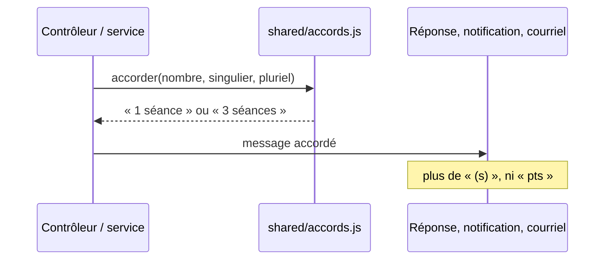

# UIX-05 · Ton des messages du serveur — conception

| | |
|---|---|
| Module | [UIX](../../plan/modules/UIX-interface.md) · fonction libre, accord du chef le 25 nov. |
| Branche | `feat/uix-05-ton-messages` |
| Rédigé par | agent Claude, le 2026-11-25 |
| **Validé** | par le chef (Claude20022002) le 2026-11-25 |

## 1. Objet et critère de « terminé »

Le serveur écrit encore « 3 séance(s) créé(s) » et un score en « pts ». Le lot supprime ces formes
dans **toutes les chaînes du serveur** (réponses HTTP, notifications, courriels, journaux, amorçage) :
chaque nombre s'accorde en clair, « 1 séance » et « 3 séances ».

Ce qui sera vrai à la fin :

- un contrôle automatique (test unitaire du serveur) ne trouve plus « (s) », « (e) », « (es) »,
  « (x) » ni « pts » dans une chaîne de `backend/` hors `backend/tests/` ;
- le critère du module est reformulé dans ce sens : le `git grep "(s)"` littéral trouvait 153
  paramètres de flèche `(s) => …`, qui ne sont pas des messages (question 2) ;
- m-7 (notifications en anglais) est **renvoyé à UIX-07**, qui couvre déjà « l'anglais complet,
  messages du serveur compris » ; aucune migration (question 1) ;
- `b/textes-enseignant` et `b/textes-coherence` ne sont **pas repris** : leur contenu est déjà dans
  `main` (voir § 2) ;
- la suite existante passe, seules les assertions qui citent un texte changé sont réalignées.

## 2. Ce qui existe

- **45 lignes** portent `(s)` dans `backend/` hors tests ; après retrait des 153 `(s) =>` et des
  appels de fonction (`ordre(s)`, `typeDe(s)`, `enseignantsDe(s)`…), il reste **34 messages** à
  réécrire :
  - `controllers/` : `calendrier` (146), `campus` (56), `composante` (107), `creneau` (170),
    `enseignant` (340), `enseignement` (96, 175), `etudiant` (396, 439), `examen` (112),
    `groupe` (129-131, un seul message), `user` (291) ;
  - `services/` : `calendrier/envoiEdt` (137, 138, 148, 151, 222, 245), `desactivation/desactivation`
    (60), `desactivation/programmation` (77), `generation/timefold/generation` (47, 98),
    `planning/examens` (118), `planning/imprevus` (91), `presences/rappelAppel` (114),
    `quiz/parties` (290, seul « pts ») ;
  - hors réponse HTTP : `server.js` (53, 66, 72, 79), `migrations/cli.js` (14), `seed.js` (808).
- **Aucun outil d'accord** : chaque phrase écrit `(s)` à la main. `shared/dates.js` prouve qu'un
  module de `shared/` s'importe sans peine depuis le serveur.
- **Contrôle automatique existant** : `scripts/verifier-neutre.mjs` (74 lignes, parcourt des dossiers,
  lit les fichiers, échoue avec un code de sortie) ; `backend/tests/utils/catalogueMoteur.test.js`
  montre qu'un test unitaire peut importer un script de `scripts/`.
- **Tests qui citent un texte à changer** : `backend/tests/integration/push.test.js:106`,
  `backend/tests/integration/quiz.test.js:202`,
  `frontend/tests/parcours/desactivation.spec.cjs:151`.
- **Branches à reprendre** : `origin/b/textes-coherence` est un ancêtre de `origin/main` (contenu déjà
  fusionné) ; `origin/b/textes-enseignant` ne diffère pas de son point de fusion avec `main`
  (`git diff 1c6bbb11 origin/b/textes-enseignant` est vide). Aucun texte à reprendre, seulement deux
  branches mortes (QUA-05).
- **m-7** (recette du 2026-10-20) : « En anglais, les notifications restent en français (texte figé
  côté serveur) ». Les notifications stockent `titre` et `message` en français
  (`backend/models/Notification.js`, `backend/utils/notificationHelper.js`), sans clé de traduction.

## 3. Questions et réponses

| N° | Question | Proposition | Réponse du chef | Bloque |
|---|---|---|---|---|
| 1 | m-7 (notifications en anglais) : dans UIX-05 ? | Reporter à UIX-07, qui couvre les messages du serveur en anglais ; UIX-05 reste en français, sans migration | **Reporter à UIX-07** (25 nov.) | non |
| 2 | Preuve du critère, alors que 153 `(s)` sont des paramètres de flèche | Un test unitaire qui lit les chaînes du serveur et échoue sur « (s) », « (e) », « (es) », « pts » ; critère du module reformulé | **Script de ton, portée serveur entier** | non |
| 3 | Profondeur de la revue du ton | Corrections ciblées : formes fautives et abréviations, sans réécrire les messages déjà corrects | **Ciblé** | non |

## 4. Solution

Principe : un seul outil d'accord, une seule vérification, des messages réécrits un par un.

- `shared/accords.js` exporte `accorder(nombre, singulier, pluriel)` : il préfixe le nombre et choisit
  la forme (« 1 séance », « 3 séances »). Zéro prend le singulier, comme l'usage français.
- `scripts/verifier-ton.mjs` exporte `verifierTon(racine)` et `lireChaines(source)` : il parcourt
  `backend/` hors `tests/` et `node_modules`, **retire les commentaires**, lit les chaînes
  (guillemets, apostrophes, gabarits) et rend les `{ chemin, ligne, texte }` fautifs. Lancé
  directement, il écrit la liste et sort en erreur, comme `verifier-neutre.mjs`.
- `backend/tests/utils/tonMessages.test.js` appelle `verifierTon` et exige une liste vide : c'est le
  critère de « terminé », et il tourne dans le job « Test Backend » sans toucher à la CI. Un second
  cas prouve que le détecteur voit une chaîne fautive et ignore un commentaire.
- Chaque message réécrit suit la même forme : `accorder(n, "séance utilise ce créneau", "séances
  utilisent ce créneau")`. Quand le nombre est au milieu d'une phrase, on compose
  (`Synchronisation terminée : ${accorder(created, "lien créé", "liens créés")}, …`).
- `quiz/parties.js` : « 2400 pts » devient « 2400 points » ; le rang reste « 2e », et « 1er » au rang 1.

### Messages ciblés (texte visé)

| Fichier | Texte visé |
|---|---|
| `calendrierController` | `${accorder(crees, "événement ajouté au calendrier", "événements ajoutés au calendrier")} ${annee.libelle}` |
| `campusController` | `${accorder(nbSalles, "salle est rattachée à ce campus", "salles sont rattachées à ce campus")} : déplacez-les ou supprimez-les d'abord` |
| `composanteController` | `${accorder(seances, "séance est déjà planifiée", "séances sont déjà planifiées")} sur cette composante` |
| `creneauController` | `${accorder(seances, "séance utilise ce créneau", "séances utilisent ce créneau")} : déplacez-les avant de le supprimer` |
| `enseignant`, `etudiant`, `user` | `${accorder(n, "enseignant créé", "enseignants créés")} avec succès` (idem étudiant, utilisateur) |
| `enseignementController` (2 sites) | `${accorder(rapport.crees, "enseignement créé", "enseignements créés")}` ; `${accorder(seances, "séance est déjà planifiée", "séances sont déjà planifiées")}` |
| `etudiantController` (synchronisation) | `Synchronisation terminée : ${accorder(created, "lien créé", "liens créés")}, ${accorder(skipped, "lien ignoré", "liens ignorés")}` |
| `examenController` | `${accorder(resultat.manquants, "surveillant manquant", "surveillants manquants")} : pas assez d'enseignants libres` |
| `groupeController` | message composé de `accorder(sousGroupes, "sous-groupe", "sous-groupes")`, `accorder(seances, "séance", "séances")`, `accorder(etudiants, "étudiant", "étudiants")` |
| `calendrier/envoiEdt` (6 sites) | `accorder(nombre, "séance", "séances")`, `accorder(changements.length - liste.length, "autre", "autres")`, `accorder(changements.length, "changement", "changements")`, `accorder(liste.length, "classe a des changements", "classes ont des changements")`, `accorder(bilan.a_republier, "classe à republier", "classes à republier")` ; le courriel suit les mêmes formes |
| `desactivation` (2 sites) | `${accorder(futures.length, "séance à venir", "séances à venir")} : confiez-les à un remplaçant ou choisissez de les annuler` |
| `generation/timefold/generation` (2 sites) | `${accorder(aPlacer, "séance à placer", "séances à placer")}` ; `${accorder(deploiement.creees, "séance créée", "séances créées")}, ${accorder(nonPlaces.length, "enseignement incomplet", "enseignements incomplets")}` |
| `planning/examens` | `${salle.nom_salle} : ${accorder(nombre, "surveillant", "surveillants")} sur ${minimum}` |
| `planning/imprevus` | `(…) : ${accorder(touchees.length, "séance à traiter", "séances à traiter")}.` |
| `presences/rappelAppel` | `${accorder(n, "rappel envoyé", "rappels envoyés")}` |
| `quiz/parties` | `${partie.titre} : ${j.score} points, ${j.rang === 1 ? "1er" : `${j.rang}e`} sur ${classes.length}.` |
| `server.js`, `migrations/cli.js`, `seed.js` | journaux de console : mêmes formes (« migration appliquée », « préavis envoyé », « compte désactivé », « événement ancien supprimé », « mutualisation ») |

## 5. Fichiers créés ou modifiés

| Fichier | Créé / modifié | Rôle | Taille visée |
|---|---|---|---|
| `shared/accords.js` | créé | outil d'accord partagé | ~15 lignes |
| `scripts/verifier-ton.mjs` | créé | vérification des chaînes du serveur | ~90 lignes |
| `backend/tests/utils/tonMessages.test.js` | créé | fige le critère de « terminé » | ~30 lignes |
| `backend/controllers/` (11 fichiers) | modifiés | messages accordés | 1 à 4 lignes par fichier |
| `backend/services/` (8 fichiers) | modifiés | messages et courriels accordés | 1 à 6 lignes par fichier |
| `backend/server.js`, `backend/migrations/cli.js`, `backend/seed.js` | modifiés | journaux accordés | 1 à 5 lignes par fichier |
| `backend/tests/integration/push.test.js`, `quiz.test.js`, `frontend/tests/parcours/desactivation.spec.cjs` | modifiés | assertions réalignées | 1 ligne chacun |
| `docs/plan/modules/UIX-interface.md` | modifié | critère d'UIX-05, état, m-7 renvoyé à UIX-07 | tableau et critères |
| `docs/sessions/2026-11-25-feat-uix-05-ton-messages.md` | créé | fiche de session | modèle |

## 6. Données et migration

Aucune table, aucune migration : le lot ne change que des chaînes. Les notifications déjà en base
gardent leur texte français (m-7 relève d'UIX-07). Aucun numéro de migration n'est demandé.

## 7. Sécurité, isolation et exigences produit

- Aucun canal d'isolation (I-1 à I-16) touché : pas de requête, pas de droit, pas de route nouvelle.
- Aucune donnée personnelle nouvelle ; rien de réel dans le dépôt.
- EP-2 et EP-11 (module UIX) : messages courts, lisibles, sans abréviation.
- `scripts/verifier-neutre.mjs` doit rester vert (aucun nom d'école dans les textes réécrits).
- QUA-12 : les messages réécrits des journaux ne portent que des nombres, aucun lien secret.

## 8. Tests

- **Nouveau** : `backend/tests/utils/tonMessages.test.js` — liste vide pour `backend/` hors tests ;
  un second cas prouve que `lireChaines` voit une chaîne fautive et ignore un commentaire.
- **Mis à jour** : `push.test.js:106` (« 2 séances à traiter »), `quiz.test.js:202`
  (« 2400 points »), `desactivation.spec.cjs:151` (« 1 désactivé, 0 programmé, 1 refusé. »).
- **Lancement local** : `npm test` dans `backend/` (unitaires, sans base), `npm test` dans
  `frontend/` ; la suite d'intégration et les parcours sont attendus en CI.

## 9. Étapes de livraison

1. Concevoir (ce document) et le commiter seul.
2. `shared/accords.js`, `scripts/verifier-ton.mjs`, `tonMessages.test.js` : le test est rouge sur les
   34 messages, il pilote la suite.
3. Contrôleurs (11 fichiers).
4. Services (8 fichiers), courriels compris.
5. Journaux : `server.js`, `migrations/cli.js`, `seed.js`.
6. Assertions des trois tests réalignées ; suite unitaire verte.
7. Module UIX et fiche de session ; commandes au chef.

## 10. Risques et retour arrière

- **Branches ouvertes qui touchent les mêmes fichiers** (ADM-02, MOT-13b) : les conflits resteront des
  lignes isolées ; fusion de `origin/main` avant la PR.
- **Messages cités par des parcours** : `desactivation.spec.cjs` est réaligné ; si un autre parcours
  cite un texte changé, il échouera en CI et sera corrigé dans la même PR.
- **Faux positif du script** (expression régulière prise pour une chaîne) : le test échoue bruyamment
  et se corrige dans `verifier-ton.mjs`, jamais en tolérant une exception de complaisance.
- **Retour arrière** : la PR ne touche ni données ni routes ; la réverter rend l'état antérieur.

## 11. Hors périmètre

- m-7, notifications et messages du serveur en anglais : UIX-07.
- Textes du site (`frontend/src/i18n/`) et de l'application : UIX-06 et UIX-07.
- Traductions arabe et mise en forme de droite à gauche : UIX-04.
- Réécriture complète des messages déjà corrects : question 3, réponse « ciblé ».
- Suppression des branches mortes : QUA-05.
