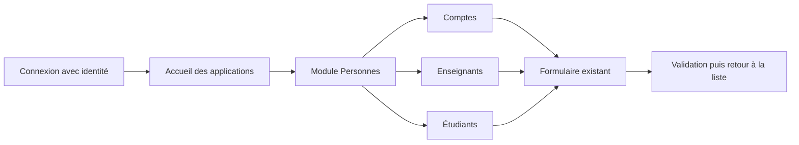
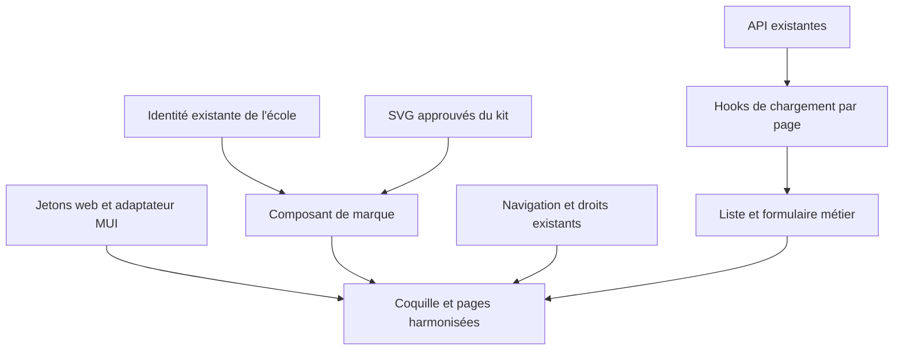

# UIX-06a · Interface de gestion cohérente et dernier logo Planner

| | |
|---|---|
| Module | UIX, première étape de UIX-06 |
| Branche | `feat/uix-06a-interface`, depuis `origin/main` à `6d89f79c` |
| Rédigé par | Codex, le 2026-11-15 |
| **Validé** | **Validé par Claude20022002 le 15 novembre 2026** : réponse « Valider » aux quatre propositions et au plan dans la conversation Codex |
| Chantier | Exception UIX-06a limitée à ce pilote autorisée par le chef le 15 novembre 2026 ; aucun quatrième chantier ouvert |

## 1. Objet et critère de terminé

Le chef demande une application de gestion dans l'esprit d'OpenEduCat, avec le dernier logo Planner. La demande concerne l'application web, comme précisé dans cette conversation, et non le site vitrine.

Le résultat visé est une expérience cohérente de bout en bout pour un premier domaine existant : connexion, accueil des applications, menu du module Personnes, comptes, enseignants et étudiants. Les autres domaines seront repris ensuite selon le même système. Ce lot ne sera pas présenté comme la refonte achevée de toute l'application.

Critères : dernier logo conforme à son kit ; commandes, filtres, listes, formulaires et états de chargement/erreur/vide cohérents ; parcours existants préservés ; aucun débordement à 390 px ; navigation clavier ; clair et sombre ; textes français/anglais. Une personne peut ouvrir Personnes, retrouver un compte, consulter ou modifier les informations existantes, puis revenir aux applications sans explication orale.

## 2. Ce qui existe et les écarts

- UIX-01a est fusionnée (#184, `16b542a1`) : accueil, recherche et navigation contextuelle. Six contrôles verts, 43 parcours réussis après `5a4a6e85`. Le suivi sur la base de cette branche contient encore des états intermédiaires : les rectifier dans ce lot, sans modifier les autres travaux.
- `frontend/src/pages/Applications.jsx` et `components/applications/` constituent le point de départ.
- `components/common/LogoEcole.jsx` affiche l'identité de l'école, sans intégrer l'assemblage du dernier kit Planner.
- `frontend/public/logo.png` représente l'école pilote ; `logo-planner.png` est une ancienne illustration, **pas le dernier logo**.
- Le dernier kit est dans le dépôt marketing voisin, `marketing/brand/logo/kit/`, piste C « mosaïque », palette Récré, validée le 11 novembre. Seuls les fichiers du logo nécessaires au produit seront copiés, pas les documents ou stratégies privés de l'agence.
- `contexts/ThemeContext.jsx` dépasse déjà 300 lignes : toute évolution exige son découpage, pas son agrandissement.
- `pages/gestion/Utilisateurs.jsx`, `Enseignants.jsx` et `Etudiants.jsx` présentent des listes et formulaires existants. Les pages Enseignants et Étudiants sont trop longues : déplacer les composants et le chargement dans leurs dossiers respectifs pendant l'harmonisation, sans changer les règles métier.
- Le socle UIX-01 complet est encore à coder. La migration 0060, l'ouverture de l'école et l'assistant d'installation ne sont pas réalisés par ce lot.

## 3. Questions à trancher

| N° | Question | Proposition | Réponse du chef | Bloque |
|---|---|---|---|---|
| 1 | UIX n'est pas un chantier ouvert et UIX-01a avait une exception limitée. Autoriser UIX-06a hors chantier ? | Oui, exception limitée à cette livraison, sans ouvrir un quatrième chantier | Oui, chef le 15 novembre 2026 | implémentation |
| 2 | Quelles premières pages pour éprouver le système avant de le déployer partout ? | Connexion, accueil/navigation et domaine Personnes : comptes, enseignants, étudiants | Oui, chef le 15 novembre 2026 | périmètre |
| 3 | Comment traiter la dépendance UIX-06 vers UIX-01 ? | Découpler explicitement ce lot visuel sans migration ; garder la dépendance pour l'état en configuration et l'assistant | Oui, chef le 15 novembre 2026 | découpage |
| 4 | Quelle direction visuelle ? | Interface de travail sobre, surfaces claires ou sombres, encre ardoise sans couleurs d'école (N-4), Inter pour l'interface (N-6), bleu nuit réservé à la marque Planner, logo SVG intact ; identité de l'école conservée | Oui, chef le 15 novembre 2026 | apparence |

Le logo ne demande aucune création : le chef a demandé le dernier logo et le kit identifie la piste validée. Si un fichier plus récent existe hors de ce kit, le chef peut le signaler avant l'intégration. Aucune supposition sur des prix, des effectifs ou de nouvelles fonctions.

## 4. Direction et solution

Scène d'usage : une personne de la scolarité travaille sur ordinateur en journée, alterne recherche et correction de fiches ; un enseignant consulte le site sur téléphone entre deux séances. Priorité à la lisibilité, à l'orientation et aux actions courantes.

### 4.1 Marque

Le kit source approuvé fixe les règles :

- Planner générique : `planner-horizontal.svg`, minimum 120 px de largeur ; variante foncée sur surface sombre.
- Dans une école : logo ou nom de l'école, filet, puis `planner-mot.svg` ; capitales PLANNER à 40 % de la hauteur du logo d'école. Pas deux symboles côte à côte.
- Favicon générique : version du kit ; conserver l'identité d'école pour les surfaces qui la personnalisent déjà.
- Les SVG restent intacts, avec leurs proportions et tracés. Petites icônes : variante du symbole prévue sous 32 px.
- Bleu nuit `#1A2A6C` pour la marque de repli. Jaune `#FFC83D`, ciel `#3DB8F5`, rose `#FF7AC6` restent les accents du logo ; pas de texte clair sur ces couleurs sur fond blanc.
- Les couleurs d'état et les couleurs d'école ne sont pas remplacées par celles du logo.

Références lues hors dépôt : `marketing/brand/logo/kit/README.md` et `marketing/brand/logo/01-assemblage-et-pose.md`, validées par le chef le 11 novembre. Le fichier maître du logo n'est pas une image générée.

### 4.2 Structure des écrans



Les listes partagent un en-tête de travail : titre, contexte utile et action principale ; une barre de recherche et filtres distincte ; actions secondaires import/export regroupées ; tableau lisible sur ordinateur et présentation empilée sur téléphone ; pagination et messages de résultat explicites. Les libellés métier et les règles des API restent ceux des écrans existants.

Les formulaires existants sont regroupés par sens (identité, contact, rattachement selon les champs actuels). Ce lot n'ajoute ni onglet Notes ni Frais ni Famille à la fiche étudiant : ces données relèvent des futurs modules. Les captures OpenEduCat inspirent l'organisation, elles ne constituent pas une liste de fonctions déjà disponibles dans Planner.

### 4.3 Schéma de maquette, ordinateur

```text
[marque école | PLANNER]  Applications / Personnes / Étudiants    [outils] [compte]
[menu Personnes]          Étudiants                           [Ajouter]
 Comptes                 [Recherche........................] [année/groupe existants]
 Enseignants             [Importer] [Exporter]
 Étudiants               Nom | Identifiant | Groupe | Actions
                         ... lignes existantes ...
                         Pagination
```

Sur téléphone : titre et action restent en tête ; filtres sur des lignes séparées, sans défilement horizontal ; chaque personne est une ligne compacte avec identité, rattachement et actions explicites. Aucun tableau aplati en texte illisible.

### 4.4 Composants et architecture



Une même source de jetons web décrit surfaces, filets, textes, actions et focus en clair/sombre. Les adaptateurs existants sont découpés, en conservant la compatibilité des écrans qui ne sont pas encore repris. La reprise globale des tableaux de séances à volets n'est pas incluse : leur présentation pourra être traitée dans une livraison distincte, avec ses parcours.

## 5. Fichiers prévus

| Zone | Rôle | Repère |
|---|---|---|
| `frontend/public/marque/` | SVG officiels strictement nécessaires, favicon | fichiers copiés sans modification des tracés |
| `frontend/src/components/common/` | assemblage de marque et états partagés | chaque composant sous 300 lignes |
| `frontend/src/components/applications/` et `pages/Applications.jsx` | accueil fidèle à la nouvelle identité | sous 300 lignes |
| `frontend/src/components/layouts/` et `components/auth/` | navigation, en-têtes et connexion | sous 300 lignes |
| `frontend/src/contexts/ThemeContext.jsx` et modules de thème extraits | adaptateur MUI, jetons et préférences | contexte raccourci |
| `frontend/src/pages/gestion/Utilisateurs.jsx`, `Enseignants.jsx`, `Etudiants.jsx` | pages assemblant les composants et hooks | pages raccourcies |
| dossiers `comptes/`, `enseignants/`, `etudiants/`, hooks et traductions dédiées | listes, formulaires et chargement par responsabilité | sous 300 lignes |
| `frontend/tests/parcours/` | parcours réels, clavier, téléphone et marque | pas de test remplaçant le serveur par une réussite fictive |
| `DESIGN.md`, `docs/plan/`, conception et fiche | documentation cohérente avec la livraison | périmètre UIX uniquement |

Le coordinateur doit être informé de ce périmètre avant le code pour éviter toute collision de mission frontend. Toute extension au backend doit faire l'objet d'une demande distincte.

## 6. Données et migration

Aucune migration, aucune nouvelle table, aucune API. Les hooks utilisent les routes existantes et les filtres déjà supportés. Pas de modification de la base locale de démonstration ou des conteneurs. Aucun champ de futur module affiché avec une valeur fictive.

## 7. Sécurité, isolation et exigences

Les protections de route, le MFA, le mot de passe initial, les contrôles serveur et le filtrage existant par rôle restent effectifs. Ne jamais rendre les données d'une autre classe ou d'une autre école visibles pour simplifier un écran. EP-2 et EP-11 : lisibilité, clavier, contrastes, libellés et traduction. La préparation RTL utilise les propriétés logiques, sans annoncer une traduction arabe complète.

## 8. Vérifications prévues

- Tests de sélection du logo selon identité, surface et petite taille ; variantes réelles du kit et proportions conformes.
- Contrastes des jetons, états de focus et formulaires, clair/sombre.
- Parcours existants de connexion, MFA, rôles, années, étudiants, import et enseignants ; le changement visuel ne masque aucune fonctionnalité existante.
- Parcours de marque et de navigation : Planner sans école ; école avec logo ; école sans logo ; logo inaccessible avec repli lisible.
- Contrôle visuel réel et axe-core sur ordinateur et téléphone, en clair/sombre. Si aucun navigateur ou serveur n'est disponible, inscrire la limite et ne pas déclarer ces critères vérifiés.
- Lint, tests frontend, build, neutralité et CI complète avant fusion.
- Seul le chef lance les commandes des serveurs et pousse la branche.

## 9. Étapes de livraison

1. Cette conception et le suivi « conception à valider », commit documentaire seul.
2. Validation du chef : questions 1 à 4 et plan ; inscrire la date exacte puis commiter la validation avant le code.
3. Intégration des seuls assets approuvés et composant de marque.
4. Jetons et composants de travail ; accueil/navigation/connexion.
5. Reprise des trois pages Personnes, avec régression des parcours existants.
6. Vérifications, relecture coordinateur, fiche, suivi et commits locaux.

La suite du site sera planifiée en livraisons distinctes après ce pilote : référentiel pédagogique, salles/calendrier, puis écrans de planning. Le présent document ne vaut pas autorisation implicite de ces autres lots.

## 10. Risques et retour arrière

- Identité d'une école effacée par la marque produit : couvrir les trois cas de logo et suivre l'assemblage du kit.
- GlobalStyles affectant des pages non reprises : isoler les nouveaux jetons, comparer les parcours et conserver l'adaptateur compatible.
- Extraction de gros fichiers : déplacer une responsabilité à la fois, sans réécrire les règles ou les requêtes pour des raisons esthétiques.
- Faux sentiment de suite ERP achevée : ne présenter que les fonctions réellement disponibles.
- Retour arrière par réversion des commits UIX-06a, sans restauration de base ni migration.

## 11. Hors périmètre

Vitrine commerciale, migration 0060 et assistant d'ouverture, application native, création de modules scolaires, modification des comptes/droits, données réelles, backend, serveurs, publication et génération d'un nouveau logo.

## 12. Vérification de reprise du 15 novembre

- Branche distante à `5ce34dd9` et PR #185 ouverte en brouillon, sans commentaire ni relecture au contrôle.
- Boîte lue : seul message UIX-01a/MOT-02, aucune validation UIX-06a. Message laissé en entrée car sa partie MOT-02 reste à traiter dans sa mission.
- Aucune fiche UIX-06a disponible ; aucun travail concurrent dans les fichiers frontend prévus relevé dans les PR ouvertes consultées. Périmètre communiqué au coordinateur pour confirmation, sans modifier son tableau des missions.
- Question 4 précisée avant validation : le thème neutre conserve l’encre ardoise (N-4 et kit, § 11). Le bleu nuit reste réservé à la marque et ne remplace pas la couleur des commandes sans école. Cette proposition précise le point 4.1 et reste à valider.
- PRODUCT.md et DESIGN.md décrivent encore le contexte historique HESTIM/panneau. Les décisions multi-écoles et le kit approuvé priment ; leur mise à jour ciblée accompagnera le pilote après accord.
- Plan et questions 1 à 4 toujours en attente du chef. Aucun code produit ni asset intégré.

## 13. Validation du chef

Le 15 novembre 2026, après présentation des quatre propositions précisées et du plan, le chef répond « Valider ». Les quatre propositions sont retenues, y compris l’exception limitée, le pilote Personnes, le découplage sans migration et la direction Inter/ardoise avec marque d’école conservée. Les mentions d’attente du § 12 sont le constat historique avant cet accord. Validation consignée et commitée avant toute implémentation.


## 14. Implémentation du pilote

- MarquePlanner et choixMarque assemblent les SVG intacts de frontend/public/marque. LogoEcole n’est pas modifié : les documents imprimés et les surfaces hors pilote gardent leur composant existant.
- ThemeGestion adapte localement la palette MUI, la typographie Inter et les états de focus. Le thème historique est extrait en trois modules de design-system ; ses huit combinaisons famille/mode/langue ont été comparées avant/après et sont identiques. Aucun réglage d’école ou de famille n’est migré.
- Les trois pages assemblent les composants de personnes/ et leurs dossiers comptes/, enseignants/, etudiants/. Les hooks conservent les requêtes et mutations existantes. Le tri et la sélection des comptes restent disponibles sur téléphone ; charges et compétences enseignants, année des groupes, import/export, invitation et MFA sont conservés.
- Les recherches Comptes et Étudiants restent limitées à la page chargée ; cette limite est maintenant annoncée, sans ajouter une API de recherche.
- Les champs reçoivent des libellés accessibles ; les formulaires conservés sont adaptés au thème commun. La soumission est désactivée pendant l’enregistrement des fiches.
- Les nouveaux parcours Personnes utilisent le vrai serveur et le vrai compte de test. Le test réseau négatif interrompt une lecture puis laisse le vrai serveur répondre lors de la nouvelle tentative. Aucune réponse métier de réussite fictive.
- Vérifications locales : unitaires, lint, build, neutralité, comparaison des thèmes et inspection Chromium/axe-core sans serveur. Les montages de composants utilisent uniquement des personnes et écoles fictives ; les contrôles de connexion compilée interrompent les API et ne valident aucune authentification. La recette avec le jeu fictif préparé par les parcours reste à lancer par le chef ou la CI.

## 15. Correction de la régression de reprise réseau

Application des vérifications du plan validé (§ 8), demandée par le coordinateur dans son message du 15 novembre à 23:54 ; aucun changement de produit ou de périmètre.

- Preuve : CI 43775905844 sur df002a8d, 47 parcours réussis, un échoué et un non exécuté. Les snapshots des deux tentatives montrent le tableau rechargé, page 1, dix comptes sur 31.
- Cause : le parcours de reprise réseau attendait le compte administrateur de connexion sur cette première page. L’API trie par id_user décroissant ; la présence de ce compte parmi les dix derniers n’est pas garantie.
- Correction prévue : fixer explicitement la largeur ordinateur du scénario ; armer une attente de réponse GET /api/users?page=1&limit=10 avant le clic Réessayer ; vérifier la réussite de la vraie lecture puis la disparition de l’erreur et l’affichage de tous les comptes de cette réponse. Ni interception de réussite, ni modification de l’API, ni augmentation artificielle du délai.
- Régression : le même parcours couvre l’échec réseau initial puis la récupération, indépendamment de l’identité des comptes sur la page. Vérifier syntaxe et collecte ; relance intégrée par le chef ou la CI, sans démarrer de serveur par l’agent.
