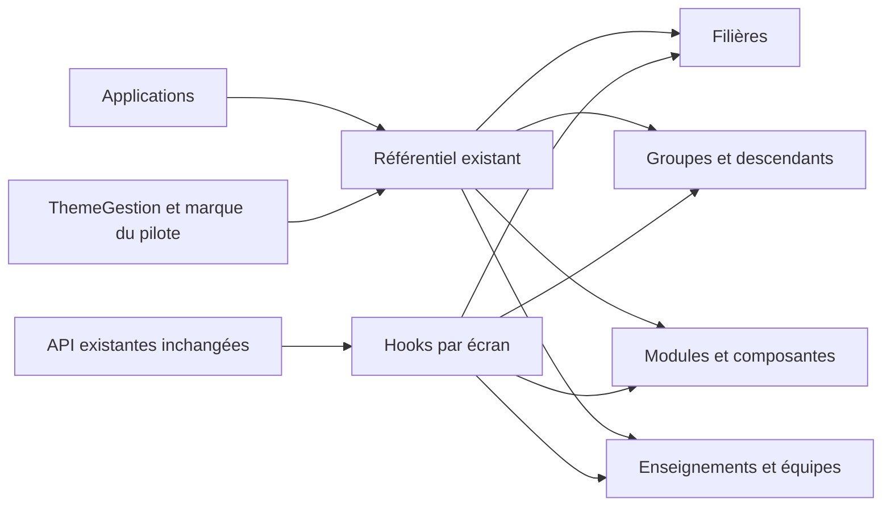

# UIX-06b · Référentiel pédagogique cohérent · conception proposée

| | |
|---|---|
| Module | UIX, suite du style unifié UIX-06 |
| Identifiant | UIX-06b confirmé par le chef le 16 novembre 2026 |
| Branche | feat/uix-06b-referentiel |
| Dossier | ..\travaux-planner\uix-06b-referentiel |
| Base | origin/main, 11329211, fusion de #185 |
| Rédigé par | Codex, le 16 novembre 2026 |
| **Validé** | **Validé par Claude20022002 le 16 novembre 2026** : réponse « J’autorise » aux trois propositions et au plan |
| Chantier | Exception UIX-06b limitée à ce lot autorisée par le chef ; aucun quatrième chantier ouvert |

## 1. Objet et critère de terminé

Le chef demande la suite après le pilote Personnes. Proposition : harmoniser les quatre écrans existants du référentiel pédagogique, sans changer leur modèle de données ni leurs fonctions : Filières, Groupes, Modules/maquette et Enseignements.

Une personne habilitée retrouve sa filière et son année/période, ouvre les groupes et les composantes d’un module, modifie une fiche existante, puis consulte les enseignements à préparer. Les actions existantes restent accessibles sur ordinateur et à 390 px, en français/anglais et clair/sombre ; navigation clavier et contrastes AA vérifiés.

Le résultat ne vaut ni socle UIX-01 complet, ni nouveau vocabulaire scolaire UIX-02, ni refonte de la génération du planning. Les quatre écrans sont un seul lot proposé, avec des étapes techniques internes pour permettre leur relecture.

## 2. Ce qui existe, lu dans le code

UIX-06a est fusionnée : #185, 11329211, six contrôles verts et 49 parcours réussis sur aa2407aa. La clôture documentaire 7dadb412 est encore locale dans l’autre dossier ; elle n’est pas présentée comme fusionnée. La présente branche part de main et actualise seulement les faits UIX nécessaires.

| Écran et route | Fonctions à conserver | Repères |
|---|---|---|
| Filières, /gestion/filieres | Recherche code/nom/partenaire ; création/édition/suppression ; cycles et régimes ; partenaires ; responsables ; import avec bilan par ligne | pages/gestion/Filieres.jsx, 289 lignes ; components/filieres/FiliereDialog.jsx et ResponsablesDialog.jsx |
| Groupes, /gestion/groupes | Filtrage filière/année ; promotions et descendants ; création d’enfant selon le type ; effectif et écart avec la somme des sous-groupes ; avertissement des groupes sans année ; import parent/enfant ; export ; désactivation de comptes réservée à l’admin | pages/gestion/Groupes.jsx, 400 lignes ; components/groupes/GroupeDialog.jsx ; useAnneeChoisie et DesactiverGroupe |
| Modules/maquette, /gestion/cours | Recherche et filtres filière/semestres impairs-pairs ; détails des composantes ; volumes, crédits, responsable, modalités, rythme et salle requise ; création/édition/suppression ; import/export | pages/gestion/Cours.jsx, 331 lignes ; components/cours/LigneModule.jsx, ModuleDialog.jsx, ComposanteDialog.jsx et importerModules.js |
| Enseignements, /gestion/enseignements | Période et filière ; génération depuis la maquette et son bilan ; sélection/mutualisation ; scission ; libellé et heures prévues ; équipe et services ; suppression | pages/gestion/Enseignements.jsx, 403 lignes ; components/planning/EquipeDialog.jsx |

Les routes de App.jsx donnent Filières à l’administration seulement. Groupes, Cours et Enseignements passent par PrivateRoute avec allowResponsable ; utils/droits.js et filieresGerables limitent les filières montrées au responsable. Ces règles restent inchangées.

Le menu appartient à la section existante nav.academic et au catalogue des applications. Aucune nouvelle application ou route n’est nécessaire. Les vocabulaires actuels sont gardés : la future adaptation au profil d’école relève de UIX-02/MOT-05.

Réutilisation du pilote : ThemeGestion, MarquePlanner et jetonsGestion ; entête de travail et champs de recherche. La liste Personnes ne peut pas être appliquée telle quelle : ses clés utilisent id_user et ses messages parlent de personnes. Les groupes et modules ont aussi une structure imbriquée à préserver.

## 3. Questions à valider

| N° | Question | Proposition | Réponse du chef | Bloque |
|---|---|---|---|---|
| 1 | Confirmer le lot UIX-06b et son exception hors chantier ? | Oui, limitée à cette livraison ; ne pas ouvrir un quatrième chantier ni étendre le lot suivant | Oui, chef le 16 novembre | implémentation |
| 2 | Quelles pages et quelles fonctions reprendre ? | Les quatre écrans du § 2, avec leurs rôles, vocabulaire, champs, filtres et actions actuels ; aucune nouvelle fonction métier | Oui, chef le 16 novembre | périmètre |
| 3 | Comment conserver la structure sur téléphone ? | Fiches compactes et détails dépliables : parent explicite pour les groupes, composantes dans leur module, sélection et actions d’équipe accessibles pour les enseignements ; aucune information simplement masquée | Oui, chef le 16 novembre | conception responsive |

Le plan réutilise la direction déjà approuvée du pilote : Inter pour l’interface, ardoise sans couleur d’école, marque d’école prioritaire, SVG mosaïque intact, clair/sombre. Il ne rouvre pas ce choix. Le découplage visuel de UIX-01 est proposé pour ce seul lot, sans migration, assistant ou modification des préférences persistées.

## 4. Solution proposée

Scène d’usage : l’administration prépare une année et sa maquette sur ordinateur en journée ; un responsable vérifie un groupe ou une équipe sur téléphone. Priorité aux listes lisibles, à la filière/période active et aux actions existantes, avec la même grammaire que Personnes.



### Structure commune

Titre et fil d’Ariane existants ; contexte et actions principales ; barre des filtres/recherche présents dans chaque écran ; résultat ou état explicite ; contenu métier ; formulaires et bilans conservés.

Ne pas inventer une recherche, une pagination, un export ou un indicateur absent pour remplir un gabarit. Filières et Modules ont une recherche locale sur la liste complète chargée par fetchAll. Groupes dépend de l’arbre filière/année ; Enseignements de la période/filière. Aucune pagination serveur nouvelle ; les comptages décrivent les résultats effectivement affichés.

### Ordinateur et téléphone

- Filières : liste de travail, code et nom lisibles, cycle/régime/partenaire/responsables accessibles ; action responsables conservée.
- Groupes : hiérarchie explicite promotion → descendants, selon les types existants. Garder le parent visible et les actions d’ajout d’enfant ; limiter l’indentation sur téléphone pour éviter les lignes écrasées.
- Modules : ligne synthétique et composantes dépliables. Sur téléphone, détails en libellé/valeur et commandes locales ; pas de tableau imbriqué plus large que l’écran.
- Enseignements : liste compacte avec groupes, volume, modalité et équipe ; sélection perceptible au clavier comme au toucher ; mutualisation et scission conservées. La génération d’enseignements depuis la maquette reste distincte du solveur de planning.
- Les formulaires gardent leurs champs et validations. Les confirmations, bilans d’import/génération, refus et actions réservées restent visibles.

Maquette de principe, sans données inventées :

```text
Applications / Référentiel / Modules
[Importer existant] [Exporter existant] [Ajouter un module]
[Recherche] [Filière] [Semestres : tous / impairs / pairs]
[Nombre de résultats]
[Module : code, nom, semestre, volume, actions] [Déplier]
  [Composantes : type, volume, groupe visé, modalité, rythme, actions]
```

### Composants et compatibilité

Extraire des outils de gestion réellement communs (entête, recherche, états) sous components/gestion/, en gardant des adaptateurs pour Personnes si ses composants sont déplacés. Une liste commune reçoit une clé explicite, jamais id_user imposé à tous les objets. Garder les rendus métier spécialisés pour les arbres, composantes et équipes ; ne pas transformer ces structures en une liste plate pour réutiliser un composant.

ThemeGestion reste local. Étendre sa couverture aux quatre routes dans DashboardLayout ; ne pas changer les autres pages. Extraction progressive : un hook charge et porte les actions ; une page assemble ; les listes/dialogues restent dans le dossier du domaine. Les fichiers déjà trop longs doivent raccourcir, jamais grossir.

### Chargement et erreurs

Distinguer chargement, échec avec nouvelle tentative, absence réelle de données et absence de correspondance aux filtres. Un échec de chargement des périodes ne doit pas afficher « aucune période » comme s’il s’agissait d’un résultat réussi. Un changement de filière/période ne doit pas laisser une ancienne réponse s’afficher sous le nouveau filtre ; couvrir les changements rapides et la sélection après rechargement. Conserver les bilans de mutation et le focus après fermeture/erreur.

## 5. Périmètre de fichiers proposé

Tous les chemins frontend ci-dessous partent de frontend/src/ ; la liste autorise la présentation, pas un changement métier ou de sécurité.

| Zone | Modification prévue | Taille |
|---|---|---|
| pages/gestion/Filieres.jsx, Groupes.jsx, Cours.jsx, Enseignements.jsx | Pages d’assemblage raccourcies | moins de 300 lignes chacune |
| components/filieres/, groupes/, cours/ | Hooks, listes et formulaires par responsabilité ; composants existants conservés ou extraits | moins de 300 lignes par fichier |
| components/enseignements/ | Chargement, liste, bilan, édition et vue d’équipe extraite | moins de 300 lignes |
| components/planning/EquipeDialog.jsx | Adaptation de présentation seulement si nécessaire ; couvrir ses autres usages | moins de 300 lignes, sans changement de service |
| components/gestion/ et adaptateurs components/personnes/ | Outils communs nommés et états cohérents, rétrocompatibles | moins de 300 lignes |
| components/layouts/DashboardLayout.jsx | Étendre la portée locale du thème aux quatre routes | moins de 300 lignes |
| components/common/ThemeGestion.jsx, design-system/jetonsGestion.js | Ajustement partagé seulement si démontré nécessaire, sans dégrader Personnes | moins de 300 lignes |
| i18n/referentiel.fr.js, referentiel.en.js, index.js | Textes de présentation nouveaux, FR/EN ; réutiliser les clés métier existantes | dictionnaires dédiés |
| frontend/tests/parcours/ et tests unitaires proches des composants | Régressions réelles, roles, états et responsive | fichiers courts |
| DESIGN.md, cette conception, suivi/module UIX et fiche | Décrire le périmètre réellement livré | documentation UIX |

Ne pas modifier App.jsx, les droits, les contrats ou services API pour simplifier la refonte. Tout besoin réel hors de ce périmètre doit être signalé au chef et au coordinateur avant écriture. Les fichiers du référentiel peuvent lire le calendrier, les salles et les enseignants, mais ces autres écrans ne sont pas repris.

## 6. Données et migration

Aucune table, migration, colonne ou API nouvelle. Pas de migration 0060, aucun changement de numéro réservé. Les clés métier, conversions numériques, filtres d’année, règles d’import, validations et payloads existants sont conservés. Aucune donnée réelle ni modification des conteneurs pour la conception.

La nomination d’un responsable est une action existante ayant un effet sur les droits ; seule sa présentation est reprise. Aucun changement de portée ni ajout d’autorisations.

## 7. Sécurité et exigences

Préserver PrivateRoute, allowResponsable et filieresGerables. Ne jamais montrer « toutes les filières » à un responsable si l’écran ne l’autorise pas. La désactivation des comptes d’un groupe reste réservée à l’admin, avec son aperçu/confirmation actuels.

EP-2 : cohérence et navigation sans nouveaux menus ; EP-9 : régression du pilote et de la préparation avant fusion ; EP-11 : FR/EN, clavier, contrastes AA, propriétés CSS logiques et réduction des animations. L’arabe complet et la gestion des comptes mineurs ne sont pas ajoutés.

## 8. Vérifications prévues

- Inventaire avant/après : chaque champ, filtre et action du § 2 reste présent pour le même rôle.
- Parcours existants Cours, Années, Désactivation, Génération et Personnes conservés.
- Nouveaux scénarios réels : filière/responsables ; groupe/descendant et import parent/enfant ; module/composantes et export filtré ; enseignements depuis maquette, bilan, sélection/mutualisation/scission et édition d’équipe. Préparer des objets fictifs propres au test, nettoyer les mutations et respecter les conditions serveur.
- Rôles : administrateur, enseignant responsable, enseignant sans responsabilité et étudiant ; aucun accès ou action étendu. Utiliser les vrais contrôles d’API, sans remplacer un refus par une réussite simulée.
- États : chargement initial, échec et reprise, liste vide, filtre vide, changements rapides de filière/année/période ; ne pas confondre erreur et absence.
- Après reprise réseau : armer l’attente avant le clic, puis comparer les lignes à la vraie réponse et à sa portée. Ne jamais présumer qu’un compte ou objet précis est sur la première page.
- Visuel/axe-core : 390 et 1280 px, clair/sombre et FR/EN ; arbres et composantes dépliés, longs noms, sélections et dialogues ; aucun débordement de page, aucune donnée supprimée au téléphone, focus visible et rendu des champs Inter.
- Lint, unitaires, build et neutralité ; tous les fichiers de code touchés sous les limites. CI complète avant fusion.
- Aucun serveur par l’agent. Si la vérification intégrée exige de démarrer les services, le chef la lance ou la CI l’exécute ; les contrôles isolés ne sont pas présentés comme une recette métier.

## 9. Étapes

1. Cette conception seule, suivi et module : proposition en attente.
2. Relecture de coordination, attribution de l’identifiant et confirmation des collisions ; réponses 1 à 3 et validation explicite du chef ; inscrire et commiter l’accord avant code.
3. Outillage commun compatible et portée du thème ; relecture Personnes.
4. Filières et Groupes ; vérifications d’arbre, années et rôle.
5. Modules/composantes et Enseignements/équipes ; vérifications métier et rôles.
6. Recette, relecture coordinateur, suivi, fiche, commits locaux ; publication et fusion par le chef.

## 10. Risques et retour arrière

Perte de structure sur téléphone : conserver parent/composantes et actions, tester les développements. Collision entre clés de lignes : clés métier explicites. Régression d’un rôle ou d’un import : contrats et tests existants conservés. Course entre filtres et réponses : chargement rattaché à la sélection active. Effet sur Personnes : adaptateurs et parcours du pilote. EquipeDialog est partagé : tester les autres usages si touché.

Retour arrière par réversion des seuls commits UIX-06b, sans restauration de base. Tout besoin de modification métier, droits, contrat ou migration interrompt le lot pour revoir le plan.

## 11. Hors périmètre et coordination

Salles, campus, créneaux, calendrier, planning/solveur, backend, migrations, assistant UIX-01, vocabulaire scolaire UIX-02, notes/frais/familles, mobile natif, serveur et publication. Aucun nouveau module ni nouvelle dépendance.

Aucune fiche UIX-06b ni message dédié trouvé au début de la préparation. PR #187 : dates/PDF/shared ; PR #183 : validation moteur/backend ; aucun chevauchement direct de leurs fichiers produit avec les quatre écrans proposés au contrôle. suivi.md est partagé : modifier seulement les lignes UIX. Le coordinateur reçoit la branche et ce périmètre ; une confirmation reste nécessaire avant implémentation. La préparation ne crée pas de mission ni d’exception à sa place.

## 12. Validation du chef

Le 16 novembre, après présentation du plan et des trois propositions, le chef répond « J’autorise ». Identifiant UIX-06b, exception limitée, quatre écrans à fonctions et droits constants, fiches et détails téléphone sont validés. L’accord est committé avant code. Le coordinateur reçoit la notification et le périmètre ; aucune nouvelle consigne dédiée en entrée au contrôle.
