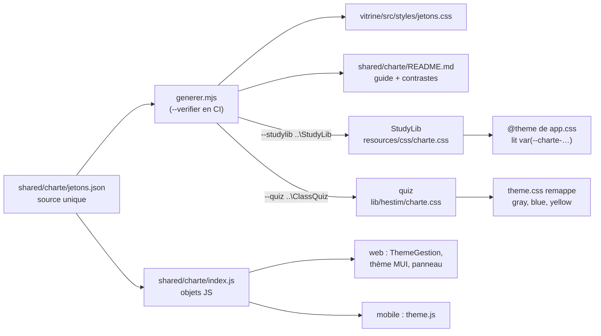
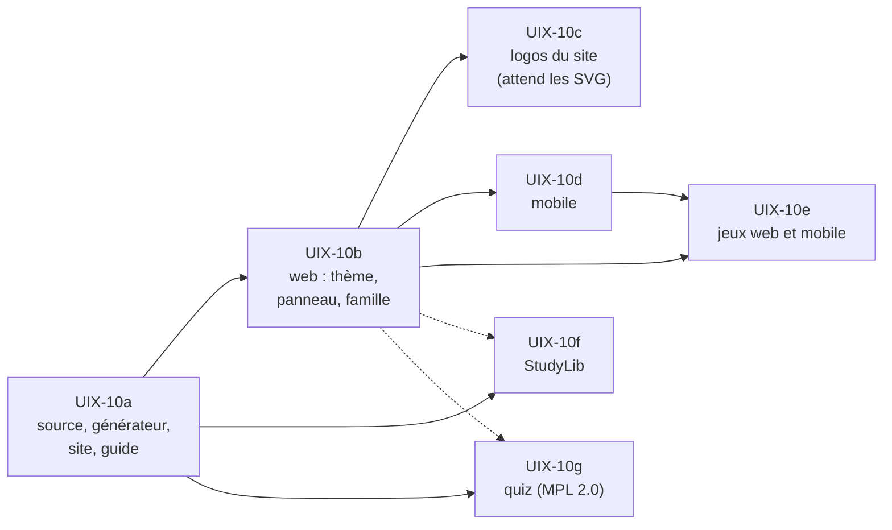

# UIX-10 · Charte commune à toutes les plateformes, d'après le site vitrine · conception

| | |
|---|---|
| Module | [UIX](../../plan/modules/UIX-interface.md) · **exception hors chantier** accordée par le chef le 18 nov., comme UIX-06, sans API ni migration |
| Branche | `doc/uix-10-charte-commune` (ce plan seul), depuis `origin/main` (`57bb122a`) |
| Mission | [uix-10-charte-commune](../../plan/missions/uix-10-charte-commune.md) |
| Taille | L pour l'ensemble ; sept fonctions, de S à M (§ 9) |
| Rédigé par | Claude Code (Opus 5.5), le 18 novembre 2026 |
| **Validé** | en attente (le chef valide : plusieurs dépôts, choix de produit) |

## 1. Objet et critère de « terminé »

Le chef, le 18 nov. : « toutes nos plateformes doivent suivre le style du site vitrine », avec les mêmes couleurs, « charte d'abord ». Les plateformes sont l'application web, le mobile, l'espace des jeux, StudyLib (la bibliothèque) et le quiz.

UIX-10 donne **une seule source de jetons visuels**, tirée du site vitrine : couleurs du logo, Inter, tailles, espaces, rayons, ombres, mouvement. Il fixe aussi **l'ordre** dans lequel chaque plateforme l'adopte.

**Terminé** (pour l'ensemble UIX-10a à UIX-10g) quand :

- les jetons vivent dans un seul fichier, `shared/charte/jetons.json` ; aucune plateforme n'écrit une couleur de la charte à la main ;
- le site, l'application web, le mobile, les jeux, StudyLib et le quiz affichent les mêmes bleus, Inter, les mêmes rayons et le même mouvement ;
- un contrôle de CI échoue si un fichier généré n'est plus à jour, ou si une paire texte et fond de la charte passe sous 4,5:1 (3:1 pour les traits et les composants) ;
- le guide de la charte, en Markdown, est généré depuis la même source ;
- aucune fonction, aucun droit, aucune API, aucune donnée ne change (§ 11).

## 2. Ce qui existe

### Le site vitrine : la référence

[`vitrine/src/styles/jetons.css`](../../../vitrine/src/styles/jetons.css) (54 lignes), écrit à la main le 18 nov. Les valeurs de couleur sont **provisoires** : elles ont été relevées sur les photos des logos, en attendant les SVG du chef ([vit-vitrine.md](../vitrine/vit-vitrine.md), § 4 bis). [`vitrine/tests/jetons.test.js`](../../../vitrine/tests/jetons.test.js) vérifie 15 paires à 4,5:1. Le site n'a **pas de mode sombre**.

| Famille | Jetons du site |
|---|---|
| Couleurs du logo | `bleu-nuit` #0B3B6F · `bleu` #1F65B3 · `bleu-profond` #0E4A8F · `bleu-clair` #A8C8EA · `blanc` #FFFFFF · `encre` #1D1D1F |
| Neutres dérivés | `gris-fond` #F2F5F9 · `gris-texte` #5A6472 · `gris-trait` #D9E0E8 · `bleu-pale` #C9DBEF · `ecran` #0F1A2B |
| Police | `'Inter Variable', system-ui, sans-serif` (`@fontsource-variable/inter` 5.3.0) |
| Titres | géant `clamp(3rem, 2rem + 5vw, 6rem)` · grand `clamp(2.5rem, 1.75rem + 3.5vw, 4.5rem)` · moyen `clamp(1.75rem, 1.4rem + 1.6vw, 2.5rem)` · accroche `clamp(1.1875rem, 1.05rem + 0.6vw, 1.3125rem)` |
| Texte | courant 1.0625rem · petit 0.875rem · interligne titre 1.05, texte 1.5 |
| Espaces | 0.5 · 1 · 1.5 · 2.5 · 4rem ; section `clamp(5rem, 3rem + 8vw, 10rem)` ; gouttière `clamp(1rem, 0.5rem + 2.5vw, 2.5rem)` |
| Largeurs | lecture 44rem · contenu 76rem · en-tête 3.25rem |
| Rayons | petit 0.75rem (12 px) · normal 1.25rem (20 px) · grand 2rem (32 px) · pilule 999px |
| Ombres | carte `0 1px 2px rgb(11 59 111 / 6%), 0 8px 24px rgb(11 59 111 / 8%)` · appareil `0 30px 60px -20px rgb(11 59 111 / 35%)` |
| Mouvement | durée 200ms · courbe `cubic-bezier(0.22, 1, 0.36, 1)` · tout à 0 s si le mouvement réduit est demandé |
| Focus | contour 3px `bleu`, décalé de 3px |

Logos : `vitrine/public/logo/planner-horloge.svg` (variante 1, horizontale) et `planner-icone.svg` (variante 4, icône bleu nuit), **redessinés** d'après les photos, à remplacer par les SVG officiels.

### L'écart de chaque plateforme

| Plateforme | Où | Ce qui est en place | Écart avec la charte |
|---|---|---|---|
| **Web, socle historique** | [`shared/design-tokens.json`](../../../shared/design-tokens.json), [`frontend/src/design-system/tokens.js`](../../../frontend/src/design-system/tokens.js) (`ds`), `themeHistorique.js`, `themeHistoriqueMUI.js` | marine du logo de l'école pilote #001861 et orange #F26322 comme couleurs « livrées » ; sol « bureau » #F3F4F7 ; Barlow et Barlow Condensed ; rayons 2 à 6 px ; mouvement 0,12 à 0,28 s, courbe `[0.16, 1, 0.3, 1]` | tout : couleurs, police, rayons (6 px contre 12 à 32), courbe. `ds.font.board` est lu par **50 fichiers**, `ds.*` par 74 ; 11 fichiers `.jsx` ont des couleurs en dur |
| **Web, gestion (UIX-06a, UIX-06b)** | [`jetonsGestion.js`](../../../frontend/src/design-system/jetonsGestion.js), [`ThemeGestion.jsx`](../../../frontend/src/components/common/ThemeGestion.jsx) (connexion et pages du pilote) | Inter ; surfaces ardoise #F6F7F9 / #141B25 ; texte #202C3D ; action ardoise #334155, remplacée par la couleur de l'école ; focus #1D4ED8 ; rayons 6 à 8 px | le plus proche : Inter, sobre. Les gris sont ardoise et non bleutés ; le focus est le bleu de Tailwind ; rayons trop petits ; pas de bleu de la charte en repli |
| **Web, thème « StudyLib »** | `themeHistorique.js` (`STUDYLIB`), `ThemeContext.jsx`, `parametres/Apparence.jsx` | seconde famille de thème au choix : Inter, bleu #1D4ED8, gris ardoise | disparaît (réponse 5) |
| **Marque dans l'application** | `frontend/public/marque/` (kit mosaïque du 11 nov.), `MarquePlanner`, `choixMarque.test.js` | logo mosaïque, bleu nuit #1A2A6C, jaune #FFC83D, ciel #3DB8F5, rose #FF7AC6 | remplacée par les logos du site (réponse 1) |
| **Panneau des départs** | `frontend/src/design-system/board/` (8 fichiers, `DepartureBoard.jsx` 421 lignes), `shared/design-tokens.json` (`board`) | fond noir mat #0B0B0D, cases #212124, lettres #F2F1EC, Barlow Condensed en capitales espacées | forme gardée, couleurs et police de la charte (réponse 4) |
| **Mobile** | [`mobile/src/theme.js`](../../../mobile/src/theme.js) (242 lignes), `marque.js` | quatre thèmes : `planner-sombre` (panneau noir), `planner-clair` (bureau), `studylib-clair`, `studylib-sombre` ; Barlow et Inter par `@expo-google-fonts` ; 47 fichiers lisent le thème ; 6 ont des couleurs en dur | deux thèmes restent (clair, sombre) ; Barlow retirée ; couleurs de la charte |
| **Jeux** | web : `pages/jeux/` (8), `components/jeux/` (16) ; mobile : `src/jeux/` (7) ; scène Kenney teintée en marine | panneau noir, `ds.font.board`, terminal en chasse fixe, scène #001861 / #24397F | accent « jeu » jaune (réponse 2), scène aux bleus de la charte |
| **StudyLib** (`..\StudyLib`, Laravel, Tailwind 4, branche `main`) | `resources/css/app.css` (`@theme`, 2 678 lignes), 6 autres feuilles (2 642 lignes) | Inter (police de Bunny, téléchargée à la construction) ; bleu #1D4ED8 ; ardoise #0F172A à #F8FAFC ; rayons 10 à 24 px ; ombres ; courbe `(0.4, 0, 0.2, 1)` ; **pas de sombre** ; **182 couleurs en dur, 64 distinctes**, dans les feuilles et les vues | même structure que la charte (Inter, rayons arrondis) : on remplace les valeurs de `@theme`, puis les couleurs en dur |
| **Quiz** (`..\ClassQuiz`, fork MPL 2.0, SvelteKit et Tailwind 4, branche `hestim`) | `frontend/src/lib/hestim/theme.css` (132 lignes), `app.css`, `app.html`, `Marque.svelte` | une seule couche de thème : les palettes Tailwind (`gray`, `slate`, `blue`, `green-600`) sont remappées sur les jetons du panneau ; Barlow chargée **depuis Google Fonts** ; sombre par classe | la bonne architecture est déjà là : on remplace les valeurs de `theme.css`. Barlow passe à Inter hébergée par le quiz |

Ce qui gêne :

- **Deux palettes « par défaut »** : #001861 (couleurs livrées, celles de l'école pilote) et #1A2A6C (mosaïque), et aucune n'est celle du site.
- **Les couleurs livrées sont celles de l'école pilote.** Elle n'en dépend pas : la migration 0055 a écrit #001861 et #F26322 dans ses réglages. Changer les couleurs livrées ne la change donc pas, mais `appliquerMarque` (web et mobile) compare aux couleurs livrées pour garder des nuances réglées à la main : ce test est à revoir (§ 4.4).
- **Trois formats** pour une même idée : JSON (`shared`), objets JS (`ds`, `theme.js`), CSS (`@theme` de Tailwind, variables du site).

## 3. Questions et réponses

Posées le 18 nov. ; le chef a retenu chaque proposition.

| N° | Question | Proposition | Réponse du chef | Bloque |
|---|---|---|---|---|
| 1 | Logo des applications : la mosaïque, ou les logos du site ? | logos du site partout ; la mosaïque quitte l'application dès que les SVG officiels arrivent, pas avant ; icône et favicon : variante 4 | **logos du site partout**, 18 nov. | UIX-10c |
| 2 | Les jeux et le quiz gardent-ils une couleur propre ? | un seul accent « jeu », le jaune #FFC83D de la mosaïque : podium, bouton « Jouer », célébrations ; jamais en texte sur blanc ; texte bleu nuit dessus | **un seul accent « jeu »**, 18 nov. | UIX-10e, 10g |
| 3 | Un guide de style consultable, et où ? | une page Markdown générée depuis la source, dans le dépôt ; rien en ligne | **Markdown généré dans le dépôt**, 18 nov. | UIX-10a |
| 4 | Que devient le panneau des départs ? | garder la forme (volets, cascade) pour les séances en direct et l'écran du hall ; fond « écran », cadre bleu nuit, Inter à chiffres tabulaires ; Barlow retirée partout | **garder la forme, aux couleurs de la charte**, 18 nov. | UIX-10b |
| 5 | Le choix de famille de thème (Planner ou StudyLib) ? | le retirer ; garder clair, sombre et automatique ; une préférence « studylib » retenue est ignorée | **retirer le choix**, 18 nov. | UIX-10b, 10d |
| 6 | Comment StudyLib et le quiz reçoivent-ils les jetons ? | un script de Planner écrit `charte.css` dans les dépôts voisins, avec version et empreinte ; chaque dépôt le commite ; un test vérifie l'empreinte | **fichier généré, commité, contrôlé**, 18 nov. | UIX-10a |
| 7 | Le mode sombre ? | un sombre dérivé pour l'application, le mobile, les jeux et le quiz ; le site et StudyLib restent clairs pour l'instant | **sombre dérivé, sauf site et StudyLib**, 18 nov. | UIX-10a |
| 8 | Les couleurs de l'école (D-21) ? | l'école reste prioritaire dans l'application ; la charte sert de repli : bleu nuit, et un accent dérivé « bleu vif » #3B82D6 ; StudyLib et le quiz : charte seule | **école prioritaire, charte en repli**, 18 nov. | UIX-10b |
| 9 | En-tête de licence du fichier généré pour le quiz | le générateur recopie les lignes SPDX du fichier voisin `theme.css` du fork ; aucun nom d'école n'est écrit dans Planner (dépôt public, `verifier-neutre`) | à confirmer avec ce plan | UIX-10g |
| 10 | Police du quiz | Inter servie par le quiz lui-même (`@fontsource-variable/inter` 5.3.0, la version du site), au lieu de Barlow chargée depuis Google Fonts : une dépendance de plus dans le fork, une requête vers Google en moins | à confirmer avec ce plan | UIX-10g |

La décision du 18 nov. sur UIX-09 tient en partie : les tuiles de la grille gardent leurs icônes Lucide, et la variante 4 n'y apparaît pas. Seule change sa seconde moitié : l'en-tête de l'application ne garde plus la mosaïque (réponse 1).

## 4. Solution

### 4.1 Le principe

Une source, un générateur, des sorties commitées :

- **Source** : `shared/charte/jetons.json`. Il contient les jetons du site, le sombre dérivé, l'accent « jeu », et ce qui vit déjà dans `shared/design-tokens.json` : statuts, couleurs de ligne des filières, panneau. Chaque couleur porte son rôle.
- **Générateur** : `shared/charte/generer.mjs`, en Node seul, sans dépendance. Il écrit les sorties ; avec `--verifier`, il ne les écrit pas, il dit lesquelles diffèrent et sort en erreur.
- **Sorties dans Planner** : `vitrine/src/styles/jetons.css` (le fichier d'aujourd'hui devient généré), et `shared/charte/README.md`, le guide (réponse 3).
- **Lecture directe en JS** : l'application web et le mobile importent `shared/charte/index.js`, comme ils importent déjà `shared/tokens.js`. Le thème MUI et les thèmes du mobile se construisent depuis ces objets ; on ne génère pas de fichier JS.
- **Sorties dans les dépôts voisins** : `--studylib <chemin>` écrit `resources/css/charte.css` ; `--quiz <chemin>` écrit `frontend/src/lib/hestim/charte.css`. Chaque fichier commence par un en-tête : « généré par Planner, shared/charte, version N, empreinte S ; ne pas modifier ». Chaque dépôt garde un petit test qui recalcule l'empreinte du corps du fichier : une retouche à la main le fait échouer.

### 4.2 Les jetons

Les noms gardent ceux du site : le site ne change pas de nom de variable. Les valeurs de couleur restent **provisoires** jusqu'aux SVG officiels ; elles ne changent qu'en un endroit, et la CI revérifie chaque paire.

**Clair** (le site, à l'identique) : `bleu-nuit`, `bleu`, `bleu-profond`, `bleu-clair`, `blanc`, `encre`, `gris-fond`, `gris-texte`, `gris-trait`, `bleu-pale`, `ecran`.

**Ajoutés pour les applications** (dérivés, sans teinte nouvelle) :

| Jeton | Valeur | Rôle | Contraste vérifié |
|---|---|---|---|
| `trait-fort` | #7D8A9C | bord des champs et des commandes (WCAG 1.4.11) ; `gris-trait` ne sert qu'aux filets décoratifs (1,3:1 sur blanc) | 3,51 sur blanc · 3,21 sur `gris-fond` · 4,98 sur `ecran` · 4,49 sur `surface-sombre` |
| `bleu-vif` | #3B82D6 | accent de repli d'une école sans couleurs (D-21 exige 3:1 sur blanc **et** sur le panneau) | 3,93 sur blanc · 4,45 sur `ecran` · 5,01 sur #0B0B0D |
| `jeu` | #FFC83D | accent des jeux et du quiz (réponse 2) : fonds de mise en avant, jamais du texte sur blanc | `bleu-nuit` dessus 7,27 · sur `ecran` 11,29 |

**Sombre dérivé** (réponse 7 ; web, mobile, jeux, quiz) :

| Jeton | Valeur | Contraste vérifié |
|---|---|---|
| `fond` = `ecran` | #0F1A2B | — |
| `surface-sombre` | #172338 | — |
| `texte-sombre` | #EDF1F7 | 15,40 sur `ecran` · 13,89 sur surface |
| `texte-sombre-second` | #A9B6C8 | 8,49 · 7,66 |
| action : `bleu-clair` | #A8C8EA, texte `ecran` dessus | 10,07 (texte sur action) · 9,08 (action sur surface) |
| `focus-sombre` | #7FB0E6 | 7,69 · 6,94 |

**Statuts et lignes** : les couleurs d'état et de ligne des filières **ne prennent pas** les couleurs du logo (règle d'UIX-06a). Elles passent dans la source telles quelles (confirmé #137D3F 5,21:1, reporté #B4410C 5,67:1, annulé #B5161C 6,78:1 sur blanc ; sur `ecran` : 8,32, 5,47 et 5,72).

**Paire à éviter**, relevée au calcul : `bleu` sur `bleu-pale` donne 4,16:1. Le générateur refuse une paire déclarée sous le seuil ; le guide la liste comme interdite.

**Typographie** : une seule famille, `'Inter Variable', Inter, system-ui, sans-serif`. Le premier nom sert au site, le second aux paquets d'Inter non variable déjà installés dans le web et le mobile. L'échelle des titres du site (avec `clamp`) sert aux pages publiques et aux accueils. Les écrans de gestion gardent une échelle fixe, plus serrée : 1.75 / 1.375 / 1.125rem, comme aujourd'hui. Le panneau, les heures et les scores utilisent les chiffres tabulaires (`font-variant-numeric: tabular-nums`). Le terminal des jeux garde la chasse fixe.

**Rayons** : ceux du site (12, 20, 32 px, pilule). La gestion dense ajoute `rayon-commande` à 8 px pour les champs, les boutons et les puces : 20 px sur une ligne de tableau serait déplacé. C'est le seul ajout.

**Ombres et mouvement** : ceux du site. Pour Motion (web) et Reanimated (mobile), la courbe est aussi donnée en tableau `[0.22, 1, 0.36, 1]`. Les trois durées d'aujourd'hui (rapide, normale, lente) deviennent 120, 200 et 320ms ; la durée du site, 200ms, est la normale. La cascade des volets garde 28ms par caractère.

### 4.3 Le panneau des départs (réponse 4)

Forme gardée : volets, cascade, lignes. Valeurs nouvelles : fond `ecran` #0F1A2B (au lieu du noir #0B0B0D), cases `surface-sombre`, cadre `bleu-nuit` ou couleur de l'école, lettres `texte-sombre`, Inter 600 en capitales à chiffres tabulaires, au lieu de Barlow Condensed. Les lampes de statut gardent leurs couleurs. Le panneau reste sombre en thème clair, comme dans un hall.

### 4.4 Couleurs de l'école (réponse 8)

Rien ne change pour une école qui a des couleurs : `nuancesMarque` et `verifierCouleur` (`shared/couleurs.js`) restent. Changent :

- les couleurs **livrées** (repli d'une école sans couleurs) deviennent `bleu-nuit` et `bleu-vif` ;
- `FOND_PANNEAU` devient `ecran` : le contrôle de l'accent se fait sur le nouveau fond du panneau. Une école dont l'accent passait sur #0B0B0D peut passer sous 3:1 sur #0F1A2B. Le contrôle le montre à l'enregistrement suivant ; à l'affichage, rien ne casse, le repli s'applique ;
- le test « mêmes couleurs que les livrées » de `appliquerMarque` (web et mobile) disparaît : les nuances se calculent toujours, il n'y a plus de valeurs réglées à la main.

L'école pilote garde son #001861 et son #F26322 par ses réglages enregistrés (migration 0055) : son application reste à ses couleurs, sur les surfaces, la police et les rayons de la charte.

### 4.5 L'adoption, plateforme par plateforme

Ordre fixé par le chef : la charte, puis le web (suite d'UIX-06), puis le mobile et les jeux, puis StudyLib et le quiz.

Les traits pointillés marquent l'ordre voulu par le chef, et non une dépendance technique : StudyLib et le quiz n'ont besoin que d'UIX-10a.

## 5. Fichiers créés ou modifiés

Par fonction. Chaque fonction écrit son plan court avant le code ; les listes ci-dessous en sont le point de départ.

| Fonction | Fichier | Créé / modifié | Rôle | Taille visée |
|---|---|---|---|---|
| 10a | `shared/charte/jetons.json` | créé | la source | ~150 lignes |
| 10a | `shared/charte/index.js` | créé | objets JS lus par le web et le mobile | < 80 |
| 10a | `shared/charte/generer.mjs` | créé | sorties CSS, guide, `--verifier`, `--studylib`, `--quiz` | < 250 |
| 10a | `shared/charte/contraste.mjs` | créé | paires déclarées et seuils (réutilise `shared/couleurs.js`) | < 80 |
| 10a | `shared/charte/README.md` | généré | le guide (réponse 3) | — |
| 10a | `shared/charte/charte.test.js` | créé | chaque paire au seuil ; sorties à jour | < 120 |
| 10a | `vitrine/src/styles/jetons.css` | généré (aujourd'hui écrit à la main) | mêmes noms, mêmes valeurs | — |
| 10a | `.github/workflows/ci-cd.yml`, `vitrine.yml` | modifiés | `generer.mjs --verifier` ; `shared/charte/**` déclenche le site | + 5 lignes |
| 10b | `shared/design-tokens.json`, `shared/tokens.js` | modifiés, puis retirés en fin de 10e | relais vers `shared/charte` le temps de la bascule | — |
| 10b | `shared/couleurs.js` | modifié | `FOND_PANNEAU` et couleurs livrées tirés de la charte | inchangée |
| 10b | `frontend/src/design-system/tokens.js`, `jetonsGestion.js`, `themeHistorique.js`, `themeHistoriqueMUI.js`, `marque.js` | modifiés | lisent `shared/charte` ; `STUDYLIB` et `flapLabelPlanner` retirés | chacun plus court |
| 10b | `frontend/src/components/common/ThemeGestion.jsx` | modifié | rayons, focus et ombres de la charte | ≤ 60 |
| 10b | `frontend/src/design-system/board/*` | modifiés | Inter, chiffres tabulaires, fond `ecran` | `DepartureBoard.jsx` ne grossit pas (421) |
| 10b | `frontend/src/contexts/ThemeContext.jsx`, `components/parametres/Apparence.jsx` | modifiés | choix de famille retiré | plus courts |
| 10b | `frontend/src/main.jsx`, `index.css`, `frontend/package.json` | modifiés | Barlow retirée ; `@fontsource/barlow*` retirés | — |
| 10b | les 50 fichiers qui lisent `ds.font.board` | modifiés | `ds.font.board` pointe vers Inter, en capitales : aucun écran à reprendre un par un, sauf les 11 fichiers aux couleurs en dur | — |
| 10c | `frontend/public/marque/`, `MarquePlanner`, `choixMarque.test.js`, `mobile/assets/` (icône, écran de lancement) | modifiés | logos officiels, variantes 1 et 4 | — |
| 10d | `mobile/src/theme.js`, `mobile/src/marque.js`, chargement des polices, `mobile/package.json` | modifiés | deux thèmes (clair, sombre) ; préférence de famille ignorée ; `@expo-google-fonts/barlow*` retirés | `theme.js` < 160 |
| 10e | `frontend/src/components/jeux/*`, `pages/jeux/*`, `mobile/src/jeux/*` | modifiés | accent `jeu`, scène aux bleus de la charte, nuage de mots | — |
| 10f | `..\StudyLib\resources\css\charte.css` | généré | variables `--charte-*` | — |
| 10f | `..\StudyLib\resources\css\app.css` (`@theme`) et les 6 autres feuilles, les vues aux couleurs en dur | modifiés | `@theme` lit `var(--charte-…)` ; les 64 couleurs en dur ramenées aux jetons | — |
| 10f | `..\StudyLib\tests\…\CharteTest.php` | créé | empreinte de `charte.css` | — |
| 10g | `..\ClassQuiz\frontend\src\lib\hestim\charte.css` | généré, en-tête SPDX MPL 2.0 (question 9) | variables `--charte-*` | — |
| 10g | `..\ClassQuiz\frontend\src\lib\hestim\theme.css`, `Marque.svelte`, `app.css`, `app.html`, `package.json` | modifiés | palettes remappées sur la charte ; Inter servie par le quiz (question 10) ; logo | — |
| 10g | `..\ClassQuiz\FORK.md` | modifié | `charte.css` ajouté aux fichiers propres du fork | — |

## 6. Données et migration

Aucune table, aucune migration, aucune route. Les couleurs de l'école restent dans `ConfigurationEtablissement`, telles quelles. Deux préférences d'appareil deviennent inutiles : `themeFamille` (navigateur) et `famille` dans `hestim.theme` (téléphone). Elles sont **ignorées**, pas effacées ; le mode clair, sombre ou automatique est gardé.

## 7. Sécurité, isolation et exigences produit

- Aucun canal d'isolation touché ; aucun droit changé.
- **EP-2** (interface sobre, axe-core sans violation) : chaque fonction garde axe-core vert en clair et en sombre. Les contrastes sont garantis à la source (§ 4.2), et non retrouvés écran par écran.
- **EP-3** (mobile rapide) : une police de moins à charger (Barlow retirée).
- **Dépôt public** : le générateur n'écrit aucun nom d'école dans Planner ; l'en-tête SPDX du quiz est recopié depuis le fork (question 9). `scripts/verifier-neutre.mjs` passe sur `shared/charte/`.
- **Licence du quiz** : les fichiers du fork modifiés restent sous MPL 2.0, avec leurs avis d'origine. `charte.css` est un fichier nouveau du fork : il porte l'en-tête SPDX que demande `FORK.md`, règle 2. La mention du fork et du projet d'origine reste dans `FORK.md` et le README. La licence ne s'étend pas à Planner : le générateur et `jetons.json` restent à Planner.
- **Aucune requête nouvelle vers un tiers** ; le quiz en perd une (Google Fonts).
- **Rien en ligne** : le guide est un fichier du dépôt.

## 8. Tests

- **10a** : `charte.test.js`. Chaque paire déclarée est au seuil, en clair et en sombre ; une paire sous le seuil est refusée ; `--verifier` échoue sur une sortie modifiée à la main ; le jeton `vitrine/jetons.css` généré est identique, valeur pour valeur, à celui d'aujourd'hui. Les tests du site (`jetons.test.js`) restent verts sans changement.
- **10b** : `jetonsGestion.test.js` et les tests de `shared/couleurs.js` adaptés au nouveau fond du panneau. Un test vérifie qu'une préférence `themeFamille = studylib` donne le thème de la charte. Les parcours existants tournent en CI : axe-core, clair et sombre, 390 et 1440 px. On ne les lance pas en local en même temps que la suite.
- **10c** : `choixMarque.test.js` sur les empreintes des SVG officiels ; les trois cas de logo d'UIX-06a (sans école, école avec logo, sans logo).
- **10d** : tests Jest de `theme.js` (deux thèmes, contrastes, préférence ancienne) ; export Android vérifié.
- **10e** : contraste de l'accent `jeu` dans ses seuls usages permis ; parcours des jeux en CI.
- **10f** : `CharteTest.php` (empreinte) ; tests PHPUnit existants ; construction Vite de StudyLib.
- **10g** : test d'empreinte de `charte.css` ; tests du quiz existants ; construction du site du quiz ; contrôle REUSE et SPDX s'il existe.

## 9. Étapes de livraison

Chaque fonction a sa branche, son plan court validé et sa PR. Les tailles sont brutes, avant conception.

| Fonction | Contenu | Taille | Dépend de | Plan validé par |
|---|---|---|---|---|
| **UIX-10a** | source, générateur, contrôle de CI, `jetons.css` du site généré, guide Markdown | M | ce plan | coordinateur (S/M, ni migration ni sécurité) |
| **UIX-10b** | web : `ds`, gestion, thème MUI, panneau, Barlow retirée, choix de famille retiré, couleurs livrées | M (L si le panneau résiste ; alors 10b1 thème, 10b2 panneau) | 10a ; #199 (UIX-06b) et UIX-09 fusionnées | chef (choix de produit visible de tous) |
| **UIX-10c** | logos du site dans le web et le mobile : en-tête (variante 1 et mot), icône et favicon (variante 4) | S | 10b ; **SVG officiels du chef** | coordinateur |
| **UIX-10d** | mobile : deux thèmes, Barlow retirée, préférence ancienne ignorée | M | 10b | coordinateur |
| **UIX-10e** | jeux, web et mobile : accent `jeu`, scène, panneau des jeux | S | 10b, 10d | coordinateur |
| **UIX-10f** | StudyLib, dans son dépôt | M | 10a | chef (autre dépôt) |
| **UIX-10g** | quiz, dans le fork, sous MPL 2.0 | M | 10a | chef (autre dépôt, licence) |

1. Ce plan, commité seul ; validé par le chef.
2. UIX-10a.
3. UIX-10b, après #199 et UIX-09. Le coordinateur règle l'ordre avec UIX-06c : 06c lit `ThemeGestion` sans le modifier ; si elle doit le modifier, 10b passe d'abord.
4. UIX-10c dès les SVG ; UIX-10d ; UIX-10e.
5. UIX-10f et UIX-10g ; à la fin, `shared/design-tokens.json` et `shared/tokens.js` sont retirés, dans la dernière PR de Planner qui les lit encore.

## 10. Risques et retour arrière

- **Couleurs provisoires** : les SVG officiels peuvent changer les bleus. Le changement se fait en une ligne de `jetons.json` ; la CI revérifie les paires et `--verifier` signale les dépôts voisins à régénérer.
- **Parcours rouges en masse** (leçon de #199) : 10b change l'apparence de tous les écrans. On ne déclare pas 10b prête sans parcours exécutés ; les copies d'écran attendues, s'il y en a, se régénèrent dans la même PR.
- **Accent d'école sous 3:1 sur le nouveau fond du panneau** : le contrôle existant l'affiche ; l'école choisit une autre teinte. Rien d'illisible à l'affichage.
- **Fichier généré retouché à la main dans un dépôt voisin** : le test d'empreinte échoue.
- **Retour arrière** : chaque fonction est une PR sans migration ; on la défait par `git revert`. 10a seule ne change rien à l'écran (le `jetons.css` généré est identique).

## 11. Hors périmètre

- Fonctions, droits, API, données, textes : rien ne change.
- Le site vitrine : il ne change ni de valeur ni de nom de variable ; sa mise en ligne relève de VIT-06.
- Le mode sombre du site et de StudyLib (réponse 7).
- Les documents imprimés (EDT du mois au format de l'école, `ds.document`) : ils gardent les couleurs du papier de l'école.
- La création des logos : les SVG sont fournis par le chef.
- Le nom « HESTIM » dans le fork du quiz (dossier `lib/hestim/`, en-têtes SPDX) : un autre sujet, pour le chef.
- L'arabe (UIX-04) : les propriétés logiques restent la règle.
