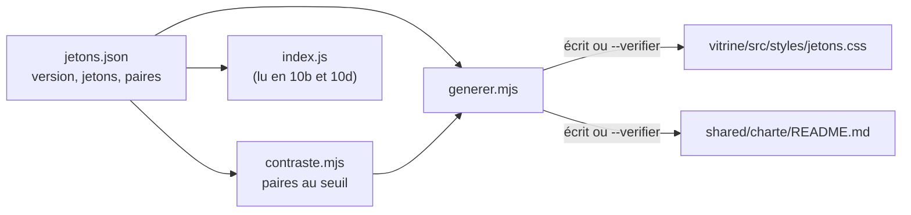

# UIX-10a · Source de la charte, générateur et guide · conception (plan court)

| | |
|---|---|
| Module | [UIX](../../plan/modules/UIX-interface.md) · **exception hors chantier** accordée par le chef le 18 nov. (UIX-10), sans API ni migration |
| Plan d'ensemble | [UIX-10](uix-10-charte-commune.md), validé par le chef le 18 nov. ; ce plan court en détaille la première fonction (§ 9) |
| Branche | `feat/uix-10a-source-charte`, empilée sur `doc/uix-10-charte-commune` (#206, non fusionnée) |
| Mission | [uix-10a-source-charte](../../plan/missions/uix-10a-source-charte.md) (branche `doc/coordination-equipe`), écrite après le début du plan ; le dossier de travail est `..\travaux-planner\uix-10a-source-charte`, créé avant la fiche, et non `uix-10a-charte` |
| Taille | M |
| Rédigé par | Claude Code (Opus 5.5), le 18 novembre 2026 |
| **Validé** | en attente · par le coordinateur (taille M, ni migration ni sécurité, § 9 du plan d'ensemble) |

## 1. Objet et critère de « terminé »

Poser la source unique des jetons visuels et son générateur, sans rien changer à l'écran. **Terminé** quand :

- `shared/charte/jetons.json` contient les jetons du site, le sombre dérivé et les trois ajouts (`trait-fort`, `bleu-vif`, `jeu`), avec leur rôle et les paires de contraste déclarées ;
- `vitrine/src/styles/jetons.css` est **généré** : mêmes noms, mêmes valeurs, à une exception près, la police (réponse 5) ;
- `shared/charte/README.md`, le guide, est généré depuis la même source : jetons, rôles, contrastes, paires interdites ;
- `node shared/charte/generer.mjs --verifier` sort en erreur si une sortie n'est plus à jour, ou si une paire déclarée passe sous son seuil ; la CI le lance à chaque PR ;
- `shared/charte/index.js` expose les jetons au web et au mobile, mais **aucun écran ne le lit encore** (UIX-10b) ;
- les tests du site (`vitrine/tests/*.test.js`) restent verts sans changement.

## 2. Ce qui existe

- [`vitrine/src/styles/jetons.css`](../../../vitrine/src/styles/jetons.css) (54 lignes, écrit à la main) : 11 couleurs, 9 de typographie, 10 d'espaces et de largeurs, 6 de rayons et d'ombres, 2 de mouvement. Le site le charge depuis `Gabarit.astro`. Le mouvement réduit est traité dans `base.css`, pas par un jeton.
- [`vitrine/tests/jetons.test.js`](../../../vitrine/tests/jetons.test.js) lit `jetons.css` par une expression (`--nom: #RRGGBB`) et vérifie 15 paires à 4,5:1.
- [`shared/couleurs.js`](../../../shared/couleurs.js) exporte `luminance` et `contraste` (WCAG 2.2). `contraste` **arrondit au centième** : une paire à 4,495 y passerait pour 4,5.
- `shared/tokens.js` importe `design-tokens.json` par un import simple : Vite, Metro et Jest l'acceptent, Node 22 le refuse sans `with { type: 'json' }`.
- CI : `vitrine.yml` (déclenché par `vitrine/**`) lance `npm run test:unit` du site ; dans `ci-cd.yml`, **aucune tâche ne lance les tests de `shared/`**, ni les tests `node --test` du frontend (`jetonsGestion.test.js` ne tourne qu'en local).
- `scripts/verifier-neutre.mjs` parcourt `shared/` (fichiers `.js` et `.mjs`).

## 3. Questions et réponses

Posées au chef le 18 nov., dans la session ; chaque proposition retenue.

| N° | Question | Réponse du chef |
|---|---|---|
| 1 | Comment `index.js` lit-il `jetons.json` ? | **import simple**, comme `shared/tokens.js` ; le test lit le JSON par `fs` et n'importe pas `index.js` |
| 2 | Quand entrent les statuts, les lignes des filières et le panneau ? | **en 10b**, quand `design-tokens.json` devient un relais : jamais deux copies actives |
| 3 | D'où viennent la version et l'empreinte de l'en-tête ? | **`version` entière** dans `jetons.json`, augmentée à la main quand une valeur change ; **empreinte** SHA-256 du corps généré (`node:crypto`), 12 caractères |
| 4 | Où tournent `--verifier` et les tests en CI ? | **tâche « Build Frontend »** de `ci-cd.yml` (deux étapes) ; `shared/charte/**` déclenche aussi `vitrine.yml` |
| 5 | La police du site : valeur commune ou valeur à part ? | **valeur commune** `'Inter Variable', Inter, system-ui, sans-serif` ; `Inter` s'ajoute en repli au site, sans effet visible ; seule différence admise avec le fichier d'aujourd'hui |
| 6 | Les sorties `--studylib` et `--quiz` ? | **en 10f et 10g** : chacune ajoute sa sortie à la table du générateur après avoir lu son dépôt ; 10a n'écrit rien hors de Planner. Depuis, UIX-10g est retirée (chef, 18 nov.) : il ne reste que `--studylib`, en 10f, après l'étude StudyLib. La fiche de mission prévoyait `--studylib` en 10a, testé sur un dossier temporaire ; la réponse du chef l'emporte, et le coordinateur le note au visa |

## 4. Solution

`jetons.json` est la seule source. `generer.mjs` lit la source, vérifie les paires, puis produit une **table de sorties** (chemin, contenu). Sans option, il écrit les fichiers ; avec `--verifier`, il compare chaque sortie au fichier commité et sort en erreur au premier écart, en nommant les fichiers en cause.

**Forme de `jetons.json`** :

- `version` (1 au départ) et une note « valeurs provisoires jusqu'aux SVG officiels » ;
- des familles (`couleurs`, `sombre`, `typographie`, `espaces`, `rayons`, `ombres`, `mouvement`). Chaque jeton a sa `valeur`, son `role` (une phrase, reprise dans le guide) et `site: true` s'il sort dans le CSS du site. Les ajouts pour les applications (`trait-fort`, `bleu-vif`, `jeu`, `rayon-commande`, l'échelle fixe de la gestion, les durées 120 et 320ms, la courbe en tableau) n'ont pas `site` ; le site garde ainsi ses seules variables ;
- `paires` : `[texte, fond, seuil]`, en clair et en sombre. On y trouve les 15 du site et celles du § 4.2 du plan d'ensemble : `trait-fort` et `bleu-vif` à 3:1, `bleu-nuit` sur `jeu`, le texte du sombre à 4,5:1 ;
- `interdites` : `bleu` sur `bleu-pale` (4,16:1), listée dans le guide.

**Contraste** : `contraste.mjs` calcule le rapport **non arrondi** à partir de `luminance` (`shared/couleurs.js`) ; l'arrondi ne sert qu'à l'affichage dans le guide. Une paire déclarée sous son seuil, ou une paire à la fois déclarée et interdite, arrête le générateur.

**En-tête** de chaque sortie : « Généré par shared/charte/generer.mjs, version N, empreinte S : ne pas modifier ; changer shared/charte/jetons.json ». L'empreinte porte sur le corps, sans l'en-tête. Le CSS du site garde ses intertitres de groupe et des valeurs hexadécimales en capitales, pour que l'expression de `jetons.test.js` les lise toujours.

**`index.js`** : un import simple de `jetons.json` (réponse 1). Il exporte la source telle quelle (`charte`) et, par famille, des objets « nom → valeur » (`couleurs`, `sombre`, `rayons`, `ombres`, `mouvement`, `typographie`).

## 5. Fichiers créés ou modifiés

| Fichier | Créé / modifié | Rôle | Taille visée |
|---|---|---|---|
| `shared/charte/jetons.json` | créé | la source | ~170 lignes |
| `shared/charte/contraste.mjs` | créé | rapport non arrondi, contrôle des paires et des interdites | < 80 |
| `shared/charte/generer.mjs` | créé | table de sorties, en-tête, écriture, `--verifier` ; exporte ses fonctions pour le test | < 220 |
| `shared/charte/index.js` | créé | objets JS pour le web et le mobile | < 60 |
| `shared/charte/charte.test.js` | créé | `node --test`, § 8 | < 120 |
| `shared/charte/README.md` | généré | le guide | — |
| `vitrine/src/styles/jetons.css` | généré (écrit à la main jusqu'ici) | mêmes variables ; police commune (réponse 5) | — |
| `.github/workflows/ci-cd.yml` | modifié | deux étapes dans « Build Frontend » : `--verifier`, puis les tests de la charte | + 5 lignes |
| `.github/workflows/vitrine.yml` | modifié | `shared/charte/**` dans les chemins qui déclenchent le site | + 2 lignes |

Rien d'autre : ni `shared/design-tokens.json`, ni `shared/tokens.js`, ni `shared/couleurs.js` (10b), ni le frontend, ni le mobile, ni les dépôts voisins. `docs/plan/suivi.md` n'est pas modifié.

## 6. Données et migration

Aucune.

## 7. Sécurité, isolation et exigences produit

- Aucun canal d'isolation, aucun droit, aucune route.
- Le générateur n'écrit que dans le dépôt, à des chemins fixes de sa table : aucun chemin ne vient d'un argument en 10a.
- Aucune dépendance nouvelle : Node seul (`node:fs`, `node:path`, `node:crypto`, `node:test`).
- EP-11 (contraste du site) garanti à la source et toujours vérifié par `jetons.test.js` ; `verifier-neutre` passe (aucun nom d'école).

## 8. Tests

`shared/charte/charte.test.js` (`node --test`) :

1. chaque paire déclarée atteint son seuil, en clair et en sombre ;
2. une source modifiée en mémoire avec une paire sous le seuil, ou une paire interdite déclarée, est refusée ;
3. les sorties commitées sont à jour, comme `--verifier` ;
4. une sortie retouchée (copie dans un dossier temporaire) est signalée par la vérification ;
5. l'empreinte de l'en-tête est celle du corps, et la version celle de `jetons.json` ;
6. le CSS du site ne contient que les jetons marqués `site` ;
7. le CSS du site porte **exactement les noms de variables d'aujourd'hui** (la liste des 38 noms est écrite dans le test) : le site ne change jamais de nom de variable (plan d'ensemble, § 4.2).

Les **valeurs** ne sont pas figées par un test permanent, puisqu'elles changeront avec les SVG officiels. Elles sont vérifiées une fois dans la session, ce qui répond au critère de la fiche (« sans aucune différence de rendu ») :

- les variables du `jetons.css` généré sont comparées à celles du fichier d'aujourd'hui : mêmes noms, mêmes valeurs, sauf `--police` ;
- le site est construit avant et après (`npm run build`), et les deux `dist/` sont comparés. Seule la valeur de la police doit différer dans la feuille construite. Si c'est le cas, Lighthouse et axe-core ne peuvent pas bouger ; sinon, on les relance en local ;
- `npm run test:unit` du site et `node scripts/verifier-neutre.mjs`.

## 9. Étapes de livraison

1. Ce plan, commité seul ; visa du coordinateur.
2. `jetons.json`, `contraste.mjs` et leurs tests.
3. `generer.mjs` : CSS du site, guide, `--verifier` ; `jetons.css` régénéré, comparaison avec l'ancien.
4. `index.js` ; CI (deux fichiers).
5. Tests du site, construction, `verifier-neutre` ; fiche de session.

PR de base `main`, à ouvrir après la fusion de #206 (sinon de base `doc/uix-10-charte-commune`).

## 10. Risques et retour arrière

- **Le site change d'apparence par erreur** : la comparaison des variables (§ 8) et la construction du site le montrent avant la PR ; seule `--police` diffère, sans effet visible.
- **Quelqu'un retouche `jetons.css` à la main** : `--verifier` fait échouer la CI.
- **Retour arrière** : `git revert` de la PR ; le `jetons.css` d'avant revient tel quel.

## 11. Hors périmètre

Les statuts, les lignes et le panneau (10b) ; tout écran du web et du mobile (10b, 10d) ; la sortie pour StudyLib (10f, après l'étude) ; ClassQuiz, retiré (UIX-10g retirée) ; le mode sombre du site ; les logos (10c).
