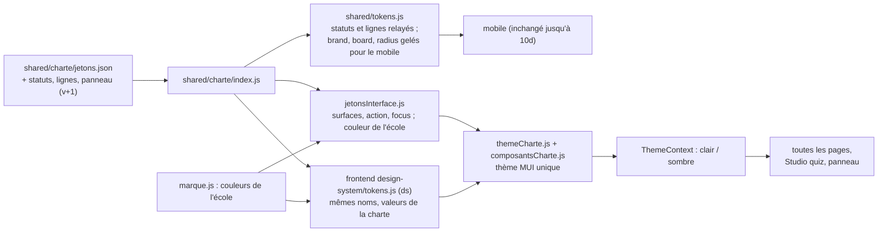

# UIX-10b · L'application web à la charte, Studio quiz compris · conception (plan court)

| | |
|---|---|
| Module | [UIX](../../plan/modules/UIX-interface.md) · **exception hors chantier** accordée par le chef le 18 nov. (UIX-10), sans API ni migration |
| Plan d'ensemble | [UIX-10](uix-10-charte-commune.md), validé par le chef le 18 nov. ; ce plan court en détaille la deuxième fonction (§ 9). Source posée par [UIX-10a](uix-10a-source-charte.md) (#207) |
| Branche | `feat/uix-10b-web-charte`, depuis `origin/main` (`736a8f7e`) |
| Dossier de travail | `..\travaux-planner\uix-10b-web-charte` |
| Préalables | #199 (UIX-06b) et #213 (UIX-09) fusionnées le 18 nov. ; UIX-10a sur `main` (charte en version 2, logos officiels de #220) |
| Taille | M (L si le panneau résiste : alors 10b1 thème, 10b2 panneau, en deux PR) |
| Rédigé par | Claude Code (Opus 5.5), le 21 novembre 2026 |
| **Validé** | **par Claude20022002 le 21 novembre 2026** (« Je valide », dans la session) |

## 1. Objet et critère de « terminé »

Toutes les pages de l'application web prennent le style du site vitrine : la connexion, la grille des applications, les pages de gestion, l'emploi du temps, les tableaux de bord, l'appel, le Studio quiz. Rien d'autre ne change : fonctions, droits, routes, données.

**Terminé** quand :

- l'application web lit ses jetons dans `shared/charte/` (par `index.js`) : aucune couleur de la charte n'est écrite à la main dans `frontend/src` ;
- **un seul thème** pour toutes les pages (réponse 1) : Inter, boutons et onglets en casse normale, cibles de 44 px, focus de la charte ; `ThemeGestion` et la liste des pages « pilotes » disparaissent ;
- le menu est sur une surface claire en clair, sombre en sombre, sur toutes les pages (réponse 2) ;
- les arrondis sont 8 px (commandes), 12 px (cartes et panneaux), 20 px (dialogues) (réponse 3) ;
- le panneau des départs garde sa forme (volets, cascade, lampes) aux couleurs de la charte : fond `ecran`, cases `surface-sombre`, cadre de l'école ou `bleu-nuit`, Inter 600 en capitales à chiffres tabulaires ;
- Barlow est retirée (`main.jsx`, `index.css`, `package.json`) ; le choix de famille Planner / StudyLib est retiré des Paramètres ; une préférence `themeFamille` déjà enregistrée est ignorée ;
- une école sans couleurs a `bleu-nuit` et `bleu-vif` ; une école avec ses couleurs les garde, sur les surfaces, la police et les arrondis de la charte ;
- axe-core reste sans violation, en clair et en sombre ; tous les parcours passent en CI ; le chef a vu les captures avant chaque commit (réponse 4).

## 2. Ce qui existe

Relevé sur `origin/main` (`736a8f7e`), le 21 nov.

| Pièce | Fichier | État |
|---|---|---|
| Source de la charte | `shared/charte/jetons.json` (version 2), `index.js` | couleurs, sombre, typographie, espaces, rayons (dont `rayon-commande` 8 px), ombres, mouvement. **Pas encore** les statuts, les lignes des filières ni le panneau (réponse 2 d'UIX-10a : ils entrent en 10b). `bleu-nuit` vaut #17395C depuis les SVG officiels |
| Jetons partagés | `shared/design-tokens.json`, `shared/tokens.js` | `brand` (marine #001861, orange #F26322), `board` (noir #0B0B0D), `status`, `lines`, `radius` 2 à 6 px. **Lus aussi par le mobile** (`mobile/src/theme.js`, `marque.js`, `__tests__/session.test.js`) |
| Couleurs de l'école | `shared/couleurs.js` | `FOND_PANNEAU = #0B0B0D` ; `verifierCouleur` sert au serveur (`backend/services/etablissement/identite.js`, refus à l'enregistrement), au web et au mobile ; son message parle du « panneau noir » (`backend/tests/integration/identiteEcole.test.js` le vérifie) |
| Jetons du web | `frontend/src/design-system/tokens.js` (`ds`, 129 lignes) | lu par 76 fichiers de `frontend/src` ; `ds.font.board` (Barlow Condensed) par 47, dont 26 posent eux-mêmes les capitales |
| Thème global | `themeHistoriqueMUI.js` (75), `composantsHistoriques.js` (164), `themeHistorique.js` (44) | Barlow, boutons en capitales condensées, rayons 2 à 6 px, sombre = panneau noir ; seconde famille `STUDYLIB` |
| Thème des pages pilotes | `jetonsGestion.js` (26) et son test, `components/common/ThemeGestion.jsx` (62) | Inter, gris ardoise, focus #1D4ED8, cibles de 44 px, rayons 6 et 8 px. Posé par `DashboardLayout` sur 8 chemins (`/applications`, Personnes, Référentiel) et par `EcranPublic` (connexion) |
| Choix de famille | `contexts/ThemeContext.jsx` (88), `components/parametres/Apparence.jsx` (35), `i18n/fr.js` et `en.js` (`common.apparence`) | `themeFamille` dans le navigateur |
| Marque | `design-system/marque.js` (31) | `appliquerMarque` saute les écoles aux couleurs « livrées » (#001861, #F26322) |
| Polices | `main.jsx`, `index.css`, `package.json` | `@fontsource/barlow`, `@fontsource/barlow-condensed`, `@fontsource/inter` (400 à 700) ; variables `--hp-*` et barres de défilement aux couleurs du panneau noir |
| Panneau | `design-system/board/` (8 fichiers ; `DepartureBoard.jsx` 421 lignes) | lit `ds.board` par des variables CSS (`--board-*`) ; utilisé par la connexion, l'accueil, les trois tableaux de bord, l'aperçu de la marque et les jeux |
| Studio quiz | `components/studio/` | lit le thème MUI et `ds` ; une seule couleur en dur (le QR code, noir sur blanc, à garder) |
| Couleurs en dur hors `design-system/` | 10 fichiers `.jsx` | QR codes (noir sur blanc, gardés), `SceneJoueur.jsx` (jeux, 10e), `SelecteurEspaces.jsx`, `MarquePlanner.jsx`, et les trois fichiers de l'identité de l'école |

Ce qui gêne : deux thèmes qui se recouvrent ; le mobile lit les mêmes jetons partagés que le web, alors qu'il ne passe à la charte qu'en 10d.

## 3. Questions et réponses

Posées au chef le 21 nov., dans la session ; chaque proposition retenue. Les réponses du plan d'ensemble (1 à 8) restent valables : panneau gardé aux couleurs de la charte (4), choix de famille retiré (5), sombre dérivé (7), école prioritaire et charte en repli (8).

| N° | Question | Réponse du chef |
|---|---|---|
| 1 | Un seul thème pour toutes les pages, ou garder le thème des pages pilotes à part ? | **un seul thème** : les règles des pages pilotes (Inter, casse normale, cibles de 44 px) valent partout. Les écrans qui écrivent eux-mêmes en style « volet » (horaires, codes, en-têtes du panneau) gardent leurs capitales, en Inter |
| 2 | Le menu : surface claire, ou couleur de l'école ? | **surface claire partout** (blanc en clair, `surface-sombre` en sombre) ; la couleur de l'école reste sur les boutons, la sélection et le cadre du panneau |
| 3 | Les arrondis ? | **8 px** boutons, champs et puces ; **12 px** cartes et panneaux ; **20 px** dialogues |
| 4 | Livraison ? | **une PR**, en deux étapes (thème, puis panneau) ; **captures montrées au chef avant chaque commit** : connexion, grille des applications, une page de gestion, emploi du temps, panneau, Studio quiz ; clair et sombre ; 390 et 1440 px. Deux PR seulement si le panneau résiste |

## 4. Solution

### 4.1 Le principe

Le thème MUI se construit depuis la charte, une seule fois, pour toutes les pages. Ce qui faisait la différence des pages pilotes (`jetonsGestion`) devient le cœur du thème global. Les jetons `ds` gardent leurs noms : les 76 écrans qui les lisent ne changent pas, seules les valeurs changent.

### 4.2 La source (étape 2)

- **`jetons.json`** reçoit trois familles, **version augmentée d'un** :
  - `statuts` : les six statuts, valeurs d'aujourd'hui (`bureau`, `bureauBg`) ; leur couleur sur le panneau aussi (`panneau`) ;
  - `lignes` : les six couleurs de ligne des filières et `ligne-inconnue`, valeurs d'aujourd'hui ;
  - `panneau` : `fond` = `ecran` #0F1A2B, `case` = `surface-sombre` #172338, `charniere` et `joint` (dérivés de `surface-sombre`, décoratifs, sans exigence de contraste), `lettre` = `texte-sombre`, `lettre-attenuee` = `texte-sombre-second`, et les lampes à leurs couleurs d'aujourd'hui (#3FCB74, #F26322, #FF5A5F). `pas-volet` 28 ms.
  - Les paires de contraste du panneau sont déclarées : lettres et lampes sur le fond et sur les cases, toutes à 4,5:1, puisque les lampes écrivent aussi les statuts. Calculées le 21 nov. : la plus basse est l'orange sur les cases, 4,94:1 (lettres 13,89 à 15,40 ; lettres atténuées 7,66 à 8,49 ; vert 7,50 à 8,32 ; rouge 5,16 à 5,72). Le générateur les vérifie.
- **`shared/tokens.js`** : `status`, `lines` et `lineUnknown` viennent de la charte (mêmes valeurs : le mobile ne voit rien). `brand`, `board` et `radius` restent dans `design-tokens.json`, **gelés pour le mobile** jusqu'à 10d, avec une ligne qui le dit ; le web ne les lit plus. Une seule copie active de chaque valeur (réponse 2 d'UIX-10a).
- **`shared/couleurs.js`** : `FOND_PANNEAU` = `ecran` (lu dans la charte). Le message de refus de l'accent dit « panneau sombre » au lieu de « panneau noir » ; le test d'intégration du serveur suit. Seul effet côté serveur : un accent entre 3,0 et 3,4:1 sur l'ancien fond serait refusé au prochain enregistrement ; l'accent de l'école pilote (#F26322) passe à 5,47:1, `bleu-vif` à 4,45:1.
- Si #222 (VIT-09a, charte version 3) est fusionnée avant, la branche reprend `main` et la version suit.

### 4.3 Le thème unique (étape 3)

- **`jetonsInterface.js`** (nouveau nom de `jetonsGestion.js`, avec son test) : surfaces, texte, filets, en-tête de tableau, action, focus, en clair et en sombre, tirés de la charte :
  - clair : fond `gris-fond`, papier `blanc`, texte `encre`, secondaire `gris-texte`, filet décoratif `gris-trait`, bord des champs `trait-fort`, action `bleu-nuit`, focus `bleu` ;
  - sombre : fond `ecran`, papier `surface-sombre`, texte `texte-sombre`, secondaire `texte-sombre-second`, action `bleu-clair` (texte `ecran` dessus), focus `focus-sombre` ;
  - la couleur principale de l'école remplace l'action, ajustée jusqu'au contraste voulu, comme aujourd'hui.
- **`themeCharte.js`** (remplace `themeHistoriqueMUI.js`) et **`composantsCharte.js`** (remplace `composantsHistoriques.js`) : un thème MUI pour toutes les pages. Les règles des pages pilotes y passent : Inter, casse normale, cibles de 44 px, en-têtes de tableau, focus de 3 px décalé de 3 px. Arrondis 8, 12 et 20 px (réponse 3). Ombres et mouvement de la charte. Échelle fixe de la gestion (1.75, 1.375, 1.125rem).
- **`ds`** (`tokens.js`) garde ses noms : `ds.colors`, `ds.brand`, `ds.nav`, `ds.board`, `ds.status`, `ds.lines`, `ds.radius`, `ds.shadow`, `ds.motion`, `ds.font` prennent les valeurs de la charte. `ds.font.board` et `ds.font.body` = la police de la charte ; `ds.font.mono` reste (terminal des jeux). `ds.document` (EDT imprimé) ne change pas (hors périmètre d'UIX-10). Le fichier raccourcit.
- **Menu** (réponse 2) : les variables `--nav-*` prennent le papier, le texte et la sélection du thème, en clair comme en sombre, sur toutes les pages.
- **`ThemeContext.jsx`** : mode clair ou sombre seulement ; `famille`, `choisirFamille`, `FAMILLES` et `variablesCss(famille, …)` retirés. **`Apparence.jsx`** : le groupe « Thème » retiré ; le texte d'introduction corrigé en français et en anglais (`common.apparence.intro`), les clés `theme`, `planner` et `studylib` retirées.
- **`themeHistorique.js`** retiré (`STUDYLIB`, `PANNEAU_STUDYLIB`, `flapLabelPlanner`).
- **`ThemeGestion.jsx`** retiré. `DashboardLayout` et `EcranPublic` n'enveloppent plus rien ; ils appellent `useFaviconPlanner` avec la même condition qu'aujourd'hui (le favicon change en 10c, pas ici). La liste des 8 chemins pilotes ne sert plus qu'à cela.
- **`marque.js`** : les couleurs livrées deviennent `bleu-nuit` et `bleu-vif` ; le test « mêmes couleurs que les livrées » disparaît (plan d'ensemble, § 4.4). Les nuances de l'école se posent sur `ds` et sur `jetonsInterface` par le même chemin qu'aujourd'hui.
- **Polices** : `main.jsx` n'importe plus Barlow ; `@fontsource/barlow` et `@fontsource/barlow-condensed` quittent `package.json` et le verrou. Inter reste servie par `@fontsource/inter` (400 à 700), déjà installé : aucune dépendance nouvelle. `index.css` : police, sélection, focus, curseur et barres de défilement aux jetons de la charte ; `--hp-*` retirées si plus rien ne les lit.
- **Couleurs en dur** : `SelecteurEspaces.jsx` et `MarquePlanner.jsx` ramenés aux jetons. Les QR codes restent noir sur blanc (lecture). `SceneJoueur.jsx` reste pour 10e. Les trois fichiers de l'identité de l'école gardent leurs exemples de saisie.

### 4.4 Le panneau des départs (étape 4)

Forme gardée (plan d'ensemble, réponse 4) : `ds.board` lit la famille `panneau`. Le cadre prend la couleur de l'école, sinon `bleu-nuit`. Les lettres passent en Inter 600, capitales, chiffres tabulaires. Le panneau reste sombre en thème clair. Inter en capitales est plus large que Barlow Condensed : les largeurs des volets, des colonnes et des codes sont reprises dans `FlapTiles.jsx`, `FlapText.jsx` et `DepartureBoard.jsx`, **sans faire grossir `DepartureBoard.jsx`** (421 lignes). Si les volets ne tiennent pas à 390 px sans réécrire le panneau, l'étape devient 10b2, dans une seconde PR (réponse 4).

Les jeux (`components/jeux/Panneau.jsx`) lisent `ds.board` : ils prennent les nouvelles couleurs sans être modifiés ; leur accent `jeu` et leur scène restent pour 10e.

### 4.5 Captures pour le chef (réponse 4)

Avant le commit des étapes 3 et 4 : connexion, grille des applications, Personnes, emploi du temps de la semaine, tableau de bord d'un étudiant (panneau), Studio quiz (éditeur et direct), Paramètres ; en clair et en sombre ; à 390 et 1440 px ; une école sans couleurs, et une école fictive à ses couleurs. Prises en local sur la base de démonstration, hors du dépôt (dossier temporaire), montrées au chef dans la session.

## 5. Fichiers créés ou modifiés

| Fichier | Créé / modifié | Rôle | Taille visée |
|---|---|---|---|
| `shared/charte/jetons.json`, `README.md` (généré), `vitrine/src/styles/jetons.css` (généré, inchangé) | modifié | statuts, lignes, panneau ; paires ; version + 1 | ~+90 lignes |
| `shared/charte/charte.test.js` | modifié | paires du panneau ; le CSS du site garde ses 38 noms | < 150 |
| `shared/tokens.js`, `shared/design-tokens.json` | modifiés | statuts et lignes relayés ; `brand`, `board`, `radius` gelés pour le mobile | plus courts |
| `shared/couleurs.js` | modifié | `FOND_PANNEAU` de la charte ; message « panneau sombre » | inchangée |
| `backend/tests/integration/identiteEcole.test.js` | modifié | le message suit | une ligne |
| `frontend/src/design-system/tokens.js` | modifié | `ds` aux valeurs de la charte | < 120 |
| `frontend/src/design-system/jetonsInterface.js`, `.test.js` | renommés de `jetonsGestion*`, modifiés | surfaces et action de la charte, couleur de l'école | < 50, < 40 |
| `frontend/src/design-system/themeCharte.js`, `composantsCharte.js` | remplacent `themeHistoriqueMUI.js`, `composantsHistoriques.js` | thème MUI unique | < 80, < 160 |
| `frontend/src/design-system/themeHistorique.js` | retiré | — | — |
| `frontend/src/design-system/marque.js` | modifié | couleurs livrées de la charte ; test des livrées retiré | < 35 |
| `frontend/src/design-system/board/*` | modifiés (étape 4) | Inter, largeurs, fond `ecran` | `DepartureBoard.jsx` ≤ 421 |
| `frontend/src/components/common/ThemeGestion.jsx` | retiré | — | — |
| `frontend/src/components/layouts/DashboardLayout.jsx`, `components/auth/EcranPublic.jsx` | modifiés | plus d'enveloppe ; `useFaviconPlanner` direct | plus courts |
| `frontend/src/contexts/ThemeContext.jsx`, `components/parametres/Apparence.jsx`, `i18n/fr.js`, `i18n/en.js` | modifiés | choix de famille retiré | plus courts |
| `frontend/src/main.jsx`, `index.css`, `frontend/package.json`, `package-lock.json` | modifiés | Barlow retirée ; CSS du navigateur à la charte | plus courts |
| `frontend/src/components/espaces/SelecteurEspaces.jsx`, `components/common/MarquePlanner.jsx` | modifiés | couleurs en dur ramenées aux jetons | inchangés |
| `frontend/src/design-system/themeCharte.test.js` | créé | § 8 | < 80 |
| `docs/plan/modules/UIX-interface.md` | modifié | ligne UIX-10 : 10b faite | — |

Hors liste, rien. Ni le mobile (10d), ni les jeux au-delà de ce qu'ils lisent déjà de `ds` (10e), ni les logos (10c), ni `docs/plan/suivi.md`.

## 6. Données et migration

Aucune table, aucune migration, aucune route. Les couleurs de l'école restent dans `ConfigurationEtablissement`. La préférence `themeFamille` du navigateur est ignorée, pas effacée. Le mode clair ou sombre enregistré (`themeMode`) est gardé.

## 7. Sécurité, isolation et exigences produit

- Aucun canal d'isolation, aucun droit, aucune route. Une seule chose change côté serveur : le texte du refus d'un accent illisible (« panneau sombre »), et le fond sur lequel il est mesuré (§ 4.2).
- **EP-2** : axe-core sans violation sur les parcours qui le lancent (grille des applications, Référentiel) ; les contrastes sont garantis à la source.
- **EP-3** : deux polices de moins à charger (Barlow et Barlow Condensed, 7 feuilles).
- **EP-11** : contraste AA en clair et en sombre (paires de la charte, `jetonsInterface.test.js`) ; les propriétés logiques restent la règle pour l'arabe.
- **EP-18, tous les contextes** : aucune requête nouvelle, aucun service tiers ; la page est plus légère sur une connexion faible. Le panneau reste sombre et contrasté, lisible projeté dans une salle. Les QR codes restent noir sur blanc. L'EDT imprimé ne change pas.
- **Dépôt public** : aucun nom d'école ; `scripts/verifier-neutre.mjs` passe.

## 8. Tests

- `shared/charte/charte.test.js` : les nouvelles paires (lettres et lampes du panneau) au seuil ; `--verifier` à jour.
- `jetonsInterface.test.js` : les contrôles d'aujourd'hui, sur les surfaces de la charte, sans couleur et avec #001861, #1D4ED8, #137D3F, #7E2259, #FFFFFF et une valeur invalide, en clair et en sombre ; le bord des champs à 3:1.
- `themeCharte.test.js` (`node --test`) : **test de régression** du choix retiré : une préférence `themeFamille = studylib` donne le thème de la charte ; le thème est le même pour toutes les pages ; boutons sans capitales ; arrondis 8, 12, 20 ; police sans Barlow.
- `shared/couleurs.js` : un accent est mesuré sur `ecran` ; test d'intégration `identiteEcole.test.js` (message « panneau sombre »).
- Mobile : `mobile/__tests__/session.test.js` et les tests du thème restent verts sans changement (le mobile ne bouge pas).
- Suite du serveur, tests du frontend, `npm run build`, tests du site (`jetons.css` inchangé), `verifier-neutre`. Les parcours tournent en CI, pas en local en même temps que la suite (leçon de #199 : on ne déclare pas la PR prête sans eux).

## 9. Étapes de livraison

1. Ce plan, commité seul ; validé par le chef.
2. La source : `jetons.json` (statuts, lignes, panneau), `tokens.js`, `couleurs.js` et leurs tests. Rien ne change à l'écran, sauf le message du serveur.
3. Le thème unique, le menu, le choix de famille, Barlow, la marque. **Captures au chef**, puis commit.
4. Le panneau des départs. **Captures au chef**, puis commit. S'il résiste : arrêt, 10b2 en seconde PR.
5. Tests, construction, `verifier-neutre`, ligne du module ; fiche de session ; commandes pour le chef.

## 10. Risques et retour arrière

- **Parcours rouges en masse** : tous les écrans changent d'apparence. Les parcours cherchent les éléments par rôle et par texte ; un bouton qui passe des capitales à la casse normale ne change pas son nom accessible. Ceux qui échouent sont corrigés dans la PR.
- **Volets trop larges en Inter** : § 4.4 ; repli en 10b2.
- **Le mobile change par erreur** : `brand`, `board`, `radius` gelés dans `design-tokens.json` ; ses tests le gardent.
- **UIX-06c** lit `ThemeGestion` dans son plan : après 10b, elle s'appuie sur le thème unique ; la ligne de son plan est à corriger avant son code (coordinateur).
- **Retour arrière** : `git revert` de la PR ; aucune donnée ni migration.

## 11 bis. Écarts constatés pendant le code (21 nov.), validés par le chef le 21 nov. (« Je valide les écarts »)

| N° | Écart | Pourquoi |
|---|---|---|
| E1 | `shared/charte/contraste.mjs`, `generer.mjs` et `index.js` modifiés (hors du § 5) : `couleursDe` lit les couleurs de toutes les familles ; titres du guide ; exports `statuts`, `lignes`, `panneau` | nécessaires pour que le générateur vérifie les nouvelles paires ; `couleursDe` générique évite aussi un conflit avec #222, qui ajoute sa propre famille |
| E2 | Le fond, les cases et les lettres du panneau ne sont pas recopiés dans la famille `panneau` : ce sont `ecran` et les jetons du sombre ; la famille ne garde que la charnière, le joint, les lampes et `pas-volet`. `pas-volet` n'est pas dans `mouvement` : l'empreinte de la vidéo du site couvre cette famille, et la vidéo aurait dû être rendue à nouveau. Après la fusion de #222 (version 3), la charte passe en version 4 | une seule copie de chaque valeur |
| E3 | `FOND_PANNEAU` reste écrit dans `shared/couleurs.js` (#0F1A2B), et `charte.test.js` vérifie qu'il vaut `ecran` | le serveur lit ce fichier sous Node, qui refuse l'import JSON simple |
| E4 | `frontend/scripts/import-json-tests.mjs` créé, et `test:unit` le charge | Node 22 refuse l'import JSON simple de `shared/charte/index.js` dans les tests `node --test` ; Vite, Metro et Jest l'acceptent. Le crochet ne sert qu'aux tests |
| E5 | `pages/Accueil.jsx` et `components/auth/PanneauAccueil.jsx` lisent `ds.board.titre` et `ds.board.letterDim` au lieu de `ds.nav.*` | avec le menu sur surface claire (réponse 2), `ds.nav` donne un texte foncé ; ces deux écrans écrivent sur le cadre sombre du panneau |
| E6 | Les couleurs du navigateur (sélection, focus, barres de défilement) passent de `index.css` aux styles globaux du thème (`stylesGlobaux` de `themeCharte.js`) ; `index.css` ne garde que des règles sans couleur | un fichier CSS ne lit pas la charte ; aucune couleur de la charte n'est écrite à la main |
| E7 | `tests/parcours/entreRoles.spec.cjs` : le parcours « thème StudyLib » devient le test de régression du choix retiré (préférence `studylib` ignorée, plus de bouton, menu clair puis sombre) | ce parcours cliquait sur le bouton retiré |
| E8 | `appliquerMarque` pose la couleur de la barre du navigateur (`theme-color`) pour toutes les écoles, y compris sans couleurs (bleu nuit) | `index.html` porte encore #001861 ; sans cela, une école sans couleurs gardait l'ancienne marine |

## 11. Hors périmètre

Les logos et le favicon (10c, SVG officiels déjà là) ; le mobile (10d) ; l'accent `jeu`, la scène et le panneau propres aux jeux (10e) ; StudyLib (10f) ; l'EDT imprimé (`ds.document`) ; le mode sombre du site ; les textes, sauf l'introduction des Paramètres d'apparence et le message de refus de l'accent.
