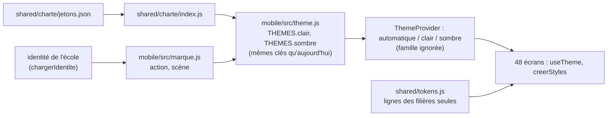

# UIX-10d · L'application mobile à la charte · conception (plan court)

| | |
|---|---|
| Module | [UIX](../../plan/modules/UIX-interface.md) · **exception hors chantier** accordée par le chef le 18 nov. (UIX-10), sans API ni migration |
| Plan d'ensemble | [UIX-10](uix-10-charte-commune.md), validé par le chef le 18 nov. ; ce plan court en détaille la quatrième fonction (§ 9). Web : [UIX-10b](uix-10b-web-charte.md) (#235, fusionnée le 21 nov.) |
| Branche | `feat/uix-10d-mobile-charte`, depuis `origin/main` (`e1858451`) |
| Dossier de travail | `..\travaux-planner\uix-10d-mobile-charte` |
| Préalables | UIX-10a (#207) et UIX-10b (#235) sur `main` ; charte en version 4 |
| Taille | M |
| Rédigé par | Claude Code (Opus 5.5), le 22 novembre 2026 |
| **Validé** | **par Claude20022002 le 22 novembre 2026** (« Je valide le plan », dans la session, avec les propositions 5 à 9) |

## 1. Objet et critère de « terminé »

L'application mobile prend le style du site vitrine et de l'application web : couleurs de la charte, Inter, arrondis, casse normale. Rien d'autre ne change : écrans, fonctions, droits, routes, données.

**Terminé** quand :

- le mobile lit ses jetons dans `shared/charte/` (par `index.js`) : `mobile/src/theme.js` n'écrit aucune couleur de la charte à la main ;
- **deux thèmes**, clair et sombre, au lieu de quatre ; le choix de famille (Planner / StudyLib) a quitté l'écran Compte ; une préférence enregistrée avec `famille` garde son mode, et sa famille est ignorée ;
- Inter partout : Barlow et Barlow Condensed sont retirées du chargement des polices et de `package.json` ;
- casse normale pour les boutons, les onglets et les titres ; les capitales restent sur le Tableau du jour (heures, salle, statuts, volets), en Inter (réponse 1) ;
- barre de titre et onglets sur la surface du thème ; la couleur de l'école va sur l'onglet actif, les boutons et la sélection (réponse 2) ;
- le Tableau garde sa structure : lignes sur la surface du thème, heure de la prochaine séance sur des volets sombres (fond `ecran`) dans les deux modes (réponse 3) ;
- sans préférence enregistrée : mode automatique ; si le téléphone ne donne pas son apparence, le sombre (réponse 4) ;
- une école sans couleurs a `bleu-nuit` (clair) et `bleu-clair` (sombre) pour l'action ; une école avec ses couleurs les garde, ajustées au contraste ;
- `shared/design-tokens.json` est retiré ; `shared/tokens.js` ne garde que les lignes des filières (dernier lecteur des jetons gelés : le mobile) ;
- tous les textes du thème sont lisibles (WCAG AA, 4,5:1) en clair et en sombre, vérifié par `theme.test.js` ; la suite Jest du mobile est verte ; l'export Android se construit ;
- le chef a vu les captures avant chaque commit de code (§ 4.5).

## 2. Ce qui existe

Relevé sur `origin/main` (`e1858451`), le 22 nov.

| Pièce | Fichier | État |
|---|---|---|
| Thèmes | `mobile/src/theme.js` (242 lignes) | quatre thèmes (`planner-sombre`, `planner-clair`, `studylib-clair`, `studylib-sombre`) ; lit `shared/tokens.js` (`brand`, `board`, `radius`, `status`, `flapStepMs`) ; couleurs StudyLib écrites à la main ; préférence `{ famille, mode }` dans `hestim.theme` |
| Clés du thème lues par les écrans | 48 fichiers (`useTheme`, `creerStyles`) | `couleurs.cadre`, `surCadre`, `bordCadre` (barres de titre, 24 fichiers) ; `polices.panneau*` (34) ; `capitales` (27) ; `espace()` (26) ; `rayons.xs` à `lg` (77 usages) ; `volet`, `verre`, `scene`, `statuts` |
| Tests de famille dans les écrans | 11 fichiers | `t.famille === 'planner' ? … : …` : tailles de police, arrondis, couleur de sélection ; `terminal.jsx` et `jeu-direct/[id].jsx` lisent `THEMES[\`${famille}-sombre\`]` |
| Choix de famille | `src/app/(onglets)/compte.jsx` (`Apparence`), `src/i18n.js` (`app.compte.themes`, fr et en) | deux aperçus de famille, puis trois modes |
| Polices | `src/app/_layout.jsx`, `package.json` | `@expo-google-fonts/barlow`, `barlow-condensed`, `inter` (400 à 700) |
| Marque | `src/marque.js` (27) | couleurs de l'école posées sur les deux thèmes Planner (barre de titre, cadre, scène) ; saute les couleurs « livrées » (#001861, #F26322) ; StudyLib exclu |
| Jetons gelés | `shared/design-tokens.json`, `shared/tokens.js` | `brand`, `board`, `radius`, `flapStepMs` gelés **pour le mobile seul** depuis UIX-10b ; `status` relayé avec la couleur de l'ancien panneau noir. Autres lecteurs : `mobile/__tests__/session.test.js` ; le web ne lit que `lines` et `lineColor` ; la migration 0055 ne le cite qu'en commentaire |
| Couleurs en dur | 7 fichiers | blanc sur caméra (`scanner.jsx`), blanc sur tuiles colorées (`quiz.jsx`), cadre blanc du logo (`connexion.jsx`) : gardés, ce sont des contrastes voulus. `IntroLogo.jsx` (marine, rouge, orange, noir de l'écran de lancement) : logos, donc UIX-10c |
| Tests | `mobile/__tests__/theme.test.js` | quatre thèmes aux mêmes clés, contrastes AA, préférence |

Ce qui gêne : les clés `cadre`, `surCadre`, `bordCadre` désignent la barre de titre colorée ; avec la réponse 2, la barre passe sur la surface et la couleur de l'école sur l'action.

## 3. Questions et réponses

Posées au chef le 22 nov., dans la session ; chaque proposition retenue. Les réponses du plan d'ensemble restent valables : choix de famille retiré (5), sombre dérivé (7), école prioritaire et charte en repli (8).

| N° | Question | Réponse du chef |
|---|---|---|
| 1 | Casse des textes ? | **même règle que le web** : casse normale pour les boutons, les onglets et les titres ; capitales gardées pour l'heure, la salle et le panneau du Tableau, en Inter |
| 2 | Barre de titre et onglets ? | **surface claire, comme le web** : barre et onglets sur la surface du thème ; la couleur de l'école sur l'onglet actif, les boutons et la sélection |
| 3 | Le Tableau du jour en thème clair ? | **garder la structure actuelle** : lignes sur la surface du thème ; volets de l'heure sombres (fond `ecran`) |
| 4 | Thème par défaut sans préférence ? | **automatique, repli sombre** si le téléphone ne donne pas son apparence |

Propositions de ce plan, **confirmées par le chef avec sa validation** (22 nov.) :

| N° | Proposition |
|---|---|
| 5 | Arrondis du web : `xs` et `sm` 8 px (commandes), `md` 12 px (cartes), `lg` 20 px (feuilles). Les pastilles rondes ou carrées gardent leur forme |
| 6 | Tailles de police : là où un écran choisit selon la famille, on garde la valeur prévue pour Inter (la branche « StudyLib » d'aujourd'hui) |
| 7 | `shared/design-tokens.json` est retiré dans cette PR (le mobile est son dernier lecteur ; plan d'ensemble, § 9, point 5) |
| 8 | L'écran de lancement (`app.json`) et `IntroLogo.jsx` restent pour UIX-10c (logos) ; l'étagère de la Bibliothèque pour BIB-10 ; l'accent « jeu » et la scène fine pour UIX-10e. La scène des jeux prend dès maintenant les nuances de `bleu-nuit` (ou de l'école), pour ne plus lire `brand` |
| 9 | Captures : sur l'émulateur Android (SDK présent sur le poste), base de démonstration locale, hors du dépôt ; si l'émulateur ne sert pas, sur le téléphone du chef par Expo Go |

## 4. Solution

### 4.1 Le principe

Comme `ds` sur le web : **les clés du thème gardent leurs noms**, seules leurs valeurs changent. Les 48 écrans qui lisent le thème ne changent pas, sauf les 11 qui testent la famille et les écrans du Tableau pour les capitales.

### 4.2 Les deux thèmes (`theme.js`)

Valeurs tirées de la charte, comme `jetonsInterface.js` du web :

| Clé | Clair | Sombre |
|---|---|---|
| `fond` | `gris-fond` | `ecran` |
| `cellule` | `blanc` | `surface-sombre` |
| `filet` | `gris-trait` | `surface-sombre` mêlé de `texte-sombre` (16 %), comme le web |
| `bord` (nouveau : bord des champs et des commandes, 3:1) | `trait-fort` | `trait-fort` |
| `lettre`, `lettreAttenuee` | `encre`, `gris-texte` | `texte-sombre`, `texte-sombre-second` |
| `cadre`, `surCadre`, `bordCadre` (barres de titre, réponse 2) | `blanc`, `encre`, `gris-trait` | `surface-sombre`, `texte-sombre`, `filet` du sombre |
| `accent`, `surAccent` | `bleu-nuit` ou l'école ; texte calculé | `bleu-clair` ou l'école ; texte calculé |
| `enCours`, `reporte`, `annule`, `statuts` | statuts de la charte (`statut-*`) | lampes du panneau (`lampe-*`) |
| `volet` (réponse 3) | fond `ecran`, case `surface-sombre`, lettre `texte-sombre`, charnière `panneau-charniere` | idem |
| `verre` | voile `blanc`, liseré `encre` à 10 % | voile `ecran`, liseré blanc à 10 % |
| `scene` | nuances de `bleu-nuit` (proposition 8) | idem |

- `polices` : `Inter_400Regular` à `Inter_700Bold` sous les noms d'aujourd'hui (`panneau`, `panneauGras`, `panneauMoyen`, `texte`, `texteGras`).
- `capitales: 'none'`, `espacement: 0` ; nouvelle clé `capitalesVolet: 'uppercase'`, lue par les fichiers de `src/board/` (réponse 1).
- `rayons` : proposition 5, tirés de `rayon-commande` (8), `rayon-petit` (12) et `rayon` (20).
- `THEMES` : `clair` et `sombre`. `FAMILLES` disparaît. `themePour({ mode }, schema)` ; schéma inconnu → sombre (réponse 4). `valide` n'exige plus la famille ; `restaurerTheme` reprend le mode d'une préférence ancienne et ignore sa famille.
- `DECALAGE_VOLET_MS` = `pas-volet` de la charte (28 ms, inchangé) ; `lineColor` vient toujours de `shared/tokens.js`.
- Le fichier passe sous 160 lignes (plan d'ensemble, § 5).

### 4.3 Les écrans

- **11 fichiers** testent la famille : le test disparaît, on garde la valeur d'Inter (proposition 6). La sélection active (`optionActive`, onglet actif, pastilles) prend `accent`. `terminal.jsx` et `jeu-direct/[id].jsx` lisent `THEMES.sombre`.
- **Tableau** (`src/board/DepartureRow.jsx`, `Spotlight.jsx`, `FlapTiles.jsx`) : `textTransform: t.capitalesVolet` et chiffres tabulaires sur l'heure et la salle.
- **Compte** : le groupe des deux familles est retiré ; restent les trois modes. Les clés `app.compte.themes` (fr, en) sont retirées ; le titre de section « Apparence » reste.
- **Champs et commandes** dont le bord est `filet` aujourd'hui (connexion, téléphone, options du Compte) : `bord`, pour le contraste de 3:1.
- **Polices** : `_layout.jsx` ne charge plus que les quatre graisses d'Inter ; `@expo-google-fonts/barlow` et `barlow-condensed` quittent `package.json` et le verrou. Aucune dépendance nouvelle.

### 4.4 La marque (`marque.js`)

- Les couleurs de l'école s'appliquent aux **deux** thèmes ; le saut des couleurs « livrées » disparaît (plan d'ensemble, § 4.4).
- La couleur principale devient `accent`, ajustée vers le texte jusqu'à 4,5:1 sur la cellule en clair et 5,5:1 en sombre, comme `jetonsInterface` sur le web ; `surAccent` est le texte le plus lisible dessus. La barre de titre ne prend plus la couleur de l'école (réponse 2).
- La scène des jeux prend les nuances de la couleur de l'école, comme aujourd'hui.
- L'école pilote garde son #001861 par ses réglages enregistrés (migration 0055).

### 4.5 Captures pour le chef

Avant chaque commit de code : connexion, Tableau du jour, Semaine et fiche d'une séance, Bibliothèque, Compte, un écran de jeu (terminal) ; en clair et en sombre ; une école sans couleurs, et une école fictive à ses couleurs. Prises hors du dépôt, montrées dans la session (proposition 9).

### 4.6 Étapes

1. Ce plan, commité seul, puis validé.
2. Thèmes, marque, polices, Compte, les 11 fichiers, le Tableau ; tests. Captures, puis commit.
3. `shared/design-tokens.json` retiré, `shared/tokens.js` réduit aux lignes, `session.test.js` suivi ; ligne du module ; fiche de session.

## 5. Fichiers créés ou modifiés

| Fichier | Créé / modifié | Rôle | Taille visée |
|---|---|---|---|
| `mobile/src/theme.js` | modifié | deux thèmes tirés de la charte ; préférence sans famille | < 160 (242) |
| `mobile/src/marque.js` | modifié | école sur les deux thèmes, action ajustée | < 40 |
| `mobile/src/app/_layout.jsx` | modifié | Inter seule | plus court |
| `mobile/src/app/(onglets)/compte.jsx`, `mobile/src/i18n.js` | modifiés | choix de famille retiré | plus courts |
| `mobile/src/app/(onglets)/_layout.jsx`, `jeux.jsx`, `semaine.jsx`, `mobile/src/app/terminal.jsx`, `jeu-direct/[id].jsx`, `mobile/src/espaces/BoutonEspaces.jsx`, `mobile/src/jeux/ChoixPersonnage.jsx`, `mobile/src/semaine/FicheSeance.jsx` | modifiés | test de famille retiré | inchangés ou plus courts |
| `mobile/src/board/DepartureRow.jsx`, `Spotlight.jsx`, `FlapTiles.jsx` | modifiés | capitales du Tableau, chiffres tabulaires | inchangés |
| `mobile/src/app/connexion.jsx`, `telephone.jsx` | modifiés | bord des champs à 3:1 | inchangés |
| `mobile/package.json`, `mobile/package-lock.json` | modifiés | Barlow retirée | — |
| `mobile/__tests__/theme.test.js` | modifié | deux thèmes, contrastes, préférence ancienne, repli sombre | < 120 |
| `mobile/__tests__/marque.test.js` | créé | école sur les deux thèmes ; couleur invalide sans effet ; contraste de l'action | < 60 |
| `shared/design-tokens.json` | retiré | — | — |
| `shared/tokens.js`, `mobile/__tests__/session.test.js` | modifiés | lignes des filières seules | plus courts |
| `docs/plan/modules/UIX-interface.md` | modifié | ligne UIX-10 : 10d faite | — |

Hors liste, rien : ni le web, ni les logos (10c), ni les jeux au-delà de la lecture du thème (10e), ni `docs/plan/suivi.md`.

## 6. Données et migration

Aucune table, aucune migration, aucune route. La préférence `hestim.theme` du téléphone garde son mode ; sa famille est ignorée, pas effacée.

## 7. Sécurité, isolation et exigences produit

- Aucun canal d'isolation, aucun droit, aucune route, aucun envoi.
- **EP-2** : contrastes garantis à la source et vérifiés par `theme.test.js` ; cibles tactiles de 48 px gardées.
- **EP-3** : deux polices de moins à charger au lancement.
- **EP-11** : aucune propriété gauche ou droite ajoutée.
- **Dépôt public** : aucun nom d'école ; `scripts/verifier-neutre.mjs` passe.

## 8. Tests

- `theme.test.js` : deux thèmes aux mêmes clés ; chaque texte à 4,5:1 sur le fond et la cellule, en clair et en sombre (lettres, statuts, volets, scène, action) ; `bord` à 3:1 ; `{ famille: 'studylib', mode: 'clair' }` donne le clair ; automatique et schéma inconnu donnent le sombre ; aucune préférence donne automatique.
- `marque.test.js` : une couleur d'école arrive sur l'action des deux thèmes, au contraste voulu ; une couleur invalide ne change rien.
- `session.test.js` : lignes des filières, sans les jetons gelés.
- Suite Jest du mobile complète ; `npx expo export --platform android` se construit.
- Web : `npm test` du site (il lit `shared/tokens.js`).

## 9. Risques et retour arrière

- **Inter plus large que Barlow Condensed** : les volets et les heures du Tableau peuvent déborder. On reprend les largeurs dans `src/board/`, et les captures le montrent avant le commit.
- **Écrans qui comptaient sur la barre colorée** pour un texte blanc : `surCadre` change avec la barre, le contraste est testé.
- **Retour arrière** : une PR sans migration ; `git revert`.

## 10. Hors périmètre

- Logos, icône et écran de lancement (UIX-10c).
- Accent « jeu » et scène fine des jeux (UIX-10e).
- Écrans de la Bibliothèque reconstruite (BIB-10).
- Le web, qui reste tel qu'UIX-10b l'a laissé.
