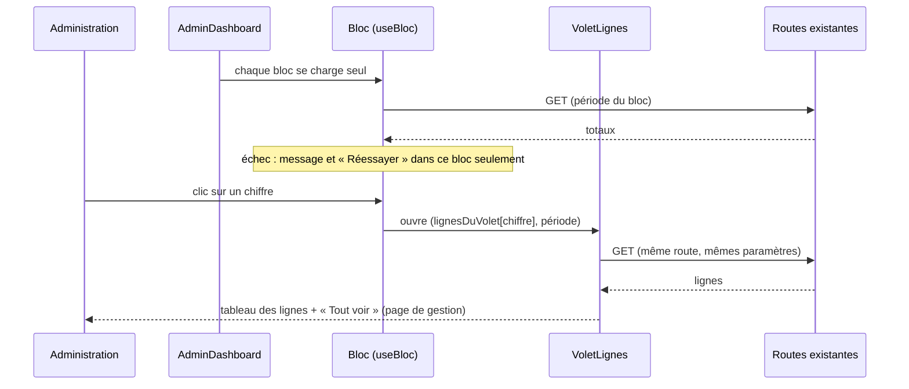

# UIX-11 · Le tableau de bord de l'administration · conception (plan court)

| | |
|---|---|
| Module | [UIX](../../plan/modules/UIX-interface.md) · étape 2 de la feuille de route, **hors chantier comme UIX-10** (chef, 18 nov.) |
| Fiche de mission | `docs/plan/missions/uix-11-tableau-de-bord.md` (branche `doc/coordination-equipe`) |
| Branche | `feat/uix-11-tableau-de-bord`, depuis `origin/main` (`d4466b23`) ; **`main` fusionnée après #235 (UIX-10b), avant toute ligne de code** |
| Dossier de travail | `..\travaux-planner\uix-11-tableau-de-bord` |
| Préalable | UIX-10b fusionnée (#235, CI verte le 21 nov., 74 parcours sur 74) : le thème unique (`themeCharte.js`, `jetonsInterface.js`) sur lequel ce tableau se construit |
| Taille | M · sans route nouvelle, sans migration, sans donnée nominative d'élève nouvelle |
| Rédigé par | Claude Code (Opus 5.5), le 21 novembre 2026 |
| **Validé** | **par le coordinateur, le 21 nov. au soir** (`docs/plan/decisions.md`, branche `doc/coordination-equipe`) : M, routes existantes, aucune migration ni donnée d'élève nouvelle ; réponses 5 et 6 ci-dessous. Les questions 1 à 4 ont la réponse du chef |

## 1. Objet et critère de « terminé »

Le tableau de bord de l'administration (`/dashboard/admin`) passe à la charte d'UIX-10b, et ajoute les chiffres que la base contient déjà. **Chaque chiffre dit sa période et ouvre, en un clic, les lignes qui le composent.**

**Terminé** quand :

- la page suit le thème d'UIX-10b, en clair et en sombre ; aucune couleur écrite en dur dans `components/dashboard/` ni dans `AdminDashboard.jsx` (jetons `ds` et palette du thème) ;
- **chaque chiffre affiché ouvre un volet** qui liste ses lignes, lues par la même route, avec un lien « Tout voir » vers la page de gestion (réponse 2) ;
- **chaque chiffre dit sa période** : « aujourd'hui et les 2 jours suivants », « cette semaine », « ce mois », « la période en cours », « les 14 prochains jours » ;
- **aucun chiffre sans source** : le § 4.2 nomme, pour chaque bloc, la route et la table qu'il lit. Ce que la base ne contient pas ne s'affiche pas, même vide ;
- **chaque bloc se charge et échoue seul**, avec son propre « Réessayer » : une route en panne ne vide plus la page (aujourd'hui, l'échec de la liste des séances affiche l'erreur de toute la page) ;
- aucun texte en dur : français et anglais dans `i18n/tableauDeBord.{fr,en}.js` ; les clés `admin.*` qui ne servent qu'ici y sont déplacées ;
- fichiers de moins de 300 lignes, commentaire de rôle en tête ; tests unitaires verts ; parcours `tableauDeBord.spec.cjs` vert, **sans violation axe-core** ; captures montrées au chef avant le commit (clair et sombre, 390 et 1440 px).

## 2. Ce qui existe

Lu dans `feat/uix-10b-web-charte` (`e0b9af3d`), qui sera sur `main` avant le code.

- `frontend/src/pages/dashboard/AdminDashboard.jsx` (206 lignes) charge six routes dans un seul `Promise.all` (l. 96-111). Cinq ont un `.catch` ; **la sixième, `affectationAPI.getAll`, n'en a pas** : son échec met toute la page en erreur (l. 119-121). On y trouve :
  - le **panneau des séances** (`DepartureBoard`), aujourd'hui et 2 jours, filtrable par bâtiment : il montre déjà ses lignes ;
  - la **file « À traiter »** (`components/dashboard/FileATraiter.jsx`, 123 lignes) : conflits non résolus, demandes de report en attente, téléphones à changer, séances à vérifier. Chaque ligne mène à sa page de gestion. Le nom de l'étudiant d'une demande de téléphone y figure déjà (l. 105) : **rien de nouveau** côté données d'élève ;
  - la **bande de quatre indicateurs** (`IndicatorsStrip`, l. 24-68), lue dans `GET /statistiques/kpis` sans période : l'année universitaire en cours, par défaut (`perimetreStatistiques`, `statistiquesController.js` l. 33-55). Seul le bouton « Statistiques » est cliquable, et aucune période n'est affichée.
- **Deux défauts de calcul** dans `getKPIs` (`statistiquesController.js` l. 382-511), dont le serveur ne change pas ici (§ 3, réponse 3) :
  - l'**occupation des salles** divise les heures de toute la période par `salles × 40 h`, soit une seule semaine (`HEURES_DISPO_PAR_SEMAINE`, l. 12), puis plafonne à 100 %. Sur une année, elle vaut toujours environ 100 % ; sur une semaine, elle est juste ;
  - le **taux de conflits** rapporte les conflits non résolus **de tout l'historique** (`Conflit.count({ resolu: false })`, sans date) aux séances **de la période** : sur une semaine, il peut dépasser 100 %.
- **Les routes utiles existent**, toutes réservées à l'administration (§ 4.2). Les pages cibles (Conflits, Examens, Suivi, Statistiques) ne lisent aucun filtre dans l'adresse, hormis `Suivi?onglet=heures` : d'où le volet (réponse 2).
- `components/suivi/UsageDuMois.jsx` affiche déjà les compteurs d'usage du mois (R-12) dans Suivi, onglet Usage. **Aucune page ne liste les lignes** derrière ces totaux (aucune liste des comptes actifs).
- `Suivi.jsx` (l. 58-66) trouve la période en cours à partir de `calendrierAPI.getAnnees()` : période active qui contient aujourd'hui, sinon la première active. Le tableau de bord reprend cette règle (§ 4.2, bloc C).
- Parcours : aucun parcours ne couvre le tableau de bord de l'administration (`telephone.spec.cjs` y passe pour la file). Le contrôle axe-core existe déjà dans `applications.spec.cjs` (l. 6-8) : il est repris tel quel.

## 3. Questions et réponses

| N° | Question | Proposition | Réponse | Bloque |
|---|---|---|---|---|
| 1 | Quels chiffres ajouter, parmi ceux des routes existantes ? | modules en retard, heures du mois, examens à venir | **Chef, 21 nov. : les trois, plus « Usage du mois »**. L'usage n'a pas de lignes : son volet montre le détail par rôle et par compteur, avec un lien vers Suivi, onglet Usage. C'est un **écart accepté** à la règle « un chiffre mène à ses lignes » | non |
| 2 | Les pages cibles ne lisent pas de filtre : comment mener « aux lignes » en un clic ? | un volet dans le tableau de bord, qui lit la même route, et « Tout voir » | **Chef, 21 nov. : le volet**. Tout reste dans `components/dashboard/`, sans toucher aux autres pages | non |
| 3 | L'occupation des salles est fausse sur une année : que faire ? | appeler la même route sur la semaine en cours | **Chef, 21 nov. : la semaine en cours**. `GET /statistiques/kpis?date_debut&date_fin` (paramètres qui existent déjà) ; le serveur ne change pas | non |
| 4 | Des taux de présence des élèves par classe ? | pas dans UIX-11 : aucune route ne les calcule | **Chef, 21 nov. : pas dans UIX-11.** Ils iront à PIL (étape 5) ou à une fonction à part, avec leur plan | non |
| 5 | Le **taux de conflits** mélange deux périodes (§ 2) : le garder ? | **le retirer de la bande**. Les conflits non résolus restent comptés dans « À traiter », qui ouvre leurs lignes. Le corriger demanderait une date au conflit côté serveur, hors de ce plan | **Coordinateur, 21 nov. : le retirer.** Les conflits non résolus restent comptés dans « À traiter » ; la correction côté serveur est un correctif à part, au chef | non |
| 6 | Quelle **semaine** pour « cette semaine » ? | du lundi au dimanche qui contiennent aujourd'hui, à l'heure du navigateur, comme `toLocalISODate` du panneau. Le calcul est isolé dans `periodes.js`, pour qu'un jour de début réglé par école (PLA-13) s'y branche sans rien recoder | **Coordinateur, 21 nov. : du lundi au dimanche**, à l'heure du navigateur, isolé dans `periodes.js` (PLA-13, EP-5) | non |

## 4. Solution

### 4.1 Le principe

La page devient une **grille de blocs indépendants**. Chaque bloc appelle sa ou ses routes par un petit crochet commun (`useBloc`) qui tient son chargement, son erreur et son « Réessayer », et se recharge avec `useLiveRefresh` comme aujourd'hui. Un bloc affiche un ou plusieurs chiffres. Chacun porte sa période, et un clic ouvre le **volet des lignes** (`VoletLignes`, un `Drawer` à droite, en plein écran sur téléphone). Le volet lit ses lignes **à l'ouverture seulement**, puis montre le titre, la période, un tableau simple et « Tout voir ». Les lignes de chaque chiffre (route, paramètres, colonnes, page « Tout voir ») sont décrites dans un seul fichier de configuration, `lignesDuVolet.js`, testé seul.

### 4.2 Les blocs, leur route et leur table

| Bloc | Chiffre | Période affichée | Route (existante) | Table lue | Volet : lignes | « Tout voir » |
|---|---|---|---|---|---|---|
| **A. Séances à venir** (panneau, inchangé dans sa forme) | les séances, une par ligne | aujourd'hui et les 2 jours suivants | `GET /affectations?date_from&date_to&ordre=asc&limit=100` | `Affectation` | (le panneau est déjà ses lignes) | Emplois du temps |
| **B. À traiter** (file, gardée) | conflits non résolus | à ce jour | `GET /conflits/non-resolus/liste?limit=5` | `Conflit` | chaque ligne mène à sa page, comme aujourd'hui | Conflits |
| | demandes de report en attente | à ce jour | `GET /demandes-report/statut/en_attente` | `DemandeReport` | idem | Demandes de report |
| | téléphones à changer | à ce jour | `GET /presences/demandes-telephone?statut=en_attente` | demandes de téléphone | idem | Signalements de présence |
| | séances à vérifier | ce mois | `GET /suivi/seances-a-verifier?mois=` | `Affectation`, appels | idem | Suivi, onglet Heures |
| **C. Cette semaine** (bande d'indicateurs, réponse 3) | occupation des salles | cette semaine (du … au …) | `GET /statistiques/kpis?date_debut&date_fin` | `Affectation`, `Creneau`, `Salle` | `kpis.taux_occupation_salles.graphique` : salle, heures, taux (les 10 plus occupées, ce que rend la route) | Statistiques |
| | séances planifiées | cette semaine | même appel (`taux_conflits.detail.total_affectations`) | `Affectation` | `GET /affectations?date_from&date_to&ordre=asc&limit=100` : jour, heure, cours, groupe, salle | Emplois du temps |
| | enseignants qui ont cours | cette semaine | même appel (`moyenne_heures_enseignant.detail.enseignants_actifs`) | `Affectation`, `Users` | `GET /statistiques/enseignants/charge?date_debut&date_fin` : enseignant, heures, cours | Statistiques |
| **D. Suivi** (question 1) | enseignements en retard | la période en cours (son nom) | `GET /calendrier/annees`, puis `GET /suivi/modules?id_periode=` | `Enseignement`, `Affectation`, périodes | lignes `en_retard` : enseignement, filière, heures attendues, réalisées, reste | Suivi, onglet Avancement |
| | heures réalisées | ce mois | `GET /suivi/enseignants?mois=` | `Affectation`, `Enseignant`, visas | une ligne par enseignant : heures réalisées, à vérifier, statut | Suivi, onglet Heures |
| **E. À venir** (question 1) | épreuves d'examen | les 14 prochains jours | `GET /examens?date_from&date_to` | `SessionExamen` | date, heure, épreuve, salles | Examens |
| **F. Usage du mois** (question 1, écart accepté) | comptes actifs | ce mois | `GET /statistiques/usage?mois=` | `AuthSession`, `JournalSecurite`, `Users` | **pas de lignes** : le détail par rôle, les appels validés, les parties de quiz et leurs joueurs, les devoirs rendus, et la définition d'un compte actif (`definition_actif`) | Suivi, onglet Usage |

Le taux de conflits n'est plus affiché (réponse 5). La bande ne garde que des chiffres justes sur la semaine.

### 4.3 La mise en page

- **Ordinateur (≥ 1200 px)** : à gauche, le panneau (A), puis « Cette semaine » (C) et « Suivi » (D) côte à côte ; à droite, « À traiter » (B), « À venir » (E), « Usage du mois » (F). C'est l'ordre d'urgence : ce qui se passe, ce qui attend, puis ce qui se mesure.
- **Téléphone (390 px)** : une colonne, dans l'ordre B, A, C, D, E, F. Ce qui attend une décision passe en premier.
- Les titres des blocs suivent le thème d'UIX-10b (Inter ; les capitales ne restent qu'au panneau). Un chiffre est un bouton, pas un lien : son nom accessible dit le chiffre, son libellé et sa période (« 12 séances planifiées, cette semaine : voir les lignes »). Le focus est celui de la charte.

## 5. Fichiers créés ou modifiés

Tous dans le périmètre de la fiche. Rien côté `backend/`, `shared/charte/`, autres tableaux de bord ou `Statistiques.jsx`.

| Fichier | Créé / modifié | Rôle | Taille visée |
|---|---|---|---|
| `frontend/src/pages/dashboard/AdminDashboard.jsx` | modifié | assemble les blocs et la grille ; ne charge plus rien lui-même | ≈ 90 lignes |
| `frontend/src/components/dashboard/useBloc.js` | créé | crochet : chargement, erreur, « Réessayer » et rafraîchissement d'un bloc | ≈ 50 |
| `frontend/src/components/dashboard/periodes.js` | créé | semaine en cours, mois en cours, 14 jours, période active ; fonctions pures | ≈ 60 |
| `frontend/src/components/dashboard/Bloc.jsx` | créé | cadre commun d'un bloc : titre, période, contenu, erreur seule | ≈ 80 |
| `frontend/src/components/dashboard/Chiffre.jsx` | créé | un chiffre cliquable (valeur, unité, libellé, période ; nom accessible) | ≈ 60 |
| `frontend/src/components/dashboard/VoletLignes.jsx` | créé | volet des lignes : lecture à l'ouverture, tableau, « Tout voir », erreur seule | ≈ 150 |
| `frontend/src/components/dashboard/lignesDuVolet.js` | créé | pour chaque chiffre : route, paramètres, colonnes, page « Tout voir » | ≈ 140 |
| `frontend/src/components/dashboard/BlocSeances.jsx` | créé | bloc A : le panneau et le filtre par bâtiment, sortis de la page | ≈ 110 |
| `frontend/src/components/dashboard/FileATraiter.jsx` | modifié | bloc B : charte, période, chargement seul par `useBloc` | ≈ 150 |
| `frontend/src/components/dashboard/BlocSemaine.jsx` | créé | bloc C (remplace `IndicatorsStrip`) | ≈ 90 |
| `frontend/src/components/dashboard/BlocSuivi.jsx` | créé | bloc D | ≈ 100 |
| `frontend/src/components/dashboard/BlocAVenir.jsx` | créé | bloc E | ≈ 70 |
| `frontend/src/components/dashboard/BlocUsage.jsx` | créé | bloc F | ≈ 70 |
| `frontend/src/i18n/tableauDeBord.fr.js`, `.en.js` | créés | textes du tableau de bord ; clés `admin.*` déplacées | ≈ 90 chacun |
| `frontend/src/i18n/index.js` ; `fr.js`, `en.js` | modifiés | une ligne d'enregistrement par langue ; clés `admin.*` retirées | — |
| `frontend/src/services/api.js` | modifié **seulement si** un appel manque (les fonctions `statistiquesAPI`, `suiviAPI`, `examenAPI`, `calendrierAPI` existent) | — | — |
| `frontend/src/components/dashboard/periodes.test.js`, `lignesDuVolet.test.js` | créés | tests unitaires (§ 8) | — |
| `frontend/tests/parcours/tableauDeBord.spec.cjs` | créé | parcours et axe-core (§ 8) | ≈ 120 |
| `docs/plan/modules/UIX-interface.md` | modifié | ligne UIX-11 | — |

## 6. Données et migration

Aucune. Aucune table, aucune route, aucune requête nouvelle côté serveur. Lecture seule de routes réservées à l'administration (`requireAdmin`). La file B garde ses actions sur les pages existantes ; le volet ne modifie rien.

## 7. Sécurité, isolation et exigences produit

- **Droits** : la page est réservée à l'administration, comme aujourd'hui. Toutes les routes lues exigent `requireAdmin` ; aucune n'est ouverte à un autre rôle par ce plan.
- **Données d'élèves** : rien de nouveau. Les volets montrent des salles, des séances, des enseignants, des enseignements, des épreuves, et des **totaux** par rôle (usage). Le seul nom d'élève reste celui qui figure déjà dans « À traiter » (demande de téléphone). Pas de taux de présence par classe (réponse 4).
- **EP-18, tous les contextes** :
  - *sans téléphone de l'élève* : la page est celle de l'administration, sur ordinateur ; rien n'y demande un téléphone ;
  - *peu de connexion* : chaque bloc se charge et échoue seul ; une route lente ne retient pas les autres ; les lignes d'un volet ne se chargent qu'à l'ouverture (rien d'avance) ; un bloc en erreur garde son « Réessayer » ;
  - *écran projeté, papier* : sans objet pour cette page ; le panneau garde sa lisibilité de loin (UIX-10b).
- **EP-5 généralisée** : aucune devise, aucun nom d'outil de l'État, aucun pays. « Cette semaine » ne suppose pas de jour de début en dur hors de `periodes.js` (question 6).
- **EP-11 et EP-16** : contraste AA du thème ; noms accessibles des chiffres ; aucun texte en dur, français et anglais. La droite à gauche viendra avec l'arabe (UIX-08), sans rien à reprendre ici : marges logiques du thème.
- **EP-19** : aucune dépendance nouvelle. Le poids du morceau JavaScript de la page (`vite build`) est **mesuré avant et après**, et écrit dans la PR. Requêtes au chargement : 6 aujourd'hui, 10 après (B 4, A 1, C 1, D 2, E 1, F 1), toutes petites ; celles des volets ne partent qu'au clic.

## 7 bis. Ce que disent les études

Registre : `docs/etude-marche/14-reprendre-et-depasser.md` (branche `etude/expertise-go4school`, #234, pas encore fusionnée).

**Public servi d'abord : le supérieur** (étape 2, puis étape 3, « le supérieur d'abord », chef, 21 nov.). Les chiffres qui comptent pour une école du supérieur sont ceux du semestre : enseignements en retard sur leur volume d'heures, heures réalisées (vacataires compris, pour la paie), épreuves, occupation de plusieurs campus (filtre par bâtiment). **Ce qui reste neutre pour la suite** : les textes disent « enseignement », « période », « groupe », jamais « module », « semestre » ou « classe » seuls ; la période vient du calendrier de l'école (`calendrierAPI`), pas d'un semestre écrit en dur ; aucun chiffre ne suppose un CM, un TD ou un TP.

| Ligne | Étude | Appliquée ou écartée | Comment, ou pourquoi |
|---|---|---|---|
| M10 | interfaces vieillies, menus qui submergent (aSc, EduPage, OpenEduCat, Classter) | appliquée | la page passe à la charte commune ; six blocs, chacun avec un seul sujet ; rien d'autre ajouté que les chiffres choisis par le chef |
| M14 | contraste et formulaire inaccessibles (Go4School) | appliquée | parcours avec axe-core, sans violation ; chiffres en boutons nommés |
| M9 / EP-16 | textes non traduisibles (OpenEduCat) | appliquée | tout dans `tableauDeBord.{fr,en}.js` |
| M17 / EP-5 | un pays écrit dans le produit | appliquée | ni devise, ni outil de l'État, ni jour de semaine en dur hors de `periodes.js` |
| M18 | le supérieur oublié | appliquée | les blocs D et E servent d'abord le semestre du supérieur (retards, heures des vacataires, épreuves) ; textes neutres |
| M2 / EP-4 | refus et conflits sans explication | appliquée, sans changement | la file B montre la description du conflit telle que le serveur l'écrit ; ce plan ne change pas le texte |
| N1 / EP-19 | sobre et mesuré | appliquée | poids du morceau de la page mesuré avant et après, dans la PR ; aucune dépendance ; volets chargés au clic |
| R15 | une tutelle qui voit plusieurs écoles (Go4School, OpenEduCat Enterprise) | écartée | GRP est reporté après PLA-11 (N8) ; ce tableau est celui d'une école, dans sa base |
| R17 | remplaçant proposé quand un enseignant est absent (aSc) | écartée | c'est MOT-09 ; l'assistant de créneaux existe déjà dans les Imprévus |
| R12 | communiqué officiel avec accusé de lecture | écartée | COM-02 ; rien à compter tant que l'accusé n'existe pas |
| PIL (fiche) | « un chiffre mène à ses lignes » | appliquée | le volet (réponse 2) ; seule exception, l'usage du mois (réponse 1, accord du chef) |

## 8. Tests

- **Unitaires** (`npm run test:unit`) :
  - `periodes.test.js` : semaine qui contient un lundi, un dimanche, un changement de mois et d'année ; mois en cours ; 14 jours ; période active qui contient aujourd'hui, sinon la première active, sinon aucune ;
  - `lignesDuVolet.test.js` : chaque chiffre affiché a une entrée ; chaque entrée a une route, des colonnes et une page « Tout voir » qui existe dans les routes de l'application ; la période passée à la route est celle affichée.
- **Parcours** `tableauDeBord.spec.cjs` (données du jeu d'essai des parcours, fictives) :
  1. l'administration ouvre le tableau de bord : les six blocs s'affichent, chaque chiffre dit sa période ;
  2. un clic sur « séances planifiées, cette semaine » ouvre le volet ; le nombre de lignes égale le chiffre (dans la limite de 100) ; « Tout voir » mène aux emplois du temps ;
  3. **un bloc échoue seul** : la route `/statistiques/kpis` est refusée par le parcours (`page.route`) ; le bloc C montre son erreur et « Réessayer », les autres blocs restent remplis ;
  4. axe-core sur `main` : aucune violation, en clair et en sombre ;
  5. au clavier : tabulation jusqu'à un chiffre, Entrée ouvre le volet, Échap le ferme et rend le focus au chiffre.
- Les parcours qui passent par la page (`telephone.spec.cjs`) restent verts.
- `npx eslint src/components/dashboard src/pages/dashboard` sans erreur ; `npm run build`.

## 9. Étapes de livraison

1. Ce plan, commité seul ; validation du coordinateur, avec les réponses 5 et 6.
2. Après la fusion de #235 : `git merge origin/main`. Puis `periodes.js`, `useBloc.js`, `Bloc.jsx`, `Chiffre.jsx`, `VoletLignes.jsx`, `lignesDuVolet.js`, avec leurs tests unitaires. Un commit.
3. Les blocs A à F, la page réassemblée, les textes déplacés. **Captures montrées au chef avant le commit** (démonstration locale, données fictives ; clair et sombre ; 390 et 1440 px). Un commit.
4. Le parcours `tableauDeBord.spec.cjs` et la mesure EP-19 (avant et après). Un commit.
5. La ligne UIX-11 du module et la fiche de session. Le chef pousse ; la CI doit être verte ; le coordinateur relit avant la PR.

## 10. Risques et retour arrière

- **Calculs du serveur** : l'occupation sur une semaine repose sur `HEURES_DISPO_PAR_SEMAINE = 40` (5 jours × 8 h, écrit en dur côté serveur). Une école ouverte le samedi aura un taux trop haut. Ce plan ne le corrige pas (serveur) : à noter pour PLA-13 (réglages par école). Le libellé ne promet pas plus : « occupation des salles, cette semaine ».
- **Plus de requêtes au chargement** (10 au lieu de 6) : toutes petites, en parallèle, et chacune indépendante. Si la mesure EP-19 ou la démonstration montrent un chargement lent, les blocs D à F se chargent après A à C (un réglage de `useBloc`, sans autre changement).
- **La liste des séances plafonne à 100** côté serveur : sur une grosse semaine, le volet le dit (« 100 premières séances ; tout voir dans les emplois du temps »).
- **Retour arrière** : la PR ne touche que le frontend du tableau de bord ; on revient en arrière par `git revert` du commit de fusion, sans migration.

## 11. Hors périmètre

- Les taux de présence des élèves par classe (réponse 4) ; la trésorerie, la présence des enseignants, les notes (PIL-01, PIL-02, étape 5).
- La correction des calculs de `getKPIs` (occupation sur une période longue, date des conflits) : un correctif serveur à part, à valider par le chef.
- Les filtres dans l'adresse des pages de gestion ; `Statistiques.jsx` ; les tableaux de bord des enseignants et des étudiants.
- Le thème et les jetons (`themeCharte.js`, `jetonsInterface.js`, `shared/charte/`) : UIX-10b. Un besoin s'y demanderait au coordinateur.
