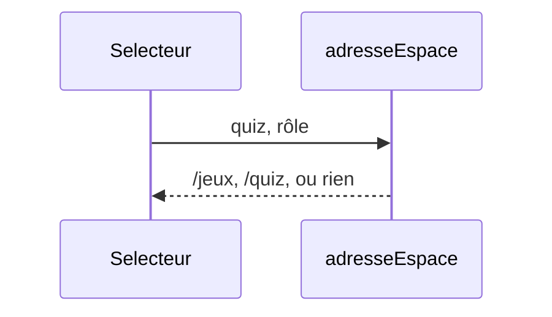

# QJE-01 · L'entrée Quiz ouvre Planner — plan court

| | |
|---|---|
| Module | [QJE](../../plan/modules/QJE-quiz-jeux-ia.md) · exception hors chantier (chef, 18 nov.) |
| Branche | `feat/qje-01-entree-studio` |
| Rédigé par | agent de Cursor (Grok 4.7), le 2026-11-18 |
| **Validé** | en attente du coordinateur (S, sans migration ni sécurité). Ce plan ne touche ni l'identité ni le serveur. Aucun code avant ce « validé ». |

## 1. Objet et critère de « terminé »

Dans le sélecteur d'espaces, l'entrée « Quiz » ne construit plus d'adresse vers ClassQuiz. Elle ouvre une page de Planner. Le titre affiché reste « Quiz ».

Vérifié par un test de `adresseEspace` et, si la question 3 est retenue, par le parcours `classQuizEteint.spec.cjs`.

## 2. Ce qui existe

`shared/espaces.js`, `adresseEspace` :

- l'administration n'a pas d'entrée Quiz ;
- sans `urlQuiz` en `http` ou `https`, personne n'a l'entrée, y compris l'enseignant ;
- l'enseignant reçoit `/jeux` (Activités), pas ClassQuiz ;
- tout autre rôle reçoit `urlQuiz` + `/play`, le site ClassQuiz.

`/studio-quiz` (Mes quiz) est réservé à l'enseignant. `/quiz` existe déjà pour l'étudiant (saisie du code). Le sélecteur web est `SelecteurEspaces.jsx`. L'application mobile ne liste pas Quiz.

Le parcours `frontend/tests/parcours/classQuizEteint.spec.cjs` attend que, ClassQuiz éteint, l'enseignant ne voie plus l'entrée Quiz.

## 3. Questions et réponses

| N° | Question | Proposition | Réponse | Bloque |
|---|---|---|---|---|
| 1 | Où arrive l'étudiant, à la place de `/play` ? | `/quiz`, page déjà réservée à l'étudiant. Pas `/studio-quiz`, qui le refuserait. | en attente | oui |
| 2 | L'enseignant reste-t-il sur `/jeux` ? | Oui. Il n'ouvre déjà pas ClassQuiz. `/studio-quiz` serait un autre choix. | en attente | oui |
| 3 | L'entrée reste-t-elle visible quand ClassQuiz est éteint ? | Oui. Elle ne dépend plus de `urlQuiz`. L'administration reste sans entrée. Le parcours enseignant change. | en attente | oui |
| 4 | L'application mobile, qui ne liste pas Quiz ? | On n'y touche pas. | en attente | non |

## 4. Solution

Si les propositions 1 à 3 sont retenues, `adresseEspace('quiz')` ne lit plus `urlQuiz` :

- administration : `null` ;
- enseignant : `/jeux` ;
- étudiant : `/quiz` ;
- autre rôle : `null`, comme aujourd'hui dès que l'adresse ClassQuiz manque.

Aucune chaîne `/play` ni d'adresse absolue vers le service de quiz. Le sélecteur web n'a pas d'autre changement : une adresse qui commence par `/` est déjà ouverte dans Planner.

## 5. Fichiers créés ou modifiés

| Fichier | Créé / modifié | Rôle | Taille visée |
|---|---|---|---|
| `shared/espaces.js` | modifié | adresses Quiz | la fonction reste courte |
| `frontend/src/components/espaces/adresseEspace.test.js` | créé | rôles, absence de `/play` | un fichier court |
| `frontend/tests/parcours/classQuizEteint.spec.cjs` | modifié si la question 3 est oui | l'entrée enseignant reste visible ClassQuiz éteint | le test existant |
| `docs/sessions/…-feat-qje-01-entree-studio.md` | créé | fiche, au moment du code | — |

## 6. Données et migration

Aucune.

## 7. Sécurité, isolation et exigences produit

Pas d'OIDC, pas de conteneur, pas de secret. L'entrée ne sort plus vers un autre site. Le nom affiché reste « Quiz » (archive du 20 octobre, § 3).

## 8. Tests

`node --test` sur `adresseEspace.test.js` via `npm run test:unit` dans `frontend/` (ce script n'est pas dans la CI aujourd'hui). Cas : enseignant `/jeux`, étudiant `/quiz`, admin `null`, aucun résultat ne contient `/play`. Si la question 3 est oui, le parcours `classQuizEteint` : l'enseignant voit encore l'entrée quand la config est éteinte.

## 9. Étapes de livraison

1. Ce plan, commité seul. Arrêt : le coordinateur valide.
2. Après le « validé » : le code, les tests, la fiche.

## 10. Risques et retour arrière

Un étudiant qui comptait sur `/play` arrive sur `/quiz`. Retour arrière : revenir au commit d'avant.

## 11. Hors périmètre

L'application mobile. Les pages du Studio. Les conteneurs ClassQuiz, l'OIDC, l'import des quiz (QJE-03, QJE-06). `docs/plan/suivi.md`.
