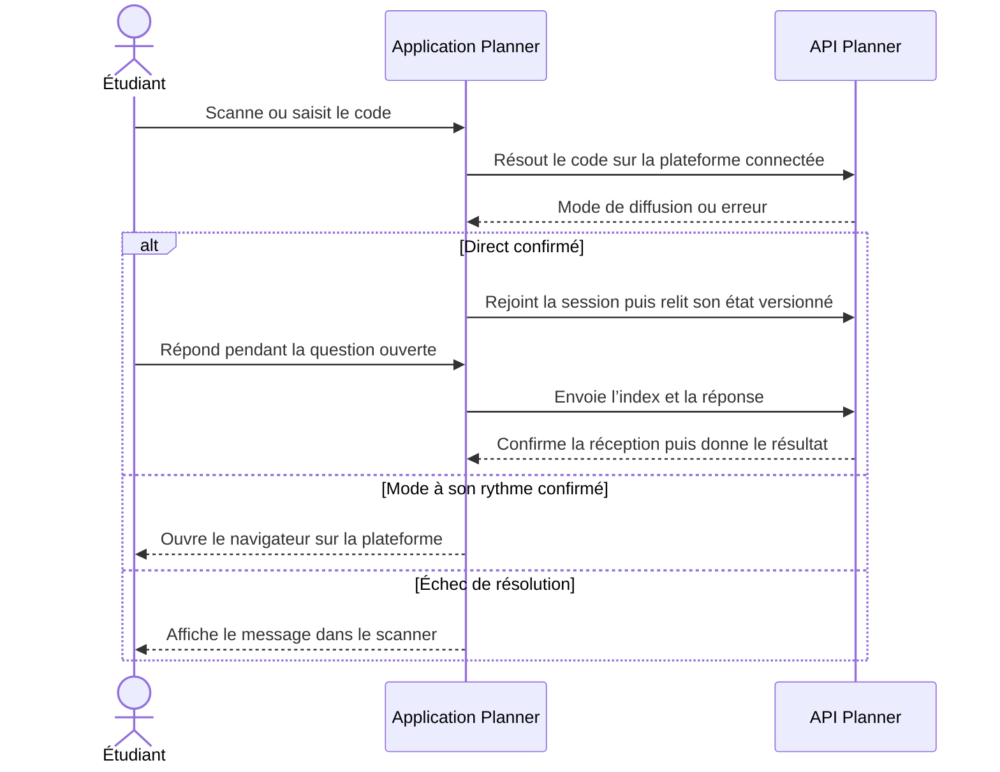

# QJE-03 · Joueur natif du Studio quiz

| | |
|---|---|
| Module | [QJE](../../plan/modules/QJE-quiz-jeux-ia.md) · exception hors chantier du 18 novembre |
| Mission | [Sortie de ClassQuiz](../../plan/missions/sortie-classquiz.md), après QJE-01 |
| Branche | `feat/qje-03-joueur-natif` |
| Rédigé par | Codex, le 26 novembre 2026 |
| **Validé** | En attente de Claude20022002 |

## 1. Objet et recette attendue

Le lot SC-1c relie un étudiant au direct du Studio dans l’application. La recette propose une partie complète déclenchée depuis le site de l’enseignant. L’étudiant rejoint, attend, répond aux six types du direct, puis voit la correction, ses points, son rang et le podium. Une perte de connexion, un accès depuis un autre groupe ou une diffusion close ont chacun une issue testée. Les choix à valider sont au § 3.

## 2. Ce qui existe

- Le [scanner](../../../mobile/src/app/scanner.jsx) reconnaît les QR du Studio. Le [parseur](../../../mobile/src/quiz/studio.js) extrait leur code de six caractères et le [client mobile](../../../mobile/src/api/donnees.js) envoie le code à l’API configurée de Planner. Quand l’API renvoie une session directe, le scanner ouvre `/quiz-direct/[id]`. Il traite actuellement toute erreur de résolution comme un motif d’ouverture du web. Il n’offre aucune saisie de code lorsque la caméra est indisponible.
- Le [joueur React Native](../../../mobile/src/app/quiz-direct/%5Bid%5D.jsx) et ses [contrôles de réponse](../../../mobile/src/quiz/ReponseDirect.jsx) sont déjà présents. Il affiche les images via l’API authentifiée et renvoie à l’écran de la classe pour le son ou la vidéo. [Le crochet](../../../mobile/src/quiz/useDirect.js) garde la version de la partie, relit toutes les secondes au premier plan et bloque le chevauchement des lectures.
- [Les routes du direct](../../../backend/routes/quizDirectRoutes.js) sont authentifiées et ont un limiteur par compte. [Le service joueur](../../../backend/services/studio/directJoueur.js) contrôle le rôle et le groupe à l’entrée, puis rattache les réponses au joueur. Le serveur tient le délai, la correction et les points selon la justesse et la rapidité. Une réponse au même index est unique.
- Les [tests API mobiles](../../../mobile/__tests__/quizDirectApi.test.js), [tests d’intégration](../../../backend/tests/integration/quizDirect.test.js) et le [parcours web](../../../frontend/tests/parcours/quizDirect.spec.cjs) existent. Le parcours Playwright ouvre le joueur web, même pour sa vue téléphone. Il reste à prouver la recette sur le joueur React Native.

## 3. Questions au chef

| N° | Question | Proposition | Réponse du chef | Bloque |
|---|---|---|---|---|
| 1 | Le périmètre mobile natif est-il le direct du Studio, comme SC-1c ? | Oui. Le mode « chacun à son rythme » continue à s’ouvrir dans le navigateur sur la plateforme connectée. | À viser | Code |
| 2 | L’étudiant peut-il saisir le code depuis le scanner, même si la caméra est refusée ? | Oui. Garder le scanner comme entrée existante et offrir la saisie du code affiché ou lu par l’enseignant. Réutiliser la même résolution pour QR et saisie. | À viser | Entrée sans caméra |
| 3 | Quel comportement pour une question avec son ou vidéo quand la salle n’a pas d’écran ? | Garder les images natives et le renvoi au poste de la classe pour le son et la vidéo. Sans écran, l’enseignant utilise un questionnaire dont l’énoncé, les options et l’image éventuelle suffisent sur l’appareil. | À viser | Recette des médias |
| 4 | Quel appareil réel fait foi pour le visa de la recette native ? | Un appareil Android de recette connecté à un environnement de test avec deux comptes étudiants fictifs, dont l’un rejoint sur le web. Ajouter une passe iOS si un appareil de recette est disponible. | À viser | Recette native |

## 4. Solution proposée

Réutiliser le joueur, le protocole d’état versionné et les six types déjà pris en charge (choix unique, choix multiple, vrai ou faux, nombre, réponse courte, ordre). Le scanner soumet le code via la route actuelle. Un mode direct confirmé ouvre l’écran natif. Un mode à son rythme confirmé prend la route web actuelle. Un échec de résolution reste dans le scanner. Afficher une erreur récupérable quand le réseau revient et un message d’issue quand le serveur refuse ou ferme l’accès. Vérifier qu’un nouvel essai est possible après une erreur. La saisie manuelle proposée ne change ni le format du code ni le rôle autorisé.

En cas de coupure pendant une question, afficher l’état de connexion et n’indiquer « envoyée » qu’après confirmation du serveur. Au retour au premier plan ou du réseau, reprendre la lecture existante en conservant au plus une requête de lecture en vol. Après un envoi dont l’issue est inconnue, relire la vue complète sans le paramètre `depuis`. Le serveur peut répondre `inchange` à une lecture versionnée tant que l’étape est la même, même si la réponse a été enregistrée. La vue complète permet de vérifier `repondu` avant de proposer un nouvel envoi. L’étudiant répond seulement si le serveur montre la question encore ouverte et sans réponse enregistrée. Reprendre le rang et la correction à partir de la nouvelle vue.

## 5. Périmètre d’écriture proposé

| Fichier | Rôle |
|---|---|
| `mobile/src/app/scanner.jsx`, `mobile/src/quiz/studio.js` et, si nécessaire, un composant de saisie dans `mobile/src/quiz/` | Réutiliser la résolution du code et distinguer les issues de navigation. Garder le scanner sous le repère de 200 lignes. |
| `mobile/src/app/quiz-direct/[id].jsx`, `mobile/src/quiz/useDirect.js`, `mobile/src/quiz/direct.js` | État de connexion, confirmation de l’envoi, reprise et rendu des états existants. |
| `mobile/src/i18n.js`, `mobile/__tests__/quizStudio.test.js`, `quizDirect.test.js` et `quizDirectApi.test.js` | Messages FR/EN, régressions du code, des refus et de la reprise. Un test colocalisé dans `mobile/__tests__/` si un nouveau composant le nécessite. |
| `docs/plan/modules/QJE-quiz-jeux-ia.md`, `docs/sessions/` | Consigner les résultats après la réalisation. |

## 6. Données et migration

Les objets de session, de joueur et de réponse du Studio restent ceux de l’API actuelle. Aucune migration. Le code et la réponse en cours restent volatils sur le téléphone. Le serveur décide quelles données de la partie sont visibles à chaque étape.

## 7. Sécurité, isolation et accessibilité

EP-12 et EP-15 : utiliser les routes authentifiées de l’école connectée. Un QR ne choisit ni l’hôte des requêtes, ni l’identité, ni le droit à la partie. Vérifier que l’étudiant hors groupe est refusé et qu’un client d’une autre école n’obtient pas les données de la session avec le dispositif de recette existant. Le résultat et les solutions viennent du serveur après la correction. La version de l’état évite de transférer chaque fois le même contenu. EP-2 et EP-16 : messages dans le dictionnaire mobile, cibles tactiles et libellés existants, contrôle à la taille de texte agrandie. Aucun pays ni fuseau codé en dur.

## 7 bis. Ce que disent les études

| Ligne | Étude | Application au lot |
|---|---|---|
| M4, M5 | [Reprendre et dépasser](../../etude-marche/14-reprendre-et-depasser.md), § 3 | Routes authentifiées et test des refus de rôle et de groupe. |
| M8 à M11, M14, M18 | Même étude, § 3 | Recette et retour arrière, traductions et charte mobile, relevé du poids et de l’accès au joueur, accessibilité. D’abord pour les formations du supérieur, avec les rôles et groupes existants. |
| M12, R10 | Même étude, § 2 et § 3 | Mesurer l’ouverture et le trafic du direct. Le seuil vitrine de 200 Ko concerne la vitrine. R10 concerne les téléchargements de fichiers, tandis que le joueur affiche l’image de la question dans la session. |
| M-2, M-16 | [Étude EP-18](../qualite/etude-ep18-faible-equipement.md), § 5.4 et § 8 | Le direct demande un appareil pour répondre. La copie et l’impression à son rythme relèvent de M-2. |
| Module 4 | [Modules et packs](../../etude-marche/15-modules-et-packs.md), § 4 | Réutiliser Quiz et jeux et le Studio de Planner conformément à la sortie de ClassQuiz. |

## 7 ter. EP-18 selon l’équipement

| Contexte | Fonctionnement | Preuve |
|---|---|---|
| A. Étudiant sans appareil | Le web fonctionne sur un poste prêté par l’école. Sans poste, l’étudiant peut suivre la projection ou participer oralement hors du classement. Le papier pour l’épreuve relève de M-2. | Une participation web depuis un ordinateur ; revue des limites. |
| B. Réseau lent ou coupé | Mesurer en Slow 3G (400 kbit/s, 400 ms) le poids à l’ouverture et le trafic des relectures. Une coupure ne valide aucune nouvelle réponse. Après reprise, la vue serveur indique si elle avait été reçue et si la question est toujours ouverte. | Couper et rétablir le réseau avant et après un envoi. Simuler un accusé perdu alors que la version reste la même, avec et sans réponse reçue. Vérifier l’absence de doublon et de stock d’envois hors ligne. |
| C1. Avec projecteur | L’enseignant pilote et projette depuis le site. Les étudiants rejoignent avec le QR ou le code proposé. | Partie avec écran projeté, mobile et navigateur. |
| C2. Sans projecteur | L’enseignant lance depuis un poste connecté et communique le code. L’étudiant joue sur son appareil si l’énoncé est autonome. Le choix d’un questionnaire avec son ou vidéo dépend de la réponse à la question 3. | Partie avec code communiqué sans projection et un quiz texte ou image. |

## 8. Vérifications et livraison

1. Visa du chef sur le plan et les quatre réponses. Consigner le visa dans un commit avant tout code.
2. Étendre les tests mobiles de résolution de code, erreurs et reprise. Lancer Jest, lint et export Android. Relancer les tests d’intégration et le parcours web du direct si le banc est disponible.
3. Recette native avec les comptes fictifs, les six types, un refus de groupe, une question close, une coupure et le podium. Consigner les mesures, le nombre d’appels, les étapes d’accessibilité et les résultats de la recette.

## 9. Retour arrière et limites du lot

Revenir à la version mobile précédente si la recette échoue. Les routes et données du Studio restent compatibles. Le retrait de ClassQuiz, le transfert et la vérification des quiz de l’école pilote relèvent de QJE-06. L’impression et la saisie d’une copie par l’enseignant relèvent de M-2. Le joueur à son rythme, le tableau de bord de l’enseignant, les règles de notation et les changements de protocole ou de déploiement relèvent de chantiers distincts.
