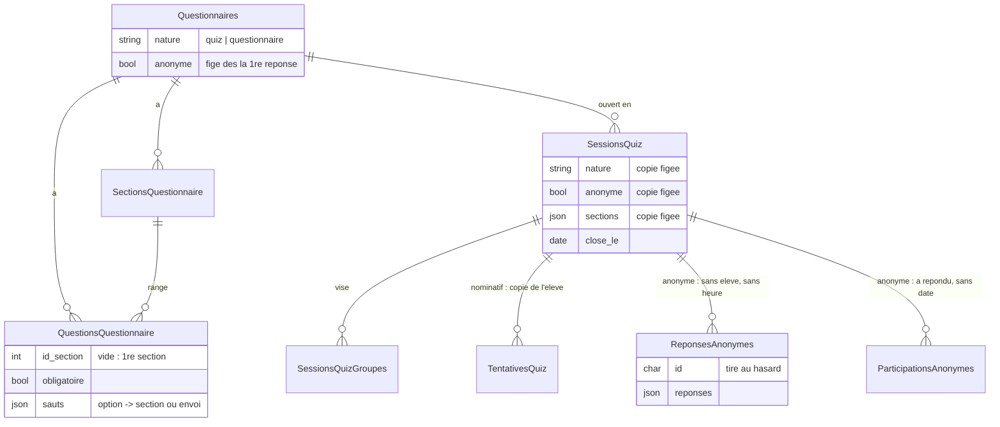

# QJE-14 · Un Studio quiz « comme Google Forms » — conception

| | |
|---|---|
| Module | [QJE](../../plan/modules/QJE-quiz-jeux-ia.md) · rattachée à l'exception de la sortie de ClassQuiz, accordée le 18 nov. (réponse 18) ; aucun quatrième chantier |
| Branche | `doc/qje-14-studio-forms` (ce plan) ; le code, sur une branche par fonction (§ 9) |
| Mission | [qje-14-studio-forms](../../plan/missions/qje-14-studio-forms.md) |
| Rédigé par | Claude Code (Opus 5.5), session de VS Code, le 2026-11-21 ; 24 réponses du chef le même jour |
| **Validé** | **par Claude20022002 le 21 novembre 2026** (« Validé », sans réserve) : choix de produit, données d'élèves, migrations, droits de l'administration. Chaque fonction 14a à 14e garde son plan court à valider |

## 1. Objet et critère de « terminé »

Le chef veut, en plus du Studio (18 nov.) : (1) des **sections** et des questions qui suivent la réponse précédente ; (2) un **tableau des réponses** par question et par élève, avec des graphiques et un export CSV ou Excel ; (3) des **questionnaires non notés** (enquête, inscription, avis), avec des réponses anonymes possibles ; (4) une **création simple** : une page, une question en un clic, un aperçu immédiat, le glisser-déposer.

**Terminé** quand, sur une école dont l'interrupteur est allumé :

- un enseignant crée sur une seule page un questionnaire non noté à trois sections, avec un saut selon une réponse, le voit en aperçu, l'ouvre à sa classe avec une date de fin ;
- les élèves le trouvent sur leur page Quiz et dans l'espace de la classe, y répondent depuis le site ou l'application ;
- en anonyme, aucune donnée de l'école (tables, écrans, export) ne relie une réponse à un élève, ni par l'identité ni par l'heure ni par l'ordre ; rien ne s'affiche sous 3 réponses ;
- l'auteur voit la synthèse en graphiques, le tableau (une ligne par répondant) et exporte en CSV et en Excel ; personne d'autre ne les voit ;
- l'administration fait de même vers plusieurs classes ;
- les réponses non notées s'effacent seules 12 mois après la fermeture ;
- les quiz notés gardent tout ce qu'ils font aujourd'hui, avec le nouvel éditeur et des sections.

Vérifié par les tests du § 8, dont un parcours de bout en bout par fonction.

## 2. Ce qui existe

**Le Studio quiz** (plan archivé [studio-quiz](../../archives/plans/studio-quiz.md), migrations 0044, 0046, 0051) :

| Point | État aujourd'hui | Fichiers |
|---|---|---|
| Banque | `Questionnaires` d'un enseignant (titre, consignes, étiquettes, réglages JSON, archive) | `backend/migrations/0044-studio-quiz.js`, `services/studio/questionnaires.js` |
| Questions | dix types notés (`choix_unique` … `reponse_libre`), données par type en JSON, médias, ordre global, **ni section ni « obligatoire »** | `shared/quiz/studio/types.js` |
| Passation | `SessionsQuiz` : code, copie figée des questions, réglages, ouverture et fermeture, **un seul** groupe facultatif, « à son rythme » ou en direct | `services/studio/sessions.js`, migration 0046 |
| Répondre | **compte d'étudiant seulement** (403 sinon), de son groupe si un groupe est visé ; la copie (`TentativesQuiz`) s'enregistre réponse par réponse, avec `debut` et `rendue_le` | `services/studio/tentatives.js:30-41`, `routes/passationRoutes.js` |
| Résultats | indicateurs, copies, facilité et discrimination, répartition des choix **en chiffres, sans graphique** | `services/studio/analyse.js`, `pages/studio/Resultats.jsx` |
| Export | CSV des **scores** (nom, prénom, courriel, points, durée), **pas des réponses** | `sessions.js:183-189` |
| Éditeur | trois onglets ; **deux volets** (plan à gauche, une question à droite) ; flèches pour réordonner, **pas de glisser-déposer**, aperçu en ouvrant une passation d'essai | `pages/studio/EditeurQuiz.jsx`, `components/studio/editeur/*` |
| Droits | `requireRole("enseignant")` ; tout est à l'auteur, 404 pour un collègue | `routes/studioQuizRoutes.js:39` |
| Conservation | textes des supports d'IA effacés après 30 jours ; **les copies d'élèves, jamais** | `iaGeneration.js:273` |
| Mobile | l'application lit le QR et ouvre la page du site, déjà connectée | `mobile/src/quiz/studio.js` |

Outils déjà dans le site : **recharts** (graphiques) et **SheetJS** (`xlsx`). Aucune bibliothèque de tableur côté serveur, aucune de glisser-déposer (le joueur utilise le glisser natif, `ReponsesInteractives.jsx:97`).

**Le sondage de l'enseignant** (COU-01, EC-9, migration 0059, [conception](../espace-de-cours/conception-ec9-sondage.md)) : une question, 2 à 6 choix, dans la classe ; interrupteur `sondages_actifs` éteint par défaut ; **anonyme par construction** (S-6 : le choix incrémente un compteur, la participation dit seulement « a répondu », sans date) ; répartition montrée à partir de 3 réponses (S-7). Il **reste** (réponse 1) : QJE-14 en reprend les règles d'anonymat, sans y toucher.

**Migrations** : 0083 est écrite sur `feat/sta-01-offres-stage` (#230) sans être inscrite dans `suivi.md` ; 0084 et plus semblent libres. Les numéros se réservent auprès du coordinateur (§ 6).

## 3. Questions et réponses

Toutes posées au chef le 21 nov. (le coordinateur n'était dans aucune session) ; toutes répondues.

| N° | Question | Réponse du chef |
|---|---|---|
| 1 | Les questionnaires non notés remplacent-ils le sondage COU-01 ? | **Ils le complètent** : le sondage éclair reste dans la classe ; pas de migration des sondages |
| 2 | Jusqu'où va la logique ? | **Sections et sauts**, comme Google Forms : une question à choix unique envoie vers une section ou vers l'envoi |
| 3 | Les sauts valent-ils pour les quiz notés ? | **Non** : sections pour tous, sauts en non noté seulement ; un quiz noté garde le même total pour tous |
| 4 | Qui répond à un questionnaire non noté ? | **Les comptes de l'école** : élèves d'une classe, connectés ; pas de lien public |
| 5 | Comment rendre une réponse anonyme ? | **Par construction**, comme S-6 ; résultats à partir de 3 réponses |
| 6 | Texte libre en anonyme ? | **Non** : en anonyme, choix, listes, échelles, grilles et nombres seulement |
| 7 | Conservation (loi 09-08) | Non notées : **effacées 12 mois après la fermeture** ; copies notées : gardées avec l'année scolaire et son archive |
| 8 | Élèves mineurs | **Interrupteur de l'école éteint par défaut** + rappel à la création (ni santé, ni religion, ni opinions, ni origine, ni vie familiale) ; avis d'un juriste avant d'allumer chez une école de mineurs |
| 9 | Formats d'export | **CSV et Excel** ; une ligne par répondant, une colonne par question ; en anonyme, ni nom ni heure, lignes mélangées |
| 10 | Qui voit et exporte ? | **L'auteur seul** ; un collègue ou l'administration reçoit 404 |
| 11 | L'administration crée-t-elle ses questionnaires ? | **Oui, dans QJE-14** |
| 12 | Point de départ de l'effacement | **La fermeture + 12 mois** |
| 13 | Qui l'administration vise-t-elle ? | **Des classes choisies** (groupes et sous-groupes, jusqu'à toutes) ; élèves seulement |
| 14 | Le nouvel éditeur remplace-t-il l'actuel ? | **Oui, pour tous**, quiz notés compris |
| 15 | Nouveaux types (non noté) | **Liste déroulante, échelle linéaire, grille à choix** ; pas de dépôt de fichier, pas de date |
| 16 | Modifier sa réponse après l'envoi ? | **En nominatif seulement**, si l'auteur le permet, tant que c'est ouvert ; jamais en anonyme |
| 17 | Où produire le .xlsx ? | **Dans le navigateur**, avec SheetJS déjà présent ; le serveur envoie le tableau déjà filtré |
| 18 | Chantier | **L'exception de la sortie de ClassQuiz** (18 nov.) |
| 19 | Mobile | **Comme les quiz** : l'application ouvre la page du site ; l'écran natif viendra avec QJE-03 |
| 20 | Notification aux élèves | **Au choix de l'auteur**, case cochée par défaut ; notification interne, aucun courriel |
| 21 | Les journaux binaires de MySQL relient réponse et participation pendant 30 jours | **L'écrire et l'accepter** (§ 7.3) |
| 22 | Plafond des notifications | **3 par jour et par élève** ; au-delà, ouvert sans notification, et l'auteur le voit dit |
| 23 | Questionnaire sans date de fin | **Date de fin obligatoire**, au plus 6 mois après l'ouverture, proposée à 2 semaines |
| 24 | Où l'élève trouve ses questionnaires | **Page Quiz** (« À remplir ») **et espace de la classe**, près des sondages |

Questions laissées au coordinateur, réversibles et internes au module : les noms exacts des tables et des fichiers, l'ordre des lots dans chaque fonction, la forme des écrans dans la charte (UIX-10).

## 4. Solution

**Un seul Studio, deux natures.** Un questionnaire du Studio est soit un **quiz** (noté, comme aujourd'hui), soit un **questionnaire** (non noté). La nature se choisit à la création et ne change plus. Les deux partagent la banque, l'éditeur, les sections, les passations par code, lien ou QR, et le tableau des réponses.

| | Quiz (noté) | Questionnaire (non noté) |
|---|---|---|
| Types | les dix d'aujourd'hui | choix unique et multiple, liste déroulante, échelle linéaire, grille à choix, nombre ; réponse courte et longue en **nominatif** seulement (réponse 6) |
| Points, bonne réponse, correction | oui | non |
| Sections | oui, une section = une page | oui |
| Sauts | non (réponse 3) | oui (réponse 2) |
| « Obligatoire » | non : une question sans réponse vaut 0 | oui, par question |
| Anonyme | non | au choix de l'auteur, **figé dès la première réponse** |
| Direct en classe, IA | oui | non (§ 11) |
| Auteur | enseignant | enseignant ou administration (réponse 11) |
| Envoi | réponse par réponse, comme aujourd'hui | **en une fois** à la fin ; le brouillon reste dans le navigateur |
| Conservation | avec l'année scolaire (sans changement dans QJE-14) | effacé 12 mois après la fermeture |

**Sections et sauts.** Un questionnaire a une ou plusieurs sections, dans l'ordre. Une question appartient à une section. Après la dernière question d'une section, la suite est « section suivante », une section nommée, ou « envoyer ». Une question à choix unique ou à liste déroulante peut porter des **sauts** : pour chaque option, une section ou « envoyer ». Règle qui évite les boucles : **un saut ne va que vers une section plus loin**. Le serveur refait le chemin à l'envoi : il écarte les réponses hors du chemin et exige les questions obligatoires du chemin. Une seule fonction partagée calcule ce chemin pour le serveur, le site et l'application.

**Anonymat par construction** (réponses 5, 6, 16, 21) : la réponse anonyme est rangée dans une table **sans élève, sans heure et sans numéro croissant** (identifiant tiré au hasard) ; une autre table, sans date, dit seulement « a répondu ». Les deux écritures sont dans une même transaction, comme S-6. Le nombre de réponses se compte, il n'est pas tenu sur la passation (sa date de mise à jour trahirait l'heure).



```mermaid
sequenceDiagram
    participant E as Élève (site ou application)
    participant S as Serveur
    participant B as Base de l'école
    E->>S: rejoindre (code, lien, liste « À remplir »)
    S->>S: interrupteur, classe visée, ouverte, déjà répondu ?
    S-->>E: sections et questions (sans données d'autrui)
    Note over E: répond section par section ;<br/>le brouillon reste dans le navigateur
    E->>S: envoyer toutes les réponses
    S->>S: refait le chemin (sauts), écarte le reste,<br/>exige les obligatoires du chemin
    alt anonyme
        S->>B: une transaction : ReponsesAnonymes (sans élève ni heure)<br/>+ ParticipationsAnonymes (élève, sans date)
    else nominatif
        S->>B: TentativesQuiz rendue (réponses, sans correction)
    end
    S-->>E: « Réponse envoyée »
```

**Tableau des réponses** (réponses 9, 10, 17) : trois vues pour l'auteur. **Synthèse** : un graphique par question (barres pour les choix, les listes et les échelles, barres empilées pour une grille, répartition et médiane pour un nombre, liste des textes en nominatif). **Par répondant** : en nominatif, chaque copie (déjà là) ; en anonyme, aucune. **Tableau** : une ligne par répondant, une colonne par question. Le serveur prépare le tableau, déjà filtré : en anonyme, ni nom, ni heure, lignes mélangées à chaque appel, et **rien sous 3 réponses** que leur nombre. Le CSV vient du serveur (la fonction `champCsv` existe) ; l'Excel est fait dans le navigateur à partir du même tableau, avec SheetJS. Rien n'est envoyé à un service extérieur (EP-13). Les quiz notés gagnent aussi la synthèse et le tableau des réponses, en plus du CSV des scores.

**Éditeur sur une page** (réponse 14) : toutes les sections et les questions en cartes sur une page ; un clic sur une carte l'ouvre sur place ; « + » sous chaque carte ajoute une question (le dernier type choisi, changeable) ; glisser-déposer natif pour les cartes et les sections, et **les mêmes déplacements au clavier** (Alt + flèches) ; l'aperçu à côté sur grand écran, au-dessus par un bouton en téléphone, sans ouvrir de passation. L'IA, les médias et l'import gardent leurs fenêtres.

**Administration** (réponses 11, 13, 22) : elle accède aux questionnaires non notés du Studio (pas aux quiz), vise une ou plusieurs classes de l'école, avec leurs sous-groupes. Une passation peut donc viser **plusieurs groupes**. Les notifications « Nouveau questionnaire » partent par lots, au plus 3 par jour et par élève, tous auteurs confondus.

## 5. Découpage en fonctions

Chaque fonction a son plan court, validé avant son code, et une branche à elle. L'ordre suit la dépendance des données.

| Fonction | Contenu | Taille | Migration | Dépend de |
|---|---|---|---|---|
| **QJE-14a** | Modèle et règles partagées : nature, sections, sauts, « obligatoire », trois nouveaux types, chemin calculé, interrupteur ; API de la banque | M | A | — |
| **QJE-14b** | L'éditeur sur une page, pour tous : cartes, sections, sauts, glisser-déposer et clavier, aperçu | L | — | 14a |
| **QJE-14c** | Répondre à un questionnaire non noté : nominatif et anonyme, envoi unique, modification en nominatif, date de fin obligatoire, listes « À remplir », notification, **effacement à 12 mois** ; sections en pages dans les quiz notés | L | B | 14a, 14b |
| **QJE-14d** | Tableau des réponses : synthèse en graphiques, tableau, CSV et Excel, seuil de 3 ; aussi pour les quiz notés | M | — | 14c |
| **QJE-14e** | Questionnaires de l'administration : droits, plusieurs classes, plafond des notifications | M | C | 14c |

L'effacement est dans 14c, et pas après : aucune réponse non notée n'est gardée sans sa règle de conservation. Total brut : environ 15 jours (M = 2, L = 5).

## 6. Fichiers, données et migrations

**Fichiers principaux** (détaillés dans le plan court de chaque fonction ; 300 lignes au plus, 200 pour une route) :

| Fichier | Créé / modifié | Rôle | Fonction |
|---|---|---|---|
| `shared/quiz/studio/typesQuestionnaire.js` | créé | les trois nouveaux types, quels types pour quelle nature, anonyme ou non | 14a |
| `shared/quiz/studio/sections.js` | créé | vérifier sections et sauts (pas de saut en arrière), calculer le chemin | 14a |
| `backend/services/studio/sections.js` | créé | sections de la banque (créer, renommer, déplacer, supprimer en rattachant ses questions à la précédente) | 14a |
| `backend/services/studio/questionnaires.js`, `reglages.js`, `sessions.js` | modifiés | nature, anonyme figé, obligatoire, sauts, copie figée des sections | 14a, 14c |
| `frontend/src/pages/studio/EditeurQuiz.jsx` et `components/studio/editeur/*` | refaits | l'éditeur sur une page | 14b |
| `backend/services/studio/reponsesQuestionnaire.js` | créé | envoi unique, chemin, anonymat, modification | 14c |
| `backend/services/studio/conservation.js` | créé | effacement à 12 mois, appelé par la tâche quotidienne existante | 14c |
| `backend/routes/questionnaireRoutes.js` | créé | côté élève : à remplir, rejoindre, envoyer | 14c |
| `backend/services/studio/tableauReponses.js` | créé | synthèse et tableau filtrés, CSV | 14d |
| `frontend/src/pages/studio/Resultats.jsx` | modifié | les trois vues, Excel par SheetJS | 14d |
| `backend/routes/studioQuizRoutes.js` | modifié | `requireRole("enseignant", "admin")`, nature vérifiée dans le service | 14e |

**Migrations** (numéros **à réserver par le coordinateur** ; proposition 0084, 0085, 0086, puisque 0083 est écrite par STA-01). « Étendre puis contracter » : rien n'est retiré dans QJE-14.

| | Contenu | Base qui a déjà des données |
|---|---|---|
| **A** (14a) | `Questionnaires` + `nature` (`quiz` par défaut) + `anonyme` (faux) ; table `SectionsQuestionnaire` (questionnaire, ordre, titre, description, suite) ; `QuestionsQuestionnaire` + `id_section` (vide = première section), `obligatoire` (faux), `sauts` (JSON vide) ; `SessionsQuiz` + `nature`, `anonyme`, `sections` (copie figée), `close_le` ; `ConfigurationEtablissement` + `questionnaires_actifs` (faux pour toutes les bases, HESTIM compris) | tous les quiz restent des quiz notés à une section implicite : rien ne change pour eux |
| **B** (14c) | table `ReponsesAnonymes` (identifiant tiré au hasard, passation, réponses ; **sans horodatage**) ; table `ParticipationsAnonymes` (passation, élève ; **sans horodatage**) | tables neuves, vides |
| **C** (14e) | table `SessionsQuizGroupes` (passation, groupe) ; recopie de `SessionsQuiz.id_groupe` existant ; le service ne lit plus que la nouvelle table ; la colonne reste jusqu'à une contraction hors de QJE-14 | une ligne par passation qui visait un groupe |

Retour arrière de chaque migration : tables et colonnes retirées ; C ne retire pas `id_groupe`, toujours rempli.

## 7. Sécurité, isolation, données d'élèves et exigences produit

### 7.1 Droits

| Qui | Peut |
|---|---|
| Enseignant | créer quiz et questionnaires ; viser ses classes (règle actuelle `verifierGroupe`) ; voir et exporter **ses** résultats |
| Administration | créer des **questionnaires** (pas des quiz) ; viser des classes de l'école ; voir et exporter **ses** résultats |
| Élève | répondre aux passations de ses classes (groupe ou sous-groupe) ; un questionnaire non noté vise **toujours** au moins une classe (réponse 4), le code, le lien et le QR n'en sont que des chemins ; un quiz noté garde la règle d'aujourd'hui (classe facultative) ; jamais voir les réponses d'autrui |
| Collègue, autre administrateur | **404** sur ce qui n'est pas à lui (réponse 10) |

L'auteur ne répond pas à ses propres questionnaires, sauf en aperçu, qui ne compte pas. Tout est vérifié par le serveur ; le client n'est jamais cru (chemin, types, droits, anonymat).

### 7.2 Anonymat : ce qui est garanti

- Aucune ligne ne relie un élève à sa réponse anonyme ; ni date, ni heure, ni numéro croissant dans les deux tables ; le nombre de réponses n'est pas tenu sur la passation.
- Le tableau, la synthèse et l'export d'une passation anonyme n'ont ni nom, ni heure ; les lignes sont mélangées à chaque appel ; sous **3 réponses**, seul leur nombre sort du serveur (comme S-7).
- Pas de texte libre en anonyme, ni « Autre : … » dans un choix (réponse 6).
- `anonyme` se fige dès la première réponse : on ne rend pas nominatif ce qui a été promis anonyme, ni l'inverse.
- Pas de modification de réponse en anonyme (réponse 16).
- L'élève voit avant de répondre : « Anonyme : votre enseignant ne saura pas ce que vous avez répondu » ou « Nominatif : votre nom est joint à vos réponses ».
- Les journaux du serveur n'écrivent pas le contenu d'une réponse.

### 7.3 Anonymat : la limite écrite (réponse 21)

Les journaux binaires de MySQL, gardés pour restaurer la base, enregistrent la réponse et la participation dans la même transaction, avec l'heure. Quelqu'un qui détient les clés des sauvegardes pourrait les relier tant que ces journaux existent (30 jours sur B2, chiffrés). C'est déjà le cas du sondage COU-01. **Décision du chef : l'écrire et l'accepter.** La phrase est reprise dans ce plan, dans l'avertissement de l'auteur et sur la page Sécurité du site quand elle parlera des questionnaires : « anonyme pour l'école, l'enseignant et l'export ; les journaux de restauration, chiffrés et effacés après 30 jours, ne sont lus que par l'exploitant pour une restauration ».

### 7.4 Données d'élèves et loi 09-08

- **Interrupteur** `questionnaires_actifs`, éteint pour toutes les bases (D-04) ; comme `sondages_actifs`, aucun écran ne l'allume aujourd'hui : l'exploitant l'allume à la demande de l'école. Éteint, les questionnaires disparaissent des écrans et toute écriture rend 403. Les quiz notés n'en dépendent pas.
- **Avant d'allumer chez une école de mineurs**, l'avis d'un juriste (réponse 8). Les réponses à des questionnaires sont des données d'élèves ; la question rejoint Q-19 (loi 09-08, condition légale).
- **Rappel à la création** d'un questionnaire : ni santé, ni religion, ni opinions politiques, ni origine, ni vie familiale.
- **Conservation** : non notées, effacées **12 mois après la fermeture** (anonymes et nominatives), par la tâche quotidienne qui purge déjà le Studio ; date de fin **obligatoire**, au plus 6 mois après l'ouverture. Copies notées : sans changement dans QJE-14 ; elles suivront l'archivage de l'année quand il existera. Aujourd'hui, elles ne sont jamais effacées : **écart signalé**, hors périmètre.
- **Export d'une école** et archivage : les tables suivent la passation, qui suit son auteur et ses groupes.

### 7.5 Isolation et exigences produit

- Toutes les tables vivent dans la base de l'école (D-01) ; aucune route ne prend d'identifiant d'école ; un groupe visé est contrôlé dans la base courante.
- **EP-13 « Aucun envoi caché »** : aucun envoi sortant ; l'Excel est fait dans le navigateur ; la notification est interne. La liste des envois sortants ne change pas.
- **EP-4** (chaque refus s'explique) : refus codés et phrases (`QUESTIONNAIRE_FERME`, `DEJA_REPONDU`, `OBLIGATOIRE_MANQUANT`, `SAUT_EN_ARRIERE`, `TYPE_INTERDIT_EN_ANONYME`, `QUESTIONNAIRES_FERMES`).
- **EP-2** (interface sobre) : une page, une action principale ; l'avancé (sauts, anonymat) se déplie.
- Limites de débit : celles du Studio, plus une sur l'envoi des réponses par compte.

## 8. Tests

| Niveau | Fichier (prévu) | Ce qu'il prouve |
|---|---|---|
| Unitaire | `backend/tests/utils/sectionsStudio.test.js` | saut en arrière refusé ; chemin calculé ; réponses hors chemin écartées ; obligatoire manquant sur le chemin refusé, hors chemin accepté |
| Unitaire | `backend/tests/utils/typesQuestionnaire.test.js` | les trois types ; texte refusé en anonyme ; points et bonne réponse ignorés en non noté |
| Intégration | `backend/tests/integration/questionnaires.test.js` | interrupteur éteint : 403 ; élève hors de la classe : 403 ; deux envois : 409 ; anonyme : aucune colonne d'élève ni d'heure dans `ReponsesAnonymes`, participation sans date ; `anonyme` figé après la 1re réponse ; modification nominative acceptée tant que c'est ouvert, refusée en anonyme |
| Intégration | `backend/tests/integration/tableauReponses.test.js` | sous 3 réponses anonymes, seul le nombre ; export anonyme sans nom ni heure, ordre différent d'un appel à l'autre ; collègue et administration : 404 |
| Intégration | `backend/tests/integration/questionnairesAdmin.test.js` | l'administration crée un questionnaire et pas un quiz ; plusieurs classes ; plafond de 3 notifications par jour et par élève |
| Unitaire | `backend/tests/utils/conservationStudio.test.js` | effacé à 12 mois et un jour après la fermeture, gardé la veille ; copies notées jamais touchées |
| Régression | suites `studioQuiz`, `quizDirect`, `sondages` | les quiz notés, le direct et le sondage ne changent pas |
| Parcours | `frontend/tests/parcours/questionnaire.spec.cjs` | créer sur une page (3 sections, un saut), ouvrir, répondre en élève par deux chemins, voir la synthèse, exporter ; à 390 px compris |
| Parcours | `frontend/tests/parcours/studioQuiz.spec.cjs` | mis à jour pour le nouvel éditeur |

Avant chaque annonce : la suite du serveur et les parcours (règle du 29 oct.).

## 9. Étapes de livraison

1. Ce plan, validé par le chef, commité seul sur `doc/qje-14-studio-forms` ; la ligne QJE-14 du module. Numéros de migration réservés par le coordinateur.
2. QJE-14a : plan court, validé, code, PR (`feat/qje-14a-modele`).
3. QJE-14b : plan court (avec une maquette de l'éditeur montrée au chef), validé, code, PR (`feat/qje-14b-editeur`).
4. QJE-14c : plan court, validé, code, PR (`feat/qje-14c-reponses`).
5. QJE-14d : plan court, validé, code, PR (`feat/qje-14d-tableau`).
6. QJE-14e : plan court, validé, code, PR (`feat/qje-14e-administration`).
7. Allumer l'interrupteur chez une école : décision de l'école et du chef, après l'avis du juriste si elle a des mineurs.

## 10. Risques et retour arrière

| Risque | Parade |
|---|---|
| Le nouvel éditeur casse l'habitude des enseignants qui ont des quiz | même banque, mêmes fenêtres (IA, médias, import) ; parcours `studioQuiz` mis à jour ; maquette montrée au chef avant le code |
| Une réponse anonyme se devine (petite classe) | seuil de 3 ; pas de texte libre ; pas d'heure ; lignes mélangées |
| Les journaux binaires relient pendant 30 jours | limite écrite et acceptée (§ 7.3) |
| Glisser-déposer natif peu commode au toucher | les mêmes déplacements par boutons et au clavier |
| Notifications trop nombreuses (administration) | plafond de 3 par jour et par élève |
| Copies notées jamais effacées | écart signalé (§ 7.4), à traiter avec l'archivage de l'année |

Retour arrière : chaque fonction a sa PR ; les migrations ne retirent rien ; éteindre `questionnaires_actifs` cache tout le non noté sans toucher aux quiz.

## 11. Hors périmètre

- Lien public sans compte (réponse 4), répondants du personnel, des parents ou de l'extérieur.
- Remplacer ou fondre le sondage COU-01 (réponse 1).
- Sauts dans les quiz notés (réponse 3), conditions combinées par question.
- Questionnaire non noté en direct, ou généré par l'IA.
- Dépôt de fichier, question « date ».
- Partage d'un questionnaire ou de ses résultats entre enseignants.
- Écran natif dans l'application (QJE-03).
- Effacement des copies notées et archivage de l'année (ADM, PLA).
- Un écran pour allumer l'interrupteur.
