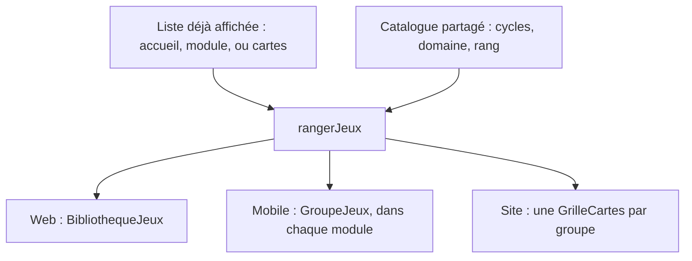

# QJE-15 · Les jeux rangés par niveau, puis par filière — conception

| | |
|---|---|
| Module | (nom fixé par QJE-17) · exception hors chantier (chef, 18 nov.) |
| Branche | `feat/qje-15-jeux-par-niveau` |
| Rédigé par | agent de Cursor (Grok 4.7), le 2026-11-26 ; revu le 2026-11-27 ; amendé le 2026-11-27 ; accroches réécrites le 2026-11-28 |
| **Validé** | chef, 27 nov. : questions 1 et 2 (quatre cycles, tableau tel quel, variantes écartées). Le champ s'appelle `domaine`. La séparation est QJE-17. Questions 5 et 6 validées le 28 nov. (`e9a0c5a3`) : les onze accroches du § 4 bis ; la voie d'image telle que proposée (neuf vues ; Codex pour Labo Big-O et Requête Parfaite ; une ligne de `credits.md` par image). |

## 1. Objet et critère de « terminé »

Chaque jeu du catalogue porte un ou plusieurs cycles scolaires et un domaine. Le web, le mobile et la page des jeux du site montrent les jeux dans le même ordre : le cycle, puis le domaine, puis le rang du tableau ci-dessous. Un cycle ou un domaine sans jeu dans la liste affichée n'a pas de titre. La carte montre une image du jeu, son titre, son domaine, une accroche courte et, dans l'application, la progression.

Ce plan ne range que les jeux : le terminal et les dix simulations. Les quiz du Studio n'y entrent pas. Là où il faut le nom du module des jeux, le plan écrit (nom fixé par QJE-17). Le chef a décidé le 26 nov. que les quiz et les jeux sont séparés partout : sur le site, dans l'application, dans l'offre et dans le plan. QJE-15 ne fait pas cette séparation. QJE-16 reste l'interrupteur de l'IA par école. Les écrans qui montrent encore les deux sont au § 2 bis.

On le vérifie par un test du catalogue (les onze lignes du tableau), un test du rangement (l'ordre ne dépend pas de la langue ni de l'ordre d'arrivée), les tests du site sur l'ordre des cartes, et axe-core sur la bibliothèque des jeux. Les deux façons de jouer restent celles d'aujourd'hui.

## 2. Ce qui existe

Lu sur `origin/main` (`7469bb70`).

- `shared/jeux/catalogue.js` (44 lignes) réunit le terminal et les dix simulations. Le terminal a `discipline: 'informatique'`. Chaque simulation a une `discipline` (`algorithmique`, `bases-de-donnees`, `systemes-d-exploitation`, `robotique`, `reseaux`, `cybersecurite`, `intelligence-artificielle`, `gestion-de-projet`, `gestion`, `logistique`).
- `shared/simulations/catalogue/_aide.js` : `curriculum(fr, en)` pose `niveaux: [1, 2, 3]`. Ces trois nombres sont les trois défis du jeu. Le libellé (`Génie Informatique : Cybersécurité`, `IA & Big Data : Machine Learning`, etc.) est le sous-titre déjà affiché. Ce plan ne réécrit ni ce libellé ni ces trois nombres.
- `shared/simulations/catalogue.js` : l'ordre du tableau `SIMULATIONS` est lu par position dans `backend/tests/utils/simulations.test.js`. Cet ordre-là reste.
- Le web, `frontend/src/pages/jeux/Jeux.jsx` (367 lignes). Le panneau « Tous les jeux » (vers les lignes 241-305) affiche `accueil.jeux` à plat. L'enseignant voit les onze jeux ; l'étudiant voit ceux proposés dans ses modules (`backend/services/jeux/jeux.js`, `accueilJeux`). La progression, le bouton Jouer et le bouton Lancer en classe sont dans ce panneau.
- Le mobile, `mobile/src/app/(onglets)/jeux.jsx` (257 lignes). Les jeux sont sous chaque module, avec la progression. Il n'y a pas de second catalogue « tous les jeux ».
- Le site, `vitrine/src/pages/[lang]/bibliotheque-des-jeux.astro`. Une seule `GrilleCartes`, dix cartes, titres et résumés dans `vitrine/src/i18n/{fr,en,ar}/bibliotheque-des-jeux.json`. Le test `vitrine/tests/contenu.test.js` fige l'ordre français actuel (Tri Cyber en premier, Labo Big-O en dernier). Le terminal n'est pas sur cette page. La phrase « Dix jeux d'informatique et de gestion : Tri Cyber » est sur la page du module du site (VIT-18), qui montre aussi les quiz. QJE-15 ne la modifie pas. Cette page est au § 2 bis.
- `accueilJeux` recopie une liste fermée de champs (`code`, `type`, `modes`, `discipline`, `titre`, `resume`, `source`, `curriculum`, `progression`). Un champ ajouté au catalogue n'arrive pas tout seul dans cette réponse.

`curriculum.niveaux` et `defis[].niveau` du terminal (niveaux 1 à n des commandes) restent des difficultés de défi. Le cycle scolaire est un champ nouveau, `cycles`, pour que les deux sens ne se mélangent pas. À l'écran, le titre dit quand même « Supérieur », « Lycée », etc.

## 2 bis. Écrans où la page des jeux montre aussi des quiz

QJE-17 s'en sert. QJE-15 range les lignes de jeux et laisse les blocs de quiz où ils sont. Aucun de ces trois écrans ne change de nom dans ce plan. Rien dans `vitrine/src/components/applications/` : c'est VIT-24.

| Écran | Ce qui est mêlé | Ce que QJE-15 touche |
|---|---|---|
| Web, route `/jeux`, titre « Activités » (`frontend/src/pages/jeux/Jeux.jsx`) | La zone des quiz de l'enseignant, l'historique des quiz terminés, et les jeux. Le sous-titre parle des quiz, des devoirs et des jeux. | Le panneau des jeux seulement. |
| Mobile, onglet « Activités » (`mobile/src/app/(onglets)/jeux.jsx`) | Sous chaque module : quiz en cours, devoirs, puis jeux. Plus bas, les derniers quiz. | Les jeux du module seulement. |
| Site, page du module (VIT-18), dans `vitrine/src/pages/[lang]/applications/` | Les quiz, le studio et les jeux sur la même page, dont la phrase « Dix jeux d'informatique et de gestion : Tri Cyber ». Le nom affiché et le segment réunissent encore les deux familles. | Rien. La bibliothèque (`bibliotheque-des-jeux.astro`) ne montre que les dix simulations : c'est elle que QJE-15 range. |

## 3. Questions et réponses

| N° | Question | Proposition | Réponse du chef | Bloque |
|---|---|---|---|---|
| 1 | Quels niveaux, et dans quel ordre ? | Quatre cycles, dans cet ordre : `college` (Collège), `lycee` (Lycée), `superieur` (Supérieur), `formation-professionnelle` (Formation professionnelle). Ce sont les types de VIT-05, avec le collège et le lycée séparés comme dans les profils de la conception C-5. Ni primaire ni maternelle. Aujourd'hui les onze jeux portent seulement `superieur` : les trois autres cycles existent dans la liste et ne s'affichent pas. | chef, 27 nov. : ces quatre cycles, dans cet ordre | non |
| 2 | Le classement de chacun des onze jeux | Le tableau du § 4. Quatre domaines, dans cet ordre : Informatique, Réseaux et cybersécurité, Intelligence artificielle, Gestion et logistique. Tous les jeux au supérieur seulement. | chef, 27 nov. : le tableau tel quel | non |
| 3 | La monnaie de « Pilote des stocks » et « Budget ERP » | Réglée par M-11 (`fix/qje-jeux-unite-neutre`, `4475a053`) : le mot est « crédits ». QJE-15 ne réécrit pas ces consignes et ne change pas les montants. Le code de QJE-15 part de `main`, qui a déjà M-11, et ne remet pas « MAD ». | M-11 fusionnée (#283, 26 nov.) | non |
| 4 | Le numéro donné pour la séparation et pour le nom du module | Le plan écrivait (nom fixé par QJE-16). QJE-16 est l'interrupteur de l'IA par école (décision D2, 18 nov.). | coordinateur, 27 nov. : la séparation prend QJE-17. QJE-16 reste l'interrupteur de l'IA. | non |
| 5 | Les accroches de la carte | Les onze phrases du § 4 bis, en français et en anglais, 60 caractères au plus. | chef, 28 nov. : les onze phrases | non |
| 6 | La voie d'image de chaque jeu | Le tableau du § 4 bis : vue du jeu, ou image générée par Codex. La banque libre reste ouverte, aux règles écrites là. | chef, 28 nov. : validée telle que proposée | non |

Le chef écarte les variantes (27 nov.) : Robot Route reste au supérieur seul, et Budget ERP, Sprint Agile et Pilote des stocks aussi. Les variantes étaient : ajouter `lycee` à Robot Route ; ajouter `formation-professionnelle` aux trois jeux de gestion.

## 4. Solution

Le catalogue gagne deux champs, et une fonction pure range une liste déjà fournie par l'écran.

- `cycles` : un tableau non vide, valeurs prises dans `CYCLES`.
- `domaine` : un code pris dans `DOMAINES`. L'entité `Filiere` reste la filière d'une école. Les titres d'écran restent ceux du tableau.
- `rangerJeux(jeux)` groupe par cycle, puis par domaine, puis par le rang du tableau. Elle omet un groupe vide. L'ordre est celui des deux listes fermées, pas l'ordre alphabétique d'une langue. Elle ne trie pas `SIMULATIONS` ni `JEUX`.

L'écran connaît déjà les jeux (réponse d'accueil, ou cartes du site). Il lit le cycle et le domaine avec `jeuParCode(code)` dans le catalogue partagé, déjà importé par le web et le mobile. `backend/` ne change pas. Aucune migration.

### Les quatre domaines

| Code | Titre français | Titre anglais |
|---|---|---|
| `informatique` | Informatique | Computer science |
| `reseaux-cybersecurite` | Réseaux et cybersécurité | Networks and cybersecurity |
| `intelligence-artificielle` | Intelligence artificielle | Artificial intelligence |
| `gestion-logistique` | Gestion et logistique | Business and logistics |

Les titres arabes de la page du site sont la traduction de ces quatre titres, écrits dans le fichier arabe au moment du code et visibles dans la PR.

### Tableau jeu par jeu

L'ordre des lignes dans un domaine est le rang. Le site reprend le même ordre, sans le terminal.

| Rang | Code | Jeu | Cycles | Domaine | Raison, tirée des défis |
|---|---|---|---|---|---|
| 1 | `terminal-linux` | Terminal Linux | supérieur | Informatique | Défi d'orientation : `pwd`, `ls`, `whoami`. La suite va jusqu'aux droits, aux processus et à une astreinte sur un serveur (résumé). Un seul cycle pour tout le jeu. Absent du site. |
| 2 | `big-o-lab` | Labo Big-O | supérieur | Informatique | Défi 1, motifs de base : constant, logarithmique, linéaire, quadratique. Défi 3 : Fibonacci naïf, exponentiel. |
| 3 | `quete-sql` | Requête Parfaite | supérieur | Informatique | Défi 1 : remettre les clauses dans l'ordre. Défi 2 : agrégation. Défi 3 : filtrer après l'agrégat. |
| 4 | `cpu-process` | Ordonnanceur CPU | supérieur | Informatique | Défi 1 : deux tâches simples, quatre processus. Défi 2 : échéances serrées. Défi 3 : fenêtre critique. |
| 5 | `robot-route` | Robot Route | supérieur | Informatique | Défi 1 : première livraison. Défi 2 : passage obligatoire. Défi 3 : trajet sous contrainte. Le geste est un programme de déplacement sur une grille. |
| 1 | `topo-reseau` | Nœuds Réseaux | supérieur | Réseaux et cybersécurité | Défi 1 : première topologie, capacité. Défi 2 : même sous-réseau, isolation. Défi 3 : zéro confiance. |
| 2 | `tri-cyber` | Tri Cyber | supérieur | Réseaux et cybersécurité | Défi 1 : incidents évidents, dont un rançongiciel sur des postes secrets. Défi 3 : zero-day et données RH. |
| 1 | `threshold-lab` | Labo des seuils | supérieur | Intelligence artificielle | Défi 1 : séparer les pièces. Défi 2 : ne manquer aucun défaut. Défi 3 : le coût d'une erreur. |
| 1 | `budget-erp` | Budget ERP | supérieur | Gestion et logistique | Défi 1 : premier plan. Défi 2 : budget serré. Défi 3 : couverture maximale. Quatre postes de coût. |
| 2 | `sprint-agile` | Sprint Agile | supérieur | Gestion et logistique | Défi 1 : première sélection du backlog. Défi 2 : dépendances obligées. Défi 3 : tension extrême. |
| 3 | `stock-pilot` | Pilote des stocks | supérieur | Gestion et logistique | Défi 1 : juste ce qu'il faut. Défi 2 : une journée de délai. Défi 3 : budget serré. Trois jours sans rupture. |

Ce que l'enseignant voit sur le web, de haut en bas : Supérieur, puis Informatique (terminal, Big-O, SQL, CPU, robot), Réseaux et cybersécurité (nœuds, tri), Intelligence artificielle (seuils), Gestion et logistique (budget, sprint, stocks). L'étudiant voit le même ordre, limité aux jeux proposés dans ses modules. Un module qui n'a que Pilote des stocks montre un seul titre, « Supérieur », puis « Gestion et logistique », puis le jeu.

Le site, sous les mêmes titres, sans le terminal : Big-O, SQL, CPU, robot, nœuds, tri, seuils, budget, sprint, stocks.

Le sous-titre `curriculum.discipline` reste sous la carte, comme aujourd'hui. Le titre de section est le domaine du tableau, plus court, et le même pour plusieurs jeux.

### Comment `Jeux.jsx` redescend sous 300 lignes

Le panneau du catalogue sort dans `frontend/src/components/jeux/BibliothequeJeux.jsx` (titres de cycle et de domaine, carte : image, titre, domaine, accroche, progression, Jouer, Lancer). La fenêtre « proposer un jeu » sort dans `frontend/src/components/jeux/ProposerJeuDialog.jsx`. `Jeux.jsx` garde l'accueil, les modules et l'historique, et appelle ces deux composants. 367 lignes moins ces deux blocs, plus les deux appels : la cible est sous 300.

Le mobile appelle `mobile/src/jeux/GroupeJeux.jsx` à la place de la boucle des jeux d'un module. La carte y a les mêmes éléments. `jeux.jsx` reste à 257 lignes ou en dessous.

La page du site rend une grille par groupe, dans `vitrine/src/components/jeux/CartesJeux.astro` : le surtitre est le cycle, le titre de section est le domaine, la carte a l'image, le titre, le domaine et l'accroche. `GrilleCartes` ne change pas. `vitrine/src/components/applications/` non plus. La phrase de la page du module du site ne change pas. Le site n'a pas de progression : la page est une lecture.

## 4 bis. Présentation

Le chef demande (27 nov.) une présentation attirante, avec une image de chaque jeu : ce sont des jeux pour apprendre en s'amusant. L'écran le montre sur le web, sur le mobile et sur la page des jeux du site. La voie d'image et les onze accroches sont visées le 28 nov. (`e9a0c5a3`). Le mobile et le site suivent. Le web attend #229. Le catalogue (`cycles`, `domaine`, `rangerJeux`) n'attend pas cette planche.

### 1. L'image de chaque jeu

Deux voies pour cette première série. La banque libre reste permise si le chef la choisit sur la planche.

- **Vue du jeu.** Capture de l'écran du défi 1, ou dessin composé des éléments de cet écran (la grille, les cartes, les blocs). On la refait en reprenant la même capture quand l'écran de jeu change. La ligne de `credits.md` dit « vue », le défi, et la date.
- **Image générée par Codex.** Pour un écran qui est surtout du texte : à 512 px, les lignes ne se lisent plus. La consigne décrit les éléments du jeu, sans personne, sans marque, sans logo. Le coordinateur la transmet à Codex. On la refait en redonnant la même consigne. La ligne dit « générée » et la date.
- **Banque libre**, si le chef la retient pour un jeu. Licence qui permet l'usage commercial et la modification : Unsplash, Pexels, Pixabay, domaine public, CC0. CC BY seulement avec le nom de l'auteur dans `credits.md`. Refusées : « usage éditorial seulement », CC BY-NC, CC BY-ND, licence illisible. Aucune personne reconnaissable, aucune marque, aucun logo, aucune œuvre protégée visible. `credits.md`, à côté des images, porte pour chaque image l'adresse de la page source, l'auteur, la licence et la date du téléchargement. On le relit à chaque PR.

| Code | Voie visée | Pourquoi |
|---|---|---|
| `terminal-linux` | vue | L'écran est le terminal. Le cadre et l'invite se reconnaissent à 512 px. |
| `big-o-lab` | Codex | L'écran est du code. Consigne : cinq courbes, les classes du jeu (constant, logarithmique, linéaire, quadratique, exponentiel), sans texte de code, sans personne, sans marque et sans logo. |
| `quete-sql` | Codex | L'écran est des fragments de requête. Consigne : cinq cartes de clauses dans le désordre, les mots du jeu (`SELECT`, `FROM`, `WHERE`, `GROUP BY`, `HAVING`), sans personne, sans marque et sans logo. |
| `cpu-process` | vue | Quatre blocs à ordonner : ils restent visibles à 512 px. |
| `robot-route` | vue | La grille et le trajet sont le jeu. |
| `topo-reseau` | vue | Trois commutateurs et quatre équipements. |
| `tri-cyber` | vue | Quatre cartes d'incident à classer. |
| `threshold-lab` | vue | Un seuil et deux tas de pièces. |
| `budget-erp` | vue | Quatre postes de coût. |
| `sprint-agile` | vue | Les éléments du backlog retenus. |
| `stock-pilot` | vue | Trois jours de réapprovisionnement. |

### 2. Le format

WebP, 512 px sur le grand côté, 15 Ko au plus (repère des illustrations de VIT-09c). Chargée à la demande (`loading="lazy"`), avec le titre du jeu comme texte de remplacement. Largeur et hauteur écrites, pour que la liste ne saute pas.

Les fichiers vivent dans `shared/jeux/images/<code>.webp`, avec `shared/jeux/images/credits.md`. Le web et le mobile les importent depuis ce dossier, seulement depuis `BibliothequeJeux` et `GroupeJeux`. Le site en reçoit une copie dans `vitrine/public/jeux/`, parce que la vitrine ne lit pas `shared/`. Le nom de fichier est le `code` du jeu.

Le poids s'écrit dans la PR, à côté des chiffres de M-9 : premier chargement du web 339,0 Ko gzip, et 35,9 Ko d'animation tenus hors des écrans qui n'en ont pas besoin. Les images ne entrent pas dans ce premier chargement. On mesure la somme des WebP réellement demandés par l'écran des jeux (au plus 11 × 15 Ko). Un écran qui ne montre pas les jeux ne les demande pas.

### 3. La carte

Image, titre, domaine, accroche, et dans l'application la progression. Le résumé long du catalogue reste au catalogue. L'arabe de l'accroche est la traduction de la phrase française, écrite dans le fichier arabe au moment des écrans et visible dans la PR.

Chaque accroche dit seulement ce que fait le jeu. Le ton est celui d'un défi : tutoiement, verbe d'action. 60 caractères au plus, en français et en anglais. Ni marque, ni personnage.

| Code | Accroche française | Accroche anglaise |
|---|---|---|
| `terminal-linux` | Tu es l'admin : prouve-le en vraies commandes. | You're the admin: prove it with real commands. |
| `big-o-lab` | Devine : à quelle vitesse ce programme grandit ? | Guess it: how fast does this program grow? |
| `quete-sql` | En vrac : remets cette requête dans l'ordre. | Scrambled: put this query back in order. |
| `cpu-process` | À toi de choisir quel processus passe en premier. | You pick which process runs first. |
| `robot-route` | Trace le chemin sans heurter d'obstacle. | Plot the path: don't hit an obstacle. |
| `topo-reseau` | Relie ces machines sans jamais les mélanger. | Connect these machines without mixing them. |
| `tri-cyber` | Classe les incidents : l'urgent avant le calme. | Rank the incidents: urgent first, then calm. |
| `threshold-lab` | Règle le seuil, et vois le coût d'une erreur. | Set the threshold, and see what an error costs. |
| `budget-erp` | Quatre postes, un budget : répartis-le. | Four lines, one budget: you split it. |
| `sprint-agile` | Choisis le sprint sans casser les dépendances. | Pick the sprint: don't break the dependencies. |
| `stock-pilot` | Tiens trois jours sans une seule rupture. | Last three days without a single stockout. |

### 4. EP-19 et EP-18

EP-19 : la page des jeux du site reste au plus à 200 Ko transférés hors médias lancés à la demande. Chaque image est une requête à part. La PR écrit le poids de la page et le poids de la première rangée d'images. Si la page avec cette rangée dépasse 200 Ko, on s'arrête avant de changer une autre page.

EP-18 : la liste reste lisible sans les images. Titre, domaine, accroche et progression s'affichent même si l'image n'est pas arrivée. Les `modes` de jeu ne changent pas.

### 5. La planche

Avant le code des écrans, une planche hors dépôt : `..\travaux-planner\qje-15-planche\`. Six cadres : web, mobile et site, chacun en 390 px et en 1440 px. Le chef y voit la carte et la voie d'image. Rien de cette planche n'entre dans le dépôt. `verifier-neutre.mjs` refusera tout PDF ou document Office suivi par git, hors sa liste justifiée (`fix/neutralite-pdf-edt`) : la planche n'est pas un fichier du dépôt.

## 5. Fichiers créés ou modifiés

Au moment du code. Le catalogue (`shared/`) peut partir sans attendre #229 : cette PR ne touche pas `shared/`. Les écrans web attendent #229, qui touche `Jeux.jsx`, et la planche du § 4 bis. M-11 (#283) et #282 sont sur `main`. Les images suivent la voie visée le 28 nov. : neuf vues, et Codex pour Labo Big-O et Requête Parfaite. Pas dans le commit de cette réécriture.

| Fichier | Créé / modifié | Rôle | Taille visée |
|---|---|---|---|
| `shared/jeux/catalogue.js` | modifié | `CYCLES`, `DOMAINES`, `cycles` et `domaine` sur le terminal, `rangerJeux` | sous 120 lignes |
| `shared/simulations/catalogue/*.js` | modifié | `cycles` et `domaine` sur chaque simulation. Ni les défis, ni les montants, ni `curriculum` | inchangée, plus deux champs |
| `shared/jeux/images/<code>.webp` et `credits.md` | créé | l'image et ses crédits, après le choix du chef | 15 Ko au plus par image |
| `backend/tests/utils/rangementJeux.test.js` | créé | le tableau du § 4 et les groupes vides | court |
| `frontend/src/components/jeux/BibliothequeJeux.jsx` | créé | le panneau rangé, avec la carte du § 4 bis | sous 200 lignes |
| `frontend/src/components/jeux/ProposerJeuDialog.jsx` | créé | la fenêtre déjà présente | sous 80 lignes |
| `frontend/src/pages/jeux/Jeux.jsx` | modifié | appelle les deux composants | sous 300 lignes |
| `mobile/src/jeux/GroupeJeux.jsx` | créé | les jeux d'un module, rangés | sous 150 lignes |
| `mobile/src/app/(onglets)/jeux.jsx` | modifié | appelle `GroupeJeux` | 257 lignes ou moins |
| Traductions web et mobile des quatre cycles et des quatre domaines | modifié | titres d'écran et accroches | quelques clés |
| `vitrine/src/components/jeux/CartesJeux.astro` | créé | la grille illustrée de la bibliothèque | sous 120 lignes |
| `vitrine/src/pages/[lang]/bibliotheque-des-jeux.astro` | modifié | une grille par groupe | sous 80 lignes |
| `vitrine/public/jeux/` | créé | copie des WebP servie par le site | |
| `vitrine/src/i18n/{fr,en,ar}/bibliotheque-des-jeux.json` | modifié | `code` sur chaque carte, titres, accroches | |
| `vitrine/tests/contenu.test.js` | modifié | l'ordre français du § 4, sans le terminal | |
| `docs/plan/modules/` (fichier du module, nom fixé par QJE-17) | modifié | la ligne QJE-15 | |
| `docs/sessions/` | créé | la fiche | |

## 6. Données et migration

Aucune table. Le cycle et le domaine vivent dans le catalogue partagé, pas dans `JeuModule` ni dans `JeuProgression`. Le serveur continue de valider la progression comme aujourd'hui. Si un jour le classement devait être enregistré par école, ce serait une autre fonction, avec un numéro de migration demandé au coordinateur.

## 7. Sécurité, isolation et exigences produit

Le rangement ne lit aucune donnée d'une autre école : la liste vient déjà de l'accueil filtré. Aucun canal I-1 à I-16 n'est ouvert. Les droits restent : l'étudiant joue aux jeux proposés, l'enseignant lance en classe.

EP-18 : les `modes` ne changent pas. Le terminal reste `individuel` et `collectif`. Les simulations restent au défaut de `modesDuJeu`, `individuel`. La liste se lit sans les images (§ 4 bis). EP-19 : le poids de la page des jeux est mesuré dans la PR, images de la première rangée comprises.

Aucun pays, aucune devise, aucun fuseau écrit par cette fonction. Le mot « crédits » vient de M-11.

## 7 bis. Ce que disent les études

La fonction sert d'abord le supérieur (étape 3). Les noms des autres cycles sont dans la liste fermée : un jeu de lycée ou de formation professionnelle plus tard réutilise le même rangement, et le chef valide alors sa ligne.

| Ligne | Étude | Appliquée ou écartée | Comment, ou pourquoi |
|---|---|---|---|
| M18 | Le supérieur est le cœur du produit aujourd'hui | appliquée | Les onze jeux sont au supérieur. |
| M17 | Aucun pays ni aucune devise écrite en dur | appliquée | QJE-15 n'écrit pas de monnaie. M-11 pose « crédits ». |
| Pack 4, étude 15 | Les jeux, à trouver dans le produit | appliquée | La bibliothèque range les jeux par cycle et par domaine. Le libellé de l'étude réunit encore les deux familles ; QJE-17 le sépare. |
| C5, expertise du site | Raconter les contextes d'EP-18 | appliquée | La page du site reste une lecture. On y joue dans l'application, sur le téléphone ou au tableau, selon les `modes` déjà déclarés. |
| M14 | axe-core sans violation | appliquée | axe-core sur la bibliothèque des jeux, web et site. |
| R10, N3 | Poids affiché avant un téléchargement | appliquée aux images | Chaque WebP fait au plus 15 Ko et se charge à la demande. Le poids est écrit dans la PR. Aucun fichier n'est proposé en téléchargement. |
| N7 | Plusieurs systèmes de notes | écartée | La fonction ne note pas. |

## 7 ter. EP-18 : tous les contextes

| Contexte | Ce que fait la fonction | Preuve ou test |
|---|---|---|
| **A. Au moins un élève sans téléphone ni ordinateur** | Il voit la même liste projetée par l'enseignant. Le terminal se lance encore au tableau (`collectif`). Le rangement ne retire pas ce mode. | Les `modes` du catalogue sont inchangés ; un test le vérifie. |
| **B. Connexion lente ou coupée** | La liste (titre, domaine, accroche, progression) est dans le paquet déjà chargé. L'image arrive après, ou n'arrive pas. | Le test de `rangerJeux` n'appelle pas le réseau. Un test de carte affiche le titre quand l'image manque. |
| **C. Ordinateur et projecteur, ou salle sans écran** | Avec un projecteur, l'enseignant affiche la bibliothèque. Sans écran, la liste ne se joue pas : la classe revient au lancement au tableau quand le jeu le permet, comme aujourd'hui. | Parcours `sessionsJeu` inchangé. |

## 8. Tests

- Catalogue : les onze codes ont exactement les `cycles` et le `domaine` du tableau. Un code absent ou un cycle hors liste fait échouer le test.
- `rangerJeux` : mélanger l'entrée rend le même ordre ; une liste de deux jeux du même domaine n'a qu'un titre ; un domaine sans jeu dans la liste n'a pas de titre ; le résultat ne dépend pas de la langue.
- `SIMULATIONS` garde l'ordre que `simulations.test.js` déstructure.
- Web : `BibliothequeJeux` affiche le titre « Supérieur » puis « Informatique » avant le premier jeu du tableau, et le bouton Lancer ouvre encore la fenêtre de séance.
- Site : `contenu.test.js` attend l'ordre du § 4 sans le terminal, en français ; les trois langues ont les mêmes `code`.
- `sessionsJeu`, `verifier-neutre.mjs`, axe-core sur la bibliothèque des jeux.

## 9. Étapes de livraison

1. L'amendement du 27 nov. (ce texte), commité seul. Les questions 1 et 2 sont visées. Les questions 5 et 6 attendent la planche.
2. Le catalogue dans `shared/` : `cycles`, `domaine`, `rangerJeux` et son test. Sans attendre #229.
3. La planche hors dépôt. Questions 5 et 6 visées le 28 nov.
4. Le mobile et le site. Le web attend #229 sur `main`.
5. Fiche de session, module QJE, rapport. Le coordinateur relit la branche avant la PR. Le chef pousse.

`fix-audit-vitrine` a son § 7 validé par le coordinateur le 27 nov. (`95f66923`). Son code attend 19 h 02 UTC. Il ne bloque pas le catalogue.

## 10. Risques et retour arrière

- #229 touche `Jeux.jsx`. Les écrans web l'attendent. Le catalogue dans `shared/` non.
- Sortir le panneau de `Jeux.jsx` peut casser le bouton Lancer. Le test du § 8 le couvre. Revenir, c'est retirer `cycles`, `domaine` et les composants : l'accueil redevient la liste plate.
- L'ordre du site change pour les lecteurs. Le test figé est mis à jour dans le même commit que la page.
- Confondre les niveaux 1, 2, 3 des défis avec le cycle. Le champ s'appelle `cycles`. Le sous-titre actuel continue d'afficher 1, 2, 3.

## 11. Hors périmètre

- `backend/`, les tables, les moteurs, la validation des défis, les quiz du Studio.
- Séparer les quiz et les jeux sur les écrans du § 2 bis, et fixer le nom du module des jeux : c'est QJE-17. QJE-16 reste l'interrupteur de l'IA.
- La charte des jeux (UIX-10e).
- `docs/plan/suivi.md`.
- `vitrine/src/components/applications/` (VIT-24).
- Réécrire `curriculum.discipline`, les résumés, ou les consignes en crédits (M-11 et #229).
- Ajouter le terminal à la page du site, ou modifier la phrase « Dix jeux d'informatique et de gestion ».
- Donner à une école son propre domaine de jeux : le domaine du tableau est celui du catalogue, pas l'entité `Filiere`.
- Un PDF ou un document Office dans le dépôt. La planche reste hors du dépôt.
