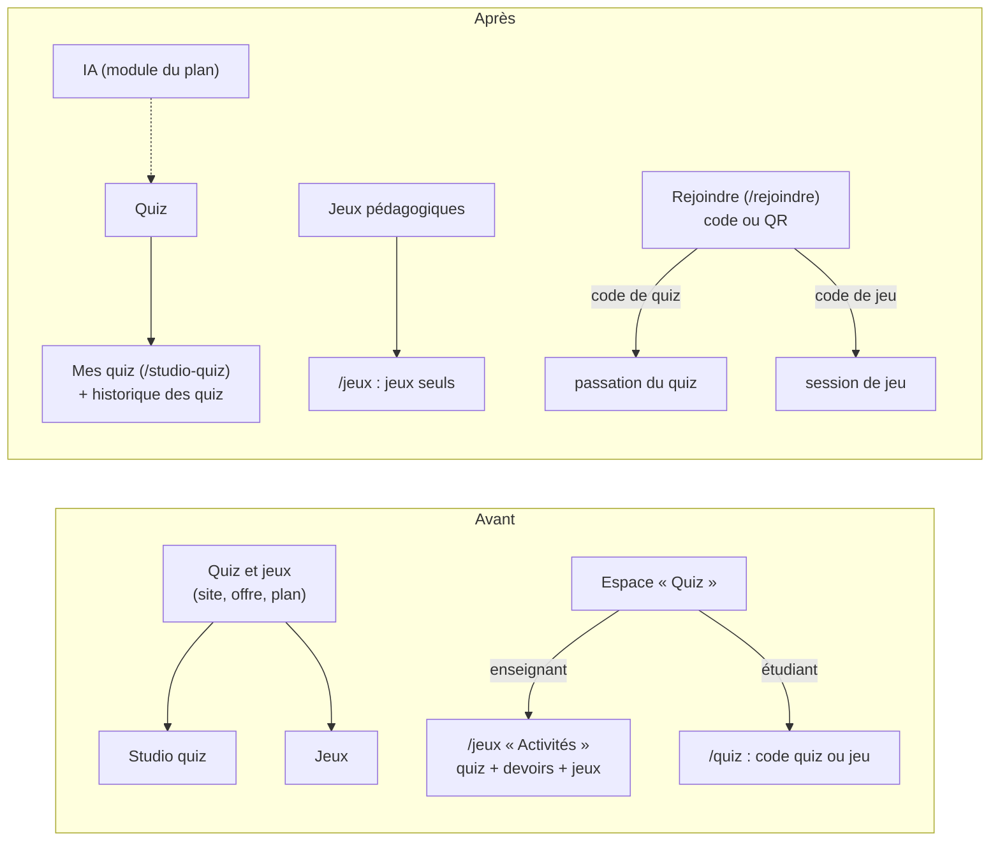

# QJE-17 · Séparer les quiz et les jeux pédagogiques : conception

| | |
|---|---|
| Module | [QJE](../../plan/modules/QJE-quiz-jeux-ia.md) · hors chantier, décision du chef du 26 nov. |
| Branche | `etude/qje-17-separer-quiz-jeux` (ce plan) ; une branche par étape de code (§ 9) |
| Rédigé par | Claude (Opus 5.5), session VS Code, le 2026-11-27, sur la mission du coordinateur ([fiche](../../plan/missions/qje-17-separer-quiz-jeux.md)) |
| **Validé** | en attente |

## 1. Objet et critère de « terminé »

Les quiz et les jeux ne sont pas la même chose. Ils deviennent **deux modules distincts** partout où ils sont aujourd'hui réunis : le site, l'application (web et mobile), l'offre et le plan. Décision du chef du 26 nov.

- **Quiz** : l'enseignant écrit ses questions dans le Studio. L'élève y répond en direct, à son rythme, puis dans un questionnaire non noté (QJE-14) ou une évaluation notée (QJE-10).
- **Jeux pédagogiques** : des jeux livrés avec Planner, le terminal Linux et les simulations à défis, puis les jeux de l'atelier (QJE-18). L'élève réussit des défis que vérifie un moteur.

La mission est terminée, étape par étape, quand :

1. Les deux noms sont validés : **« Quiz »** et **« Jeux pédagogiques »** (réponses 1 et 2). Aucun texte ne réunit plus les deux sous un seul nom. Un test de garde le prouve (§ 8).
2. Sur le **site**, il y a deux pages de module, deux tuiles et deux logos dans le style de VIT-09d. Les anciennes adresses renvoient vers les nouvelles.
3. Dans l'**application** (web et mobile), il y a deux entrées distinctes. « Quiz » ne mène plus aux jeux. L'écran de chacun ne nomme pas l'autre. L'élève a une porte neutre, « Rejoindre ». Aucune route ni donnée n'est cassée.
4. Dans l'**offre**, il y a deux modules vendables, Quiz (n° 4) et Jeux pédagogiques (n° 18). Chacun s'allumera seul quand le registre VEN-01 existera.
5. Dans le **plan**, il y a deux modules, plus un module d'IA. Chaque fonction QJE est rangée dans l'un des trois.

## 2. Ce qui existe : où quiz et jeux sont réunis

Lu sur `origin/main` (`44870e1d`). Ce relevé complète celui de la fiche de mission et le § 2 bis du plan de QJE-15.

### 2.1 Site (`vitrine/`)

| Endroit | Ce qui réunit les deux |
|---|---|
| `src/donnees/modules.js:18` | un seul module `quizEtJeux` (n° 4, segment `quiz-et-jeux`, logo `activites`) |
| `src/pages/[lang]/applications/quiz-et-jeux.astro` | une page : la section des quiz (reprise d'« En classe »), le Studio, la grille des jeux, le bouton « Voir les dix jeux » et l'onglet « Bibliothèque des jeux » |
| `src/pages/[lang]/bibliotheque-des-jeux.astro` | la page des dix simulations, onglet de « Quiz et jeux ». Son nom côtoie le module « Bibliothèque » (les documents) |
| `astro.config.mjs:13` | renvoi `/quiz-et-jeux/` vers `/applications/quiz-et-jeux/` |
| `src/i18n/{fr,en,ar}/` | `quiz-et-jeux.json` ; `modules.json` et `commun.json` (`quizEtJeux`) ; `fonctionnalites.json` (application `activites`, groupe `jeux`, tous deux « Quiz et jeux ») ; `equipement.json` (`quizEtJeux.s1` à `s3`, qui mêlent quiz et terminal) ; `enseignants.json` et `etudiants.json` (carte « Quiz et jeux ») ; `solutions.json` (`superieur.aujourdhui[3]`, « Appel, quiz et jeux » ; `collegeLycee.aujourdhui[1]`, « Des quiz et des jeux ») ; `accueil.json` (`quiz.surtitre`, `quiz.lien`, `illustrations.applications`) |
| `src/donnees/fonctionnalites.json` | les entrées `quiz`, `quiz-ia` et `jeux` : application `activites`, catégorie `jeux`, module `quizEtJeux` |
| `src/donnees/equipement.js:81` | un seul bloc `quizEtJeux` |
| `src/components/socle/illustrations.js:13,21,24` | `quizEtJeux`, `enseignants` et `bibliotheque-des-jeux` montrent tous l'image `activites` |
| `src/components/solutions/types.js:11` | le type « collège-lycée » renvoie vers `module.quizEtJeux` |
| `src/pages/[lang]/enseignants.astro:10` | la page principale de l'enseignant est `module.quizEtJeux` |
| `tests/` | `modules`, `contenu`, `applications`, `navigation`, `ouverture`, `roles`, `bibliotheque`, `axe.parcours`, `applications.rendu`, `ouverture.rendu` citent `quizEtJeux`, `quiz-et-jeux` ou `activites` |

Les phrases qui **énumèrent** les quiz et les jeux comme deux choses distinctes restent telles quelles (réponse 8). Exemples : « L'appel, les quiz, les jeux et les sondages se font dans le même outil » (`en-classe`, `enseignants`, `direction`, `scolarite`), le critère du comparatif, « Le scanner enregistre la présence et rejoint un quiz ou un jeu » (`application.json`).

### 2.2 Application web (`frontend/`, `shared/`)

| Endroit | Ce qui réunit les deux |
|---|---|
| `shared/espaces.js:30-53` | l'espace « Quiz » envoie l'enseignant sur `/jeux` (page « Activités ») et l'étudiant sur `/quiz` |
| `frontend/src/components/applications/catalogue.js:8` | une seule application `activites` (« Quiz et jeux ») regroupe `nav.myQuizzes`, `nav.takeQuiz` et `nav.games` |
| `frontend/src/i18n/applications.{fr,en}.js:38` | `activites` : « Quiz et jeux », « Créer, partager et participer aux activités » |
| `frontend/src/components/applications/teintes.js:8`, `shared/charte/jetons.json:64-65,222-223` | la teinte `app-activites`, « logo de l'application Quiz et jeux » |
| `shared/icones/index.js:11,15`, `shared/icones/modules/activites*.svg`, `shared/icones/images/activites.webp` | un seul logo `activites` (manette et point d'interrogation) |
| `frontend/src/components/layouts/navigation.jsx:116,121,150` | enseignant : « Mes quiz » (`/studio-quiz`) et « Activités » (`nav.games`, `/jeux`) ; étudiant : « Quiz » (`/quiz`) |
| `frontend/src/pages/jeux/Jeux.jsx` (367 lignes) | page « Activités » : sous-titres qui parlent de quiz, de devoirs et de jeux ; zone `ZoneQuizEtDevoirs` (vide tant que `DEVOIRS_ACTIFS` est faux) ; historique des quiz ClassQuiz terminés ; fenêtre `ResultatsQuiz` |
| `frontend/src/components/jeux/` | `QuizIa.jsx`, `ResultatsQuiz.jsx`, `ZoneQuizEtDevoirs.jsx`, `PanneauDevoirs.jsx` : des composants de quiz et de devoirs rangés avec les jeux |
| `frontend/src/pages/jeux/AccueilJeux.jsx` | l'étudiant qui ouvre `/jeux` est renvoyé sur `/quiz` |
| `frontend/src/pages/studio/Quiz.jsx:13-16` | la page « Quiz » de l'étudiant essaie un code inconnu comme jeu : une seule porte (retours du 21 oct.) |
| `frontend/src/i18n/fr.js:1163,1255-1267` | `nav.games` et `jeux.titre` valent « Activités » ; `jeux.quizFerme` (un texte de quiz) est rangé sous `jeux` |
| `frontend/src/components/quiz/QuizFerme.jsx:19` | « Aller aux activités » mène à `/jeux` |
| `frontend/src/components/aide/fiches.js:35-36` | les fiches d'aide « quiz par l'IA » et « devoir » pointent vers `/jeux` |

### 2.3 Application mobile (`mobile/`)

| Endroit | Ce qui réunit les deux |
|---|---|
| `src/app/(onglets)/jeux.jsx` (257 lignes) | écran « Activités », sans onglet, ouvert par une notification : sous chaque module, les quiz en cours, les devoirs, puis les jeux ; plus bas, les derniers quiz |
| `src/i18n.js:16,234` | `onglets.jeux` et `app.activites.titre` valent « Activités » |
| `src/alertes/liens.js:7-31` | `/jeux?partie=…` et `/jeux?resultats=…` (quiz ClassQuiz) ouvrent les écrans de quiz ; `/jeux` seul ouvre « Activités » |
| `src/app/scanner.jsx` | la seule porte de l'étudiant vers les quiz et les jeux (R-10). Elle est déjà neutre et ne change pas |
| `src/espaces/BoutonEspaces.jsx` | lit `shared/espaces.js` : il suivra le changement du web |

### 2.4 Serveur (`backend/`)

| Endroit | Ce qui réunit les deux |
|---|---|
| `routes/activiteRoutes.js`, `services/activites/activites.js` | `GET /api/activites` regroupe quiz en cours, devoirs et jeux par module. Seul l'écran mobile « Activités » le lit |
| `services/quiz/parties.js:119,293`, `services/quiz/devoirs.js:244` | les notifications des parties ClassQuiz et des devoirs portent un lien `/jeux…`. Ces liens sont **enregistrés en base** |
| `migrations/0030-activites-but-notion.js` | `but` et `notion` sur `JeuxModules` et sur `Devoirs` : un même vocabulaire, deux tables distinctes |

Les routes du serveur sont déjà séparées : `studioQuizRoutes`, `quizDirectRoutes`, `quizIaRoutes` d'un côté, `jeuxRoutes` et `sessionJeuRoutes` de l'autre. Les tables aussi.

### 2.5 Offre et plan

- **Étude 15** (`docs/etude-marche/15-modules-et-packs.md`) : « Quiz et jeux », n° 4, au § 4.1 ; le pack « Classe » se vend « autour de Quiz et jeux » (§ 5.1) ; le pack Supérieur compte « 1 à 4 et 6 » (§ 5.2) ; logo `activites` (§ 7). La part gratuite comprend le « Studio quiz de base » ([decisions.md](../../plan/decisions.md), l. 549).
- **Plan** : un seul module, [QJE « Quiz, jeux pédagogiques et IA »](../../plan/modules/QJE-quiz-jeux-ia.md), et une ligne dans [README.md](../../plan/README.md), § 1.
- **Registre des modules** (VEN-01, étape 2) : il n'existe pas encore. Aucun interrupteur par module n'existe en base. Seul `classquiz_actif` existe, par école.
- **Conceptions du site** (VIT-07, VIT-10, VIT-20, VIT-23…) : elles parlent de « Quiz et jeux ». Ce sont des documents datés. Ils ne sont pas réécrits (§ 11).

## 3. Questions et réponses

Questions 1 à 11 posées au chef le 27 nov. avec l'outil de questions. **Il a retenu les onze propositions.** Les questions 12 à 15 sont réversibles et internes au module : elles vont au coordinateur.

| N° | Question | Proposition | Réponse | Bloque |
|---|---|---|---|---|
| 1 | Le nom du module des jeux, sans « quiz » | « Jeux pédagogiques » partout : site, offre, plan, application | **chef : « Jeux pédagogiques »** | — |
| 2 | Le nom du module des quiz | « Quiz » | **chef : « Quiz »** | — |
| 3 | Où va l'IA ? | La préparation des quiz par l'IA reste aux quiz. QJE-07, 12, 13 et 16 forment un troisième module du plan, « IA ». Il sert tous les modules et ne se vend pas à part (l'IA est incluse, décision du 11 oct.) | **chef : oui** | — |
| 4 | Les logos | `activites` est refait en manette seule et devient le logo des jeux. Un logo nouveau pour les quiz, dans le style de VIT-09d. Codex les dessine, planche au chef | **chef : oui** | étape 17b |
| 5 | L'offre | Quiz garde le n° 4. Jeux pédagogiques prend le n° 18. Les deux vont dans les packs Classe et École ; le pack Supérieur devient « 1 à 4, 6 et 18 ». La part gratuite reste le Studio quiz de base : les jeux sont payants | **chef : oui** | étape 17a |
| 6 | La porte de l'étudiant (un code pour un quiz ou un jeu) | Une porte neutre, « Rejoindre » : un seul champ, code ou QR code. Le scanner du mobile ne change pas (R-10) | **chef : oui** | étape 17d |
| 7 | La page « Bibliothèque des jeux » du site | Elle devient l'onglet « Tous les jeux » du module Jeux pédagogiques. L'ancienne adresse renvoie vers elle | **chef : oui** | étape 17c |
| 8 | Les phrases qui citent quiz et jeux côte à côte | Les énumérations restent. Changent : tout titre ou nom qui les réunit, et tout lien unique vers les deux. Les phrases nouvelles sont écrites ici (§ 4.2) | **chef : oui** | étape 17c |
| 9 | La page web « Activités » de l'enseignant (`/jeux`) | Elle devient « Jeux pédagogiques ». L'historique et les résultats des quiz partent dans « Mes quiz ». Les devoirs (éteints) rejoindront l'Espace de cours à leur retour | **chef : oui** | étape 17d |
| 10 | Le sélecteur d'espaces | Enseignant : « Quiz » (vers « Mes quiz ») et « Jeux pédagogiques » (vers `/jeux`). Étudiant : « Rejoindre ». Planner et Bibliothèque ne changent pas | **chef : oui** | étape 17d |
| 11 | L'écran mobile « Activités » | Il ne montre plus que les jeux. Les quiz en cours et les derniers quiz vont sur un écran « Quiz », fait après le joueur natif de QJE-03. Aucun onglet n'est ajouté (R-10) | **chef : oui** | étapes 17e et 17f |
| 12 | Les codes du plan et le sort des identifiants QJE-xx | Trois fichiers de module : `QUI` (Quiz), `JEU` (Jeux pédagogiques), `IAG` (IA). **Les QJE-01 à QJE-18 gardent leur numéro**, car des branches, des missions et des commits les citent. Chacun est rangé dans le fichier de son module, et une table de correspondance va dans le README du plan. Une fonction nouvelle prend le code de son module (`JEU-01`…) | coordinateur, puis chef | étape 17a |
| 13 | Les identifiants techniques | `quiz` et `jeux` pour les logos, les teintes (`app-quiz`, `app-jeux`), le catalogue de l'application et le futur registre VEN-01. Côté site : `quiz` et `jeuxPedagogiques`, segments `quiz` et `jeux-pedagogiques`. Routes et tables inchangées : `/jeux`, `/studio-quiz`, `/quiz`, `/api/activites` | coordinateur | étapes 17b à 17d |
| 14 | Où vont les anciennes adresses du site | `/applications/quiz-et-jeux/` et `/quiz-et-jeux/` vers « Toutes les applications » (`/applications/`), où les deux tuiles se voient : aucun des deux modules n'est favorisé, comme pour l'ancienne adresse de la Bibliothèque. `/bibliotheque-des-jeux/` vers `/applications/jeux-pedagogiques/tous-les-jeux/` | coordinateur | étape 17c |
| 15 | Où ranger « Rejoindre » dans la grille des applications de l'étudiant | Hors de la grille : c'est une porte, pas une application. On l'ouvre depuis le sélecteur d'espaces, le menu et le tableau de bord, comme le scanner sur le téléphone | coordinateur | étape 17d |

## 4. Solution

Le principe : **séparer les noms, les entrées et les écrans, sans toucher aux routes du serveur ni aux tables.** On procède par « étendre puis contracter ». Les nouvelles clés (`quiz`, `jeux`) arrivent à côté des anciennes (`activites`, `quizEtJeux`). Les anciennes ne disparaissent qu'à la dernière étape (17g), quand plus rien ne les lit.

### 4.1 Les noms

| | Quiz | Jeux pédagogiques | Porte de l'étudiant |
|---|---|---|---|
| Français | Quiz | Jeux pédagogiques | Rejoindre |
| Anglais | Quizzes | Learning games | Join |
| Arabe | à traduire avec les autres textes arabes du site (`ar/` n'est pas publié, `LANGUES_PUBLIEES = ['fr', 'en']`) | idem | idem |
| Logo | nouveau, dessiné par Codex | `activites` refait en manette seule | aucun logo (ce n'est pas un module) |

« Mes quiz » reste le nom de la rubrique de l'enseignant. « Activités » disparaît des écrans.

### 4.2 Les phrases nouvelles, pour le visa du chef

Les sources de chaque phrase sont citées. Le test de garde de VIT-18 les vérifie (`equipement.js` porte ses sources).

| Clé | Français | Anglais |
|---|---|---|
| `modules.json` · `quiz` | Quiz | Quizzes |
| `modules.json` · `jeuxPedagogiques` | Jeux pédagogiques | Learning games |
| `quiz.json` · `meta.titre` | Quiz · Planner | Quizzes · Planner |
| `quiz.json` · `meta.description` | Dix façons de poser une question, en direct ou à son rythme. | Ten ways to ask a question, live or at one's own pace. |
| `quiz.json` · `entete.titre` | Créer, projeter, répondre. | Create, project, answer. |
| `jeux-pedagogiques.json` · `meta.titre` | Jeux pédagogiques · Planner | Learning games · Planner |
| `jeux-pedagogiques.json` · `meta.description` | Dix simulations à défis et un terminal Linux, pour s'exercer en jouant. | Ten challenge simulations and a Linux terminal, to practise by playing. |
| `jeux-pedagogiques.json` · `entete.titre` | S'exercer en jouant. | Practise by playing. |
| `jeux-pedagogiques.json` · `entete.accroche` | L'enseignant propose un jeu dans son module, ou le lance en classe. Chacun joue sur son téléphone, ou tous ensemble au tableau. | The teacher offers a game in a course module, or launches it in class. Everyone plays on their phone, or together at the board. |
| `jeux-pedagogiques.json` · `jeux.lien` (était « Voir les dix jeux ») | Voir tous les jeux | See all the games |
| onglet (était « Bibliothèque des jeux ») | Tous les jeux | All games |
| `equipement.json` · `quiz.s1` | Dans un quiz à son rythme, chaque réponse est enregistrée aussitôt : une coupure ne perd rien. Le quiz en direct demande une connexion. | In a self-paced quiz, each answer is saved immediately: a dropped connection loses nothing. The live quiz needs a connection. |
| `equipement.json` · `quiz.s3` | Un quiz se joue dans n'importe quel navigateur, mais chaque étudiant répond depuis un appareil. | A quiz is played in any browser, but each student answers from a device. |
| `equipement.json` · `jeuxPedagogiques.s1` (état « non ») | Les jeux demandent une connexion : le serveur vérifie chaque défi. | The games need a connection: the server checks each challenge. |
| `equipement.json` · `jeuxPedagogiques.s2` (état « marche ») | Chacun joue sur son téléphone ou sur un ordinateur, sans écran projeté. | Everyone plays on their phone or on a computer, with no projector. |
| `equipement.json` · `jeuxPedagogiques.s3` (état « en partie ») | Le terminal Linux se joue au tableau : l'enseignant tape lui-même la commande. Les simulations se jouent depuis un appareil. | The Linux terminal is played at the board: the teacher types the command. The simulations are played from a device. |
| `solutions.json` · `superieur.aujourdhui[3]` | titre : L'appel, les quiz et les jeux pédagogiques ; texte : L'appel par QR code ou à la main, les quiz en direct et les jeux pédagogiques, avec le même compte. | Attendance, quizzes and learning games ; Attendance by QR code or by hand, live quizzes and learning games, with the same account. |
| `solutions.json` · `collegeLycee.aujourdhui[1]` | titre : Des quiz et des jeux pédagogiques ; texte : Des quiz en direct ou à son rythme. Les jeux pédagogiques portent sur l'informatique et la gestion. | Quizzes and learning games ; Live quizzes, or at each pupil's own pace. The learning games are about computing and management. |
| `enseignants.json` · carte 1 | titre « Quiz » (vers `module.quiz`) ; le texte ne change pas | « Quizzes » |
| `enseignants.json` · carte nouvelle | titre : Jeux pédagogiques ; texte : L'enseignant propose un jeu dans son module, ou le lance en classe. | Learning games ; The teacher offers a game in a course module, or launches it in class. |
| `etudiants.json` · carte 2 | titre « Quiz » (vers `module.quiz`) ; le texte ne change pas | « Quizzes » |
| `fonctionnalites.json` (i18n) | applications et groupes : `quiz` « Quiz », `jeux` « Jeux pédagogiques » | « Quizzes », « Learning games » |
| `accueil.json` · `illustrations.applications` | « Quiz et jeux » devient « Quiz », et « Jeux pédagogiques » s'ajoute | « Quizzes », « Learning games » |
| application · `espaces` Quiz (résumé) | Créer et lancer vos quiz | Create and run your quizzes |
| application · `espaces` Jeux pédagogiques (résumé) | Des jeux à défis, en classe ou sur chaque téléphone | Challenge games, in class or on each phone |
| application · `espaces` Rejoindre (résumé) | Avec le code ou le QR code de l'enseignant | With the teacher's code or QR code |
| application · `applications.quiz.resume` | Créer des quiz, les lancer et retrouver leurs résultats. | Create quizzes, run them and find their results. |
| application · `applications.jeux.resume` | Proposer des jeux dans ses modules et les lancer en classe. | Offer games in your course modules and launch them in class. |
| application · `jeux.sousTitreEnseignant` | Dans chaque module, proposez un jeu ou lancez-le en classe, pour vérifier la compréhension d'une notion ou faire s'entraîner vos étudiants. | In each course module, offer a game or launch it in class, to check understanding of a topic or let your students practise. |
| application · `nav.join` et titre de `/rejoindre` | Rejoindre ; champ : « Code donné par votre enseignant » | Join ; field: "Code given by your teacher" |
| application · `QuizFerme` (était « Aller aux activités ») | Aller à Mes quiz | Go to My quizzes |

`accueil.json` · `quiz.surtitre` et `quiz.lien` ne sont plus lus depuis que VIT-20 a retiré la section de l'accueil. L'étape 17c le vérifie : s'ils ne sont plus lus, ils sont retirés, pas réécrits.

### 4.3 Ce qui change, partie par partie

**Plan et offre (17a, documents).**
- Trois fichiers remplacent `QJE-quiz-jeux-ia.md` : `QUI-quiz.md`, `JEU-jeux-pedagogiques.md` et `IAG-ia.md`. L'ancien fichier devient un renvoi d'une ligne.
- Rangement des fonctions :
  - **Quiz** : QJE-01, 02, 03, 06, 09 (défis Linux *dans un quiz* ; dépend de QJE-04), 10, 11, 14, et la préparation des quiz par l'IA, qui existe déjà ;
  - **Jeux pédagogiques** : QJE-04, 05, 08, 15, 17, 18, et le correctif M-11 ;
  - **IA** : QJE-07, 12, 13, 16.
- Tables :
  - Quiz possède les tables du Studio, `quizDirect`, `QuizPartie`, `QuizResultat` et `GenerationQuiz` ;
  - Jeux pédagogiques possède `JeuModule`, `JeuProfil`, `JeuProgression`, `JeuEtatDefi` et `sessionsJeu` ;
  - IA possède le client `services/ia/*` et le quota.
- Autres documents : la ligne du README (§ 1) et sa table de correspondance ; l'étude 15 (§ 4.1, n° 4 et n° 18 ; § 5.1 et 5.2 ; § 7) ; VEN-01, qui déclarera `quiz` et `jeux` comme deux modules ; `suivi.md`.

**Logos et teintes (17b).**
- Logos : `shared/icones/modules/jeux.svg` et `jeux-petit.svg` (manette seule, refaite depuis `activites`), `quiz.svg` et `quiz-petit.svg` (logo nouveau), et `shared/icones/images/{jeux,quiz}.webp`.
- `shared/icones/index.js` : `quiz` et `jeux` dans `APPLICATIONS` et `MODULES_ILLUSTRES` (18 modules).
- Teintes : `app-quiz` et `app-jeux` dans `shared/charte/jetons.json`, avec leurs paires de contraste. La teinte nouvelle des quiz va sur la planche du chef.
- `activites` reste en place jusqu'à 17g.

**Site (17c).**
- `modules.js` : `quiz` (n° 4, segment `quiz`, logo `quiz`) et `jeuxPedagogiques` (n° 18, catégorie « enseigner », segment `jeux-pedagogiques`, logo `jeux`), affiché juste après Quiz.
- Pages : `applications/quiz.astro` (section des quiz, Studio) et `applications/jeux-pedagogiques.astro` (grille des jeux, bouton « Voir tous les jeux », onglet « Tous les jeux »). La page des jeux, déjà rangée par QJE-15, devient `applications/jeux-pedagogiques/tous-les-jeux.astro`.
- Textes : `quiz-et-jeux.json` se partage en `quiz.json` et `jeux-pedagogiques.json` ; `bibliotheque-des-jeux.json` devient `tous-les-jeux.json`. Les autres textes suivent le § 4.2.
- Registre et données : `fonctionnalites.json` (les entrées `quiz` et `quiz-ia` vont au module `quiz`, l'entrée `jeux` à `jeuxPedagogiques`) ; `equipement.js` (deux blocs) ; `illustrations.js`, `solutions/types.js`, `enseignants.astro` (page principale : `module.quiz`).
- Renvois : `astro.config.mjs` (§ 3, question 14).

**Application web (17d).**
- `shared/espaces.js` : espaces `quiz` (enseignant, vers `/studio-quiz`), `jeux` (enseignant, vers `/jeux`), `rejoindre` (étudiant, vers `/rejoindre`). `adresseEspace` suit le rôle.
- `catalogue.js` : applications `quiz` (`nav.myQuizzes`, `nav.takeQuiz`) et `jeux` (`nav.games`). `nav.join` reste hors de la grille (question 15).
- `navigation.jsx` : enseignant « Mes quiz » et « Jeux pédagogiques » ; étudiant « Rejoindre » et « Quiz » (ses quiz passés).
- Route `/rejoindre` et `/rejoindre/:code` : le champ de code de `pages/studio/Quiz.jsx` en sort, avec sa règle actuelle (un code inconnu comme quiz est essayé comme jeu). `/quiz/code/:code` reste valable (QR déjà imprimés ou projetés) et mène au même écran. `/quiz` garde les quiz passés.
- `Jeux.jsx` : titre et sous-titres des jeux seuls. `ZoneQuizEtDevoirs` est retirée de la page. L'historique des quiz ClassQuiz terminés et `ResultatsQuiz` passent dans « Mes quiz », affichés seulement si l'école a ClassQuiz (ils partent avec QJE-06). `QuizIa.jsx`, `ResultatsQuiz.jsx`, `ZoneQuizEtDevoirs.jsx` et `PanneauDevoirs.jsx` quittent `components/jeux/` pour `components/quiz/`.
- Autres fichiers : `applications.{fr,en}.js`, `teintes.js`, `fr.js` et `en.js` (`nav.games`, `jeux.*`, `jeux.quizFerme` déplacé sous `quiz`), `QuizFerme.jsx`, `aide/fiches.js`.
- `MesClasses.jsx` (lien « donner un devoir » vers `/jeux`) n'est pas touché : les devoirs sont éteints, et leur retour se fera dans l'Espace de cours.

**Mobile (17e, puis 17f).**
- 17e : `(onglets)/jeux.jsx` ne montre plus que les jeux du module et la progression, avec le titre « Jeux pédagogiques ». `i18n.js` suit. `alertes/liens.js` garde la lecture des anciens liens `/jeux?partie=` et `/jeux?resultats=`, qui sont en base.
- 17f, après QJE-03 : un écran « Quiz » reçoit les quiz en cours et les derniers quiz. Une notification de quiz l'ouvre.

**Serveur : rien ne change.** `/api/activites` garde son format, car l'écran mobile le lit pendant la transition. Les liens de notification déjà enregistrés restent lisibles. Les nouveaux liens des parties ClassQuiz disparaissent avec QJE-06. Il n'y a donc aucune raison de les changer.

**Contraction (17g).** Retirer `activites` (logo, image, teinte, clé de catalogue), `quizEtJeux`, `quiz-et-jeux.json` et les clés `jeux.*` devenues sans lecteur. Quand l'écran mobile ne lit plus que `jeux` de `/api/activites`, écrire un plan court (coordinateur) pour décider si la route reste ou cède la place à `/api/jeux`.

## 5. Fichiers créés ou modifiés

Ce plan ne modifie que lui-même et la fiche de session. Pour chaque étape, le coordinateur fixe le périmètre exact après le visa. Les fichiers sont ceux du § 4.3. Les fichiers qui dépassent déjà les seuils (`Jeux.jsx`, 367 lignes) ne grossissent pas : QJE-15 en sort deux composants, et 17d en retire la zone des quiz.

## 6. Données et migration

**Aucune migration. Aucune table touchée.** Les routes (`/jeux`, `/quiz`, `/studio-quiz`, `/api/*`) restent. Une base qui a déjà des données ne voit rien changer : notifications enregistrées, sessions de jeu, parties, progression, tout reste lisible.

## 7. Sécurité, isolation et exigences produit

- Aucun canal d'isolation (I-1 à I-16) n'est touché.
- `/rejoindre` est sous `PrivateRoute` pour l'étudiant, comme `/quiz`. Les droits par rôle ne changent pas : l'administration n'a ni quiz ni jeux.
- EP-2 et M10 : le menu ne montre que ce que le rôle utilise. VEN-01 limitera ensuite le menu aux modules actifs, ce que la séparation rend possible.
- EP-11 : axe-core sans violation sur les pages touchées.
- EP-16 : aucun texte en dur ; chaque texte en `fr` et en `en`.
- EP-19 : poids des deux pages du site mesuré, au plus 200 Ko.

## 7 bis. Ce que disent les études

Le public visé d'abord : le supérieur (étape 3). Rien n'y est propre à un cycle ; QJE-15 range les jeux par cycle.

| Ligne | Étude | Appliquée ou écartée | Comment, ou pourquoi |
|---|---|---|---|
| R4 | une page par module (14) | appliquée | une page Quiz, une page Jeux pédagogiques |
| R7 | une offre lisible : socle et modules (14) | appliquée | deux modules vendables, chacun clair (étude 15, n° 4 et n° 18) |
| R16 | l'IA activée école par école (14) | appliquée | le module IA du plan porte QJE-16 |
| M9 | textes traduisibles (14) | appliquée | toutes les phrases en fr et en, dans les fichiers de textes |
| M10 | menus qui submergent (14) | appliquée | deux entrées claires au lieu d'une « Activités » mêlée ; VEN-01 viendra |
| M14 | contraste et accessibilité (14) | appliquée | axe-core, contraste des deux teintes vérifié par le test des jetons |
| M15 | promesses sans preuve (14) | appliquée | chaque phrase du § 4.2 décrit du code existant ; les sources de `equipement.js` sont citées |
| § 4.1, n° 4 | Quiz et jeux vendable (15) | modifiée | deux modules (réponse 5) |
| [01, § 4] | les jeux en classe sont rares chez les autres (15) | appliquée | les jeux ont leur propre page et leur propre tuile, l'argument se voit |

## 7 ter. EP-18 : tous les contextes

La séparation ne change aucun comportement. Elle change les noms et l'emplacement des entrées.

| Contexte | Ce que fait la fonction | Preuve ou test |
|---|---|---|
| **A. Au moins un élève sans téléphone ni ordinateur** | inchangé : le terminal Linux se joue au tableau, et le quiz imprimé viendra avec M-2a | parcours `sessionsJeu` (mode collectif) |
| **B. Connexion lente ou coupée** | inchangé ; les deux pages du site sont mesurées (EP-19) ; aucun écran de l'application ne grossit | poids écrit dans la PR de 17c |
| **C. Projecteur (C1) ou rien (C2)** | inchangé : quiz en direct et terminal se projettent ; sans projecteur, quiz à son rythme et jeux sur l'appareil | textes d'`equipement.json`, § 4.2 |

## 8. Tests

- **Test de garde** (nouveau, 17c et 17d) : les textes `fr` et `en` du site et de l'application ne contiennent plus « Quiz et jeux », « Quizzes and games » ni « Quiz and games ». Il est montré en échec sur le code d'avant.
- **Site** :
  - `modules.test.js` : 18 modules, `quiz` et `jeuxPedagogiques` disponibles, chacun avec son logo ;
  - `contenu.test.js` : textes, « Voir tous les jeux », ordre des jeux de QJE-15 sur `tous-les-jeux` ;
  - `applications.rendu.cjs` : les deux pages, l'onglet, les trois renvois (§ 3, question 14) ;
  - `navigation`, `ouverture`, `roles`, `bibliotheque` mis à jour ; `axe.parcours.cjs` sur les deux pages et sur « Tous les jeux ».
- **Web** :
  - `catalogue.test.js` : enseignant `quiz` et `jeux`, étudiant `quiz` ; `nav.join` hors de la grille ;
  - `adresseEspace.test.js` : les trois espaces, selon le rôle ;
  - un test de `/rejoindre` : un code de quiz ouvre le quiz, un code de jeu ouvre la session ;
  - `/quiz/code/:code` reste valable.
- **Parcours** : `sessionsJeu.spec.cjs`, `quizDirect.spec.cjs`, `studioQuiz.spec.cjs`, `applications.spec.cjs`, `classQuizEteint.spec.cjs`, verts dans la CI.
- **Mobile** :
  - tests de `alertes/liens.js` : les anciens liens `/jeux?partie=` et `/jeux?resultats=` mènent toujours au quiz ;
  - l'écran des jeux ne lit plus `quiz`.
- **Neutralité** : `scripts/verifier-neutre.mjs` sur chaque branche.
- **Icônes** : `shared/icones/icones.test.js` et le test de contraste des jetons (17b).

## 9. Étapes de livraison

Une branche et une PR par étape. Les tailles sont brutes. Chaque étape commence après la fusion des missions qui tiennent ses fichiers.

| Étape | Contenu | Agent proposé | Taille | Attend |
|---|---|---|---|---|
| **17a** | plan, offre et registre : trois fichiers de module, README, étude 15, VEN-01, `suivi.md`, `decisions.md` | coordinateur (documents qu'il tient), sur le visa du chef | S | le visa de ce plan ; la question 12 |
| **17b** | logos `quiz` et `jeux`, images, teintes ; planche au chef | Codex (seul à générer les images), après VIT-24 | M | 17a ; VIT-24, dans sa file |
| **17c** | site | session Claude (celle-ci, ou une autre que fixe le coordinateur) | M | 17b ; **VIT-24** fusionnée (`modules.js`, `components/applications/`, `fonctionnalites.json`, `modules.json`, `commun.json`) ; la part du site de **QJE-15** fusionnée (page des jeux, `contenu.test.js`) ; `illustrations.js` (`components/socle/`) : accord avec VIT-25 |
| **17d** | application web et `shared/espaces.js` | session Claude | M | 17b ; **#229** et les écrans web de **QJE-15** fusionnés (`Jeux.jsx`) ; **QJE-14a** fusionnée si elle est ouverte (`MesQuiz.jsx`) |
| **17e** | écran mobile des jeux | session Claude | S | la part mobile de **QJE-15** fusionnée (`jeux.jsx`) |
| **17f** | écran mobile des quiz | Codex ou session Claude, au choix du coordinateur | S | **QJE-03** fusionnée (#280) |
| **17g** | contraction : retirer `activites` et `quizEtJeux` | session Claude | S | 17c à 17f |

Après 17c, **VIT-25** filme les pages Quiz et Jeux pédagogiques. **QJE-18** range ses jeux dans le module Jeux pédagogiques dès 17a, sans attendre la suite. **VIT-20f** est fusionnée (#284) ; ses logos de la série B restent la référence de style.

## 10. Risques et retour arrière

- **Collision avec les missions ouvertes** : l'ordre du § 9 l'évite. Chaque étape reprend `origin/main` juste avant son code.
- **Liens déjà partagés** (QR imprimés, favoris, moteurs de recherche) : `/quiz/code/:code`, `/jeux` et les trois adresses du site renvoient. Aucune adresse ne meurt.
- **Notifications en base** : leurs liens `/jeux…` restent lisibles (§ 4.3, mobile). Un test le prouve.
- **Deux noms pendant la transition** : entre 17c et 17g, les clés `activites` et `quizEtJeux` coexistent avec les nouvelles, mais aucun écran ne les affiche. 17g les retire.
- **Retour arrière** : chaque étape est une PR sans migration, qui s'annule par `git revert`.

## 11. Hors périmètre

- Les routes et les tables du serveur ; `/api/activites` jusqu'à 17g.
- Le rangement des jeux par cycle et par domaine (QJE-15), les nouveaux jeux (QJE-18), la charte des jeux (UIX-10e).
- Les devoirs, éteints : à leur retour, ils iront dans l'Espace de cours, par une fonction COU.
- Le prix des modules : la vente est gelée. L'étude 15 ne donne que la composition des packs.
- La réécriture des conceptions datées du site (VIT-07, VIT-10, VIT-20…) : ce sont des archives de décisions. Les fichiers de module et l'étude 15 suffisent.
- Le registre des modules (VEN-01) : QJE-17 ne fait que lui donner deux clés.
