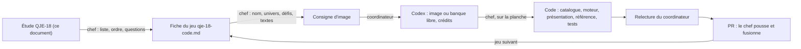
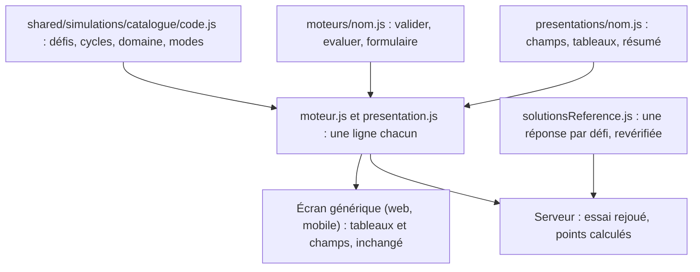

# QJE-18 · L'atelier des jeux : étude et catalogue — conception

| | |
|---|---|
| Module | [JEU · Jeux pédagogiques](../../plan/modules/JEU-jeux-pedagogiques.md) (fichier créé par QJE-17a ; sur `main`, la fonction est encore dans [QJE](../../plan/modules/QJE-quiz-jeux-ia.md)) · hors chantier, demande du chef du 27 nov. |
| Branche | `etude/qje-18-atelier-jeux` (cette étude) ; puis `feat/qje-18-<code-du-jeu>`, une branche par jeu |
| Rédigé par | Claude (Opus 5.5), sous-agent du coordinateur, le 2026-11-27, sur la [fiche de mission](../../plan/missions/qje-18-atelier-jeux.md) |
| **Validé** | en attente (choix de produit : le chef valide la liste, l'ordre et les réponses du § 3) |

Cette étude est l'**étape 1** de QJE-18 : des documents, aucun code. Chaque jeu retenu aura ensuite sa propre fiche (`qje-18-<code-du-jeu>.md`), validée par le chef avant son code.

## 1. Objet et critère de « terminé »

Le chef demande (27 nov.) de nouveaux jeux pédagogiques, **un par matière**, sur des mécaniques éprouvées par les plateformes de jeux pédagogiques les plus jouées, **jamais la copie d'un jeu**. Les quiz relèvent du module Quiz (QJE-17) : ici, un jeu est un défi que l'élève **résout en agissant**, vérifié par un moteur, avec des niveaux et de l'expérience, comme les onze jeux d'aujourd'hui.

L'étude est terminée quand le chef a visé :

1. le relevé des plateformes et de leurs mécaniques (§ 2.3), sourcé et daté ;
2. le croisement mécaniques × matières (§ 4.1) ;
3. le catalogue (§ 4.2) : onze jeux proposés, chacun avec son nom, sa matière, ses cycles, son domaine, sa mécanique, ses trois premiers défis, son moteur, son mode, ses contextes EP-18 et sa voie d'image ;
4. l'ordre (§ 4.3) et les réponses aux questions (§ 3).

## 2. Ce qui existe

### 2.1 Les onze jeux et leurs moteurs

Lu sur `origin/main` (`fb821d24`).

| Moteur (`shared/simulations/moteurs/`) | Jeu | Ce que l'élève saisit | Ce que le moteur vérifie | Réutilisable tel quel pour |
|---|---|---|---|---|
| `robot` | Robot Route | un programme `N E S W`, 40 pas au plus | collision, arrivée, passages, nombre de pas | un parcours sur une grille |
| `seuil` | Labo des seuils | un entier de 0 à 100 | précision, rappel, coût des erreurs | un réglage d'un seul paramètre sur des observations |
| `stock` | Pilote des stocks | trois commandes | ruptures, capacité, budget, délai | un flux sur trois périodes |
| `triage` | Tri Cyber | quatre niveaux de 1 à 4 | niveau calculé par la grille portée × données × statut | non : la grille est propre au jeu |
| `sql` | Requête Parfaite | quatre positions (permutation) | chaque fragment à sa position (`clauses[].position`) | **toute remise en ordre de quatre éléments** : le moteur ne lit que `texte` et `position` |
| `reseau` | Nœuds Réseaux | quatre index de commutateur (0 à 2) | nombre d'appareils par commutateur, même commutateur, commutateurs différents | une répartition de quatre éléments en trois groupes, à capacité comptée en nombre |
| `cpu` | Ordonnanceur CPU | un ordre de quatre processus | échéances, rotation moyenne | un ordonnancement de quatre tâches |
| `sprint` | Sprint Agile | cinq choix 0 ou 1 | capacité, valeur minimale, éléments obligatoires, dépendances | **tout choix d'un sous-ensemble de cinq éléments** sous un plafond, un plancher, des obligations et des dépendances |
| `budget` | Budget ERP | quatre quantités | coût fixe + unitaire, couverture, coût unitaire | un modèle de coût à quatre postes |
| `complexite` | Labo Big-O | quatre classes de 1 à 6 | classe dérivée du profil de boucle | non : les classes sont propres au jeu |
| (terminal) | Terminal Linux | des commandes | le système de fichiers simulé (`shared/terminal/`) | non |

Chaque moteur est une fonction pure et bornée : `valider(cles, reponse)`, `evaluer(defi, reponse)`, `formulaire(valeurs)` (`shared/simulations/moteur.js`, registre `REGISTRE`).

### 2.2 Ce qui contraint un jeu nouveau

Lu dans le code ; chaque point pèse sur le catalogue.

1. **L'écran est générique.** `frontend/src/components/jeux/AtelierSimulation.jsx` (81 lignes) et son pendant mobile affichent les **tableaux** et les **champs** que la présentation décrit : des champs d'entier (`nombre` : 1 à 3 chiffres, 0 à 999) ou un champ de texte de 160 caractères. Seul `robot` a un dessin à lui (sa grille). **Un jeu qui tient en tableaux et en champs ne demande aucun code d'écran** ; un dessin nouveau (un graphe, un chronogramme) toucherait ces écrans, qui ne sont pas dans le périmètre de QJE-18 (QJE-15 et QJE-17 y travaillent). Tous les jeux proposés tiennent donc en tableaux et en champs.
2. **La présentation suit le moteur.** `presentation.js` choisit la présentation par `jeu.moteur`. Réutiliser un moteur avec d'autres libellés (un bloc de courriel au lieu d'un fragment SQL) demande d'**inscrire le même moteur sous un second nom** dans les deux registres, avec une présentation à lui. Le moteur ne change pas (question 6).
3. **La forme de la réponse est fixe.** `valider` ne voit pas le défi : chaque moteur fixe le nombre de valeurs (ou une fourchette courte), et la réponse a **une seule clé** (`lignesSolution` lit la première valeur).
4. **La solution de référence vit au serveur.** `backend/services/jeux/solutionsReference.js` garde une réponse par défi (identifiant `<préfixe>-0N`) et la revérifie par le moteur. Un jeu nouveau y ajoute sa ligne, hors du périmètre écrit dans la fiche de mission (question 7).
5. **Les tests lisent le catalogue par position.** `backend/tests/utils/simulations.test.js` déstructure `SIMULATIONS` ; `mobile/__tests__/simulations.test.js` (`premier`) attend une réponse pour le premier défi de chaque jeu. Un jeu nouveau s'ajoute **à la fin** de `SIMULATIONS` et dans `premier`.
6. **Les textes communs grossissent.** `shared/simulations/i18n.js` fait 161 lignes pour dix jeux. Onze jeux de plus le porteraient au-delà de 300 lignes (question 8).
7. **Le seed** propose chaque jeu dans un module de sa discipline (`backend/seed.js`, `MODULE_JEU_PAR_DISCIPLINE`). Une discipline nouvelle (mathématiques, automatisme, anglais) y prend sa ligne.
8. **Le mode collectif n'existe que pour le terminal.** Les sessions de jeu (`backend/services/jeux/sessions.js`) rejouent des commandes ; les simulations déclarent `individuel` seulement (contrat, § 1.1). Les jeux proposés ici aussi (question 9).
9. **Le retour après un échec** ne donne ni la valeur attendue, ni la bonne position (contrat, § 1.0, décision du 10 nov.). Les moteurs nouveaux le tiennent ; le § 4.4 dit comment pour chaque famille de réponse.
10. **L'enseignant peut jouer.** `jeuAccessible` ne filtre que le rôle `etudiant` (`backend/services/jeux/jeux.js:121`) : l'enseignant ouvre un jeu sur l'écran projeté et joue les propositions de la classe. C'est le chemin EP-18 d'aujourd'hui pour une classe sans téléphones (§ 7 ter).
11. **QJE-15** ajoute `cycles` (`college`, `lycee`, `superieur`, `formation-professionnelle`) et `domaine` (quatre codes : `informatique`, `reseaux-cybersecurite`, `intelligence-artificielle`, `gestion-logistique`), et une image par jeu dans `shared/jeux/images/<code>.webp` avec `credits.md`. La liste des domaines est fermée : les matières nouvelles en demandent d'autres (question 4).

### 2.3 Les plateformes de jeux pédagogiques les plus jouées, et leurs mécaniques

Relevé du 27 nov. 2026. Les chiffres sont ceux que publie chaque éditeur, à la date dite ; ils ne se comparent pas entre eux (inscrits, joueurs, lancements, licences). Aucun chiffre n'est donné sans source.

| Plateforme | Ce qu'on y fait | Mécaniques | Chiffre d'usage publié | Pour Planner |
|---|---|---|---|---|
| **Kahoot!** | quiz en direct, projeté | course aux points, podium, minuteur | 1,5 milliard de participations sur les douze mois de 2020, 5 milliards depuis 2013 ([blog de l'éditeur, 5 janv. 2021](https://kahoot.com/blog/2021/01/05/kahoot-5-billion-players-year-record-high-growth/)) | **quiz** : module Quiz, pas l'atelier |
| **Blooket**, **Gimkit** | quiz habillés de modes de jeu (économie, défense) | les points gagnés en répondant achètent des avantages | Blooket : plus de 15 millions d'inscrits en juin 2024 ([Techopedia](https://www.techopedia.com/?p=299119), source secondaire) ; Gimkit : aucun chiffre fiable trouvé | **quiz** : module Quiz |
| **Prodigy Math** | jeu de rôle où chaque combat est un exercice de calcul | aventure, progression, récompenses | 150 millions d'inscrits revendiqués ([blog de l'éditeur, 22 juin 2021](https://www.prodigygame.com/blog/prodigy-education-turns-10)) ; environ 9 millions d'actifs par mois en janv. 2021 ([Wikipédia](https://en.wikipedia.org/wiki/Prodigy_Math_Game)) | la progression, déjà dans le contrat (niveaux, expérience) ; l'habillage d'exercices en combats reste un quiz |
| **Duolingo** | leçons courtes de langue | expérience, série de jours, ligues, objectifs du jour | 58,7 millions d'utilisateurs actifs par jour au 2e trimestre 2026 ([lettres aux actionnaires](https://investors.duolingo.com/)) | la progression ; ses exercices sont des questions, donc des quiz |
| **Code.org** (Heure de code) | énigmes de programmation par blocs | **programmer un parcours** sur une grille, niveaux courts, contrainte de longueur | 910 millions d'« heures servies » cumulées fin 2019 ([rapport annuel 2019](https://code.org/files/Code.org-Annual-Report-2019.pdf)) : un compte d'activités, pas d'élèves | **mécanique reprise** (Robot Route l'a déjà) |
| **Scratch** (MIT) | créer des jeux et des animations par blocs | **créer** et partager | plus de 100 millions d'inscrits en 2022 ([rapport annuel 2022 de la Scratch Foundation](https://www.scratchfoundation.org/s/2022_AnnualReport_ScratchFoundation-eype.pdf)) | la création de jeux : QJE-05 et QJE-08, hors de cet atelier |
| **PhET** (université du Colorado) | simulations de sciences | **régler des paramètres et observer** l'effet | plus de 250 millions de lancements de simulations en 2025 ([rapport d'impact 2025](https://phet.colorado.edu/publications/PhET_Impact_Report_2025.pdf)) | **mécanique reprise** (seuils, stocks ; ici le triphasé, la dichotomie) |
| **Minecraft Education** | monde ouvert, constructions, défis de code | **construire**, bac à sable | plus de 40 000 systèmes scolaires dans 140 pays selon le site de l'éditeur ([education.minecraft.net](https://education.minecraft.net/), consulté le 27 nov. 2026) ; une autre page du même éditeur dit 115 pays : chiffres non concordants | le bac à sable n'est pas vérifiable par un moteur borné : écarté |
| Jeux d'ingénierie « à banc d'essai » (genre commercial, plusieurs éditeurs) | construire une machine ou un programme qui passe une série de tests | **construire puis tester**, contre-exemple affiché, optimiser | aucun chiffre public comparable | **mécanique reprise** (automates, Grafcet, routage, droits) |
| Jeux de gestion et de réseau de transport (genre commercial) | relier des lieux, répartir une ressource | **relier au moindre coût**, **allouer sous contraintes** | aucun chiffre public comparable | **mécanique reprise** (graphes, sous-réseaux, finance, triphasé) |

Ce que disent les études sur les jeux pour apprendre (sources externes) :

- **Clark, Tanner-Smith et Killingsworth, 2016** (*Review of Educational Research*, 86(1), 79-122 ; [résumé SRI](https://www.sri.com/publication/education-learning-pubs/digital-learning-pubs/digital-games-design-and-learning-a-systematic-review-and-meta-analysis-brief/)) : les jeux numériques font mieux apprendre que les conditions sans jeu (g = 0,33) ; **la conception compte plus que le support** ; les jeux au visuel simple font aussi bien ou mieux que les jeux chargés.
- **Wouters et coll., 2013** (*Journal of Educational Psychology*, 105(2), 249-265, [notice](https://research-portal.uu.nl/en/publications/a-meta-analysis-of-the-cognitive-and-motivational-effects-of-seri/)) : les jeux sérieux font mieux apprendre (d = 0,29) et retenir (d = 0,36) que l'enseignement classique, **sans être plus motivants** ; l'effet est plus fort quand le jeu est **complété par l'enseignement**, joué en **plusieurs séances**, et **en groupe**.

D'où trois choix de cette étude : un écran sobre (tableaux et champs), un bilan court après chaque défi qui relie le jeu au cours (le champ `bilan` du catalogue), et des défis courts qu'on rejoue sur plusieurs séances.

### 2.4 Les matières

Relevées par la fiche de mission (emplois du temps d'exemple, `docs/exemple_emploi_du_temps_donnee.yaml`, et liste des supports du chef). Les supports lus hors dépôt, pour le niveau des défis et rien d'autre : tris et complexité, sous-réseaux FLSM et VLSM, droits Linux, automates programmables industriels, gradateurs, test du khi-deux, modèle conceptuel de données, un recueil de travaux dirigés d'UML, un support de communication. **Rien n'en est recopié** : les défis du § 4.2 sont écrits pour cette étude, avec des données à nous.

## 3. Questions et réponses

| N° | Question | Proposition | Réponse du chef | Bloque |
|---|---|---|---|---|
| 1 | Combien de jeux dans ce premier catalogue ? | **Onze** (§ 4.2), dont **trois pour commencer** (§ 4.3). Chacun reste une proposition tant que sa fiche n'est pas validée | | oui |
| 2 | Des jeux de lycée dès cette série ? | **Oui, deux** : La Sonde (dichotomie) et Le Courrier du port (anglais), marqués `lycee` et `superieur`. Les neuf autres au supérieur, cinq aussi en formation professionnelle. Aucun au collège | | oui |
| 3 | Qui code les jeux après le premier ? | **La même session Claude**, jeu par jeu ; Alexis, auteur des jeux actuels, relit le premier moteur nouveau (L'Archipel) si le chef le souhaite | | non |
| 4 | Les domaines de QJE-15 sont fermés (quatre). Lesquels ajouter ? | Trois : `mathematiques` (Mathématiques), `genie-electrique` (Génie électrique et automatisme), `langues-communication` (Langues et communication). Ordre : Informatique, Réseaux et cybersécurité, Intelligence artificielle, Mathématiques, Génie électrique et automatisme, Gestion et logistique, Langues et communication. Ajoutés par le premier jeu qui en a besoin, dans `shared/jeux/catalogue.js` (fichier de QJE-15 : avec l'accord de son agent) | | oui, pour le jeu 2 |
| 5 | Après un échec, peut-on montrer un **contre-exemple** (le mot mal classé, le paquet qui n'arrive pas, le test d'accès qui échoue) ? | **Oui** : la réponse est la machine (table, routes, droits), pas le verdict d'un test ; le contre-exemple est le cœur de la mécanique « construire puis tester », comme la collision de Robot Route dit déjà le pas fautif. Pour une réponse faite **seulement** de choix 0 ou 1, le moteur dit **combien** sont faux, jamais lesquels | | oui, pour les moteurs nouveaux |
| 6 | Réutiliser un moteur sous un second nom (`ordre` pour `sql`, `portefeuille` pour `sprint`) ? | **Oui** : une ligne de plus dans chacun des deux registres, une présentation nouvelle ; le fichier du moteur ne change pas, ses tests non plus. Réversible, dans le module : le coordinateur peut trancher | | oui, pour le jeu 1 |
| 7 | Le périmètre d'écriture d'un jeu (fiche de mission) oublie des fichiers que tout jeu touche | L'élargir, pour chaque jeu, à : `shared/simulations/moteur.js` et `presentation.js` (registres), `shared/simulations/catalogue.js` (ajout en fin), `backend/services/jeux/solutionsReference.js`, `backend/tests/utils/` et `backend/tests/integration/` (tests du jeu), `mobile/__tests__/simulations.test.js` (`premier`), `backend/seed.js` (`MODULE_JEU_PAR_DISCIPLINE`). Le coordinateur l'écrit dans la fiche de mission | | oui, avant le code du jeu 1 |
| 8 | `shared/simulations/i18n.js` dépasserait 300 lignes | Un fichier de textes par moteur nouveau (`shared/simulations/i18n/<moteur>.js`), fusionné dans l'objet commun ; les textes des dix jeux actuels restent où ils sont | | non |
| 9 | Aucun jeu nouveau ne se joue au tableau en mode `collectif` | Les onze jeux sont `individuel`. Pour une classe sans téléphones, l'enseignant joue au tableau (§ 7 ter). Proposer au module JEU une fonction à part : **le rejeu au tableau des simulations**, générique puisque toutes les réponses sont des vecteurs courts. Décision du chef (fonction nouvelle) | | non |
| 10 | Les blocs du Courrier du port sont en anglais : on les traduit dans la version française ? | **Non** : l'anglais est la matière. Le cadre (titre, consigne, aide, bilan) suit la langue de l'écran ; les blocs restent en anglais dans les deux langues | | non |
| 11 | Les noms des jeux | Ceux du § 4.2 sont des propositions. La fiche de chaque jeu vérifie que le nom n'est pas une marque ou un titre de jeu existant avant que le chef le valide | | non |
| 12 | Un dessin propre à un jeu (le graphe de L'Archipel, le chronogramme du Grafcet) ? | **Pas dans cette série** : tableaux et champs seulement (§ 2.2, point 1). Un dessin viendra avec la charte des jeux (UIX-10e) ou une fonction d'écran à part | | non |

## 4. Solution

### 4.1 Mécaniques × matières

Les mécaniques retenues viennent du § 2.3. La course aux points et la question-réponse (Kahoot!, Blooket, Gimkit, Duolingo, Prodigy) restent au module Quiz.

| Mécanique | Exemple de plateforme | Matières où elle sert | Déjà couvert |
|---|---|---|---|
| M1 · Programmer un parcours | Code.org | algorithmique ; automatisme (séquence) | Robot Route |
| M2 · Construire une machine, puis la tester sur un banc d'essai | jeux d'ingénierie | théorie des langages (automates) ; automatisme (Grafcet) ; réseaux (routage statique) ; systèmes (droits Linux) | non |
| M3 · Régler des paramètres et observer | PhET | IA (seuils) ; analyse numérique (dichotomie) ; électrotechnique (triphasé) | Labo des seuils, Pilote des stocks |
| M4 · Allouer sous contraintes | jeux de gestion | réseaux (sous-réseaux VLSM) ; finance (choix d'investissements) ; électrotechnique (équilibre des phases) ; gestion de projet | Sprint Agile, Budget ERP, Nœuds Réseaux |
| M5 · Remettre en ordre | (mécanique commune) | SQL ; anglais professionnel (courriel, appel) | Requête Parfaite |
| M6 · Classer | (mécanique commune) | complexité ; cybersécurité | Labo Big-O, Tri Cyber |
| M7 · Relier au moindre coût | jeux de réseau de transport | graphes, recherche opérationnelle | non |
| M8 · Enquêter : calculer, puis décider sur ses propres calculs | PhET (démarche) | statistiques (khi-deux) | non |

| Domaine (fiche de mission) | Matières | Couvert aujourd'hui | Proposé ici |
|---|---|---|---|
| Mathématiques | analyse numérique, recherche opérationnelle, graphes, statistiques | non | L'Archipel (M7), La Sonde (M3), L'Enquête des halles (M8) |
| Informatique théorique | automates, grammaires | non | La Machine à mots (M2) |
| Programmation | tris, complexité, objet, web | en partie (Big-O) | aucun : voir § 11 |
| Données | SQL, MCD, NoSQL, science des données, apprentissage | en partie (SQL, seuils) | aucun : voir § 11 |
| Réseaux et sécurité | sous-réseaux, VLAN, routage statique, sécurité | en partie (topologie, incidents) | Cadastre IP (M4), Les Aiguilleurs (M2) |
| Systèmes | droits Linux | en partie (terminal) | Le Coffre aux droits (M2) |
| Génie électrique et automatisme | automates programmables, triphasé, transformateurs, gradateurs | non | L'Atelier des vérins (M2), Le Poste de quartier (M3, M4) |
| Gestion | finance, entrepreneuriat, management | en partie (budget, sprint) | Le Fonds des projets (M4) |
| Langues et communication | anglais professionnel, communication | non | Le Courrier du port (M5) |

### 4.2 Le catalogue : onze jeux proposés

Chaque fiche est courte ; la fiche du jeu, plus tard, fixe les textes, les données exactes et les tests. Les chiffres des défis ont été vérifiés par un script hors dépôt (solution unique, ou toutes les solutions acceptées par le moteur). Aucun défi ne nomme une école, une personne, une marque, un pays ni une devise.

Les codes de jeu sont stables (enregistrés en base) : ils sont proposés ici et figés à la validation de la fiche du jeu.

#### J1 · Le Courrier du port (`courrier-du-port`) · *Harbour Mail*

| | |
|---|---|
| Matière, cycles, domaine | anglais professionnel · `lycee`, `superieur`, `formation-professionnelle` · Langues et communication |
| Univers | le bureau du fret d'un port : les messages des partenaires arrivent en morceaux, il faut les remettre en ordre avant le départ du navire |
| Mécanique | M5, remettre en ordre |
| L'élève apprend | la structure d'un courriel, d'un appel et d'un rapport professionnels en anglais : salutation, contexte, demande, échéance, formule de fin |
| Défi 1 | un courriel de demande, quatre blocs : salutation à la capitainerie, objet (un conteneur en retard), demande de confirmation d'un horaire avant une date, formule de fin |
| Défi 2 | un appel téléphonique, quatre répliques : se présenter, dire l'objet, convenir d'une action, confirmer et conclure |
| Défi 3 | un rapport d'incident, quatre paragraphes : résumé, conséquences, mesures prises, suite prévue (les connecteurs *as a result*, *so far*, *next* guident l'ordre) |
| Moteur | **réutilisé** : `sql`, inscrit sous le nom `ordre` avec une présentation neutre (« Bloc n — position 1 à 4 ») |
| Mode, EP-18 | `individuel` ; A : projeté, la classe propose l'ordre à voix haute ; B : textes dans le paquet, aucun appel pendant la saisie ; C2 : quatre bandes de papier à remettre en ordre, réponse saisie ensuite par l'élève |
| Image | **banque libre** (photo de grues et de conteneurs, sans marque lisible) ; consigne : « Quai de port au crépuscule, grues et conteneurs unis sans aucun logo ni inscription, recadré carré, dominante bleu nuit #1A2A6C. » |

#### J2 · L'Archipel (`archipel`) · *The Archipelago*

| | |
|---|---|
| Matière, cycles, domaine | graphes, recherche opérationnelle · `superieur` · Mathématiques |
| Univers | six îles reliées par des lignes de bateau : trouver la traversée la plus rapide, puis poser les câbles qui relient toutes les îles au moindre coût |
| Mécanique | M7, relier au moindre coût |
| L'élève apprend | le plus court chemin (Dijkstra) et l'arbre couvrant de poids minimal (Kruskal, Prim) ; pourquoi le chemin direct n'est pas toujours le plus court |
| Défi 1 | plus court chemin de A à F sur huit lignes (A–B 4, A–C 2, B–C 1, B–D 5, C–D 8, C–E 10, D–E 2, E–F 3) : réponse unique, A–C–B–D–E–F, 13 ; le piège est A–B direct (4) contre A–C–B (3) |
| Défi 2 | arbre couvrant de poids minimal sur huit liaisons (A–B 3, A–C 1, B–C 4, B–D 2, C–D 5, C–E 6, D–E 7, E–F 2) : réponse unique, 14 |
| Défi 3 | même réseau, un câble D–E déjà posé qu'on garde : réponse unique, 15 |
| Moteur | **nouveau** : `graphe`. Réponse : huit choix 0 ou 1 (une ligne par liaison du tableau). Il vérifie : chemin de la source à la cible sans branche ni boucle, ou arbre qui couvre toutes les îles sans cycle, liaisons imposées présentes, coût égal à l'optimum. L'optimum est calculé par le moteur sur les 256 sous-ensembles (borné), jamais écrit à la main. Retour : « chemin coupé », « une boucle », « une île isolée », « un trajet moins coûteux existe » |
| Mode, EP-18 | `individuel` ; A : projeté, l'enseignant coche les liaisons proposées par la classe ; C2 : le tableau des liaisons se recopie au tableau noir |
| Image | **Codex** ; consigne : « Six îlots stylisés vus de haut, reliés par des lignes pointillées de bateau, sans texte, aplats sobres de la charte, bleu nuit #1A2A6C et une teinte d'accent. » |

#### J3 · L'Atelier des vérins (`atelier-des-verins`) · *The Cylinder Workshop*

| | |
|---|---|
| Matière, cycles, domaine | automates programmables industriels (Grafcet) · `superieur`, `formation-professionnelle` · Génie électrique et automatisme |
| Univers | un petit atelier automatisé : une perceuse, un poste de remplissage, un monte-charge ; l'élève écrit la séquence, l'atelier la rejoue |
| Mécanique | M2, construire puis tester (et M1, séquence) |
| L'élève apprend | étapes, actions, réceptivités ; l'état initial à retrouver ; une action dangereuse tant qu'une condition n'est pas vraie |
| Défi 1 | perceuse, quatre étapes : serrer la pièce (fin : « pièce serrée »), descendre le foret moteur en marche (« foret en bas »), remonter (« foret en haut »), desserrer (« pièce libre ») |
| Défi 2 | remplissage de flacons, cinq étapes : avancer le convoyeur (« flacon en place »), ouvrir la vanne (« niveau atteint »), fermer la vanne, boucher, évacuer ; ouvrir la vanne sans flacon en place est un danger |
| Défi 3 | monte-charge à deux vitesses, six étapes : monter vite jusqu'au capteur de ralentissement, lentement jusqu'à l'étage, attendre une temporisation (réceptivité « 10 s écoulées »), puis redescendre de même |
| Moteur | **nouveau** : `grafcet`. Réponse : pour chaque étape (six au plus), l'action choisie et la réceptivité choisie, par leur index dans les listes du défi. Il simule : l'effet de chaque action sur les capteurs, une réceptivité qui ne deviendra jamais vraie (« blocage à l'étape n »), une action interdite dans l'état courant (« danger à l'étape n »), le retour à l'état initial, l'objectif atteint (« pièce percée ») |
| Mode, EP-18 | `individuel` ; A : projeté, l'enseignant saisit la séquence dictée ; C2 : le tableau des actions et des capteurs s'imprime, le Grafcet se dessine sur papier |
| Image | **Codex** ; consigne : « Poste de perçage stylisé avec deux vérins et un convoyeur, vue de trois quarts, sans marque ni texte, aplats de la charte, bleu nuit #1A2A6C. » |

#### J4 · La Sonde (`sonde`) · *The Probe*

| | |
|---|---|
| Matière, cycles, domaine | analyse numérique (dichotomie) · `lycee`, `superieur` · Mathématiques |
| Univers | une sonde descend dans un puits et cherche la profondeur où une mesure change de signe ; à chaque étape, l'élève dit si la sonde remonte ou descend |
| Mécanique | M3, régler et observer (et M1, une suite de choix) |
| L'élève apprend | la méthode de dichotomie, le signe de f(a)·f(m), le nombre d'itérations pour une précision donnée |
| Défi 1 | f(x) = x² − 2 sur [1 ; 2], trois étapes : réponse GDD (G : la racine est dans la moitié gauche) |
| Défi 2 | f(x) = x³ − x − 1 sur [1 ; 2], quatre étapes : réponse GDGD |
| Défi 3 | f(x) = x³ + x − 1 sur [0 ; 1], précision 0,01 : sept étapes (2⁷ = 128 > 100), réponse DGDGDDD ; un nombre d'étapes faux est signalé |
| Moteur | **nouveau** : `dichotomie`. Réponse : un texte de lettres `G` et `D` (8 au plus), comme le programme de Robot Route. Il rejoue la dichotomie en nombres exacts (milieux dyadiques) ; retour : « à l'étape n, la racine n'est plus dans l'intervalle », « nombre d'étapes » |
| Mode, EP-18 | `individuel` ; A : projeté, calcul à la main ou à la calculatrice ; C2 : la fonction et l'intervalle s'écrivent au tableau |
| Image | **Codex** ; consigne : « Coupe d'un puits stylisée avec une sonde suspendue et des graduations, une courbe qui traverse l'axe, sans texte, bleu nuit #1A2A6C. » |

#### J5 · L'Enquête des halles (`enquete-des-halles`) · *The Market Hall Survey*

| | |
|---|---|
| Matière, cycles, domaine | statistiques (test du khi-deux) · `superieur` · Mathématiques |
| Univers | les marchands d'une halle couverte veulent savoir si le choix des clients dépend du moment de la journée ; l'élève mène l'enquête |
| Mécanique | M8, calculer puis décider |
| L'élève apprend | les effectifs théoriques, la statistique du khi-deux, les degrés de liberté, la décision au seuil de 5 % |
| Défi 1 | tableau 2 × 2 (38, 22 / 12, 28) : les quatre effectifs théoriques, réponse 30, 30, 20, 20 |
| Défi 2 | tableau 2 × 2 (22, 18 / 18, 22) : khi-deux arrondi à l'unité (0,8 → 1), degrés de liberté (1), décision (pas de lien, valeur critique 3,84 donnée dans le tableau) |
| Défi 3 | tableau 2 × 3 (28, 20, 12 / 12, 20, 28) : khi-deux arrondi (12,8 → 13), degrés de liberté (2), décision (lien, valeur critique 5,99) |
| Moteur | **nouveau** : `khideux`. Réponse : deux à quatre entiers. Il calcule effectifs et statistique ; il accepte un arrondi à 0,5 près ; **la décision est jugée sur le khi-deux de l'élève** (« décision incohérente avec votre calcul ») : la bonne décision n'est jamais révélée |
| Mode, EP-18 | `individuel` ; A : projeté, calcul en groupe ; C2 : le tableau de contingence s'écrit au tableau |
| Image | **Codex** ; consigne : « Étals d'une halle couverte stylisés, avec un tableau à double entrée flottant au-dessus, sans personne ni texte, bleu nuit #1A2A6C. » |

#### J6 · Le Poste de quartier (`poste-de-quartier`) · *The Neighbourhood Substation*

| | |
|---|---|
| Matière, cycles, domaine | électrotechnique (circuits triphasés) · `superieur`, `formation-professionnelle` · Génie électrique et automatisme |
| Univers | un poste qui alimente un quartier : brancher des charges sur les trois phases sans surcharger l'une ni déséquilibrer le neutre |
| Mécanique | M4, allouer sous contraintes, et M3, observer le courant de neutre |
| L'élève apprend | la puissance par phase, l'équilibrage, le courant de neutre d'un réseau déséquilibré (charges résistives, 230 V) |
| Défi 1 | six charges (3 000, 2 000, 1 000, 2 500, 1 500, 2 000 W), écart entre phases de 500 W au plus : seul l'équilibre parfait (4 000 W par phase) passe, à l'ordre des phases près |
| Défi 2 | mêmes règles, deux charges déjà branchées (à ne pas déplacer) et 4 500 W au plus par phase |
| Défi 3 | six charges (3 500, 2 300, 1 200, 2 800, 1 700, 900 W), la première fixée sur L1, 4 500 W au plus par phase, courant de neutre de 2 A au plus (le meilleur placement donne 1,74 A) |
| Moteur | **nouveau** : `triphase`. Réponse : six index de phase (0 à 2). Il calcule la puissance par phase, l'écart, le courant de neutre ; retour : « phase surchargée », « écart trop grand », « courant de neutre trop fort », « charge fixe déplacée », avec les valeurs mesurées du placement de l'élève |
| Mode, EP-18 | `individuel` ; A : projeté ; C2 : la liste des charges s'écrit au tableau, l'élève additionne à la main |
| Image | **banque libre** (photo d'un transformateur de distribution ou d'un poste, sans marque visible) ou **Codex** si aucune photo n'est sans marque ; consigne : « Poste électrique de quartier, trois câbles de couleurs distinctes vers des maisons stylisées, sans marque ni texte, bleu nuit #1A2A6C. » |

#### J7 · Cadastre IP (`cadastre-ip`) · *The IP Land Registry*

| | |
|---|---|
| Matière, cycles, domaine | réseaux (sous-réseaux, VLSM) · `superieur`, `formation-professionnelle` · Réseaux et cybersécurité |
| Univers | un cadastre où les blocs d'adresses sont des parcelles : chaque service reçoit la plus petite parcelle qui lui suffit, sans empiéter sur la voisine |
| Mécanique | M4, allouer sous contraintes |
| L'élève apprend | le préfixe selon le nombre d'hôtes, l'alignement d'un bloc, le découpage VLSM sans chevauchement ni gaspillage |
| Défi 1 | bloc 192.0.2.0/24 (plage réservée à la documentation), quatre services de 100, 50, 20 et 10 hôtes : préfixes /25, /26, /27, /28, débuts .0, .128, .192, .224 |
| Défi 2 | bloc 198.51.100.0/25, besoins 40, 25, 5 hôtes et un lien point à point : /26, /27, /29, /30 ; début libre si aligné |
| Défi 3 | bloc 203.0.113.64/26, besoins 20, 12, 6 hôtes et un lien : /27, /28, /29, /30, et le dernier /30 du bloc laissé libre pour une extension |
| Moteur | **nouveau** : `adressage`. Réponse : huit entiers (préfixe et dernier octet du début, pour quatre services). Il vérifie : assez d'hôtes, préfixe le plus long qui suffit, alignement, dans le bloc, aucun chevauchement, réserve libre |
| Mode, EP-18 | `individuel` ; A : projeté ; C2 : exercice papier classique, réponses saisies après coup |
| Image | **Codex** ; consigne : « Plan cadastral stylisé en parcelles de tailles décroissantes (une moitié, un quart, un huitième), sans chiffres ni texte, bleu nuit #1A2A6C. » |

Les adresses des défis sont prises dans les trois plages réservées à la documentation (RFC 5737) : aucune adresse réelle.

#### J8 · Les Aiguilleurs (`aiguilleurs`) · *The Switchmen*

| | |
|---|---|
| Matière, cycles, domaine | réseaux (routage statique) · `superieur`, `formation-professionnelle` · Réseaux et cybersécurité |
| Univers | trois postes d'aiguillage relient des quartiers ; chaque poste a sa table, et les paquets doivent arriver sans tourner en rond |
| Mécanique | M2, construire puis tester |
| L'élève apprend | la table de routage, le prochain saut, la boucle, la route par défaut |
| Défi 1 | trois routeurs en ligne (R1–R2–R3), un réseau derrière chacun : six routes à écrire (prochain saut : 1, 2 ou 3 ; les trois cases du quatrième réseau restent à 0) |
| Défi 2 | trois routeurs en triangle et un quatrième réseau derrière R3 : le chemin le plus court en sauts |
| Défi 3 | le même triangle, une liaison coupée et une route par défaut à placer : aucune boucle |
| Moteur | **nouveau** : `routage`. Réponse : neuf entiers (trois routeurs × trois réseaux distants ; 0 = pas de route). Il fait voyager un paquet de chaque réseau vers chaque autre (huit sauts au plus) ; retour : « le paquet de N1 vers N3 n'arrive pas », « boucle entre R1 et R2 », « chemin plus long que nécessaire » |
| Mode, EP-18 | `individuel` ; A : projeté ; C2 : le schéma se dessine au tableau |
| Image | **Codex** ; consigne : « Trois postes d'aiguillage stylisés reliés par des rails, des paquets en forme de wagons, sans texte ni logo, bleu nuit #1A2A6C. » |

#### J9 · Le Coffre aux droits (`coffre-aux-droits`) · *The Permission Vault*

| | |
|---|---|
| Matière, cycles, domaine | systèmes (droits et permissions Linux) · `superieur`, `formation-professionnelle` · Réseaux et cybersécurité |
| Univers | un immeuble de casiers partagés : chaque casier a un propriétaire, un groupe et « les autres », et une liste d'accès à respecter |
| Mécanique | M2, construire puis tester |
| L'élève apprend | les droits r, w, x en octal, le sens de x sur un dossier, le moindre privilège |
| Défi 1 | un dossier « Rapports » : le propriétaire fait tout, le groupe lit et entre, les autres rien : 750 |
| Défi 2 | trois dossiers : public en lecture (755), équipe en écriture (770), archives en lecture seule (550) |
| Défi 3 | une boîte de dépôt où le groupe dépose sans lister (730), et le **moindre privilège** exigé : aucun droit en trop |
| Moteur | **nouveau** : `droits`. Réponse : trois entiers à trois chiffres de 0 à 7. Il joue la liste d'accès du défi ; retour : « l'accès n est refusé alors qu'il est demandé », « l'accès n est permis alors qu'il est interdit », « un droit en trop » |
| Mode, EP-18 | `individuel` ; A : projeté ; C2 : la liste d'accès s'imprime |
| Image | **Codex** ; consigne : « Mur de casiers stylisés, trois cadenas de formes différentes, sans texte ni logo, bleu nuit #1A2A6C. » |

Il complète le terminal (qui fait taper `chmod`) sans le répéter : ici on **conçoit** la politique d'accès.

#### J10 · Le Fonds des projets (`fonds-des-projets`) · *The Project Fund*

| | |
|---|---|
| Matière, cycles, domaine | finance pour l'ingénieur (choix d'investissements) · `superieur`, `formation-professionnelle` · Gestion et logistique |
| Univers | le comité d'un fonds choisit les projets d'une entreprise avec un capital limité ; les montants sont en crédits |
| Mécanique | M4, allouer sous contraintes |
| L'élève apprend | le rationnement du capital, la VAN comme critère, un projet obligatoire à VAN négative (mise aux normes), un projet qui dépend d'un autre |
| Défi 1 | capital 100 ; cinq projets (investissement / VAN) 40 / 12, 30 / 10, 50 / 15, 20 / 4, 60 / 20 ; VAN totale d'au moins 32 : réponse unique, le premier et le dernier |
| Défi 2 | capital 120 ; une mise aux normes obligatoire (20 / −2), une ligne neuve (50 / 18), une extension qui dépend de la ligne (30 / 12), un logiciel (40 / 11), une formation (20 / 5) ; VAN d'au moins 33 : réponse unique |
| Défi 3 | capital 130 ; deux obligations (20 / −2, 30 / −1) et une chaîne de dépendances (40 / 14, puis 30 / 11, puis 20 / 6) ; VAN d'au moins 22 : réponse unique |
| Moteur | **réutilisé** : `sprint`, inscrit sous le nom `portefeuille` avec sa présentation (« Investissement », « VAN », « Capital ») |
| Mode, EP-18 | `individuel` ; A : projeté, débat de classe ; C2 : le tableau des projets s'écrit au tableau |
| Image | **Codex** ; consigne : « Cinq maquettes de projets (une usine, une éolienne, un entrepôt) posées sur une table de comité, sans personne ni texte, bleu nuit #1A2A6C. » |

#### J11 · La Machine à mots (`machine-a-mots`) · *The Word Machine*

| | |
|---|---|
| Matière, cycles, domaine | théorie des langages (automates finis) · `superieur` · Informatique |
| Univers | un centre de tri postal où les colis portent des mots de `a` et de `b` ; la machine que l'élève câble accepte ou refuse chaque colis |
| Mécanique | M2, construire puis tester sur un banc d'essai |
| L'élève apprend | l'automate fini déterministe, la table de transitions, les états acceptants, le contre-exemple |
| Défi 1 | les mots qui ont un nombre pair de `b` (deux états suffisent) |
| Défi 2 | les mots qui finissent par `ab` (trois états) |
| Défi 3 | les mots qui contiennent `bb` (trois états, dont un puits) |
| Moteur | **nouveau** : `automate`. Réponse : neuf entiers (six transitions vers les états 0 à 2, trois drapeaux acceptants). Il compare l'automate de l'élève à celui du défi sur tous les mots de 0 à 6 lettres (127 mots, borné) ; retour : le plus court mot mal classé |
| Mode, EP-18 | `individuel` ; A : projeté, la classe propose des mots à tester ; C2 : la table se remplit sur papier |
| Image | **Codex** ; consigne : « Tapis de tri stylisé où des colis marqués de pastilles de deux formes passent devant trois portiques, sans lettres ni logo, bleu nuit #1A2A6C. » |

#### Tableau de synthèse

| N° | Jeu | Matière | Cycles | Mécanique | Moteur |
|---|---|---|---|---|---|
| J1 | Le Courrier du port | anglais professionnel | lycée, supérieur, formation pro. | remettre en ordre | `sql` réutilisé (`ordre`) |
| J2 | L'Archipel | graphes, recherche opérationnelle | supérieur | relier au moindre coût | `graphe`, nouveau |
| J3 | L'Atelier des vérins | automates programmables (Grafcet) | supérieur, formation pro. | construire puis tester | `grafcet`, nouveau |
| J4 | La Sonde | analyse numérique | lycée, supérieur | régler et observer | `dichotomie`, nouveau |
| J5 | L'Enquête des halles | statistiques (khi-deux) | supérieur | calculer puis décider | `khideux`, nouveau |
| J6 | Le Poste de quartier | électrotechnique (triphasé) | supérieur, formation pro. | allouer, observer | `triphase`, nouveau |
| J7 | Cadastre IP | sous-réseaux (VLSM) | supérieur, formation pro. | allouer sous contraintes | `adressage`, nouveau |
| J8 | Les Aiguilleurs | routage statique | supérieur, formation pro. | construire puis tester | `routage`, nouveau |
| J9 | Le Coffre aux droits | droits Linux | supérieur, formation pro. | construire puis tester | `droits`, nouveau |
| J10 | Le Fonds des projets | finance | supérieur, formation pro. | allouer sous contraintes | `sprint` réutilisé (`portefeuille`) |
| J11 | La Machine à mots | automates finis | supérieur | construire puis tester | `automate`, nouveau |

### 4.3 L'ordre proposé

Règle de la fiche : d'abord les matières non couvertes, un moteur réutilisable en premier.

| Rang | Jeu | Pourquoi à ce rang | Taille |
|---|---|---|---|
| **1** | J1 · Le Courrier du port | matière non couverte (langues) ; **moteur réutilisé** sans changement : il éprouve le chemin complet d'un jeu (catalogue, alias, présentation, référence, tests, image, domaine nouveau) sans risque de moteur ; premier jeu de lycée | S |
| **2** | J2 · L'Archipel | matière non couverte (mathématiques) ; premier moteur nouveau, petit et entièrement calculé (optimum par énumération) ; il ouvre le domaine Mathématiques | M |
| **3** | J3 · L'Atelier des vérins | matière non couverte (génie électrique), demandée par la formation professionnelle ; le moteur de simulation le plus riche de la série | M |
| 4 | J4 · La Sonde | mathématiques, second jeu de lycée ; reprend le champ de texte de Robot Route | S |
| 5 | J5 · L'Enquête des halles | mathématiques (statistiques) | M |
| 6 | J6 · Le Poste de quartier | génie électrique, second jeu | M |
| 7 | J11 · La Machine à mots | informatique théorique, non couverte | M |
| 8 | J10 · Le Fonds des projets | moteur réutilisé ; gestion, déjà en partie couverte | S |
| 9 | J7 · Cadastre IP | réseaux, déjà en partie couverts | M |
| 10 | J8 · Les Aiguilleurs | réseaux | M |
| 11 | J9 · Le Coffre aux droits | systèmes, déjà en partie couverts par le terminal | S |

**Trois jeux pour commencer : J1, J2, J3.** Chacun suit l'étape 2 de la fiche de mission : sa fiche validée, son image (consigne au coordinateur, Codex ou banque libre, planche au chef), son code et ses tests, la relecture, la PR ; puis le suivant.

### 4.4 Ce qu'un jeu de l'atelier ajoute, et le retour après un échec

Le retour après un échec suit le contrat (§ 1.0) :

| Famille de réponse | Ce que le moteur dit | Ce qu'il ne dit jamais |
|---|---|---|
| Ordre (J1) | quels blocs sont mal placés, comme `sql` aujourd'hui | la bonne position |
| Choix 0 ou 1 seulement (J2, J10) | la règle violée (capacité, boucle, coût) ou le nombre de choix faux | lesquels sont faux |
| Valeurs calculées (J5, J6, J7) | quelle valeur est fausse, et les mesures **de la réponse de l'élève** | la valeur attendue |
| Machine à tester (J3, J8, J9, J11) | le premier test qui échoue (contre-exemple), si le chef l'accepte (question 5) | la table, les routes ou les droits attendus |
| Suite de choix (J4) | l'étape où la racine sort de l'intervalle, comme la collision de Robot Route | les choix suivants |

## 5. Fichiers créés ou modifiés

Pour cette étude : ce document et la fiche de session. Pour chaque jeu, au moment de son code et selon la réponse 7 :

| Fichier | Créé / modifié | Rôle | Taille visée |
|---|---|---|---|
| `docs/conception/jeux/qje-18-<code>.md` | créé | la fiche du jeu, validée par le chef | courte |
| `shared/simulations/catalogue/<code>.js` | créé | défis, `cycles`, `domaine`, `modes`, `curriculum` sans école | sous 120 lignes |
| `shared/simulations/catalogue.js` | modifié | le jeu ajouté **en fin** de `SIMULATIONS` | + 2 lignes |
| `shared/simulations/moteurs/<moteur>.js` | créé (moteur nouveau) | fonction pure et bornée | sous 80 lignes |
| `shared/simulations/presentations/<moteur>.js` | créé | champs, tableaux, résumé | sous 60 lignes |
| `shared/simulations/moteur.js`, `presentation.js` | modifié | une ligne d'import et une entrée de registre chacun | + 2 lignes |
| `shared/simulations/i18n/<moteur>.js` | créé (réponse 8) | textes FR et EN du jeu | sous 100 lignes |
| `shared/jeux/catalogue.js` | modifié (premier jeu d'un domaine nouveau) | le domaine ajouté à `DOMAINES` (réponse 4) | + 1 ligne |
| `shared/jeux/images/<code>.webp`, `credits.md` | créé, modifié | l'image et sa ligne de crédits | 15 Ko au plus |
| `backend/services/jeux/solutionsReference.js` | modifié | trois réponses de référence | + 1 ligne |
| `backend/tests/utils/<moteur>.test.js` | créé | chaque défi a une solution, une mauvaise réponse échoue, un échec ne contient aucune valeur attendue, saisie mal formée refusée | |
| `backend/tests/integration/` | modifié | 401, 403 hors module, score du client ignoré, solution vue à 0 point | |
| `mobile/__tests__/simulations.test.js` | modifié | la réponse du premier défi dans `premier` | + 1 ligne |
| `backend/seed.js` | modifié | la discipline du jeu dans `MODULE_JEU_PAR_DISCIPLINE` | + 1 ligne |
| fichier du module JEU, fiche de session | modifié, créé | état du jeu | |

## 6. Données et migration

Aucune table nouvelle. Les jeux vivent dans le catalogue partagé ; la progression, les essais et la solution vue passent par les tables existantes (`JeuProgression`, `JeuEtatDefi`). Le `code` d'un jeu et l'`id` de ses défis sont figés à la validation de sa fiche : ils sont enregistrés en base.

## 7. Sécurité, isolation et exigences produit

- **Serveur** : le client envoie une réponse, jamais un score ; le serveur rejoue l'essai avec le même moteur ; un champ en trop est refusé (400) ; l'accès au module est revérifié à chaque essai (contrat, § 1).
- **Moteurs bornés** : aucune exécution de code saisi ; aucune boucle qui dépend de la saisie au-delà d'une borne écrite (256 sous-ensembles pour `graphe`, 127 mots pour `automate`, huit sauts pour `routage`, six étapes pour `grafcet`, huit itérations pour `dichotomie`).
- **Isolation** : aucun canal I-1 à I-16 n'est touché ; un jeu ne lit aucune donnée d'école.
- **Neutralité** : aucun nom d'école, de personne ni de marque ; aucune devise (« crédits », M-11) ; aucune adresse IP réelle (plages de documentation) ; aucune phrase d'un support de cours.
- **EP-11 et EP-16** : textes en français et en anglais dans le catalogue et les fichiers de textes ; l'arabe des écrans suit UIX.
- **EP-2** : axe-core sur l'écran du jeu ; l'écran générique tient déjà les cibles de 44 px et les tableaux lisibles par un lecteur d'écran.

## 7 bis. Ce que disent les études

La série sert d'abord le **supérieur** (étape 3) ; deux jeux portent aussi le lycée, cinq la formation professionnelle, à l'essai. Les champs `cycles` et `domaine` restent ouverts au collège sans rien changer au code.

| Ligne | Étude | Appliquée ou écartée | Comment, ou pourquoi |
|---|---|---|---|
| M18 | Le supérieur est le cœur du produit | appliquée | neuf jeux sur onze au supérieur seul ou d'abord |
| M17 | Aucun pays ni aucune devise en dur | appliquée | montants en crédits ; adresses de documentation ; tension de 230 V écrite comme une donnée du défi, pas comme un pays |
| M14 | axe-core sans violation | appliquée | critère de « terminé » de chaque jeu |
| N1 (EP-19) | Sobre et mesuré | appliquée | un jeu ajoute quelques Ko de données au paquet ; son image fait 15 Ko au plus et se charge à la demande ; le poids est écrit dans chaque PR |
| R10, N3 | Poids affiché avant un téléchargement | sans objet | aucun jeu ne fait télécharger de fichier |
| C5, expertise du site | Raconter les contextes d'EP-18 | appliquée | chaque fiche dit ce que fait la classe sans téléphone et sans écran |
| Étude 15, module n° 18 (après QJE-17a) | Les jeux pédagogiques, vendables à part ; aucun concurrent relevé n'annonce de jeux en classe (étude 01, § 4) | appliquée | l'atelier élargit le module aux matières hors informatique |
| Clark et coll. 2016 (externe) | La conception compte plus que le support ; un visuel simple suffit | appliquée | écran générique sobre ; effort mis dans les défis |
| Wouters et coll. 2013 (externe) | Plus efficace avec l'enseignement, en plusieurs séances, en groupe | appliquée en partie | `bilan` relié au cours, défis courts ; le jeu en groupe attend le rejeu au tableau (question 9) |
| N7 | Plusieurs systèmes de notes | écartée | les jeux entraînent, ils ne notent pas (`but: 'entrainer'`) |

## 7 ter. EP-18 : tous les contextes

| Contexte | Ce que font les jeux de l'atelier | Preuve ou test |
|---|---|---|
| **A. Au moins un élève sans téléphone ni ordinateur** | L'enseignant ouvre le jeu sur l'écran projeté et saisit les propositions de la classe (`jeuAccessible` ne filtre que les étudiants) ; les élèves sans appareil jouent avec la classe. Le mode `collectif` des simulations n'existe pas encore (question 9) | parcours du jeu ouvert par un compte enseignant, dans la PR de chaque jeu |
| **B. Connexion lente ou coupée** | Le catalogue et les moteurs sont dans le paquet déjà chargé : le défi se lit et se vérifie sur l'appareil (`evaluerSimulation` local, `session.js`) ; seul l'enregistrement des points attend le réseau. L'image arrive après le texte, ou pas du tout | test du moteur sans réseau ; poids de l'image dans la PR |
| **C. Ordinateur et projecteur (C1), ou rien dans la salle (C2)** | C1 : comme A. C2 : chaque défi tient sur une page (un tableau et deux à neuf cases) qui se recopie au tableau ou s'imprime depuis le navigateur ; l'élève saisit sa réponse plus tard, de chez lui ou en salle informatique | fiche de chaque jeu : défi lisible sans l'écran du jeu |

Aucun pays supposé : aucune devise, aucun fuseau, aucun férié écrit par un jeu.

## 8. Tests

Pour l'étude : `node scripts/verifier-neutre.mjs`. Les chiffres des défis du § 4.2 ont été vérifiés par un script hors dépôt (unicité de la solution ou ensemble des solutions acceptées) ; la fiche de chaque jeu les refige par ses tests.

Pour chaque jeu : tests du moteur (chaque défi a une solution qui passe, une réponse fausse échoue, un échec ne contient aucune valeur attendue, une saisie mal formée est refusée), test de la solution de référence, tests d'intégration du serveur, test de l'application (`premier`), `verifier-neutre`, axe-core sur l'écran du jeu, parcours `sessionsJeu` intact.

## 9. Étapes de livraison

1. Cette étude, commitée seule ; le chef vise la liste, l'ordre et les réponses du § 3.
2. Le coordinateur élargit le périmètre d'écriture dans la fiche de mission (réponse 7) et note les réponses 4 et 6 dans `decisions.md` s'il les tranche.
3. J1 : fiche, image, code, relecture, PR. Puis J2, puis J3.
4. Après les trois premiers : bilan au chef (temps passé, retours des enseignants) avant la suite du catalogue.

## 10. Risques et retour arrière

- **Un jeu ressemble trop à un quiz** (J1 surtout) : le chef le dit sur la fiche du jeu ; J1 peut céder sa place à J2 sans rien changer au reste.
- **Un nom pris** par une marque ou un jeu : vérifié dans la fiche du jeu, avant la validation.
- **Les fichiers communs** (`catalogue.js` de QJE-15, registres, `solutionsReference.js`) bougent en même temps que QJE-15 et QJE-17 : une ligne ajoutée à la fin, une branche par jeu à jour de `main`.
- **Retour arrière** : retirer un jeu, c'est retirer son entrée du catalogue ; ses lignes de progression restent en base sans s'afficher (`defiDuJeu` les filtre).

## 11. Hors périmètre

- Les quiz, même habillés de jeu (module Quiz) ; la création de jeux par les enseignants (QJE-05, QJE-08).
- Le mode `collectif` des simulations (question 9) ; un dessin propre à un jeu (question 12).
- Les écrans et le rangement des jeux (QJE-15), les noms et les écrans du module (QJE-17).
- Matières écartées de cette série, faute d'une vérification par un moteur qui ne soit pas un quiz : communication et management (une réponse juste dépend du jugement), programmation objet et UML (un diagramme ne se vérifie pas par une table courte), développement web, NoSQL, directive NIS2 (questions de connaissance). À revoir si un moteur de classement générique est décidé plus tard ; le modèle conceptuel de données (cardinalités) en serait le premier candidat. Les tris restent au Labo Big-O.
- `docs/plan/suivi.md`, `docs/plan/decisions.md`.
