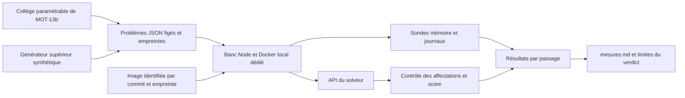

# MOT-02 · Mesurer le solveur sur un jeu scolaire — conception

| | |
|---|---|
| Module | [MOT](../../plan/modules/MOT-moteur.md) · chantier ouvert le 2026-11-15 |
| Mission | `docs/plan/missions/mot-02.md`, encore disponible dans le dossier `coordination-agents` (PR #180) |
| Branche | `etude/mot-02-mesure-solveur` |
| Dossier | `..\travaux-planner\mot-02-mesure-solveur` |
| Rédigé par | Codex, le 2026-11-15 |
| **Validé** | **En attente du coordinateur. Brouillon soumis : aucun code autorisé.** |

## 1. Objet et critère de « terminé »

Versionner le jeu scolaire, puis un jeu de 20 000 étudiants ; noter le temps, la mémoire et les règles dures violées dans `mesures.md` ; dire si la génération du collège de 600 élèves tient en moins de 10 minutes (EP-10).

Les paramètres proposés ci-dessous sont des questions, pas des décisions acquises. Les mesures se font uniquement sur le poste. Aucune mesure n'a encore été lancée.

Le résultat doit distinguer le succès du solveur sur une semaine type et la conformité de toute la génération applicative. Une mesure directe de l'API du solveur ne suffit pas à certifier le parcours complet EP-10.

## 2. Ce qui existe

État lu sur `origin/main`, commit `38f2f90f` (fusion de #181), à la création de la branche :

- `solver/pom.xml:10` et `:23` : Spring Boot 4.1.2, cœur Timefold 1.35.0, Java 21. La mission précède cette montée déjà fusionnée.
- `solver/src/main/java/ma/hestim/solver/ConfigurationSolveur.java:31` : configuration construite en Java ; aucun réglage externe de graine ou de mode d'assertion dans cette classe.
- `solver/src/main/java/ma/hestim/solver/rest/EmploiDuTempsController.java:49` : plafond de 600 s, 5 000 leçons, 500 créneaux, 2 000 salles ; arrêt sans amélioration après 20 s au plus. Une demande de 600 s n'implique donc pas 600 s effectives.
- Le même contrôleur, `:133` et `:186` : score dur et souple, affectations et violations ; analyse des violations seulement à la fin. Il ne livre pas l'instant exact de la première solution faisable.
- `backend/services/generation/timefold/probleme.js` : semaine type, enseignants imposés, séances de 1 ou 2 créneaux, 6 séances au plus par enseignement. Les élèves ne sont pas des variables : l'effectif seul ne décrit pas la difficulté.
- `ecarts-du-solveur.md` : conflits par hiérarchie de groupes, pas par élève ; les groupes de langue transversaux restent MOT-06 ; dates, fériés et volume effectivement déployé ne sont pas entièrement évalués par le solveur.
- `docker-compose.yml:109` : solveur limité à 2 CPU et 1 Gio ; `deploy/vps/docker-compose.vps.yml:36` : 1,5 CPU et 640 Mio, tas Java plafonné à 70 %.
- Fiche MOT-12 : les petits essais avant/après sont trop bruités pour conclure sur la vitesse. La mesure scolaire reste MOT-02.
- Le complément **validé par le chef** `mot-13b-solveur.md`, lu dans le dossier voisin : question 21, collège de 4 classes avec générateur paramétrable repris par MOT-02 ; changement vers un score dur/moyen/souple. Ce générateur n'est pas encore présent dans la branche MOT-02. Aucun fichier appartenant à 13b n'est modifié ici.
- Reconnaissance locale, lecture seule : Docker répond, moteur Linux, 12 CPU et 5 860 114 432 octets de RAM exposés à sa machine virtuelle. Java trouvé dans le PATH : version de répertoire 17 ; Maven absent du PATH. Utiliser la construction Docker du dépôt plutôt que changer Java sur le poste.

## 3. Questions et réponses

Questions techniques adressées au coordinateur ; toute décision de produit ou extension du périmètre reste au chef.

| N° | Question | Proposition à valider | Réponse | Bloque |
|---|---|---|---|---|
| Q1 | Quel collège et quel ordre avec MOT-13b ? | Réutiliser son générateur en lecture seule après sa livraison, multiplier ses 4 classes par 5, avec 30 élèves par classe : 20 classes, 600 élèves. Hériter de ses matières, volumes, salles et contraintes ; relever leur manifeste exact avant de figer le jeu. Aucun second générateur de collège concurrent. Préparer le protocole maintenant, mesures scolaires après disponibilité de 13b. | en attente | jeu scolaire et calendrier |
| Q2 | Comment représenter 20 000 étudiants sans dépasser artificiellement la borne API ? | Jeu supérieur distinct : 400 groupes de 50, 12 séances de 2 créneaux par groupe (4 800 leçons), 800 enseignants et 400 salles de 50 places, 40 créneaux d'une heure du lundi au vendredi (08–12 h, 13–17 h), plafonds journaliers de 480 min. Affectations des enseignants réparties par une construction témoin faisable ; disponibilité complète et un seul site pour ce premier scénario. Toutes les valeurs sont synthétiques. | en attente | grand jeu |
| Q3 | Limites de ressources du banc ? | Mesure principale au profil du VPS : 1,5 CPU, 640 Mio, pas d'échange pour le conteneur, tas à 70 %, un calcul à la fois. Garder le profil général 2 CPU/1 Gio comme série séparée facultative, jamais mélanger les verdicts. Aucun Compose applicatif lancé. | en attente | exécution |
| Q4 | Durée, répétitions et sondage ? | Pour chaque jeu/version/profil : une chauffe de 60 s non comptée puis 3 passages indépendants à budget demandé de 600 s, conteneur neuf à chaque passage ; sondage API et mémoire chaque seconde. Relever l'arrêt anticipé réel. Garde externe à 660 s, arrêt et classement incomplet si dépassée. | en attente | protocole chiffré |
| Q5 | Quelle portée du verdict EP-10 ? | « Solveur conforme sur ce jeu et ce poste » seulement si tous les passages ont toutes les séances affectées, dur = 0, moyen = 0 lorsqu'il existe, et réponse finale reçue en moins de 600 s. EP-10 applicatif complet reste non démontré par ce banc direct ; ne pas annoncer que langues transversales, calendrier et déploiement sont validés. | en attente | rédaction du verdict |
| Q6 | Comparaison de vitesse MOT-12 ? | Figer un problème commun sans champs exclusifs à 13b, mêmes octets, mêmes ressources et durées ; comparer les images construites depuis les commits avant/après MOT-12 identifiés dans son historique. Publier médiane et étendue des trois passages et les compteurs de calcul présents dans les journaux ; pas de conclusion fondée sur le seul temps d'arrêt. Aucun changement de mode d'assertion ni de source du solveur. | en attente | comparaison |
| Q7 | Faut-il filtrer les domaines du solveur dans MOT-02 ? | Exclure ce changement de cette mission d'étude : `solver/` est interdit par la fiche, alors que le plan 13b renvoie le filtrage à MOT-02. Mesurer d'abord ; toute optimisation requiert un périmètre et un plan distincts validés. | en attente | résolution de la divergence des périmètres |
| Q8 | Quels artefacts versionner ? | Générateur du grand jeu, configurations, problèmes JSON figés, manifeste sans identifiants du poste, résultats résumés et rapport dans le périmètre ci-dessous. Journaux, réponses détaillées et métadonnées locales dans `.local/`, ignoré par un `.gitignore` du banc. La première solution faisable est un temps **observé** par sondage, avec sa résolution, pas un temps exact du moteur. | en attente | format des livrables |

## 4. Solution proposée

### Jeux et reproductibilité

Le manifeste dit : élèves ou étudiants, classes/groupes, enseignants, leçons, durées, créneaux, salles, équipements, disponibilités et contraintes. Il distingue élèves et sous-groupes : ne pas additionner deux fois les élèves dans les effectifs. Pour le collège, confirmer les valeurs héritées de 13b ; s'il ne permet pas 600 élèves à l'identique, revenir au coordinateur avant toute adaptation.

Chaque JSON a une empreinte SHA-256 et un ordre stable. Le générateur du grand jeu produit aussi une affectation témoin pour vérifier que la construction n'est pas impossible par erreur. Les calculs mesurés partent sans affectation ni épinglage. Le témoin reste séparé, hors entrée du solveur. La difficulté du jeu supérieur proposé est une limite explicite : groupes indépendants, sans groupes transversaux, ni preuve de capacité pour tout établissement de 20 000 étudiants.

Aucun réglage Timefold caché ou modification de son source. Les durées d'arrêt rendent le chemin de recherche sensible à la vitesse du poste ; reproductibilité signifie mêmes entrées, versions et ressources, pas affectations finales garanties identiques.

### Exécution et collecte

Construire l'image à partir de `solver/`, en lecture seule côté sources, via son Dockerfile. Les contextes historiques de la comparaison sont extraits depuis Git sous `.local/` sans modifier les branches voisines. Enregistrer commit, identifiant d'image, versions, limites inspectées et empreinte de la requête. Vérifier que Docker est local, les ressources sont suffisantes et le port de boucle locale choisi est libre. Un nom et des labels propres à MOT-02 identifient les seuls conteneurs gérés par le banc.

Le jeton est généré pour le conteneur du banc et n'entre ni dans les arguments affichés ni dans les résultats versionnés. Le banc ne contacte que sa propre instance locale. Aucun appel à une installation Planner existante ou au serveur.

Chronométrer avec une horloge monotone : démarrage et santé séparés ; mesure principale de l'envoi POST à la réception du GET final, analyse incluse. Conserver le temps serveur comme mesure distincte. La première réponse complète avec dur nul donne une borne supérieure observée du temps de faisabilité. Le dernier GET doit être terminé, sans erreur, avec un score valide, des identifiants connus et uniques, et toutes les leçons attendues affectées.

Échantillonner la mémoire du conteneur (usage, cache et pic cgroup lorsque disponibles) ; distinguer pic natif et maximum échantillonné. Conserver CPU, arrêt/OOM, code HTTP, score, violations par règle, nombre de leçons non affectées et latence du sondage. Une valeur non exposée est « indisponible », jamais zéro. Le score dur est une pénalité pondérée, pas le nombre brut de violations ; les occurrences viennent de l'analyse. L'évaluateur indépendant complet reste MOT-04.

Une erreur, un refus de taille, un OOM, un délai dépassé ou une réponse partielle est un résultat d'échec documenté. Ne pas réduire le jeu ou augmenter les ressources discrètement. À la fin, arrêter uniquement les conteneurs identifiés du banc, conserver les résultats locaux ; aucune purge globale.

## 5. Fichiers créés ou modifiés

| Fichier | État prévu | Rôle | Taille visée |
|---|---|---|---|
| `scripts/mesures/mot-02/README.md`, `.gitignore` | créés après validation | commandes, protocole, résultats locaux ignorés | moins de 200 lignes chacun |
| `scripts/mesures/mot-02/configurations/*.json`, `jeux/*.json` | créés après validation | paramètres approuvés, problèmes figés, manifeste et témoin | données |
| `scripts/mesures/mot-02/generer-superieur.mjs` | créé après validation | grand jeu reproductible | moins de 200 lignes |
| `scripts/mesures/mot-02/mesurer.mjs` | créé après validation | pilote séquentiel | moins de 250 lignes |
| `scripts/mesures/mot-02/lib/*.mjs` | créés après validation | Docker, API, collecte, validation, synthèse | moins de 200 lignes chacun |
| `scripts/mesures/mot-02/tests/*.test.mjs` | créés après validation | contrats du banc | moins de 250 lignes chacun |
| `docs/conception/moteur-planification/mot-02-mesure-solveur.md` | créé | ce brouillon, puis plan validé |
| `docs/conception/moteur-planification/mesures.md` | créé après mesures | rapport chiffré et limites |
| `docs/conception/moteur-planification/README.md`, `docs/conception/README.md` | modifiés après validation | liens vers plan et mesures |
| `docs/plan/suivi.md` | sa seule ligne MOT-02 | état et branche |
| `docs/plan/modules/MOT-moteur.md` | modifié quand le banc existe | ce qui existe et état MOT-02 |
| `docs/sessions/2026-11-15-etude-mot-02-mesure-solveur.md` | créé | fiche et prompt de reprise |

Le générateur `scripts/college-fictif.mjs` et les fichiers de MOT-13b sont lus, jamais modifiés par cette mission. Toute adaptation hors de ce tableau est demandée avant écriture.

## 6. Données et migration

Aucune base, table ou migration. Entrées entièrement fictives ; aucun extrait de l'école d'origine. Le banc ne démarre ni MySQL, ni backend, ni services d'une installation existante.

## 7. Sécurité, isolation et exigences produit

Aucun changement aux droits, à l'isolation ou aux API du produit. Aucun canal I-1 à I-16 modifié. Boucle locale et jeton du service réutilisent le mécanisme existant. EP-10 est évaluée dans la portée approuvée à Q5 ; la cible de moins de 30 minutes sur 20 000 étudiants appartient à MOT-10 et ne peut être vérifiée avec la borne API actuelle de 600 s.

## 8. Tests prévus après validation

- Génération stable et empreintes ; effectifs et tailles attendus ; limites API et corps de requête ; témoin faisable, absence de ses affectations dans l'entrée mesurée.
- Faux solveur : succès, dur négatif, moyen négatif, score absent, leçon manquante/dupliquée/inconnue, erreur HTTP, délai et arrêt anticipé. Un score nul sans toutes les affectations est refusé.
- Collecte : conversions mémoire, mesure indisponible, horloge monotone, pas de confusion entre chauffe et passages comptés, échec conservé dans la synthèse.
- Docker : vérification des limites effectives et du contexte local ; nettoyage limité aux ressources de la session ; jeton absent des sorties versionnées.
- Essai réel court du banc, puis séries validées. `node --test`, `node --check`, `git diff --check` et contrôle de neutralité avant livraison. Les tests de l'application ne sont relancés que si son code change (hors périmètre ici).

## 9. Étapes de livraison

1. Soumettre les questions et ce brouillon au coordinateur ; attendre ses réponses et la validation avant tout code. Le dépôt de ce brouillon pour revue ne vaut pas validation.
2. Inscrire les réponses, puis commiter le plan validé séparément avant le premier commit de code.
3. Après disponibilité du générateur de 13b, figer les jeux et leurs paramètres, écrire et tester le banc dans son dossier.
4. Essai court, puis passages scolaires, grand jeu et comparaison de versions selon les réponses. Conserver chaque échec.
5. Rapport, liens, module, suivi et fiche ; commits locaux et rapport dans la boîte. Push et PR par le chef.

## 10. Risques et retour arrière

Le jeu 13b peut évoluer pendant cette conception : figer sa provenance et refaire valider un changement de contrat. Ses sous-groupes de langue ne sont pas une résolution de F-5 ; ne pas conclure que les groupes transversaux sont pris en charge. Un score modifié par 13b n'est pas directement comparable à celui d'avant : comparaison uniquement sur les règles et problèmes communs.

Le grand jeu peut dépasser mémoire ou temps malgré une taille acceptée par l'API : résultat utile, à publier tel quel. Docker Desktop diffère d'un serveur Debian : le rapport documente la machine, sans extrapoler. Les sondages et l'analyse finale ont un coût, inclus et documenté.

Retour arrière : retirer uniquement le conteneur du banc ; aucune donnée applicative modifiée. Les images et fichiers locaux sont gardés tant que les résultats doivent être revus.

## 11. Hors périmètre

Serveur, n8n, production, `solver/`, `backend/`, modification du générateur 13b, filtrage des domaines, nouvelles contraintes, choix de moteur, évaluateur indépendant complet, nouvelles dépendances du produit, promesse de prise en charge des groupes de langue et certification complète du parcours EP-10.
