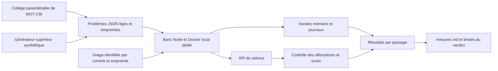

# MOT-02 · Mesurer le solveur sur un jeu scolaire — conception

| | |
|---|---|
| Module | [MOT](../../plan/modules/MOT-moteur.md) · chantier ouvert le 2026-11-15 |
| Mission | `docs/plan/missions/mot-02.md`, encore disponible dans le dossier `coordination-agents` (PR #180) |
| Branche | `etude/mot-02-mesure-solveur` |
| Dossier | `..\travaux-planner\mot-02-mesure-solveur` |
| Rédigé par | Codex, le 2026-11-15 |
| **Validé** | **Validé par le coordinateur le 2026-11-15**, réponses Q1 à Q8 dans la boîte Codex à 14:45. |

> **Reprise du 21 novembre 2026.** Le protocole du 15 novembre reste consigné ci-dessous. Le [complément sur le supérieur](#supérieur-21-novembre) porte les nouvelles propositions à valider.

## 1. Objet et critère de « terminé »

Versionner le jeu scolaire, puis un jeu de 20 000 étudiants ; noter le temps, la mémoire et les règles dures violées dans `mesures.md` ; dire si la génération du collège de 600 élèves tient en moins de 10 minutes (EP-10).

Les paramètres proposés ci-dessous ont été retenus par le coordinateur le 15 novembre ; ses réponses précisent leur application. Les mesures se font uniquement sur le poste. Aucune mesure n'a encore été lancée.

Le résultat doit distinguer le succès du solveur sur une semaine type et la conformité de toute la génération applicative. Une mesure directe de l'API du solveur ne suffit pas à certifier le parcours complet EP-10.

## 2. Ce qui existe

État lu sur `origin/main`, commit `38f2f90f` (fusion de #181), à la création de la branche :

- `solver/pom.xml:10` et `:23` : Spring Boot 4.1.2, cœur Timefold 1.35.0, Java 21. La mission précède cette montée déjà fusionnée.
- `solver/src/main/java/ma/hestim/solver/ConfigurationSolveur.java:31` : configuration construite en Java ; aucun réglage externe de graine ou de mode d'assertion dans cette classe.
- `solver/src/main/java/ma/hestim/solver/rest/EmploiDuTempsController.java:49` : plafond de 600 s, 5 000 leçons, 500 créneaux, 2 000 salles ; arrêt sans amélioration après 20 s au plus. Une demande de 600 s n'implique donc pas 600 s effectives.
- Le même contrôleur, `:133` et `:186` : score dur et souple, affectations et violations ; analyse des violations seulement à la fin. Il ne livre pas l'instant exact de la première solution faisable.
- `backend/services/generation/timefold/probleme.js` : semaine type, enseignants imposés, séances de 1 ou 2 créneaux, 6 séances au plus par enseignement. Les élèves ne sont pas des variables : l'effectif seul ne décrit pas la difficulté.
- `ecarts-du-solveur.md` : conflits par hiérarchie de groupes, pas par élève ; les groupes de langue transversaux restent MOT-06 ; dates, fériés et volume effectivement déployé ne sont pas entièrement évalués par le solveur.
- `docker-compose.yml:109` : solveur limité à 2 CPU et 1 Gio ; `deploy/vps/docker-compose.vps.yml:36` : 1,5 CPU et 640 Mio, tas Java plafonné à 70 %.
- Fiche MOT-12 : les petits essais avant/après sont trop bruités pour conclure sur la vitesse. La mesure scolaire reste MOT-02.
- Le complément **validé par le chef** `mot-13b-solveur.md`, lu dans le dossier voisin : question 21, collège de 4 classes avec générateur paramétrable repris par MOT-02 ; changement vers un score dur/moyen/souple. Ce générateur n'est pas encore présent dans la branche MOT-02. Aucun fichier appartenant à 13b n'est modifié ici.
- Reconnaissance locale, lecture seule : Docker répond, moteur Linux, 12 CPU et 5 860 114 432 octets de RAM exposés à sa machine virtuelle. Java trouvé dans le PATH : version de répertoire 17 ; Maven absent du PATH. Utiliser la construction Docker du dépôt plutôt que changer Java sur le poste.

## 3. Questions et réponses

Questions techniques adressées au coordinateur ; toute décision de produit ou extension du périmètre reste au chef.

| N° | Question | Proposition à valider | Réponse | Bloque |
|---|---|---|---|---|
| Q1 | Quel collège et quel ordre avec MOT-13b ? | Réutiliser son générateur en lecture seule après sa livraison, multiplier ses 4 classes par 5, avec 30 élèves par classe : 20 classes, 600 élèves. Hériter de ses matières, volumes, salles et contraintes ; relever leur manifeste exact avant de figer le jeu. Aucun second générateur de collège concurrent. Préparer le protocole maintenant, mesures scolaires après disponibilité de 13b. | Coordinateur, 15 nov. : Oui : construire maintenant le banc, le grand jeu et la comparaison ; attendre 13b sur main pour lire son générateur, jamais depuis sa branche. Revenir au coordinateur si 600 élèves nécessitent une adaptation. | jeu scolaire et calendrier |
| Q2 | Comment représenter 20 000 étudiants sans dépasser artificiellement la borne API ? | Jeu supérieur distinct : 400 groupes de 50, 12 séances de 2 créneaux par groupe (4 800 leçons), 800 enseignants et 400 salles de 50 places, 40 créneaux d'une heure du lundi au vendredi (08–12 h, 13–17 h), plafonds journaliers de 480 min. Affectations des enseignants réparties par une construction témoin faisable ; disponibilité complète et un seul site pour ce premier scénario. Toutes les valeurs sont synthétiques. | Coordinateur, 15 nov. : Oui, tel que proposé ; mention obligatoire : jeu supérieur simplifié. | grand jeu |
| Q3 | Limites de ressources du banc ? | Mesure principale au profil du VPS : 1,5 CPU, 640 Mio, pas d'échange pour le conteneur, tas à 70 %, un calcul à la fois. Garder le profil général 2 CPU/1 Gio comme série séparée facultative, jamais mélanger les verdicts. Aucun Compose applicatif lancé. | Coordinateur, 15 nov. : Oui, profil VPS principal ; profil général facultatif séparé. | exécution |
| Q4 | Durée, répétitions et sondage ? | Pour chaque jeu/version/profil : une chauffe de 60 s non comptée puis 3 passages indépendants à budget demandé de 600 s, conteneur neuf à chaque passage ; sondage API et mémoire chaque seconde. Relever l'arrêt anticipé réel. Garde externe à 660 s, arrêt et classement incomplet si dépassée. | Coordinateur, 15 nov. : Oui, chauffe 60 s, 3 passages neufs, budget 600 s, sondage 1 s, garde 660 s. | protocole chiffré |
| Q5 | Quelle portée du verdict EP-10 ? | « Solveur conforme sur ce jeu et ce poste » seulement si tous les passages ont toutes les séances affectées, dur = 0, moyen = 0 lorsqu'il existe, et réponse finale reçue en moins de 600 s. EP-10 applicatif complet reste non démontré par ce banc direct ; ne pas annoncer que langues transversales, calendrier et déploiement sont validés. | Coordinateur, 15 nov. : Oui. Écrire exactement : EP-10 applicative non démontrée par ce banc. | rédaction du verdict |
| Q6 | Comparaison de vitesse MOT-12 ? | Figer un problème commun sans champs exclusifs à 13b, mêmes octets, mêmes ressources et durées ; comparer les images construites depuis les commits avant/après MOT-12 identifiés dans son historique. Publier médiane et étendue des trois passages et les compteurs de calcul présents dans les journaux ; pas de conclusion fondée sur le seul temps d'arrêt. Aucun changement de mode d'assertion ni de source du solveur. | Coordinateur, 15 nov. : Oui : dernier commit avant #181 (premier parent de la fusion), puis #181 ; problème commun figé. | comparaison |
| Q7 | Faut-il filtrer les domaines du solveur dans MOT-02 ? | Exclure ce changement de cette mission d'étude : `solver/` est interdit par la fiche, alors que le plan 13b renvoie le filtrage à MOT-02. Mesurer d'abord ; toute optimisation requiert un périmètre et un plan distincts validés. | Coordinateur, 15 nov. : Oui, aucun filtrage dans MOT-02. Si le besoin est démontré, fonction distincte rattachée à MOT-10 ; divergence tranchée par le coordinateur. | résolution de la divergence des périmètres |
| Q8 | Quels artefacts versionner ? | Générateur du grand jeu, configurations, problèmes JSON figés, manifeste sans identifiants du poste, résultats résumés et rapport dans le périmètre ci-dessous. Journaux, réponses détaillées et métadonnées locales dans `.local/`, ignoré par un `.gitignore` du banc. La première solution faisable est un temps **observé** par sondage, avec sa résolution, pas un temps exact du moteur. | Coordinateur, 15 nov. : Oui ; ignorer .local/ dans le .gitignore du banc ; aucune empreinte de poste dans le manifeste. | format des livrables |

## 4. Solution proposée

### Jeux et reproductibilité

Le manifeste dit : élèves ou étudiants, classes/groupes, enseignants, leçons, durées, créneaux, salles, équipements, disponibilités et contraintes. Il distingue élèves et sous-groupes : ne pas additionner deux fois les élèves dans les effectifs. Pour le collège, confirmer les valeurs héritées de 13b ; s'il ne permet pas 600 élèves à l'identique, revenir au coordinateur avant toute adaptation.

Chaque JSON a une empreinte SHA-256 et un ordre stable. Le générateur du grand jeu produit aussi une affectation témoin pour vérifier que la construction n'est pas impossible par erreur. Les calculs mesurés partent sans affectation ni épinglage. Le témoin reste séparé, hors entrée du solveur. La difficulté du jeu supérieur proposé est une limite explicite : groupes indépendants, sans groupes transversaux, ni preuve de capacité pour tout établissement de 20 000 étudiants.

Aucun réglage Timefold caché ou modification de son source. Les durées d'arrêt rendent le chemin de recherche sensible à la vitesse du poste ; reproductibilité signifie mêmes entrées, versions et ressources, pas affectations finales garanties identiques.

### Exécution et collecte

Construire l'image à partir de `solver/`, en lecture seule côté sources, via son Dockerfile. Les contextes historiques de la comparaison sont extraits depuis Git sous `.local/` sans modifier les branches voisines. Enregistrer commit, identifiant d'image, versions, limites inspectées et empreinte de la requête. Vérifier que Docker est local, les ressources sont suffisantes et le port de boucle locale choisi est libre. Un nom et des labels propres à MOT-02 identifient les seuls conteneurs gérés par le banc.

Le jeton est généré pour le conteneur du banc et n'entre ni dans les arguments affichés ni dans les résultats versionnés. Le banc ne contacte que sa propre instance locale. Aucun appel à une installation Planner existante ou au serveur.

Chronométrer avec une horloge monotone : démarrage et santé séparés ; mesure principale de l'envoi POST à la réception du GET final, analyse incluse. Conserver le temps serveur comme mesure distincte. La première réponse complète avec dur nul donne une borne supérieure observée du temps de faisabilité. Le dernier GET doit être terminé, sans erreur, avec un score valide, des identifiants connus et uniques, et toutes les leçons attendues affectées.

Échantillonner la mémoire du conteneur (usage, cache et pic cgroup lorsque disponibles) ; distinguer pic natif et maximum échantillonné. Conserver CPU, arrêt/OOM, code HTTP, score, violations par règle, nombre de leçons non affectées et latence du sondage. Une valeur non exposée est « indisponible », jamais zéro. Le score dur est une pénalité pondérée, pas le nombre brut de violations ; les occurrences viennent de l'analyse. L'évaluateur indépendant complet reste MOT-04.

Une erreur, un refus de taille, un OOM, un délai dépassé ou une réponse partielle est un résultat d'échec documenté. Ne pas réduire le jeu ou augmenter les ressources discrètement. À la fin, arrêter uniquement les conteneurs identifiés du banc, conserver les résultats locaux ; aucune purge globale.

## 5. Fichiers créés ou modifiés

| Fichier | État prévu | Rôle | Taille visée |
|---|---|---|---|
| `scripts/mesures/mot-02/README.md`, `.gitignore` | créés après validation | commandes, protocole, résultats locaux ignorés | moins de 200 lignes chacun |
| `scripts/mesures/mot-02/configurations/*.json`, `jeux/*.json` | créés après validation | paramètres approuvés, problèmes figés, manifeste et témoin | données |
| `scripts/mesures/mot-02/generer-superieur.mjs` | créé après validation | grand jeu reproductible | moins de 200 lignes |
| `scripts/mesures/mot-02/mesurer.mjs` | créé après validation | pilote séquentiel | moins de 250 lignes |
| `scripts/mesures/mot-02/lib/*.mjs` | créés après validation | Docker, API, collecte, validation, synthèse | moins de 200 lignes chacun |
| `scripts/mesures/mot-02/tests/*.test.mjs` | créés après validation | contrats du banc | moins de 250 lignes chacun |
| `docs/conception/moteur-planification/mot-02-mesure-solveur.md` | créé | ce brouillon, puis plan validé |
| `docs/conception/moteur-planification/mesures.md` | créé après mesures | rapport chiffré et limites |
| `docs/conception/moteur-planification/README.md`, `docs/conception/README.md` | modifiés après validation | liens vers plan et mesures |
| `docs/plan/suivi.md` | sa seule ligne MOT-02 | état et branche |
| `docs/plan/modules/MOT-moteur.md` | modifié quand le banc existe | ce qui existe et état MOT-02 |
| `docs/sessions/2026-11-15-etude-mot-02-mesure-solveur.md` | créé | fiche et prompt de reprise |

Le générateur `scripts/college-fictif.mjs` et les fichiers de MOT-13b sont lus, jamais modifiés par cette mission. Toute adaptation hors de ce tableau est demandée avant écriture.

## 6. Données et migration

Aucune base, table ou migration. Entrées entièrement fictives ; aucun extrait de l'école d'origine. Le banc ne démarre ni MySQL, ni backend, ni services d'une installation existante.

## 7. Sécurité, isolation et exigences produit

Aucun changement aux droits, à l'isolation ou aux API du produit. Aucun canal I-1 à I-16 modifié. Boucle locale et jeton du service réutilisent le mécanisme existant. EP-10 est évaluée dans la portée approuvée à Q5 ; la cible de moins de 30 minutes sur 20 000 étudiants appartient à MOT-10 et ne peut être vérifiée avec la borne API actuelle de 600 s.

## 8. Tests prévus après validation

- Génération stable et empreintes ; effectifs et tailles attendus ; limites API et corps de requête ; témoin faisable, absence de ses affectations dans l'entrée mesurée.
- Faux solveur : succès, dur négatif, moyen négatif, score absent, leçon manquante/dupliquée/inconnue, erreur HTTP, délai et arrêt anticipé. Un score nul sans toutes les affectations est refusé.
- Collecte : conversions mémoire, mesure indisponible, horloge monotone, pas de confusion entre chauffe et passages comptés, échec conservé dans la synthèse.
- Docker : vérification des limites effectives et du contexte local ; nettoyage limité aux ressources de la session ; jeton absent des sorties versionnées.
- Essai réel court du banc, puis séries validées. `node --test`, `node --check`, `git diff --check` et contrôle de neutralité avant livraison. Les tests de l'application ne sont relancés que si son code change (hors périmètre ici).

## 9. Étapes de livraison

1. Questions soumises, réponses et validation reçues du coordinateur le 15 novembre à 14:45.
2. Inscrire les réponses, puis commiter le plan validé séparément avant le premier commit de code.
3. Construire maintenant le banc, le grand jeu et la comparaison. Après fusion de 13b sur main, lire son générateur depuis main, figer le collège et mesurer ; aucune lecture de son générateur depuis sa branche.
4. Essai court, puis passages scolaires, grand jeu et comparaison de versions selon les réponses. Conserver chaque échec.
5. Rapport, liens, module, suivi et fiche ; commits locaux et rapport dans la boîte. Push et PR par le chef.

## 10. Risques et retour arrière

Le jeu 13b peut évoluer pendant cette conception : figer sa provenance et refaire valider un changement de contrat. Ses sous-groupes de langue ne sont pas une résolution de F-5 ; ne pas conclure que les groupes transversaux sont pris en charge. Un score modifié par 13b n'est pas directement comparable à celui d'avant : comparaison uniquement sur les règles et problèmes communs.

Le grand jeu peut dépasser mémoire ou temps malgré une taille acceptée par l'API : résultat utile, à publier tel quel. Docker Desktop diffère d'un serveur Debian : le rapport documente la machine, sans extrapoler. Les sondages et l'analyse finale ont un coût, inclus et documenté.

Retour arrière : retirer uniquement le conteneur du banc ; aucune donnée applicative modifiée. Les images et fichiers locaux sont gardés tant que les résultats doivent être revus.

## 11. Hors périmètre

Serveur, n8n, production, `solver/`, `backend/`, modification du générateur 13b, filtrage des domaines, nouvelles contraintes, choix de moteur, évaluateur indépendant complet, nouvelles dépendances du produit, promesse de prise en charge des groupes de langue et certification complète du parcours EP-10.

## 12. Complément du 21 novembre 2026 · jeu du supérieur validé par le chef

La décision du 21 novembre place le supérieur en premier. Le collège de 600 élèves et son verdict EP-10 passent à l’étape du scolaire. Les six passages déjà publiés sur le jeu simplifié de 20 000 étudiants restent la référence de charge. Ce complément propose un jeu distinct pour répondre à deux questions. Le solveur produit-il une semaine utilisable avec les contraintes du supérieur ? À entrées et poids identiques, comment évolue la qualité souple depuis MOT-13b ? [Décision du chef](https://github.com/Claude20022002/Planner/blob/doc/coordination-equipe/docs/plan/decisions.md) · [Mesures du 15 novembre](mesures.md) · [Réponse 22](mot-13b-solveur.md)

### Jeu et tailles proposés

Une promotion de 120 étudiants comprend deux TD de 60, subdivisés chacun en deux TP de 30. Les quatre groupes de TP partitionnent la promotion. Pour chacun de trois modules, une semaine contient un CM par promotion, un TD par groupe de TD et un TP par groupe de TP. Un étudiant suit donc neuf séances par semaine. Les TP durent deux créneaux consécutifs, les CM et TD un seul.

| Paramètre du jeu fictif | Petite taille | Taille principale |
|---|---:|---:|
| Étudiants distincts | 480 | 960 |
| Promotions / groupes de TD / groupes de TP | 4 / 8 / 16 | 8 / 16 / 32 |
| Séances de CM / TD / TP | 12 / 24 / 48 | 24 / 48 / 96 |
| Séances à placer | 84 | 168 |
| Enseignants, dont vacataires | 12, dont 4 | 24, dont 8 |
| Salles sur les deux campus | 10 | 20 |

- **Grille et salles.** Les deux campus partagent cinq jours de huit créneaux d’une heure, avec une coupure à midi. Par campus, prévoir pour la petite taille un amphithéâtre de 120 places, deux salles de TD de 60 et deux laboratoires de 30. Doubler ces quantités pour la taille principale. Répartir deux spécialités de laboratoire entre les campus afin que chaque promotion ait au moins un TP à suivre sur chacun. Le trajet proposé entre campus est de 30 minutes dans chaque sens. Deux créneaux contigus sur des sites distincts ne laissent aucun temps de trajet.
- **Intervenants.** Répartir les enseignements entre promotions afin qu’au moins un permanent intervienne sur les deux campus. Chaque vacataire assure les quatre TP d’un module d’une promotion, soit huit heures, et propose quatre demi-journées de quatre heures. Alterner ces fenêtres selon le vacataire et marquer les créneaux hors fenêtre `INDISPONIBLE`. Un vœu de créneau préféré ou à éviter reste souple. Le manifeste compte les enseignants réellement affectés, les fenêtres et les séances partagées.
- **Contrôle du jeu.** Construire un emploi du temps témoin distinct pour chaque taille. Avant la mesure, vérifier chaque séance et chaque créneau occupé, les collisions de salle et d’enseignant, les feuilles de groupes communes, les capacités, équipements, fenêtres, plafonds journaliers de huit heures et trajets. Vérifier aussi qu’un CM empêche un TP de la même promotion au même moment et que deux TP frères peuvent travailler en parallèle. Le vérificateur du jeu plat ne contrôle aujourd’hui que les groupes directs. Étendre les contrôles du banc après visa. Si le témoin échoue, corriger le jeu avant toute acquisition et recalculer son empreinte.

### Mesure et seuils proposés

1. **Comparaison.** Construire les images depuis le premier parent de la fusion de MOT-13b (`ab2620a4`, avant #182) et la base intégrée (`53561918`). Comparer les deux tailles sur les règles communes, avec les mêmes entrées sans placement, les mêmes poids par défaut et les mêmes limites. Vérifier sur une affectation figée les scores dur et souple des deux versions. Si le résultat diffère, localiser la règle ou le paramètre avant d’attribuer un écart à la recherche. En cas d’écart entre versions, contrôler aussi la fusion #182 elle-même (`d0359925`) avant de conclure sur son rôle.
2. **Répétitions.** Pour chaque couple taille/version, reprendre le protocole du 15 novembre. Une chauffe exclue de 60 s précède trois passages de 600 s, chacun dans un conteneur neuf sur le poste. Alterner les versions entre répétitions. Cela représente douze passages mesurés et quatre chauffes. Conserver 1,5 CPU, 640 Mio, tas à 70 %, sondage à la seconde et garde externe de 660 s. Figer la configuration, le problème (SHA-256), l’image et le témoin pour chaque série.
3. **Faisabilité sur la version actuelle.** Pour chaque taille, proposer comme seuil trois passages sur trois avec toutes les séances affectées une fois, créneau et salle connus, aucun conflit dur, score moyen nul, réponse finale analysée en moins de 600 s depuis le POST et aucun arrêt par manque de mémoire. Indiquer séparément le temps et le pic mémoire de chaque passage. Un résultat partiel, même avec un score nul, compte comme échec. Si un seuil manque, l’étude livre tout de même son constat.
4. **Qualité souple.** Sur les solutions complètes et faisables, publier pour chaque taille le score souple total, le score par séance et les contributions disponibles par règle, avec médiane et étendue. Proposer une alerte dès que la médiane actuelle perd **plus de 10 %** de la valeur absolue de la médiane de référence, à taille et pondérations identiques. Si la médiane de référence est nulle, signaler toute baisse en points. Avec moins de trois résultats faisables par version, classer la comparaison de qualité comme indéterminée et publier le taux de complétude. Le seuil de 10 % est proposé à partir de l’écart relevé en réponse 22. Il ne vaut pas engagement de performance.
5. **Recherche de cause et restitution.** Pour un écart, relever les règles en cause (ordre CM/TD, trous, changements de campus ou de salle, vœux), la durée des phases et le débit disponible. Distinguer les pénalités des récompenses de préférence, que la liste des violations omet. Une affectation figée au même score avec des résultats libres différents oriente vers la recherche ou le budget. Si trois passages ne départagent pas les causes, inscrire « cause indéterminée » avec les éléments observés pour MOT-04. Archiver les entrées et résultats sous des noms distincts du jeu de 20 000, puis publier la synthèse dans `mesures.md`.

### Ce que disent les études

Le public de cette mesure est l’enseignement supérieur. Le banc décrit des groupes, ressources et règles de semaine type configurables. L’évaluation du collège pourra réutiliser ses contrôles et son protocole. [Registre des études, §§ 2 à 5 et 7, version du 21 novembre](https://github.com/Claude20022002/Planner/blob/8ba3a7ac7c9b6c0eeb13fa4e254ccf7e00e7b149/docs/etude-marche/14-reprendre-et-depasser.md)

| Ligne | Conséquence pour MOT-02 |
|---|---|
| M18 · supérieur | L’échantillon fait intervenir deux campus, trois types de séance, les groupes emboîtés et les vacataires aux horaires limités. |
| M1 · calcul sous contraintes, M2 · explication des refus | Vérifier la complétude puis documenter les règles et les séances en cause quand la réponse les expose. Les messages de correction de l’application relèvent de MOT-03 et EDT-03. |
| M3 · contrôles de conflit | Maintenir les contrôles du témoin et les poids communs d’un passage à l’autre. Le forçage applicatif relève du plan de parité. |
| M15 · preuve des promesses, M17 · neutralité | Publier entrées synthétiques, ressources et résultats par passage. Les volumes sont des paramètres de l’essai, sans pays ni données d’école. |
| R17 · remplacements | Le jeu exerce la disponibilité des vacataires déjà affectés. La recherche d’un remplaçant relève de MOT-09. |

### Questions pour le chef

| N° | Décision demandée | Proposition |
|---|---|---|
| Q9 | Quel jeu clôt la mesure du supérieur ? | Valider la semaine et les deux tailles de 480 et 960 étudiants décrites ci-dessus. Garder les six passages du jeu de 20 000 comme mesure de charge distincte. |
| Q10 | Quels seuils de faisabilité et de durée ? | Valider trois plannings complets sur trois par taille en moins de 600 s, avec dur et moyen à zéro, sur le profil local du VPS. |
| Q11 | Comment juger l’écart souple de la réponse 22 ? | Valider les deux versions, les douze passages et l’alerte de 10 % sur les médianes comparables. Transmettre à MOT-04 toute cause qui reste indéterminée. |

**État au 21 novembre.** Le chef a décidé la priorité du supérieur. Le chef a validé Q9, Q10 et Q11 le 21 novembre (« Je valide »). La mise en œuvre des deux jeux et la série de mesures du § 12 sont autorisées.
