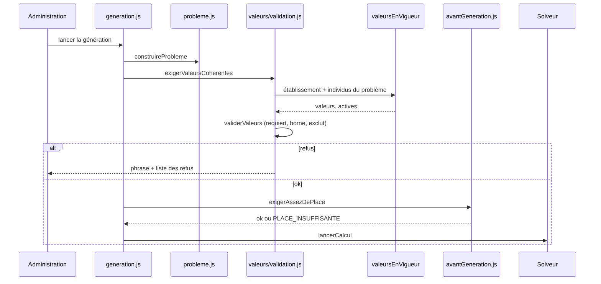

# MOT-03 · Validation avant le calcul — conception

| | |
|---|---|
| Module | [MOT](../../plan/modules/MOT-moteur.md) · chantier ouvert le 2026-11-15 |
| Branche | `feat/mot-03-validation` |
| Rédigé par | agent Cursor, le 2026-11-15 |
| **Validé** | par Claude20022002 le 2026-11-15 (« Vas y, écrit », gabarits § 4.3 compris) |

## 1. Objet et critère de « terminé »

Toute combinaison de valeurs invalide au regard des règles `requiert`, `borne` et `exclut` du catalogue est **refusée avant** le calcul Timefold. Le message nomme la règle (son nom français) et propose une correction (EP-4). Un test par famille de règles, plus un test qui parcourt **toutes** les liaisons de ces trois types dans le catalogue.

Vérification : lancer une génération avec une borne violée (ou un `requiert` non tenu, ou une exclusion) n’appelle pas `lancerCalcul` ; la session échoue avec les refus dans le rapport, comme MOT-13a pour la place.

## 2. Ce qui existe

- Catalogue : 498 paramètres, 588 liaisons dont **468 `requiert`**, **29 `borne`**, **3 `exclut`**. JSON dans `backend/services/moteur/catalogue/` ; `coherenceDesValeurs` (`verifier.js`) ne traite que `borne` et `exclut`, avec des **identifiants** dans le texte, pas le nom.
- MOT-01 : `resoudreTout` / `valeursEnVigueur` (`lecture.js`, `resolution.js`) calculent les valeurs datées. `resoudreTout` met déjà les alertes `borne`/`exclut` dans `alertes` **sans bloquer**. `controlerEcriture` refuse `borne`/`exclut` **à l’écriture** d’une ligne, pas `requiert`. La génération **ne lit toujours pas** ces valeurs (`conception-mp1.md` : `ParametresPlanning` jusqu’à MP-5).
- MOT-13a : `exigerAssezDePlace` dans `generation.js` après `construireProbleme`, avant `lancerCalcul`. `controle.js` porte sur les **contraintes déclarées**, pas sur le catalogue. MOT-13 Q16 : « sans effet » = seulement `active_si` ; le contrôle `requiert` n’est **pas** celui de MOT-13.
- `avertissements.js` : deux contrôles de charge / disponibilités, **non bloquants**. Hors MOT-03.
- Q-04 (relecture MP-1, R-1 à R-10) : **n’bloque pas** MOT-03 (écrans MOT-01 / ADM-02). R-7 : codes stables, message français d’aide.

## 3. Questions et réponses

| N° | Question | Proposition | Réponse | Bloque | À qui |
|---|---|---|---|---|---|
| 1 | Un `requiert` A→B, si B est `etat: absent` (303 paramètres hors code), refuse-t-il la génération ? | **Non.** On ignore aussi si A ou B est `solveur`, `base` ou `plan` (données des tables / du problème, pas MOT-01). Sinon ~70 refus à vide et l’école d’origine ne génère plus. Aligné MOT-13 Q16. | **oui** (chef, 15 nov.) | oui | chef |
| 2 | Quand B n’est pas absent mais n’a pas de valeur (`null` / `undefined`, pas de défaut) ? | Refus `requiert_manquant` **seulement si A doit être évalué** : donnée renseignée, ou règle **active dont l’origine n’est plus le catalogue** (un réglage d’école). Un défaut catalogue d’une règle déjà vraie n’impose pas encore ses `requiert` (collecte : MOT-05). | **oui** (chef, 15 nov.) | oui | chef |
| 3 | Quelles cibles résoudre (la résolution est par cible) ? | **Établissement**, plus chaque **enseignant, groupe, salle, matière** qui apparaît dans le problème Timefold déjà construit. Pas tout le référentiel. Date = `dateDesContraintes(periode)` (MOT-13a). | **oui** (chef, 15 nov.) | oui | chef |
| 4 | Où brancher, sans dupliquer MOT-13a ? | Même `generation.js`, **juste avant** `exigerAssezDePlace`. Nouveau module `valeurs/validation.js` (valeurs catalogue). **Pas** `controle.js`. | **oui** (chef, 15 nov.) | oui | chef |
| 5 | Faut-il aussi bloquer à l’écriture d’une version (`requiert`) ? | **Non** dans MOT-03 : un brouillon incomplet reste possible. L’écriture garde `borne`/`exclut`. Le refus `requiert` est **au lancement**. | **oui** (chef, 15 nov.) | non | chef |
| 6 | Faut-il étendre `coherenceDesValeurs` (textes identifiants) ? | **Non.** Nouvelle fonction pure `validerValeurs` qui rend `{ code, cle, de, vers, message }[]`. `coherenceDesValeurs` reste pour les profils et l’écriture. | **oui** (chef, 15 nov.) | non | chef |
| 7 | MOT-12 et MOT-02 sont avant MOT-03 dans le chantier. On code MOT-03 maintenant ? | **Oui**, consigne du coordinateur. Aucune touche à `solver/` ni `scripts/mesures/`. | **oui** (chef, 15 nov.) | non | chef |
| 8 | Textes montrés à l’administration (EP-4) | Gabarits § 4.3. | **oui** (chef, 15 nov. : « Vas y, écrit ») | oui | chef |

## 4. Solution

### 4.1 Principe

1. Construire le problème comme aujourd’hui (données Timefold).
2. Résoudre les valeurs MOT-01 pour l’établissement et les individus du problème.
3. Appliquer **toutes** les liaisons `requiert`, `borne`, `exclut` (sous les filtres Q1–Q2).
4. S’il reste un refus : `ErreurValidation` (400, `VALEURS_INVALIDES`), session `failed`, `refus_valeurs` dans `config` ; **pas** d’appel au solveur.
5. Sinon : contrôle de place MOT-13a, puis calcul.

### 4.2 Règles appliquées

| Type | Condition de refus | Ignoré si |
|---|---|---|
| `requiert` | A doit être évalué et B n’est pas renseigné | A ou B `etat` ∈ `absent`, `solveur`, `base`, `plan` ; A est une règle inactive, ou encore au défaut catalogue |
| `borne` | A et B renseignés et `compare` échoue | déjà le cas dans `coherenceDesValeurs` |
| `exclut` | A et B tous deux `true` | — |

Une règle inactive n’impose pas ses `requiert`. Les faits `ETA.TAILLE.*` viennent de `lireFaits` comme aujourd’hui.

### 4.3 Phrases proposées (à valider par le chef)

Ton : phrases courtes, comme MOT-13 (`phrases.js`). Le `nom` du catalogue, jamais l’identifiant seul.

| Code | Gabarit | Correction proposée |
|---|---|---|
| `requiert_manquant` | « {nomA} ne peut pas être évalué : il manque {nomB}. » | « Renseignez {nomB} avant de lancer le calcul. » |
| `borne_depassee` | « {nomA} ({valeurA}) doit être {op} {nomB} ({valeurB}). » | « Abaissez {nomA} ou relevez {nomB}. » (`<=`) ; inverse pour `>=`. |
| `exclusion_mutuelle` | « {nomA} et {nomB} ne peuvent pas être actifs ensemble. » | « Désactivez l’un des deux. » |

`op` lisible : `<=` → « au plus », `>=` → « au moins », `=` → « égal à », `!=` → « différent de ».

Plusieurs refus : comme `ErreurPlace`, le `message` cite le premier et le nombre des autres ; la liste complète est dans `refus`.

Quand le refus concerne un individu (enseignant, groupe, salle, matière), la phrase commence par « Pour l'enseignant {nom} : » (ou « le groupe », « la salle », « la matière »). Le nom est lu dans le problème (`enseignants`, `groupes`, `salles`, `matieres`), jamais l'identifiant seul. L'établissement n'a pas de champ `cible`. La clé de dédoublonnage inclut la portée et l'identifiant : deux cibles en faute donnent deux refus. Correction du 16 novembre (relecture EP-4), sans nouveau gabarit.

### 4.4 Ce que MOT-03 ne fait pas

Il **ne nourrit pas** le solveur avec les valeurs MOT-01 (collecte, étape 1 du README moteur). Il refuse seulement une combinaison **déjà résolue** qui viole le catalogue.

## 5. Fichiers créés ou modifiés

| Fichier | Créé / modifié | Rôle | Taille visée |
|---|---|---|---|
| `backend/services/moteur/valeurs/validation.js` | créé | `validerValeurs` (pur), `exigerValeursCoherentes`, `ErreurValidation` | < 200 |
| `backend/services/generation/timefold/generation.js` | modifié | appel avant `exigerAssezDePlace` ; `refus_valeurs` comme `refus_place` | +15 |
| `backend/tests/utils/valeursValidation.test.js` | créé | une famille par test + parcours des 468+29+3 liaisons | < 250 |
| `backend/tests/integration/generation.test.js` | modifié | génération refusée avant le calcul (faux dump de valeurs / borne) | +40 |
| `docs/conception/moteur-planification/mot-03-validation.md` | créé | ce plan | — |
| `docs/conception/moteur-planification/README.md` | modifié | lien MOT-03, ligne « Validation » du tableau § 6 | +5 |
| `docs/conception/README.md` | modifié | lien si le sommaire le demande | +2 |
| `docs/plan/modules/MOT-moteur.md`, `docs/plan/suivi.md` | modifié | état MOT-03 | — |
| fiche `docs/sessions/2026-11-15-feat-mot-03-validation.md` | créé | fin de session | — |

Hors périmètre d’écriture : `solver/`, `scripts/mesures/`, migrations, `deploy/`, `controle.js`.

## 6. Données et migration

Aucune table, aucune migration. Lecture seule de `ValeurParametre` / `VersionParametres` (MOT-01) et du catalogue.

## 7. Sécurité, isolation et exigences produit

- Isolation : inchangée (une base par école, D-01). Aucune route nouvelle.
- Droits : le lancement de génération reste celui d’aujourd’hui.
- EP-4 : chaque refus a un code et une phrase qui dit quoi faire.
- EP-10 : un parcours des liaisons en mémoire (centaines), pas de requête par liaison. Les `valeursEnVigueur` par individu du problème : N petits résolutions ; si N devient trop grand, grouper les lectures (`lireLignes` une fois, `resoudreTout` N fois) — prévu dès le premier jet.

## 8. Tests

- Unitaire `requiert` : A actif, B absent du code → pas de refus ; B `saisie` sans valeur → refus ; A règle inactive → pas de refus.
- Unitaire `borne` : max heures jour > plafond légal → refus nommé ; une valeur manquante → pas de refus.
- Unitaire `exclut` : matin et après-midi tous deux vrais → refus ; un seul vrai → ok.
- **Couverture catalogue** : pour chaque liaison `requiert`/`borne`/`exclut`, le validateur est appelé avec un jeu qui **doit** produire un refus (et un jeu qui ne doit pas), afin qu’aucune liaison ne soit oubliée.
- Intégration : `lancerCalcul` n’est pas appelé (espion) quand une borne d’établissement est violée ; le `last_message` contient le nom français.

## 9. Étapes de livraison

1. Conception (ce document) ; `suivi.md` MOT-03 « en cours » au premier commit, **après** Validé.
2. `validation.js` + tests unitaires (trois familles + parcours).
3. Branchement `generation.js` + test d’intégration.
4. README conception, module MOT, fiche de session.

## 10. Risques et retour arrière

- **Trop de refus** si Q1 est tranchée trop large : l’école d’origine ne génère plus. Filtre `absent` et règles inactives.
- **Pas assez de refus** si on ne résout que l’établissement : un plafond enseignant individuel passe. Q3.
- Retour arrière : retirer l’appel dans `generation.js` ; le reste est un module nouveau.

## 11. Hors périmètre

- Nourrir Timefold avec les valeurs MOT-01 (collecte / MOT-05 / « 303 absents »).
- MOT-12 (solveur), MOT-02 (mesures), MOT-04, MOT-13b/c.
- Écrans de réglage (Q-04, ADM-02).
- Contrôle `requiert` à l’écriture d’une version.
- Affichage « sans effet » des règles du profil (MOT-13 Q16).
