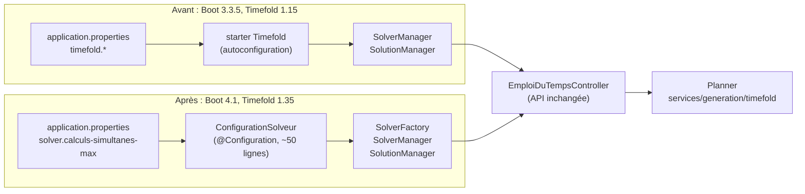
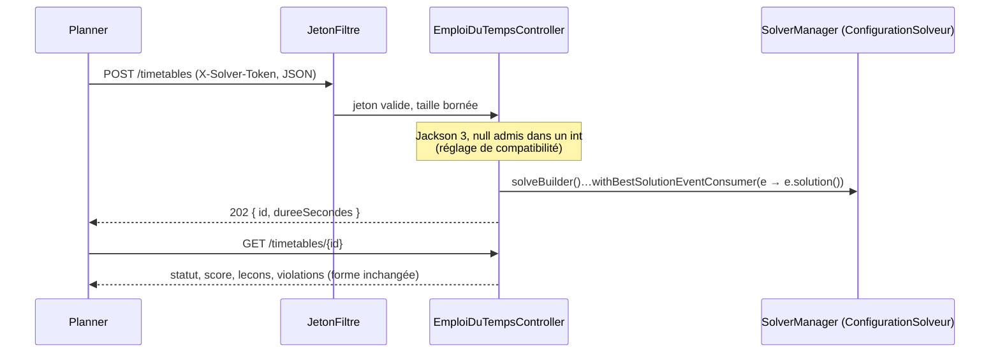

# MOT-12 · Montée du solveur (Spring Boot 4.1, Timefold 1.35) — conception

| | |
|---|---|
| Module | [MOT](../../plan/modules/MOT-moteur.md) · chantier ouvert le 2026-11-15 |
| Branche | `chore/mot-12-montee-solveur` (depuis `main` après la fusion de #178) |
| Rédigé par | Claude Code (Opus 5.5), le 2026-11-15 |
| **Validé** | par Claude20022002 le 2026-11-15 |

## 1. Objet et critère de « terminé »

Le solveur tourne sur Spring Boot 3.3.5, sans support libre depuis le 30 juin 2025, et sur Timefold 1.15.0. MOT-12 le fait passer sur une ligne soutenue, **sans changer son comportement**. Java 21 ne change pas. Le choix entre Timefold 2.x et CP-SAT reste à MOT-04 (Q-05).

**Terminé quand :**
- `solver/pom.xml` est sur **Spring Boot 4.1.x** et sur le **cœur Timefold 1.35.0**, sans le starter Timefold ;
- l'application démarre, et un test le vérifie : il charge le contexte Spring, ce qu'aucun test ne fait aujourd'hui ;
- un test envoie un problème JSON au contrôleur, avec des `null` et des champs inconnus, et lit une réponse de la même forme qu'aujourd'hui (`statut`, `score`, `dur`, `souple`, `lecons`, `violations`, `leconsEnConflit`) ;
- les 7 classes de test existantes passent sans modification de leurs assertions ;
- la compilation ne signale plus aucun appel déprécié ;
- la CI est verte, **parcours compris** : ils lancent la vraie image du solveur ;
- `pile.md`, `decisions.md` (Q-05, ligne du 13 nov.) et le module MOT disent les faits corrigés au § 2.2.

## 2. Ce qui existe

### 2.1 Le solveur

- `solver/pom.xml` : parent `spring-boot-starter-parent` 3.3.5, `timefold.version` 1.15.0, `spring-boot-starter-web` et `timefold-solver-spring-boot-starter`. En test : `spring-boot-starter-test` et `timefold-solver-test`.
- Le starter construit `SolverManager` et `SolutionManager`, injectés dans `rest/EmploiDuTempsController.java` (230 lignes). Il lit deux réglages dans `application.properties` : `timefold.solver.termination.spent-limit=60s` et `timefold.solver-manager.parallel-solver-count=2`. Aucune autre partie du dépôt ne fixe de propriété `timefold.*`.
- Le contrôleur remplace toujours l'arrêt du calcul par requête (`SolverConfigOverride`) : les 60 s du fichier ne servent que de valeur par défaut.
- Deux appels dépréciés en 1.35 et Spring 7 : `withBestSolutionConsumer` (contrôleur, ligne 108) et `HttpStatus.PAYLOAD_TOO_LARGE` (`securite/JetonFiltre.java`, ligne 55).
- Les 9 classes de test (`ConstraintVerifier`, `SolverFactory`, filtre avec les objets factices de Spring) **ne chargent jamais le contexte Spring**.
- `Dockerfile` : `maven:3.9-eclipse-temurin-21`, puis `eclipse-temurin:21-jre-alpine`. La CI construit avec Java 21 (`test-solver` : `mvn -B -ntp verify`), et les parcours construisent l'image `solver/`.

### 2.2 Ce que l'essai du 15 novembre a établi

L'essai a été fait sur des copies jetables, hors du dépôt, avec Maven 3.9 et Java 21 sous Docker. Les sources sont Maven Central et les jars eux-mêmes.

| Fait | Preuve |
|---|---|
| La ligne 1.x va jusqu'à **1.35.0** (15 oct. 2026), et non 1.31 | `maven-metadata.xml` de `timefold-solver-bom` |
| **Toute la 1.x vise Spring Boot 3.5** (1.31 : 3.5.10 ; 1.35 : 3.5.16). La 2.x vise Spring Boot 4 (2.0 : 4.0.5 ; 2.8 : 4.1.1) | `timefold-solver-build-parent-*.pom` |
| Spring Boot 3.5 n'a plus de support libre depuis le 30 juin 2026 (dernière version 3.5.16). Fins de support libre : 4.0 le 31 déc. 2026, **4.1 le 31 juil. 2027** | Maven Central, endoflife.date |
| **Boot 4.1.2 + starter Timefold 1.35 : l'application ne démarre pas** : `ClassNotFoundException: org.springframework.boot.autoconfigure.domain.EntityScanner`. Les tests Maven passent pourtant | essai : `mvn test` vert, puis `java -jar` en échec |
| **Boot 4.1.2 + cœur Timefold 1.35, sans starter** : démarrage, `/health`, refus sans jeton (401), et calcul **identique** à l'actuel (0hard/-20soft, mêmes affectations, même analyse) | essai sur le même problème JSON, envoyé aux deux images |
| Jackson 3 (Boot 4) refuse un `null` dans un `int` (`FAIL_ON_NULL_FOR_PRIMITIVES` actif par défaut). `spring.jackson.deserialization.fail-on-null-for-primitives=false` rétablit le comportement actuel | essai |
| En 2.8.0, `SolutionManager.analyze` passe par `TimefoldSolverEnterpriseService` : **l'analyse du score est payante en 2.x** | classes du jar `timefold-solver-core-2.8.0` |
| Le mode par défaut passe de `REPRODUCIBLE` (1.15) à `PHASE_ASSERT` (1.35) : il reste reproductible. Vitesse mesurée sur le petit problème : 14 647 coups/s (1.15), 15 034 coups/s (1.35) | journaux des deux images |
| `spring-boot-starter-web` est déprécié en 4.1 au profit de `spring-boot-starter-webmvc` | pom de `spring-boot-starter-web` 4.1.2 |

La décision du 13 novembre (« Spring Boot 4.x, Timefold 1.31 ») ne tient donc pas telle quelle. Elle est amendée par les réponses 1 et 2 ci-dessous.

## 3. Questions et réponses

| N° | Question | Proposition | Réponse du chef | Bloque |
|---|---|---|---|---|
| 1 | Quelle combinaison, puisque le starter 1.x ne démarre pas sous Boot 4 ? | Boot 4.1 + cœur Timefold 1.35 sans starter | **oui** (15 nov.) | — |
| 2 | Quelles versions exactes ? | Timefold 1.35.0 et Spring Boot 4.1.x (4.1.2 aujourd'hui) | **oui** (15 nov.) | — |
| 3 | Jackson 3 refuse `null` dans un `int` | garder Jackson 3, avec le réglage et un test | **oui** (15 nov.) | — |
| 4 | Quels tests ajouter ? | un test de démarrage et un test de lecture du JSON par l'API | **oui** (15 nov.) | — |
| 5 | Où coder ? | `chore/mot-12-montee-solveur` depuis `main`, dossier `..\travaux-planner\mot-12-montee-solveur` | **oui** (15 nov.) | — |
| 6 | Corriger QUA-03 et la décision du 13 nov. ? | oui, commité avec ce plan | **oui** (15 nov.) | — |
| 7 | Remplacer les deux appels dépréciés et passer à `spring-boot-starter-webmvc` ? | oui, dans MOT-12 | **oui** (15 nov.) | — |
| 8 | Comment la nouvelle image part-elle en production ? | avec le prochain paquet, lancé par le chef, après la fusion | **oui** (15 nov.) | — |

## 4. Solution

Le starter est remplacé par une classe de configuration, `ConfigurationSolveur`. Elle construit les trois objets que le starter fournissait, à partir du même modèle (`EmploiDuTemps`, `Lecon`, `ContraintesEmploiDuTemps`). Le reste du code ne change pas, à deux appels près.

- **`SolverFactory`** : classe de solution, classe d'entité, fournisseur de contraintes, arrêt par défaut à 60 s.
- **`SolverManager`** : nombre de calculs en parallèle lu depuis `solver.calculs-simultanes-max` (2). Cette propriété fixe déjà le refus 429. Une seule propriété porte donc désormais les deux bornes, qui valaient toutes deux 2.
- **`SolutionManager`** : pour l'analyse des règles enfreintes, libre en 1.x.
- Les deux lignes `timefold.*` d'`application.properties`, qui ne seraient plus lues, sont retirées. La ligne Jackson est ajoutée.
- Le mode reste celui par défaut de la 1.35 (`PHASE_ASSERT`). Il n'est pas fixé en dur.

## 5. Fichiers créés ou modifiés

| Fichier | Créé / modifié | Rôle | Taille visée |
|---|---|---|---|
| `solver/pom.xml` | modifié | parent 4.1.2, Timefold 1.35.0, `timefold-solver-core` au lieu du starter, `spring-boot-starter-webmvc` | ≈ 70 lignes |
| `solver/src/main/java/ma/hestim/solver/ConfigurationSolveur.java` | créé | les trois objets Timefold, construits sans starter | ≈ 50 lignes |
| `solver/src/main/resources/application.properties` | modifié | retrait des 2 lignes `timefold.*`, ajout du réglage Jackson | ≈ 22 lignes |
| `solver/src/main/java/ma/hestim/solver/rest/EmploiDuTempsController.java` | modifié | `withBestSolutionEventConsumer`, une ligne. Le fichier a déjà 230 lignes et ne s'allonge pas (§ 11) | 230 lignes |
| `solver/src/main/java/ma/hestim/solver/securite/JetonFiltre.java` | modifié | `HttpStatus.CONTENT_TOO_LARGE` (toujours 413) | inchangée |
| `solver/src/test/java/ma/hestim/solver/DemarrageTest.java` | créé | charge le contexte Spring ; les trois objets Timefold et le filtre existent ; nombre de calculs en parallèle = 2 | ≈ 50 lignes |
| `solver/src/test/java/ma/hestim/solver/rest/ApiProblemeTest.java` | créé | par `MockMvc` sur le contexte réel : POST d'un petit problème (avec des `null` et un champ inconnu), puis attente de `NOT_SOLVING` et contrôle de la forme de la réponse ; 401 sans jeton ; 400 pour une leçon invalide | ≈ 120 lignes |
| `docs/conception/moteur-planification/mot-12-montee-solveur.md` | créé | ce plan | — |
| `docs/conception/moteur-planification/README.md` | modifié | une ligne vers ce plan | — |
| `docs/conception/qualite/pile.md` | modifié | § 2.6 et § 3 : la 1.x va jusqu'à 1.35, elle vise Boot 3.5, le starter ne démarre pas sous Boot 4, l'analyse est payante en 2.x (vérifié dans le jar) ; renvoi vers MOT-12 | — |
| `docs/conception/moteur-planification/ecarts-du-solveur.md` | modifié | ligne « Échéance » : la fin de la 1.x n'est pas « début 2027 » ; la 1.35 est la dernière | — |
| `docs/plan/decisions.md` | modifié | ligne datée du 15 nov. qui amende celle du 13 nov. (versions, sans starter) ; Q-05 précisée | — |
| `docs/plan/modules/MOT-moteur.md`, `docs/plan/suivi.md` | modifiés | MOT-12 : texte (1.35, Boot 4.1), état, branche | — |

Le `Dockerfile`, la CI, `docker-compose.yml` et le serveur Node ne changent pas.

## 6. Données et migration

Aucune table et aucune migration. Le solveur ne garde aucune donnée : il reçoit tout par requête. Aucun numéro de migration n'est réservé.

## 7. Sécurité, isolation et exigences produit

- **Isolation** : sans effet. Le solveur ne connaît pas les écoles, et reste interne, sur le réseau privé, derrière un jeton.
- **Sécurité** : le filtre à jeton est gardé tel quel (comparaison en temps constant, 503 sans jeton configuré, taille du corps bornée). Le test d'API vérifie le refus 401 à travers le vrai contexte, et plus seulement avec les objets factices. Le passage à une ligne de Spring soutenue est la raison de MOT-12.
- **EP-4** (chaque refus s'explique) : l'analyse des règles enfreintes, `SolutionManager.analyze`, reste disponible en 1.x. Le test d'API vérifie que `violations` est présent.
- **EP-10** : la vitesse est notée avant et après sur le jeu de `ResolutionTest` (fiche de session). La mesure à grande échelle reste à MOT-02.

## 8. Tests

- Les 7 classes de test existantes, sans modification de leurs assertions.
- `DemarrageTest` : `@SpringBootTest` avec un jeton de test de 32 caractères dans les propriétés du test. C'est le test qui aurait vu l'échec du starter.
- `ApiProblemeTest` : `MockMvc` construit sur le contexte réel, avec `JetonFiltre`. Il couvre :
  - le problème accepté (202), malgré un `null` et un champ inconnu ;
  - la réponse terminée, avec `score`, `dur`, `souple`, `lecons`, `violations` et `leconsEnConflit` ;
  - le refus 401 sans jeton ;
  - le refus 400 pour une leçon de longueur 3.

  Durée du calcul réduite à 5 s.
- **Test de régression du réglage Jackson** : le cas « `null` dans un `int` » d'`ApiProblemeTest`. Il échoue si la ligne d'`application.properties` disparaît.
- CI : `test-solver` (`mvn -B -ntp verify`). Les **parcours** construisent et lancent l'image : une génération de bout en bout, avec Planner.
- En local : `mvn verify` sous Docker (Maven 3.9, Java 21), puis l'image construite, lancée et appelée sur le même problème qu'avant la montée (comparaison du score).

## 9. Étapes de livraison

1. Ce plan validé, puis commité seul, avec les corrections des faits (§ 5, lignes `docs/`) et `suivi.md` (MOT-12 « en cours »).
2. Un commit de code : `pom.xml`, `ConfigurationSolveur`, `application.properties`, les deux remplacements d'appels dépréciés et les deux tests. `mvn verify` vert, et l'image comparée à l'actuelle.
3. Fin de session : `suivi.md`, module MOT, fiche de session et prompt de reprise. Le chef pousse et ouvre la PR, puis la CI tourne, parcours compris.
4. Après la fusion : la nouvelle image du solveur part avec le prochain paquet de déploiement, lancé par le chef.

## 10. Risques et retour arrière

| Risque | Parade |
|---|---|
| Un réglage du starter oublié dans la configuration à la main | l'essai a comparé le même problème sur les deux images : résultat identique. Les parcours font une vraie génération |
| Un autre défaut de Jackson 3 sur un champ que l'essai n'envoyait pas (dates, énumérations) | le problème ne contient que des nombres, des chaînes, des listes et des booléens (`domain/`). Le test d'API envoie un problème avec tous les types de champs |
| Le mode `PHASE_ASSERT` est plus lent sur un grand problème | ses contrôles n'ont lieu qu'en fin de phase. La vitesse est notée avant et après ; MOT-02 mesure à grande échelle |
| Timefold 1.x n'est plus corrigé après 2026 | connu (Q-05) : la 1.35 est la dernière 1.x, et MOT-04 tranche ensuite entre 2.x et CP-SAT |

**Retour arrière** : relancer l'image précédente du solveur. Il n'y a ni donnée ni migration, et l'API ne change pas, donc le serveur Node n'a rien à défaire.

## 11. Hors périmètre

- Timefold 2.x et l'analyse payante : MOT-04 (Q-05).
- `HardMediumSoftScore`, les contraintes déclarées et `ConstraintWeightOverrides` : MOT-13b, dont le complément de plan suit MOT-12.
- Découper `EmploiDuTempsController.java` : 230 lignes avant MOT-12, au-dessus du repère de 200 pour un contrôleur. MOT-12 ne l'allonge pas. Le découpage (sortir l'analyse des règles enfreintes) est proposé dans le complément de plan de MOT-13b, qui touchera ce fichier.
- Java 25 et les images de base : inchangés (décision du 13 nov.).
- Les montées de Node 24 et d'Express 5 (`pile.md`, § 3).
