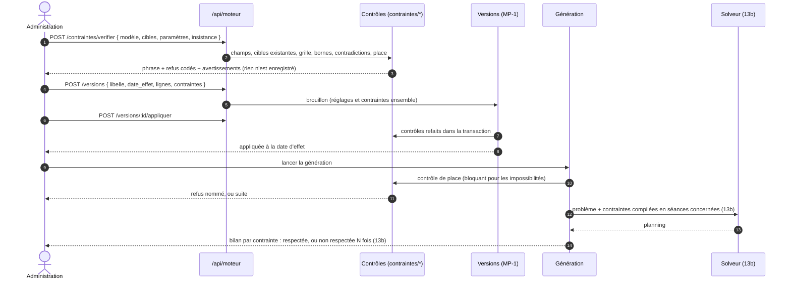
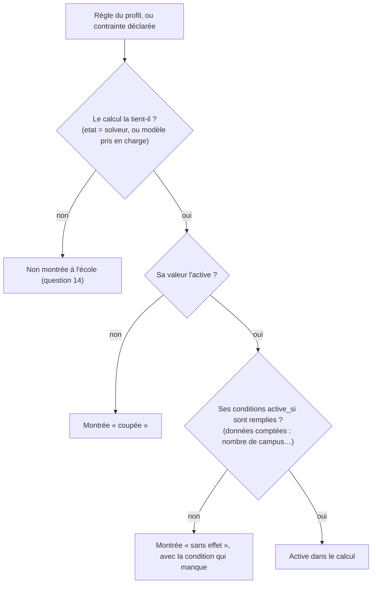
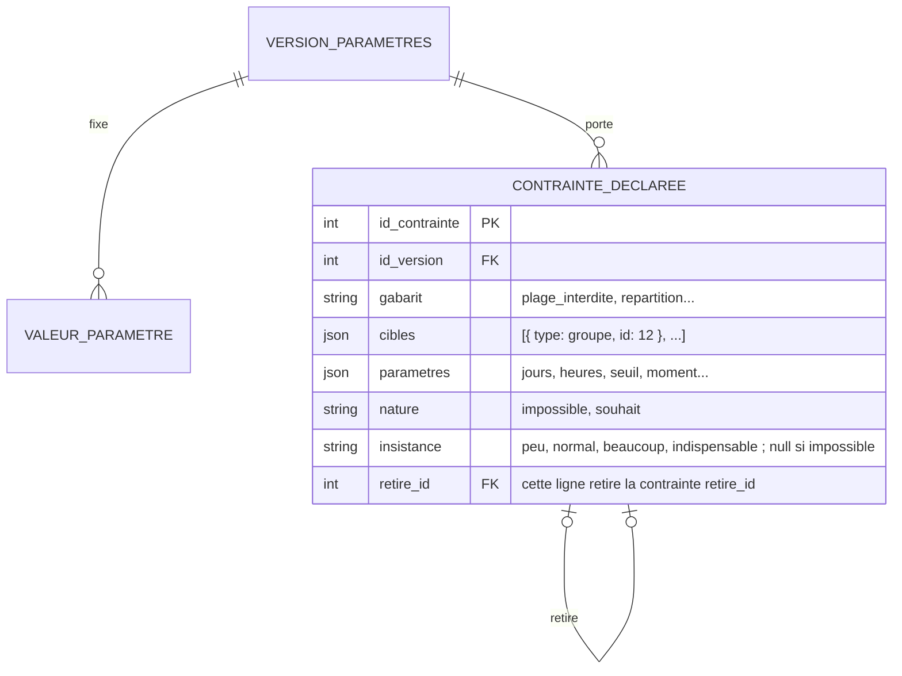

# MOT-13 · Contraintes déclarées par l'école — conception

| | |
|---|---|
| Module | [MOT](../../plan/modules/MOT-moteur.md) · chantier ouvert le 2026-11-15 (décidé le 13 novembre, à la place de QUA) |
| Branche | `feat/mot-13-contraintes` |
| Rédigé par | Claude Code (Opus 5.5), le 2026-11-15 |
| **Validé** | par Claude20022002 le 2026-11-15, avec les propositions 9 à 15 |

## 1. Objet et critère de « terminé »

**Le besoin du chef de projet (15 novembre)** : une gestion intelligente des contraintes. On n'impose pas à l'école les 498 paramètres du catalogue. Elle **fournit les contraintes qui comptent pour elle**, et le moteur se débrouille avec.

**Le principe** : l'école ne règle jamais un paramètre. Les contraintes du calcul viennent de trois sources :

| Source | Qui la fournit | Ce que voit l'école |
|---|---|---|
| **Le socle** | les données elles-mêmes : grille, salles, groupes, disponibilités | rien à régler. Ce sont les impossibilités physiques : conflits, capacité, disponibilité, grille. Les 26 règles verrouillées |
| **Le profil** | le profil de l'école (collège, lycée…) | une **liste courte « Déjà pris en compte »**, une phrase par règle. L'école peut baisser le poids d'une règle ou la couper, sauf si elle est verrouillée |
| **Les contraintes déclarées** | l'administration de l'école | ses contraintes à elle, écrites à partir de **six modèles** (§ 4.2) : qui, quand, combien, et avec quelle insistance |

Ce qui rend la gestion « intelligente » :

1. **Une règle sans objet ne coûte rien.** Une règle dont la condition sur les données n'est pas remplie ne compte pas, et l'école voit pourquoi (« sans effet : un seul campus »).
2. **Ce qui est montré est tenu.** La liste du profil ne montre que les règles que le calcul applique vraiment.
3. **Les contradictions sont refusées avant le calcul.** Un contrôle de place compare les créneaux qui restent libres au besoin, et il nomme les contraintes en cause.
4. **Chaque contrainte a sa phrase.** Cette phrase sert à l'écran, dans le contrôle et dans le bilan de la génération (« respectée » ou « non respectée 3 fois »).

**La fonction se livre en trois étapes** (réponse 7) :

| Étape | Contenu | Dépend de |
|---|---|---|
| **MOT-13a** | Côté serveur : modèles, enregistrement dans les versions datées de MP-1, contrôles, liste « Déjà pris en compte », routes. **La génération ne change pas** | — |
| **MOT-13b** | Le solveur tient les contraintes déclarées et lit les poids des règles du profil. Le bilan est calculé hors du solveur. Plus le collège fictif | MOT-12 (montée de Timefold) |
| **MOT-13c** | L'écran « Règles de génération » de l'école | MOT-13a, avec ADM-02 |

**Critère de « terminé » de MOT-13a** :
- les six modèles sont décrits en données, et un test vérifie que chaque règle du catalogue qu'ils citent existe ;
- une contrainte déclarée s'enregistre dans une version datée, s'applique, s'abandonne et s'annule, comme un réglage de MP-1 ;
- toute contrainte invalide est refusée avec un code et une phrase qui dit quoi corriger (champ manquant, cible inexistante, plage hors de la grille, borne légale dépassée) ;
- le contrôle de place refuse, à la génération, un groupe dont le besoin dépasse ses créneaux libres, et il nomme les contraintes en cause. À l'enregistrement, il ne fait qu'avertir ;
- `GET /api/moteur/contraintes/profil` rend la liste « Déjà pris en compte » du profil résolu, avec l'état de chaque règle (active, coupée, sans effet et pourquoi) ;
- la suite du serveur est verte, et le problème envoyé au solveur pour l'école d'origine ne change pas.

**Critère de MOT-13b**, précisé dans un complément de plan avant son code :
- sur le jeu de l'école d'origine, le planning n'est pas moins bon qu'aujourd'hui ;
- sur le collège fictif, chaque contrainte déclarée est respectée, ou bien le bilan dit combien de fois elle ne l'est pas, et pourquoi.

## 2. Ce qui existe

| Quoi | Où | Réutilisé ou gênant |
|---|---|---|
| Catalogue : 498 paramètres, 134 règles (48 strictes, 86 souples), 5 profils | `backend/services/moteur/catalogue/` | **réutilisé** : les modèles citent ses règles, et le profil donne la liste « Déjà pris en compte » |
| Valeurs datées à portée (MP-1) : versions brouillon, appliquée, annulée ; portées école, cycle, niveau, filière, individuelle | `services/moteur/valeurs/*`, migration 0061, routes `/api/moteur` | **réutilisé** : une contrainte déclarée vit dans une version de paramètres, avec le même cycle de vie |
| `regleActive` : une règle compte si sa valeur l'active et si ses conditions `active_si` sont remplies | `valeurs/resolution.js` | **réutilisé tel quel** (réponse 16) : `profil.js` en tire la raison d'une règle sans effet |
| Contrôles avant la génération : 2 contrôles et 3 exclusions | `generation/timefold/avertissements.js` (69 lignes) | **étendu** : on y ajoute le contrôle de place |
| Solveur : 22 règles, poids en dur, `HardSoftScore` | `solver/.../ContraintesEmploiDuTemps.java` (332 lignes) | **non touché en 13a**. En 13b, les règles nouvelles vont dans un fichier à part, puisque celui-ci dépasse déjà 300 lignes |
| Ce que le solveur sait d'une séance : `coursId` (matière), `groupes`, `feuilles`, `enseignants`, `salle`, `creneau` | `solver/.../domain/Lecon.java` | **suffisant** : les six modèles ne demandent aucune variable nouvelle (F-1 à F-8 ne bougent pas) |
| Disponibilités des enseignants, saisies par l'enseignant ou par l'administration | `disponibiliteRoutes.js`, `Disponibilite` | **source unique** de l'indisponibilité d'un enseignant (EP-5). Aucun modèle ne la double |
| Vœux des enseignants (créneau préféré, à éviter) | `Voeu`, règles « Vœu » du solveur | inchangés (réponse 6) |
| `ParametresPlanning` : pause du vendredi, samedi après-midi, plafonds | `config/parametresPlanning.js` | en 13b, la pause et le samedi deviennent des contraintes déclarées de l'école d'origine (question 13) |
| Le relevé de MP-1 : `id_portee` n'est pas contrôlé, une valeur orpheline reste sans effet (R-8) | `conception-mp1.md`, § 7 | **corrigé pour les contraintes** : la cible doit exister |

## 3. Questions et réponses

| N° | Question | Proposition | Réponse du chef | Bloque |
|---|---|---|---|---|
| 1 | Ouvrir le chantier MOT alors que #171 (QUA) n'est pas fusionnée | l'inscrire sur cette branche ; #171 se fusionne avant | **oui** (15 nov.) | — |
| 2 | Où placer la gestion des contraintes | nouvelle fonction MOT-13, en tête du chantier ; le code du solveur après MOT-12 | **oui** (15 nov.) | — |
| 3 | Comment l'école exprime une contrainte | modèles guidés ; la phrase libre traduite par l'IA plus tard, relue par l'école | **oui** (15 nov.) | — |
| 4 | La force d'une contrainte déclarée (D-09) | une impossibilité est stricte et contrôlée avant le calcul ; un souhait est souple : peu, normal, beaucoup, indispensable | **oui** (15 nov.) | — |
| 5 | Les règles du profil, visibles ou non | une liste courte « Déjà pris en compte », désactivable sauf les règles verrouillées | **oui** (15 nov.) | — |
| 6 | Qui déclare | l'administration ; les enseignants gardent leurs disponibilités et leurs vœux ; le responsable de filière viendra avec ADM-01 | **oui** (15 nov.) | — |
| 7 | Le périmètre | trois étapes : 13a serveur, 13b solveur, 13c écran | **oui** (15 nov.) | — |
| 8 | Les jeux d'essai | l'école d'origine (non-régression) et un petit collège fictif | **oui** (15 nov.) | — |
| 9 | « Indispensable » : comment le distinguer d'un souhait fort ? | un **niveau de score intermédiaire** (`HardMediumSoftScore`) : aucun nombre de souhaits ordinaires ne pèse plus qu'un indispensable non tenu. C'est fait en 13b ; en 13a, seul le niveau est enregistré | **oui** (15 nov.) | 13b |
| 10 | Le stockage des contraintes déclarées | une table `ContrainteDeclaree` rattachée à `VersionParametres`, migration **0080** (§ 6) | **oui** (15 nov.) | 13a |
| 11 | Les modèles de la première version | les six du § 4.2. L'ordre (A avant B) et le lieu (salle préférée) viennent ensuite, sans changer la structure | **oui** (15 nov.) | 13a |
| 12 | L'enseignant comme cible | seulement dans `plafond_par_jour` (sa charge, que l'école règle). Son indisponibilité reste dans ses disponibilités, ses préférences dans ses vœux : l'écran y renvoie, sans rien doubler (EP-5) | **oui** (15 nov.) | 13a |
| 13 | La pause du vendredi et le samedi après-midi de l'école d'origine | en 13b, ils deviennent deux contraintes déclarées (une plage interdite et une plage à éviter de poids 50), créées par la migration, dans une base qui a des comptes seulement | **oui** (15 nov.) | 13b |
| 14 | Une règle du profil que le solveur n'applique pas encore (par exemple `PED.COGN.DIFFICILES_REPARTIES`) | elle n'est **pas montrée** à l'école tant que le calcul ne la tient pas (« ce qui est montré est tenu ») | **oui** (15 nov.) | 13a |
| 15 | Niveau et cycle comme cibles | pas avant VSC-01 (les tables n'existent pas) ; d'ici là : école, rythme, filière, groupe, matière, enseignant, salle | **oui** (15 nov.) | — |
| 16 | Ajoutée pendant le code. Une règle est-elle « sans effet » quand ses données requises (`requiert`) manquent ? Le catalogue marque absentes des données que lisent des règles déjà appliquées (capacité réglementaire, compatibilité des salles…) : elles seraient affichées sans effet à tort | « sans effet » seulement quand une condition `active_si` n'est pas remplie (un seul campus…). Le contrôle par `requiert` viendra avec les règles nouvelles (MOT-11) | **oui** (15 nov.) | 13a |

## 4. Solution

### 4.1 Le parcours d'une contrainte

### 4.2 Les six modèles de la première version

Un **modèle** est une forme de contrainte, décrite en données dans `contraintes/gabarits.js`. Il a des champs typés, des cibles admises, une nature, et les règles du catalogue dont il est l'instance. L'école remplit un modèle, et c'est ce remplissage qu'on appelle une **contrainte déclarée**.

| Modèle | Exemple de phrase | Cibles | Champs | Nature | Règles du catalogue couvertes |
|---|---|---|---|---|---|
| `plage_interdite` | « Les 6e A n'ont pas cours le mercredi de 12 h à 18 h. » | école, rythme, filière, groupe, salle, matière | jours, heure de début, heure de fin | **impossibilité** (stricte) | `HOR.REGLE.PLAGES_RESTREINTES`, `SAL.REGLE.INDISPONIBLE`, `HOR.REGLE.HEURES_AUTORISEES` |
| `plage_a_eviter` | « Éviter les cours de la filière X le samedi après-midi. » | école, rythme, filière, groupe, salle, matière | jours, heure de début, heure de fin | souhait | `HOR.REGLE.PLAGES_RESTREINTES`, `HOR.REGLE.COURS_TARDIFS`, `HOR.REGLE.COURS_TOT` |
| `moment_de_la_journee` | « Mathématiques plutôt le matin. » | matière, groupe | `matin`, `apres_midi` ou `pas_en_fin_de_journee` | souhait | `MAT.REGLE.MATIN`, `MAT.REGLE.PAS_FIN_JOURNEE`, `PED.COGN.FONDAMENTAUX_MATIN` |
| `plafond_par_jour` | « Pas plus de 2 séances de français par jour pour une classe. » | groupe, enseignant, matière | quoi (heures, séances, séances à la suite), seuil | souhait, ou impossibilité si une règle stricte la couvre déjà | `MAT.REGLE.MAX_PAR_JOUR`, `MAT.REGLE.CONSECUTIVES_MAX`, `ENS.CHARGE.MAX_CONSECUTIVES`, `HOR.REGLE.MAX_CONSECUTIVES`, `PED.ORG.MATIERES_PAR_JOUR`, `ENS.CHARGE.MAX_CLASSES_JOUR` |
| `repartition` | « Les séances d'anglais sur des jours différents, au moins un jour d'écart. » | matière, groupe | jours différents, écart minimal en jours | souhait | `MAT.REGLE.JOURS_DIFFERENTS`, `MAT.REGLE.ESPACEMENT`, `MAT.REGLE.ECART_MIN`, `HOR.REGLE.EQUILIBRE_SEMAINE` |
| `ensemble_ou_separe` | « L'espagnol et l'allemand des 4e en même temps. » ; « Jamais sport puis mathématiques à la suite. » | deux listes de matières, avec un groupe ou une filière | `en_meme_temps`, `jamais_le_meme_jour`, `jamais_a_la_suite` | souhait ; `en_meme_temps` peut être une impossibilité (alignement) | `MAT.REGLE.ALIGNEMENT`, `MAT.REGLE.INCOMPATIBLES`, `MAT.REGLE.REGROUPEMENT`, `PED.COGN.DIFFICILES_SUIVIES` |

Ces six modèles couvrent **22 des 134 règles** du catalogue : la plupart de celles que l'école règle elle-même et que les variables actuelles permettent. Le reste se répartit ainsi :
- le socle, qui se règle par les données ;
- les règles qui demandent de changer le modèle (F-1 à F-8, MOT-06 et MOT-07) ;
- le confort de la journée (trous, repas, changement de salle), qui reste dans la liste du profil ;
- les préférences d'un enseignant (`PRF.ENS.*`), qui restent ses vœux, saisis par lui (réponse 6).

**L'insistance d'un souhait** : peu, normal, beaucoup ou indispensable. Les trois premiers niveaux multiplient le poids de départ du modèle par 1, 3 et 10. Ce sont des valeurs de départ, à régler sur de vrais plannings. « Indispensable » passe au niveau intermédiaire du score (question 9). Une impossibilité n'a pas d'insistance.

**Les cibles sont des listes** : « Mathématiques des 6e A, 6e B et 6e C » forme une seule contrainte. Elles se ramènent toutes à des séances : un groupe compte avec ses sous-groupes, une filière avec ses groupes, un rythme avec ses filières.

### 4.3 Une règle compte-t-elle ?

### 4.4 Les contrôles

| Contrôle | Quand | Effet | Exemple de message |
|---|---|---|---|
| Champs du modèle (type, jours, heures dans l'ordre, seuil positif) | vérification, enregistrement | refus | « L'heure de fin doit venir après l'heure de début. » |
| La cible existe dans cette école | vérification, enregistrement | refus `cible_invalide` | « Le groupe demandé n'existe plus. Choisissez un autre groupe. » |
| La plage touche au moins un créneau de la grille | vérification, enregistrement | avertissement | « Aucun cours n'est prévu le dimanche : cette contrainte est sans effet. » |
| Les bornes légales (`borne` du catalogue) | vérification, enregistrement | refus `borne_depassee` | « Le plafond dépasse le maximum légal de 8 h par jour. » |
| Contradictions directes : même cible, « le matin » et « l'après-midi » ; plage à éviter qui couvre tout le moment préféré ; `en_meme_temps` et `jamais_le_meme_jour` sur les mêmes matières | vérification, enregistrement | avertissement, avec les deux phrases | « "Mathématiques le matin" et "Éviter les matinées des 6e A" se contredisent pour les 6e A. » |
| **Contrôle de place** : pour chaque groupe et chaque type de salle, les créneaux de la grille, moins les impossibilités et les disponibilités, comparés aux créneaux qu'il faut (séances × longueur) | vérification, si une période est donnée : avertissement ; **génération : refus** | refus nommé, avec les contraintes en cause | « Les 6e A ont besoin de 26 créneaux par semaine ; il en reste 22 à cause de "Pas de cours le mercredi après-midi" et de "Pas de cours le vendredi après 16 h". Retirez ou réduisez l'une d'elles. » |

Avant la génération, le contrôle de place ne fait qu'avertir, et seulement si l'on donne une période à `POST /contraintes/verifier` : sans période, il n'y a pas d'enseignements à compter, et les enseignements ne sont pas toujours saisis quand l'école règle ses contraintes. À la génération, il bloque, parce que le calcul ne peut pas tenir des impossibilités qui ne laissent pas assez de place. Un manque dû aux seules disponibilités des enseignants ne bloque pas : il reste l'avertissement d'aujourd'hui, pour que la génération de l'école d'origine ne change pas.

### 4.5 Les routes (MOT-13a)

Réservées à l'administration, comme celles de MP-1. Les refus suivent le format de l'API : `{ message, code, violations: [{ index, champ, code, message }] }`.

| Route | Rôle |
|---|---|
| `GET /api/moteur/gabarits` | les six modèles : champs, cibles admises, natures, insistances, avec des **codes stables** pour la traduction (R-7) |
| `GET /api/moteur/contraintes?date=` | les contraintes en vigueur à cette date : phrase, état (active, ou sans effet et pourquoi), version d'origine |
| `GET /api/moteur/contraintes/profil?date=&filiere=&groupe=` | la liste « Déjà pris en compte » : pour chaque règle du profil tenue par le calcul, sa phrase, son insistance, et son état (active, coupée, sans effet, verrouillée) |
| `POST /api/moteur/contraintes/verifier` | contrôle à blanc d'une ou plusieurs contraintes : phrases, refus, avertissements ; le contrôle de place si `id_periode` est donné. Rien n'est enregistré |
| `POST /api/moteur/versions` | **étendue** : `contraintes: [...]` (ajouts) et `retirer: [id_contrainte]` à côté de `lignes`. Le reste du cycle (appliquer, abandonner, annuler) ne change pas de forme |

Pour couper ou adoucir une règle du profil, l'école passe par une ligne de MP-1 : `valeur: false`, ou un `poids`. Rien de nouveau à stocker pour cela.

### 4.6 Le solveur (MOT-13b, en bref)

Il sera détaillé dans un complément de plan, à valider avant son code.

- Le serveur **compile** chaque contrainte en une liste explicite de séances concernées, plus ses paramètres. Le solveur ne connaît ni les filières ni les rythmes.
- Un fichier Java à part, `ContraintesDeclarees.java`, contient une règle par modèle. Chaque pénalité porte l'identifiant de sa contrainte, pour le bilan.
- Le score passe à `HardMediumSoftScore` (question 9). Les poids des 10 règles souples existantes sont lus depuis les valeurs résolues (`ConstraintWeightOverrides`, disponible après MOT-12). Un test vérifie que **le problème de l'école d'origine reste identique**.
- Le bilan est calculé **hors du solveur**, dans le serveur, par un évaluateur par modèle. C'est le premier morceau de l'évaluateur indépendant de MOT-04, et il ne dépend pas de `ScoreAnalysis`, qui devient payant en 2.x.

## 5. Fichiers créés ou modifiés (MOT-13a)

| Fichier | Créé / modifié | Rôle | Taille visée |
|---|---|---|---|
| `backend/services/moteur/contraintes/gabarits.js` | créé | les six modèles en données : champs, cibles, nature, règles couvertes, poids de départ | 180 |
| `backend/services/moteur/contraintes/phrases.js` | créé | la phrase en français d'une contrainte, à partir de son modèle et des noms des cibles | 120 |
| `backend/services/moteur/contraintes/controle.js` | créé | contrôle d'une contrainte : champs, bornes, plage dans la grille ; refus codés | 180 |
| `backend/services/moteur/contraintes/contradictions.js` | créé | contradictions directes entre contraintes | 120 |
| `backend/services/moteur/contraintes/place.js` | créé | contrôle de place par groupe et par salle (fonction pure) | 160 |
| `backend/services/moteur/contraintes/cibles.js` | créé | existence des cibles, puis leur expansion en groupes et en séances (lecture en base) | 140 |
| `backend/services/moteur/contraintes/enVigueur.js` | créé | contraintes en vigueur à une date (appliquées, non retirées), comme `lignesEnVigueur` | 80 |
| `backend/services/moteur/contraintes/versionsContraintes.js` | créé | les contraintes dans le cycle d'une version : contrôle, enregistrement, version inverse. `versions.js` reste court | 110 |
| `backend/services/moteur/contraintes/avantGeneration.js` | créé | lit les contraintes en vigueur, et fait le contrôle de place sur le problème construit | 60 |
| `backend/services/moteur/contraintes/profil.js` | créé | liste « Déjà pris en compte » : règles du profil tenues par le calcul, et leur état | 120 |
| `backend/services/moteur/valeurs/versions.js` | modifié | une version porte aussi des contraintes ; le détail est dans `versionsContraintes.js` | 154 → 165 |
| `backend/services/generation/timefold/generation.js` | modifié | appelle `avantGeneration.js` après la construction du problème : un refus arrête la génération avec son message. Écart avec la première version du plan, qui visait `avertissements.js` : ses fonctions sont pures et `probleme.js` a déjà 260 lignes | 135 → 145 |
| `backend/tests/integration/valeursMoteur.test.js` | modifié | rejoue la migration 0080 autour de la 0061, dont la table renvoie aux versions | +10 |
| `backend/models/ContrainteDeclaree.js`, `models/index.js` | créé, modifié | le modèle et son lien avec `VersionParametres` | 60 |
| `backend/migrations/0080-contraintes-declarees.js` | créé | la table (§ 6) | 60 |
| `backend/controllers/moteurContraintesController.js`, `routes/moteurContraintesRoutes.js` | créés | les quatre routes nouvelles | 120, 20 |
| `backend/controllers/moteurValeursController.js` | modifié | `contraintes` et `retirer` dans `POST /versions` | 68 → 85 |
| `backend/tests/utils/contraintesDeclarees.test.js` | créé | modèles, phrases, contrôles, contradictions, place (fonctions pures) | 250 |
| `backend/tests/integration/contraintesDeclarees.test.js` | créé | routes, cycle d'une version, cibles inexistantes, refus à la génération, problème de l'école d'origine inchangé | 250 |
| `backend/tests/utils/catalogueMoteur.test.js` | modifié | chaque règle citée par un modèle existe dans le catalogue | +15 |
| `docs/conception/moteur-planification/README.md`, `docs/conception/README.md` | modifiés | lien vers ce document | +2 |
| `docs/plan/modules/MOT-moteur.md`, `docs/plan/suivi.md`, `docs/plan/decisions.md` | modifiés | MOT-12, MOT-13, chantier, migration 0080, décisions des 13 et 15 novembre | — |

## 6. Données et migration

**Table possédée par MOT** : `ContrainteDeclaree`. Elle s'ajoute aux tables du module dans son fichier.

- **Numéro de migration** : 0080, à réserver dans `suivi.md` au premier commit (question 10).
- **Immuabilité**, comme MP-1 (I-D5) : une contrainte appliquée ne se modifie jamais. Pour la modifier, une nouvelle version la retire (`retire_id`) et en ajoute une autre. Annuler une version crée la version inverse.
- **La phrase n'est pas stockée** : elle se calcule à la lecture, avec les noms actuels des cibles.
- **Base qui a déjà des données** : la table est créée vide. Une base neuve aussi (PLA-03). Aucune donnée d'école n'est écrite en 13a.
- **« Étendre puis contracter »** : la table s'ajoute, et rien n'est retiré. `ParametresPlanning` reste lu par la génération jusqu'à 13b.

## 7. Sécurité, isolation et exigences produit

- **Droits** : `requireAdmin` sur toutes les routes, comme MP-1. Le responsable de filière viendra avec ADM-01 (réponse 6).
- **Isolation** : la table vit dans la base de l'école (D-01), et aucune route ne prend d'identifiant d'école. Une cible est contrôlée dans la base de l'école courante, ce qui ferme pour les contraintes le trou de R-8 (la valeur orpheline). Aucun canal I-1 à I-16 n'est ouvert.
- **Le serveur ne croit pas le client** : modèle, champs, cibles et insistance sont contrôlés côté serveur ; les phrases sont faites par le serveur.
- **Pas de fuseau du navigateur** : les dates d'effet suivent le fuseau de l'école (`aujourdhui()`, comme MP-1). Les heures sont des heures de la grille, sans fuseau.
- **Exigences produit** :
  - EP-1 (mise en route) : une école commence avec zéro contrainte déclarée et un profil ;
  - EP-2 (interface sobre) : jamais les 498 paramètres ;
  - EP-4 (chaque refus s'explique) : refus codés, phrases, contrôle de place nommé ;
  - EP-5 (saisie unique) : les disponibilités ne sont pas doublées ;
  - EP-10 : le contrôle de place reste linéaire en nombre de groupes et de créneaux.

## 8. Tests

- **Unitaires** (fonctions pures) :
  - chaque modèle : un cas valide et chaque refus ;
  - chaque phrase ;
  - chaque contradiction ;
  - le contrôle de place : assez de place, place juste suffisante, place insuffisante avec les contraintes nommées, sous-groupes comptés avec leur groupe ;
  - la liste du profil : règle coupée, règle sans effet (un seul campus), règle non tenue par le calcul absente.
- **Catalogue** : chaque règle citée par un modèle existe. Une règle du profil non tenue par le calcul n'apparaît pas dans la liste.
- **Intégration** (MySQL) :
  - création, application, abandon et annulation d'une version avec des contraintes ;
  - retrait d'une contrainte ;
  - cible inexistante refusée ;
  - date d'effet future sans effet aujourd'hui ;
  - génération refusée par le contrôle de place, avec le message attendu ;
  - **le problème construit pour l'école d'origine est identique avant et après** (non-régression).
- **Parcours** : rien en 13a, puisqu'il n'y a pas d'écran. Ils tournent dans la CI de la PR.

## 9. Étapes de livraison

1. Ce plan validé, puis commité seul, avec `suivi.md` (chantier MOT ouvert, MOT-12 et MOT-13 ajoutées, MOT-13 « en cours », migration 0080 réservée) et `decisions.md`.
2. MOT-13a, code dans cet ordre :
   - les modèles et leurs phrases ;
   - les contrôles et les contradictions ;
   - le contrôle de place ;
   - la table et les versions ;
   - les routes ;
   - l'appel avant la génération.

   Un commit par étape, avec ses tests.
3. Vérification : suite du serveur, lint, `verifier-neutre`. Puis la fiche de session.
4. PR de MOT-13a, ouverte par le chef.
5. Ensuite, dans l'ordre du chantier :
   - MOT-12 (montée du solveur) ;
   - le complément de plan de MOT-13b, validé, puis son code ;
   - MOT-13c avec ADM-02 ;
   - MOT-02, MOT-03, MOT-04.

## 10. Risques et retour arrière

| Risque | Parade |
|---|---|
| Six modèles ne suffisent pas à une école | un modèle de plus est un fichier de données, sa phrase et son évaluateur. La table ne change pas |
| Des impossibilités rendent le calcul insoluble | le contrôle de place bloque avant le calcul et nomme les contraintes. Les cas qu'il ne voit pas (place suffisante au total, mais mal répartie) attendent CP-SAT (MOT-04) |
| Des poids de départ mal calibrés | trois niveaux seulement, plus « indispensable » sur son propre niveau de score. Calibrage sur le collège fictif en 13b |
| Un chevauchement avec MOT-03 (validation avant le calcul) | MOT-13 ne contrôle que les contraintes déclarées et la place. MOT-03 garde toutes les règles `requiert`, `borne` et `exclut` du catalogue, et réutilisera `controle.js` |
| Un chevauchement avec MOT-10 (poids lus depuis les valeurs) | 13b ne lit que les poids des 10 règles souples existantes. MOT-10 garde la grande échelle et le reste. Sa ligne sera précisée dans le fichier du module |
| `versions.js` qui grossit trop | l'annulation part dans un fichier à part au-delà de 200 lignes |
| **Retour arrière** | 13a ne change pas la génération : retirer la route suffit. La migration 0080 a son `down` (suppression de la table vide ou inutilisée) |

## 11. Hors périmètre

- La phrase libre traduite par l'IA (réponse 3) : une étape ultérieure, MOT-13d, à concevoir après QJE-07. L'IA ne recevra jamais de données d'élève.
- Les modèles « ordre » (A avant B) et « lieu » (salle ou campus préféré) : après la première version.
- Les contraintes datées ponctuelles (« pas de cours le 12 mars ») : ce sont des événements et des indisponibilités ponctuelles, qui existent déjà.
- Les cibles niveau et cycle : après VSC-01.
- Le responsable de filière qui déclare sur sa filière : ADM-01.
- L'écran : MOT-13c.
- Les suggestions de contraintes courantes par profil (« alignez les langues ») : à l'écran, en 13c ou après.
- Les écarts du modèle F-1 à F-8 : MOT-06 et MOT-07.
