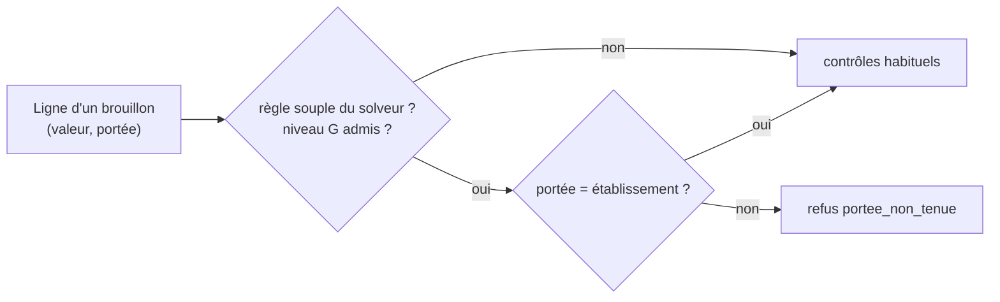

# MOT-13 · Refuser l'activation fine d'une règle souple du solveur (réponse 23) — conception

| | |
|---|---|
| Module | [MOT](../../plan/modules/MOT-moteur.md) · chantier ouvert le 2026-11-15 |
| Branche | `feat/mot-13-coupure-fine` |
| Rédigé par | Claude Code (Opus 5.5), le 2026-11-15 |
| **Validé** | par Claude20022002 le 2026-11-15, avec les réponses 23 à 25 |

Plan court : une petite étape de MOT-13, entre 13b (fusionnée, #182) et 13c. Elle vient de la réponse 23 du [complément 13b](mot-13b-solveur.md).

## 1. Objet et critère de « terminé »

Le solveur ne lit l'activation et le poids d'une règle souple qu'**à la portée de l'école** (`poidsDuSolveur.js`). La réponse 20 refuse déjà un poids plus fin (`portee_non_tenue`). Cette étape refuse aussi la **valeur** (couper : `false`, ou remettre : `true`) d'une telle règle à une portée plus fine que l'école, puisqu'elle n'aurait aucun effet sur le calcul.

Terminé quand :
- une ligne qui change la valeur d'une règle souple du solveur à une portée plus fine que l'établissement est refusée avec `portee_non_tenue`, à l'enregistrement d'un brouillon comme à son application ;
- la même ligne à la portée de l'établissement reste permise ;
- les autres paramètres ne changent pas (une règle dure, une valeur qui n'est pas une règle, une règle souple que le solveur n'applique pas) ;
- tests unitaires et d'intégration verts, dont un test de régression par cas refusé.

## 2. Ce qui existe

| Quoi | Où | Effet |
|---|---|---|
| Refus d'un poids fin (réponse 20) | `backend/services/moteur/valeurs/ecriture.js`, l. 51 | modèle à suivre : même code, même phrase |
| Contrôle appelé à l'enregistrement et à l'application d'un brouillon | `versions.js`, l. 69 et l. 110-112 | les deux chemins sont couverts sans autre changement |
| Annulation d'une version | `versions.js`, `annulerVersion` | n'appelle pas le contrôle : une ancienne ligne fine peut toujours être annulée |
| Poids envoyés au solveur | `poidsDuSolveur.js` | lit la seule portée de l'école ; valeur `false` → poids 0 |
| Règles souples du solveur qu'une école modifie | catalogue | `MAT.REGLE.JOURS_DIFFERENTS`, `SAL.REGLE.TAILLE_ADAPTEE`, `HOR.REGLE.TROUS`, `HOR.REGLE.CHANGEMENT_SALLE`, `HOR.REGLE.UN_CAMPUS_PAR_JOUR`, `PED.PROG.CM_AVANT_TD` (niveaux `GPI`). `SAL.REGLE.DISTANCIEL_SANS_SALLE` n'est pas modifiable ; les deux vœux `PRF.ENS.*` ne se règlent qu'au niveau de la personne, et leur valeur est le vœu lui-même |
| Valeurs fines déjà en base | — | aucune : ni données de démonstration, ni écran (il vient en 13c). Pas de migration |

## 3. Questions et réponses

| N° | Question | Proposition | Réponse du chef | Bloque |
|---|---|---|---|---|
| 23 | Couper une règle souple du solveur à une portée plus fine que l'école | refuser (`portee_non_tenue`), dans une étape à part avant 13c | **oui** (15 nov.) | — |
| 24 | Refuser seulement la coupure (`false`), ou aussi la remise en marche fine (`true`) ? | les deux : toute valeur fine est sans effet | **les deux** (15 nov.) | — |
| 25 | Les deux vœux `PRF.ENS.*` (niveau « personne » seulement) | hors du refus : leur valeur est le vœu d'un enseignant, pas une activation | **oui** (15 nov.) | — |

## 4. Solution

Dans `controlerEcriture`, dans le bloc qui contrôle la valeur : si le paramètre est une règle, que le solveur l'applique (`regle_solveur`), qu'elle est souple (force demandée, sinon celle du catalogue), que sa portée admet l'établissement (niveau `G`) et que la portée demandée n'est pas l'établissement, alors l'erreur est `portee_non_tenue`, avec la phrase « Le calcul applique « <nom> » à toute l'école : réglez-la au niveau de l'établissement. »

La condition « admet l'établissement » écarte les vœux (question 25) sans les nommer. Une ligne `retiree` n'a pas de valeur pour le contrôle (`versions.js`, l. 69) : annuler un réglage fin reste permis.

## 5. Fichiers créés ou modifiés

| Fichier | Nature | Lignes (avant → après) |
|---|---|---|
| `backend/services/moteur/valeurs/ecriture.js` | modifié : la condition, le commentaire de rôle | 61 → ≈ 66 |
| `backend/tests/utils/valeursMoteur.test.js` | cas refusés (`false` et `true` à la filière, au niveau), cas permis (établissement, règle dure, vœu à la personne) | + ≈ 10 |
| `backend/tests/integration/generationContraintes.test.js` | refus par l'API, à côté du test de la réponse 20 | + ≈ 8 |
| `docs/plan/suivi.md`, module MOT, fiche de session | état | — |

## 6. Données et migration

Aucune. Pas de nouvelle table ni de nouvelle colonne, et aucune ligne existante à reprendre.

## 7. Sécurité, isolation et exigences produit

Aucun changement de droits : le refus s'ajoute aux contrôles existants, pour tout auteur, Plateforme comprise (comme la réponse 20).

## 8. Tests

- Unitaires (`valeursMoteur.test.js`), un test par cas refusé.
- Intégration (`generationContraintes.test.js`) : refus 400 `portee_non_tenue` par `POST /api/moteur/versions`.
- Suite du serveur complète avant de rendre la main. Les parcours tournent dans la CI de la PR.

## 9. Étapes

1. Ce plan, commité seul après validation.
2. Le code et ses tests, en un commit.
3. Fin de session : `suivi.md`, module MOT, fiche.

## 10. Risques et retour arrière

| Risque | Parade |
|---|---|
| Un brouillon déjà enregistré avec une valeur fine ne s'applique plus | voulu : le message dit quoi faire. Aucun brouillon de ce type n'existe |
| Le refus touche une valeur qui n'est pas une activation | la condition exige `role: regle`, `regle_solveur`, force souple et niveau `G` ; tests des cas permis |
| **Retour arrière** | revenir sur le commit : une condition, sans données |

## 11. Hors périmètre

- La valeur fine d'une **règle dure** du solveur, par exemple `ENS.CHARGE.MAX_H_JOUR` : la génération lit encore son plafond dans l'ancienne configuration (`probleme.js`, l. 252), pas dans MP-1. C'est MOT-10.
- Des poids et des activations plus fins que l'école : MOT-10.
- L'écran : MOT-13c.
