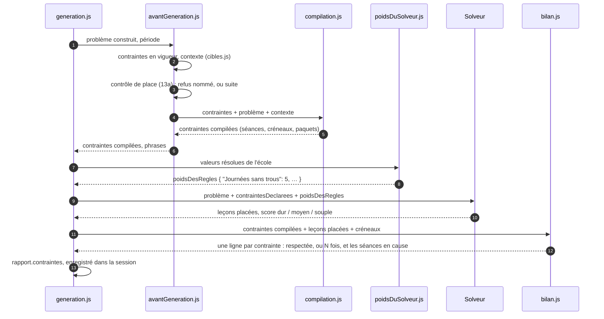
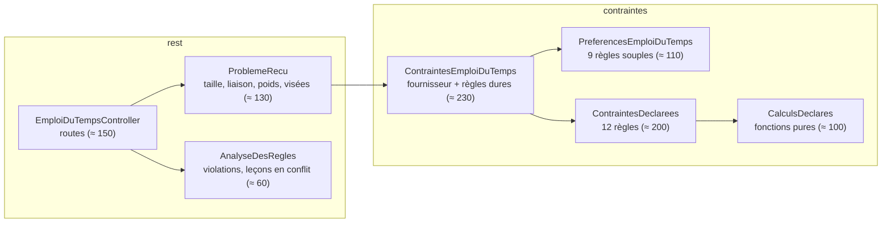

# MOT-13b · Le solveur tient les contraintes déclarées — complément de conception

| | |
|---|---|
| Module | [MOT](../../plan/modules/MOT-moteur.md) · chantier ouvert le 2026-11-15 |
| Plan d'origine | [mot-13-contraintes-declarees.md](mot-13-contraintes-declarees.md) (validé le 15 nov., réponses 1 à 16). Ce document en détaille l'étape 13b (§ 4.6) |
| Branche | `feat/mot-13b-solveur`, dossier `..\travaux-planner\mot-13b-solveur`. Le plan est commité depuis `main` ; **le code part de `main` après la fusion de MOT-12** (#181), fusionnée dans la branche avant le premier commit de code |
| Rédigé par | Claude Code (Opus 5.5), le 2026-11-15 |
| **Validé** | par Claude20022002 le 2026-11-15, avec les propositions 17 à 21 |

## 1. Objet et critère de « terminé »

MOT-13a enregistre les contraintes déclarées de l'école et refuse celles qui ne laissent pas assez de place, mais **la génération ne les lit pas**. Elle ignore aussi les poids que l'école donne aux règles du profil, alors que la liste « Déjà pris en compte » les montre. MOT-13b ferme ces deux écarts. Le solveur tient les six modèles et lit les poids. Le bilan de chaque contrainte est calculé hors du solveur.

**Terminé quand :**
- le score du solveur est un `HardMediumSoftScore`. Un souhait « indispensable » non tenu pèse sur le niveau intermédiaire. L'API rend `moyen` à côté de `dur` et `souple` ;
- le serveur envoie au solveur les contraintes en vigueur, **compilées en séances concernées**, et le solveur pénalise chacune selon sa nature et son insistance :
  - impossibilité → niveau dur ;
  - indispensable → niveau intermédiaire ;
  - souhait → niveau souple, au poids de départ × insistance ;
- les poids des **9 règles souples** du profil sont lus depuis les valeurs résolues de l'école et appliqués par `ConstraintWeightOverrides` (poids 0 pour une règle coupée). La 10e, « Pas de samedi après-midi », devient une contrainte déclarée ;
- la pause du vendredi et le samedi après-midi de l'école d'origine sont deux contraintes déclarées, créées par la migration 0081. L'écran « Paramètres de planning » ne les montre plus, et la saisie manuelle lit les plages déclarées ;
- chaque génération enregistre dans son rapport un **bilan par contrainte déclarée** : respectée, ou non respectée N fois, avec les séances en cause. Il est calculé par le serveur, sans `ScoreAnalysis`. Un test de concordance vérifie que le serveur et le solveur comptent pareil ;
- **sur l'école d'origine, le planning n'est pas moins bon** :
  - un test de référence donne le même score dur et souple sur une affectation fixée ;
  - le problème construit pour le jeu de démonstration envoie les mêmes poids qu'aujourd'hui, et ses deux plages ne visent aucun créneau ;
  - les parcours font une génération réelle ;
- **sur le collège fictif** (4 classes), aucune impossibilité et aucun indispensable n'est enfreint (dur = 0, moyen = 0). Le bilan dit, pour chaque souhait, s'il est tenu ou combien de fois il ne l'est pas ;
- `EmploiDuTempsController.java` passe sous 200 lignes, et `ContraintesEmploiDuTemps.java` sous 300 ;
- la CI est verte, parcours compris.

## 2. Ce qui existe

| Quoi | Où | Pour 13b |
|---|---|---|
| 22 règles du solveur : 12 dures, 10 souples aux poids en dur, `HardSoftScore` | `solver/.../contraintes/ContraintesEmploiDuTemps.java` (332 lignes) | le score change partout ; les règles souples partent dans un fichier à part ; « Pas de samedi après-midi » disparaît |
| `Parametres.samediApresMidi` et `parametres.samediApresMidi` envoyé par `probleme.js` (ligne 253) | `domain/Parametres.java`, `probleme.js` | retirés |
| **La pause du vendredi n'est pas dans le solveur** : seule la saisie manuelle la contrôle (`affectationRules.js`, l. 236). La grille de démonstration commence le vendredi après-midi à 14 h 30 et n'a pas de samedi après-midi (`seed.js`, l. 477-496) | | en contrainte déclarée, la pause ne vise aucun créneau de cette grille : le calcul ne change pas |
| Contrôleur : routes, contrôle de taille, liaison des leçons, analyse | `rest/EmploiDuTempsController.java` (230 lignes) | découpé (§ 4.6) |
| Liens catalogue → solveur : `regle_solveur` sur 24 règles. Les 10 souples : `MAT.REGLE.JOURS_DIFFERENTS` 20, `SAL.REGLE.DISTANCIEL_SANS_SALLE` 5, `SAL.REGLE.TAILLE_ADAPTEE` 1, `HOR.REGLE.TROUS` 5, `HOR.REGLE.CHANGEMENT_SALLE` 2, `HOR.REGLE.UN_CAMPUS_PAR_JOUR` 10, `HOR.REGLE.PLAGES_RESTREINTES` 50, `PED.PROG.CM_AVANT_TD` 5, `PRF.ENS.CRENEAUX_PREFERES` 1, `PRF.ENS.CRENEAUX_EVITER` 3 | `backend/services/moteur/catalogue/parametres/*.json` | **ces poids sont ceux du solveur**, et le profil « université » ne les change pas : envoyer les poids résolus ne change rien pour l'école d'origine |
| Résolution des valeurs (profil, établissement, portées) | `valeurs/resolution.js`, `valeurs/lecture.js` (`valeursEnVigueur`) | réutilisée, à la portée établissement |
| `concerne(k, lecon, ctx)` : une contrainte vise-t-elle une séance ? Contexte : filière d'une matière, feuilles d'un groupe, noms | `contraintes/place.js`, `contraintes/cibles.js` (`contexteDuControle`) | **réutilisés** par la compilation |
| `exigerAssezDePlace` lit déjà les contraintes en vigueur à la date de la période | `contraintes/avantGeneration.js` (54 lignes) | il rend aussi les contraintes compilées |
| `tenu: false` sur les six modèles ; la liste du profil montre les règles `etat = solveur` | `contraintes/gabarits.js`, `contraintes/profil.js` | `tenu: true` ; une règle souple n'est montrée que si elle a un `regle_solveur` |
| Les deux anciens réglages : écran, config, saisie manuelle | `ParametresPlanning.jsx` (l. 24-25), `config/parametresPlanning.js`, `affectationRules.js` (389 lignes) | retirés de l'écran et de la config ; la saisie lit les plages (réponse 18) |
| `ConstraintWeightOverrides` et `HardMediumSoftScore` | cœur Timefold 1.35.0 (vérifié dans le jar le 15 nov.) | utilisés, sans service payant |

## 3. Questions et réponses

Les réponses 1 à 16 sont celles du plan d'origine. Celles-ci sont propres à 13b.

| N° | Question | Proposition | Réponse du chef | Bloque |
|---|---|---|---|---|
| 17 | Samedi après-midi : 50 est impossible avec l'insistance (10 × 1, 3 ou 10) | « beaucoup » (100) : elle reste de loin la règle souple la plus lourde, et la grille d'origine n'a pas de samedi après-midi | **oui** (15 nov.) | migration |
| 18 | Les deux anciens réglages, à l'écran et dans la saisie manuelle | retirés de l'écran et de la config. La saisie manuelle lit **toutes** les plages déclarées en vigueur : interdite → bloquant, à éviter → avertissement. Le samedi passe donc de bloquant à avertissement. Jusqu'à 13c, ces plages ne se changent que par l'API | **oui** (15 nov.) | 13b |
| 19 | Où montrer le bilan | dans le rapport de la génération, rendu par l'API. L'écran viendra en 13c | **oui** (15 nov.) | 13b |
| 20 | Un poids à une portée plus fine que l'école, pour une règle appliquée par le solveur | seul le poids de l'école est appliqué. Plus fin : refusé à l'enregistrement (`portee_non_tenue`). Les poids plus fins viendront avec MOT-10 | **oui** (15 nov.) | 13b |
| 21 | Taille du collège fictif | 4 classes, une par niveau, 4e et 3e dédoublées en espagnol et allemand ; un générateur qui prend la taille en paramètre, repris par MOT-02 | **oui** (15 nov.) | 13b |
| 22 | Posée après le code. Jeu de démonstration, 60 s : règles dures identiques à `main`, score souple 10 % moins bon en moyenne (-570 contre -520) ; le score d'une affectation fixée est identique, et l'écart ne vient ni des contraintes ni des poids. Le critère « pas moins bon » est-il tenu ? | accepter pour 13b ; MOT-02 mesure la qualité sur plusieurs passages et plusieurs tailles, et cherche la cause (score à trois niveaux) | **oui** (15 nov.) | fusion de 13b |
| 23 | Posée après le code. Couper une règle souple du solveur (`valeur: false`) à une portée plus fine que l'école est permis, mais sans effet sur le calcul | refuser aussi la coupure fine (`portee_non_tenue`), dans une petite étape à part, avant 13c ; hors de cette branche | **oui** (15 nov.) | 13c |

## 4. Solution

### 4.1 Le parcours d'une génération



### 4.2 La compilation (serveur)

Le solveur ne connaît ni les filières, ni les rythmes, ni les matières par leur nom. `compilation.js`, une fonction pure, ramène chaque contrainte à quatre familles :

| Modèle | Famille | Ce qui est envoyé |
|---|---|---|
| `plage_interdite`, `plage_a_eviter` | `PLAGE` | les séances visées (`concerne` de `place.js`) et les **créneaux** de la grille qui touchent la plage. Pour une cible « salle » : les salles et les créneaux. La séance est pénalisée si elle y est posée |
| `moment_de_la_journee` | `PLAGE` | les séances visées et les créneaux **à éviter** : l'après-midi pour « matin » (début à 12 h 30 ou après, comme `APRES_MIDI` aujourd'hui), le matin pour « après-midi », le dernier rang de chaque jour pour « pas en fin de journée » |
| `plafond_par_jour` | `PLAFOND` | des **paquets** de séances, comptés jour par jour : un par classe la plus fine (feuille), ou un par enseignant si la cible est un enseignant. Les matières citées comptent ensemble. Plus `quoi` (heures, séances, séances à la suite) et le seuil |
| `repartition` | `REPARTITION` | un paquet par feuille et par matière, et l'écart minimal en jours |
| `ensemble_ou_separe` | `ENSEMBLE` | un paquet par groupe visé, ou par classe (groupe racine) pour une filière ou l'école. Chaque paquet a deux côtés, A et B. Le groupe entier, et non la feuille : l'espagnol et l'allemand d'une 4e sont suivis par deux demi-groupes |

Chaque contrainte compilée porte :
- son identifiant ;
- son **niveau** : `DUR` (impossibilité), `MOYEN` (indispensable) ou `SOUPLE` ;
- son **poids**, s'il s'agit d'un souhait : `poidsDe` de `gabarits.js`, soit le poids de départ × l'insistance.

Une contrainte qui ne vise aucune séance est envoyée vide : elle ne coûte rien, et le bilan la dit « sans effet ».

Exemple de ce que reçoit le solveur :

```json
"poidsDesRegles": { "Journées sans trous": 30, "Vœu : créneau préféré": 1 },
"contraintesDeclarees": [
  { "id": 12, "famille": "PLAGE", "niveau": "DUR", "lecons": ["e5-1", "e5-2"], "creneaux": [101, 102], "salles": [] },
  { "id": 13, "famille": "PLAFOND", "niveau": "SOUPLE", "poids": 30, "quoi": "SEANCES", "seuil": 2,
    "paquets": [{ "a": ["e1-1", "e1-2", "e1-3"] }] },
  { "id": 14, "famille": "ENSEMBLE", "niveau": "DUR", "relation": "EN_MEME_TEMPS",
    "paquets": [{ "a": ["e8-1", "e8-2"], "b": ["e9-1", "e9-2"] }] }
]
```

### 4.3 Le solveur

**Score.** `HardMediumSoftScore` partout. Les règles dures restent dures, et les souples restent souples. Le niveau intermédiaire ne sert qu'aux indispensables.

**Poids des règles du profil.** `EmploiDuTemps` reçoit `poidsDesRegles`, une table « nom de règle → poids ». À la réception, `ProblemeRecu` la change en `ConstraintWeightOverrides<HardMediumSoftScore>` :
- un nom inconnu est refusé (400), pour ne jamais perdre un poids sans bruit ;
- une règle absente garde son poids par défaut, celui d'aujourd'hui ;
- un poids 0 coupe la règle.

**Les contraintes déclarées**, dans `ContraintesDeclarees.java` :
- À la réception, chaque contrainte donne des faits `Visee` (leçon, contrainte, paquet, côté). Ils sont joints à la leçon **par son identifiant** : une jointure indexée, comme `voeuxTouches` aujourd'hui. Un coup ne revoit donc que les contraintes de la leçon déplacée.
- Il y a une règle par famille et par niveau, soit 12 règles. Leurs noms sont stables, par exemple « Contrainte déclarée : plage (impossible) ». Chaque pénalité porte l'identifiant de sa contrainte (`justifyWith`), pour les tests.
- Ce que compte chaque famille, une fois par occurrence :
  - `PLAGE` : un créneau visé occupé par une séance visée ;
  - `PLAFOND` : l'excès sur le seuil, par paquet et par jour. En heures, il est arrondi à l'heure supérieure ;
  - `REPARTITION` : une paire de séances d'un même paquet à moins de l'écart en jours ;
  - `ENSEMBLE` :
    - `en_meme_temps` : une séance d'un côté sans séance de l'autre côté au même créneau de début ;
    - `jamais_le_meme_jour` : une paire A-B le même jour ;
    - `jamais_a_la_suite` : une paire A-B le même jour, à 30 min ou moins l'une de l'autre (`PAUSE_COURTE`, comme le changement de salle).
- Le poids d'une occurrence :

  | Niveau | Pénalité |
  |---|---|
  | Dur | 1 dur |
  | Moyen | 1 moyen |
  | Souple | le poids de la contrainte |

  Les calculs sont des fonctions statiques à part, `CalculsDeclares`, que le serveur reproduit (§ 4.4).

Le filtrage du domaine (retirer d'office les créneaux interdits des valeurs possibles d'une séance) serait plus rapide. Il n'est pas fait en 13b : la pénalité dure suit le modèle des règles actuelles, et elle reste visible dans l'analyse. MOT-02 mesurera s'il le faut.

### 4.4 Le bilan (serveur)

`bilan.js` est une fonction pure. Elle relit les leçons placées avec les mêmes contraintes compilées, et applique les mêmes calculs que `CalculsDeclares`, écrits en JavaScript. Pour chaque contrainte déclarée, elle rend :

```json
{ "id_contrainte": 13, "phrase": "Pas plus de 2 séances par jour pour les cours de Français.", "nature": "souhait",
  "insistance": "normal", "etat": "non_respectee", "fois": 3,
  "exemples": ["Français, 6e A, mardi : 3 séances"] }
```

- `etat` : `respectee`, `non_respectee` ou `sans_effet` ;
- `exemples` : 5 au plus.

Le bilan va dans `rapport.contraintes`, lu par l'API des sessions de génération (réponse 19).

Le bilan ne dépend pas de `ScoreAnalysis`, qui devient payant en 2.x : c'est le premier morceau de l'évaluateur indépendant de MOT-04. L'analyse actuelle (`violations`) reste pour les règles du socle et du profil.

**Concordance.** Un fichier commun, `solver/src/test/resources/concordance-declarees.json`, contient un petit problème avec une affectation fixée, ses contraintes compilées et le nombre attendu d'occurrences par contrainte. Le test Java (`ConstraintVerifier`) et le test du serveur le lisent tous les deux. Si l'un des calculs change seul, l'un des deux tests échoue.

### 4.5 La pause du vendredi et le samedi après-midi

La migration **0081** reprend les deux anciens réglages, comme la 0061 l'a fait pour les autres :
- elle ne s'applique que dans une base qui a des comptes ;
- elle lit les valeurs en base, ou les valeurs par défaut ;
- elle crée une version appliquée, « Reprise des réglages de planning », datée du jour de la migration ;
- cette version porte :
  - si la pause est active : `plage_interdite`, cible rythme « initiale », vendredi, de `debut` à `fin` (12 h 30 à 14 h 30 par défaut) ;
  - si le samedi après-midi n'est pas autorisé : `plage_a_eviter`, cible rythme « initiale », samedi de 12 h 30 à 23 h 59, insistance « beaucoup » (réponse 17).

Les lignes de `ParametresPlanning` restent en base. Elles ne sont plus lues, puisque les deux clés quittent `config/parametresPlanning.js`. Le `down` supprime la version reprise et ses contraintes. Il suffit de rétablir les deux clés dans la config pour retrouver les anciennes valeurs.

Ensuite :
- la ligne `HOR.REGLE.PLAGES_RESTREINTES` du catalogue perd son `regle_solveur`. Ce sont les modèles de plage qui la tiennent, et elle quitte la liste du profil ;
- dans la saisie manuelle, `affectationRules.js` remplace ses deux contrôles par un appel à `plagesDeLaSeance.js` (réponse 18) : les plages déclarées en vigueur à la date de la séance, avec la même fonction `concerne`.

### 4.6 Découpage des fichiers Java



Les noms des règles existantes ne changent pas : le serveur et l'analyse les lisent.

## 5. Fichiers créés ou modifiés

**Solveur**

| Fichier | Créé / modifié | Rôle | Taille visée |
|---|---|---|---|
| `contraintes/ContraintesEmploiDuTemps.java` | modifié | fournisseur, règles dures, `HardMediumSoftScore` | 332 → ≈ 230 |
| `contraintes/PreferencesEmploiDuTemps.java` | créé | les 9 règles souples, déplacées sans changement ; « Pas de samedi après-midi » retirée | ≈ 110 |
| `contraintes/ContraintesDeclarees.java` | créé | les 12 règles des contraintes déclarées | ≈ 200 |
| `contraintes/CalculsDeclares.java` | créé | excès d'un plafond, paires trop proches, séances sans partenaire | ≈ 100 |
| `domain/ContrainteDeclaree.java`, `domain/Visee.java` | créés | contrainte compilée (avec ses paquets) ; fait « leçon visée » | ≈ 90, ≈ 15 |
| `domain/EmploiDuTemps.java` | modifié | `contraintesDeclarees`, `poidsDesRegles`, `ConstraintWeightOverrides`, visées, score | 75 → ≈ 110 |
| `domain/Parametres.java` | modifié | `samediApresMidi` retiré | 40 → 36 |
| `rest/EmploiDuTempsController.java` | modifié | routes seulement ; `moyen` dans la réponse | 230 → ≈ 150 |
| `rest/ProblemeRecu.java` | créé | `verifierTaille` (plus : 2 000 contraintes au plus, poids connus), `relier`, poids, visées | ≈ 130 |
| `rest/AnalyseDesRegles.java` | créé | l'analyse, sortie du contrôleur | ≈ 60 |
| `ConfigurationSolveur.java` | modifié | types du score | 51 |
| Tests : `ContraintesDeclareesTest`, `PoidsDesReglesTest`, `ConcordanceTest`, `CollegeFictifTest`, `ReferenceScoreTest` | créés | § 8 | ≈ 250, 80, 70, 60, 70 |
| `ApiProblemeTest`, `ResolutionTest`, `PreferencesTest` | modifiés | `moyen` ; poids inconnu → 400 ; le test du samedi retiré | — |
| `src/test/resources/concordance-declarees.json`, `college-fictif.json` | créés | jeux communs | — |

**Serveur et site**

| Fichier | Créé / modifié | Rôle | Taille visée |
|---|---|---|---|
| `services/moteur/contraintes/compilation.js` | créé | § 4.2 (fonction pure) | ≈ 200 |
| `services/moteur/contraintes/bilan.js` | créé | § 4.4 (fonction pure) | ≈ 180 |
| `services/moteur/contraintes/avantGeneration.js` | modifié | rend aussi les contraintes compilées et leurs phrases | 54 → ≈ 85 |
| `services/moteur/contraintes/plagesDeLaSeance.js` | créé | plages en vigueur qui touchent une séance manuelle | ≈ 60 |
| `services/moteur/contraintes/gabarits.js` | modifié | `tenu: true` pour les six | 135 |
| `services/moteur/contraintes/profil.js` | modifié | une règle souple n'est montrée que si elle a un `regle_solveur` | 63 → ≈ 65 |
| `services/moteur/valeurs/poidsDuSolveur.js` | créé | valeurs résolues à la portée de l'école → `poidsDesRegles` (0 si coupée) | ≈ 50 |
| `services/moteur/valeurs/ecriture.js` | modifié | refus `portee_non_tenue` (réponse 20) | 58 → ≈ 65 |
| `services/moteur/catalogue/parametres/07-horaires.json` | modifié | `PLAGES_RESTREINTES` : `regle_solveur` retiré, description | — |
| `services/moteur/valeurs/anciensParametres.js` | modifié | commentaire : les deux réglages sont repris par la 0081 | 17 |
| `services/generation/timefold/probleme.js` | modifié | `samediApresMidi` retiré | 260 → 259 |
| `services/generation/timefold/generation.js` | modifié | contraintes et poids dans le problème ; `rapport.contraintes` | 140 → ≈ 155 |
| `services/planning/affectationRules.js` | modifié | les deux contrôles remplacés par `plagesDeLaSeance` | 389 → ≈ 385 |
| `config/parametresPlanning.js` | modifié | `pause_vendredi` et `samedi_apres_midi_initiale` retirés | 57 → 45 |
| `migrations/0081-plages-reprises.js` | créé | § 4.5 | ≈ 80 |
| `frontend/src/pages/gestion/ParametresPlanning.jsx`, `frontend/src/i18n/fr.js`, `en.js` | modifiés | les deux réglages retirés de l'écran | — |
| `tests/fixtures/collegeFictif.js` | créé | générateur du collège fictif (taille en paramètre) | ≈ 200 |
| `scripts/college-fictif.mjs` | créé | écrit `college-fictif.json` pour le solveur ; avec `--resoudre <url>`, l'envoie à un solveur et affiche le bilan | ≈ 80 |
| Tests : `utils/compilationContraintes.test.js`, `utils/bilanContraintes.test.js` (concordance comprise), `integration/generationContraintes.test.js`, `integration/plagesReprises.test.js` | créés | § 8 | ≈ 250, 200, 200, 120 |
| `tests/integration/regles.test.js`, `referentiel.test.js`, `utils/referentiel.test.js`, `valeursMoteur.test.js` | modifiés | les deux anciens réglages ; `portee_non_tenue` | — |
| Ce plan, `mot-13-contraintes-declarees.md` (§ 4.6 renvoie ici), `moteur-planification/README.md` | créé, modifiés | — | — |
| `docs/plan/modules/MOT-moteur.md`, `docs/plan/suivi.md` | modifiés | MOT-13b, migration 0081 réservée | — |

`affectationRules.js` dépasse déjà 300 lignes. Il ne grossit pas, et son découpage reste hors de 13b.

## 6. Données et migration

- **Aucune table nouvelle.** La 0081 écrit des lignes dans les tables de MP-1 et de MOT-13 : `VersionsParametres` et `ContraintesDeclarees`. **Le numéro 0081 est réservé** dans `suivi.md` avec ce plan.
- **Base neuve** (PLA-03) : rien n'est écrit. L'école commence sans contrainte déclarée (EP-1).
- **Base qui a des comptes** : une version appliquée et deux contraintes au plus, tirées des valeurs en base.
- **Étendre puis contracter** : les lignes de `ParametresPlanning` restent en base, et ne sont plus lues. Les supprimer est un nettoyage à part, plus tard.
- **Ordre de déploiement** : le serveur et le solveur partent dans le **même paquet**. Un ancien serveur avec un nouveau solveur perdrait le samedi après-midi. Un nouveau serveur avec un ancien solveur enverrait des champs que l'ancien ignore.
- **À vérifier par le chef sur la production**, avant le déploiement. Le résultat attendu est vide : la pause, devenue impossibilité, ne retire alors aucun créneau.

  ```sql
  SELECT id_creneau, jour_semaine, heure_debut, heure_fin FROM Creneaux
  WHERE regime = 'initiale' AND variante = 'normale' AND (
    (jour_semaine = 'vendredi' AND heure_debut < '14:30' AND heure_fin > '12:30')
    OR (jour_semaine = 'samedi' AND heure_debut >= '12:30'));
  ```

  Si des lignes sortent, la génération les évitera désormais, comme la saisie manuelle le fait déjà.

## 7. Sécurité, isolation et exigences produit

- **Isolation** : tout se lit dans la base de l'école courante (D-01). Le solveur ne reçoit que des identifiants de séances, de créneaux et de salles, et toujours aucun nom. Aucun canal I-1 à I-16 n'est ouvert.
- **Le solveur ne croit pas le serveur sans borne** :
  - 2 000 contraintes au plus ;
  - noms de règles connus ;
  - poids entre 0 et 1 000 ;
  - une visée qui cite une séance inconnue est ignorée et comptée dans un refus 400.
- **Droits** : inchangés (`requireAdmin` sur les routes de MP-1 et de MOT-13).
- **Exigences produit** :
  - EP-4 : chaque contrainte a son bilan, avec sa phrase et ses exemples ;
  - EP-5 : les disponibilités et les vœux des enseignants restent la seule source de leurs indisponibilités et de leurs préférences ;
  - EP-10 : les jointures sont indexées par séance, et le collège fictif est résolu en 30 s au plus.
- **« Ce qui est montré est tenu »** : les six modèles passent à `tenu: true` ; les poids de la liste du profil sont appliqués, et un poids plus fin est refusé.

## 8. Tests

**Solveur (Java)**
- `ReferenceScoreTest` : sur le problème de `ResolutionTest`, une affectation fixée donne **le même score dur et souple qu'avant 13b**. La valeur est relevée sur `main` avant le premier commit de code, puis écrite dans le test. Le niveau moyen vaut 0.
- `ContraintesDeclareesTest` (`ConstraintVerifier`) : pour chaque famille et chaque niveau, un cas tenu et un cas enfreint, avec le nombre attendu. Il couvre aussi :
  - la salle visée ;
  - les sous-groupes de langue alignés ;
  - le plafond en heures arrondi ;
  - un écart de 2 jours.
- `PoidsDesReglesTest` : un poids changé change la pénalité ; 0 coupe la règle ; un nom inconnu est refusé.
- `ConcordanceTest` : le fichier commun (§ 4.4).
- `CollegeFictifTest` : `college-fictif.json` résolu en 30 s au plus : dur = 0 et moyen = 0.
- `ApiProblemeTest` : `moyen` dans la réponse ; poids inconnu → 400. Ancien champ `samediApresMidi` envoyé : accepté et ignoré.

**Serveur**
- `compilationContraintes.test.js` : chaque modèle, chaque type de cible, une contrainte sans effet, `moment_de_la_journee` sur deux grilles, les paquets par feuille, par enseignant et par classe.
- `bilanContraintes.test.js` : chaque famille ; les exemples lisibles ; **la concordance**, sur le même fichier que le test Java.
- Collège fictif : le fichier écrit par le générateur est identique à celui qui est commité. Un générateur changé sans le fichier fait échouer le test.
- `generationContraintes.test.js` (MySQL, solveur simulé) :
  - le problème envoyé porte les contraintes compilées et les poids résolus ;
  - une règle coupée part à 0 ;
  - `rapport.contraintes` est rempli ;
  - **pour l'école d'origine, les poids envoyés sont exactement les poids en dur d'aujourd'hui**, et les deux plages reprises ne visent aucun créneau de la grille de démonstration.
- `plagesReprises.test.js` : la 0081 dans une base avec comptes (deux contraintes, valeurs en base respectées), dans une base neuve (rien), et son `down`.
- Saisie manuelle : une séance sur une plage interdite déclarée → 409 bloquant ; sur une plage à éviter → avertissement.
- MP-1 : un poids à la portée filière sur `HOR.REGLE.TROUS` → `portee_non_tenue`.

**Bout en bout**
- Les parcours (CI) font une génération réelle avec la nouvelle image.
- En session : l'image construite génère le jeu de démonstration, avec le score comparé à l'image actuelle. Le collège fictif passe par `scripts/college-fictif.mjs --resoudre` ; son bilan est recopié dans la fiche de session.

## 9. Étapes de livraison

1. Ce plan validé, puis commité seul, avec `suivi.md` (MOT-13b « plan validé », 0081 réservée) et le renvoi du plan d'origine.
2. Après la fusion de MOT-12 : `main` fusionnée dans la branche, puis le score de référence relevé.
3. Un commit par étape, chacune avec ses tests :
   1. solveur : `HardMediumSoftScore`, découpage du contrôleur et des règles, poids des règles (`ReferenceScoreTest`, `PoidsDesReglesTest`) ;
   2. solveur : `ContraintesDeclarees` et la concordance ;
   3. serveur : `poidsDuSolveur`, `compilation`, `bilan`, branchement dans la génération, `portee_non_tenue` ;
   4. migration 0081, saisie manuelle, config et écran ;
   5. collège fictif : générateur, fichier, test Java, essai en session.
4. Vérification : `mvn verify`, suite du serveur, lint, `verifier-neutre`, essai de l'image. Puis la fiche de session.
5. PR ouverte par le chef ; CI verte, parcours compris. Le déploiement suit, serveur et solveur dans le même paquet (§ 6).

### Écarts relevés pendant le code (15 novembre)

Des détails d'exécution, sans changement de comportement promis par ce plan :
- **Séances épinglées** : jamais visées par une contrainte déclarée, ni par séance ni par salle (le solveur ne peut pas les déplacer ; la saisie manuelle contrôle les plages).
- **Plage sans créneau** : le solveur ne crée aucune visée pour elle. Les deux plages reprises ne touchent pas la grille de démonstration, mais leurs 530 visées coûtaient environ 10 % de vitesse de calcul.
- **Classe racine** : `avantGeneration.js` lit le parent de chaque groupe pour les paquets « par classe » de `ensemble_ou_separe` (`lecon.groupes` mêle ancêtres et descendants).
- **`seed.js` exporte `GRILLE_HESTIM`**, pour que le test des plages reprises lise la vraie grille de démonstration plutôt qu'une copie.
- **`ProblemeRecu` est public**, et les règles déclarées ont un aiguillage `ContraintesDeclarees.regle(famille, niveau)` : les tests de concordance et du collège fictif lisent le problème comme l'API.
- **Écran** : les types « plage » et « booléen » de `ParametresPlanning.jsx`, devenus sans usage, sont retirés avec leurs traductions.

## 10. Risques et retour arrière

| Risque | Parade |
|---|---|
| Le planning de l'école d'origine change | `ReferenceScoreTest` ; poids envoyés identiques ; plages sans créneau visé ; vérification SQL du § 6 ; parcours |
| Les calculs du serveur et du solveur divergent | test de concordance sur un fichier commun |
| Le calcul ralentit avec beaucoup de contraintes | jointures indexées par séance ; 2 000 contraintes au plus ; mesure sur le collège fictif ; le filtrage du domaine est gardé pour MOT-02 |
| Des impossibilités mal réparties rendent le calcul insoluble, alors que le contrôle de place passe | le bilan les montre « non respectées » avec les séances en cause ; elles restent au niveau dur, donc le score le dit. CP-SAT (MOT-04) les prouvera |
| Le samedi passe de bloquant à avertissement en saisie manuelle | voulu (réponse 18) ; la phrase de l'avertissement le dit |
| Des poids de départ mal calibrés | réglés sur le collège fictif. Ce sont des valeurs de départ (plan d'origine, § 4.2) |
| **Retour arrière** | relancer les deux images précédentes, serveur et solveur ensemble. Lancer le `down` de la 0081 et rétablir les deux clés de la config, ce qui rend l'écran et la saisie d'avant. Aucune donnée d'école n'est perdue |

## 11. Hors périmètre

- L'écran « Règles de génération » et l'affichage du bilan : MOT-13c, avec ADM-02.
- Des poids plus fins que l'école, par filière ou par groupe : MOT-10.
- Le filtrage du domaine pour les plages interdites, et la mesure à grande échelle : MOT-02.
- Le découpage d'`affectationRules.js` (389 lignes).
- La suppression des anciennes lignes de `ParametresPlanning`.
- Les modèles « ordre » et « lieu », et la phrase libre traduite par l'IA (plan d'origine, § 11).
