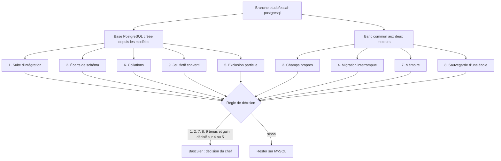

# Essai PostgreSQL (Q-30) — conception

| | |
|---|---|
| Module | [PLA](../../plan/modules/PLA-plateforme.md) · étude **hors chantier**, accordée par le chef le 17 nov. 2026 (Q-30-2), cadrée « essai resserré » le même jour |
| Branche | `etude/essai-postgresql` (à créer après validation ; le code de l'essai **n'est jamais fusionné**, seul le rapport l'est) |
| Rédigé par | Claude Code (Opus 5.5), le 2026-11-17, d'après la [contre-expertise](contre-expertise-architecture-donnees.md), § 5 |
| Taille | **M** (2 jours bruts). Si l'essai dépasse sa taille, c'est déjà un résultat : « la bascule coûte plus que M » |
| **Validé** | **par Claude20022002 le 2026-11-17** (« Je valide le plan de l'essai, Docker est lancé ») ; propositions du § 3 retenues |

## 1. Objet et critère de « terminé »

Dire, **par la mesure**, si Planner gagne assez à passer de MySQL 8.4 à PostgreSQL pour en payer le prix, avec l'horizon d'environ 10 écoles à 3 ans. **L'issue par défaut est « rester sur MySQL »** (réponse du chef du 17 nov.).

**Terminé** quand le rapport `docs/conception/plateforme/rapport-essai-postgresql.md` :
- donne le résultat chiffré de chacun des 9 critères du § 4, sur les deux moteurs quand c'est pertinent ;
- applique la règle de décision du § 4 et conclut « rester » ou « basculer » ;
- donne le prix d'une bascule (fichiers touchés, jours estimés), qui reste utile même si l'on reste ;
- est relu par le coordinateur, puis la conclusion est inscrite par le chef dans `decisions.md`.

**Contrainte de calendrier** : l'essai ne retarde pas EXP-02b. S'il n'est pas fini quand EXP-02b est prête, EXP-02b part sur MySQL.

## 2. Ce qui existe

- `backend/config/db.js` lit déjà `DB_DIALECT` : la connexion peut viser PostgreSQL sans changer le code de connexion.
- `backend/tests/integration/setupEnv.js` : la suite d'intégration vise une base de test décrite par l'environnement (`DB_DIALECT`, `DB_HOST`, `DB_PORT`…). Elle tourne fichier par fichier sur une seule base (`maxWorkers: 1`).
- **Migrations** : la 0001 rejoue un export SQL de MySQL (`migrations/sql/0001-baseline.sql`) ; 18 migrations contiennent du SQL brut (56 appels). Elles ne peuvent pas tourner telles quelles sur PostgreSQL.
- **Traits propres à MySQL hors migrations** (contre-expertise, § 2) : `GET_LOCK`/`RELEASE_LOCK` (`services/taches/periodiques.js`, `rateLimiterMiddleware.js`), `ON DUPLICATE KEY` avec `IF()`, `JSON_CONTAINS` (`services/calendrier/versionPubliee.js`), `performance_schema` (`services/supervision/etat.js`), guillemets obliques dans un `literal` (`controllers/statistiquesController.js`, l. 342-343), `SUM` d'une expression booléenne (`services/annonces/annonces.js`, `services/studio/directEtat.js`).
- **Forçage d'un chevauchement** par l'administration, avec justification, qui ouvre un conflit (`services/planning/seances.js`) : toute contrainte en base doit le laisser passer.
- **Collations** : mélange `utf8mb4_unicode_ci` et `utf8mb4_0900_ai_ci` (étude, § 10). La connexion et l'unicité des adresses comptent aujourd'hui sur l'insensibilité à la casse de MySQL.
- **PLA-03b** (schéma de départ) : plan validé, branche locale `feat/pla-03b-schema-depart`, pas encore codée. L'essai ne l'attend pas (§ 4, critère 2).
- **Docker n'est pas lancé** sur le poste de travail (constaté le 17 nov.) : l'essai en a besoin (§ 3, question 2).

## 3. Questions et réponses

| N° | Question | Proposition | Réponse du chef | Bloque |
|---|---|---|---|---|
| 1 | Ajouter les paquets `pg` et `pg-hstore` au serveur, **dans la branche d'essai seulement** ? | oui ; jamais fusionnés tant que la bascule n'est pas décidée | oui (plan validé) | le code |
| 2 | Où tourner l'essai ? | sur le poste, avec Docker Desktop lancé par le chef : un conteneur PostgreSQL 18 (version exacte notée dans le rapport) et le MySQL 8.4.13 de test ; **jamais sur le serveur** | oui ; Docker lancé le 17 nov. | le code |
| 3 | Qui fait l'essai ? | une session Claude Code (Opus 5.5) désignée par le coordinateur, avec une fiche de mission | la session qui a écrit le plan, à la demande directe du chef (17 nov.) | le code |
| 4 | Le prototype des champs propres (critère 3) peut-il servir de point de départ à VSC-01 ? | non : c'est un banc jetable ; VSC-01 conçoit le vrai modèle | non (plan validé) | — |

## 4. Solution : neuf critères et une règle de décision

Principe : **pas de sécurité par ligne** (sans objet à 10 écoles). Pour aller vite, la base PostgreSQL de l'essai est créée **depuis les modèles** (`sequelize.sync()`), pas en réécrivant les 62 migrations ; l'écart entre ce schéma et celui des migrations MySQL est relevé (critère 2).

| N° | Critère | Mesure et seuil |
|---|---|---|
| 1 | **Prix de la bascule** | la suite d'intégration passe sur PostgreSQL. On relève le nombre de fichiers applicatifs touchés hors `models/` et migrations. Seuil : **15 fichiers au plus**, aucun changement d'API |
| 2 | **Schéma** | base neuve créée depuis les modèles. On liste les écarts avec le schéma des migrations MySQL : index, contraintes, valeurs par défaut. Seuil : liste complète ; chaque écart a sa correction chiffrée |
| 3 | **Champs propres** (même banc sur les deux moteurs) | 5 000 personnes, 30 champs propres en JSON. Seuils : filtre et tri sur un champ propre **sous 50 ms au 95e centile**, sans index ; validation de 1 000 lignes importées **sous 2 s**. Si les deux moteurs passent : égalité |
| 4 | **Migration interrompue** | une migration de trois instructions échoue à la deuxième. Sur PostgreSQL : rien n'est appliqué. Sur MySQL : on mesure la remise en état par la procédure D-16 (sauvegarde puis reprise). **Sous 15 min pour une école** : avantage jugé mineur |
| 5 | **Exclusion partielle** | une contrainte PostgreSQL refuse deux séances actives non forcées dans la même salle sur des plages qui se chevauchent, toutes grilles confondues, et laisse passer le forçage. On note ce que fait MySQL à la place (contrôle sous verrou) |
| 6 | **Collations** | connexion par identifiant et par adresse insensible à la casse ; unicité de l'identifiant ; recherche d'un nom sans accent, en français et en arabe. Seuil : même comportement que MySQL, sans `citext` dispersé dans le code |
| 7 | **Mémoire** | PostgreSQL avec 10 bases, à côté d'un MySQL qui garde StudyLib : **1,5 Gio au plus au total**, sous la charge de PLA-06 réduite (50 utilisateurs par école active) |
| 8 | **Sauvegarde et restauration d'une école seule** | à une heure donnée, chiffrée à clé publique (R-6). Objectifs du 26 oct. : 15 min de perte au plus, 4 h pour rétablir |
| 9 | **Reprise d'HESTIM** | le jeu fictif de `seed.js`, au schéma réel, converti de MySQL vers PostgreSQL : mêmes comptes de lignes, mêmes tests verts. **Aucune donnée réelle** |

**Règle de décision** : basculer seulement si **1, 2, 7, 8 et 9** passent, **et** si **4 ou 5** apporte un gain que le chef juge décisif. Sinon, **rester sur MySQL**. Le rapport est gardé comme prix d'une bascule future.

## 5. Fichiers créés ou modifiés

| Fichier | Créé / modifié | Rôle | Fusionné ? |
|---|---|---|---|
| `scripts/essais/postgresql/` (banc, docker-compose de l'essai, scripts de mesure) | créé | banc des critères 3, 4, 7, 8, 9 | non |
| `backend/` : `package.json`, les fichiers aux traits MySQL du § 2 | modifié | critère 1 : faire passer la suite | non |
| `docs/conception/plateforme/rapport-essai-postgresql.md` | créé | le rapport | **oui** |
| `docs/sessions/2026-11-..-etude-essai-postgresql.md` | créé | fiche de session | oui |

## 6. Données et migration

Aucune migration de Planner, aucun numéro réservé. Les bases de l'essai sont jetables, sur le poste seulement. Aucune donnée réelle : le jeu de `seed.js` est fictif.

## 7. Sécurité, isolation et exigences produit

- Rien ne touche le serveur, n8n, ni `main`.
- Aucun secret dans le dépôt : mots de passe de test dans `.env` locaux, ignorés par Git.
- Le critère 8 reprend le chiffrement à clé publique de R-6 avec une clé d'essai, jamais la clé de production.

## 8. Tests

- La suite d'intégration complète sur les deux moteurs (critère 1), avec le nombre de tests verts de chaque côté.
- Le banc a ses propres tests, pour les fonctions de mesure (comme le banc de PLA-06).

## 9. Étapes de livraison

1. Ce plan est validé par le chef ; la question 2 est tranchée (Docker lancé).
2. Critères 1, 2, 6 et 9 : faire passer la suite sur PostgreSQL, puis relever les écarts.
3. Critères 3, 4, 5, 7 et 8 : le banc.
4. Rapport, fiche de session, ligne de `suivi.md`. Le chef pousse la branche, ouvre une PR, et ne fusionne que le rapport (par une branche `doc/` si besoin).

## 10. Risques et retour arrière

- **Dépassement de taille** : on arrête, et on rapporte ce qui est mesuré.
- **Biais de `sync()`** : le schéma tiré des modèles peut différer de celui des migrations. Le critère 2 rend cet écart visible au lieu de le cacher.
- **Retour arrière** : rien à défaire, puisque rien n'est fusionné hors du rapport.

## 11. Hors périmètre

- Sécurité par ligne (RLS) et base partagée entre écoles.
- StudyLib : elle reste sur MySQL.
- La bascule elle-même, qui serait une fonction à part, décidée par le chef après le rapport.
- Le modèle des champs propres : il appartient à VSC-01.
