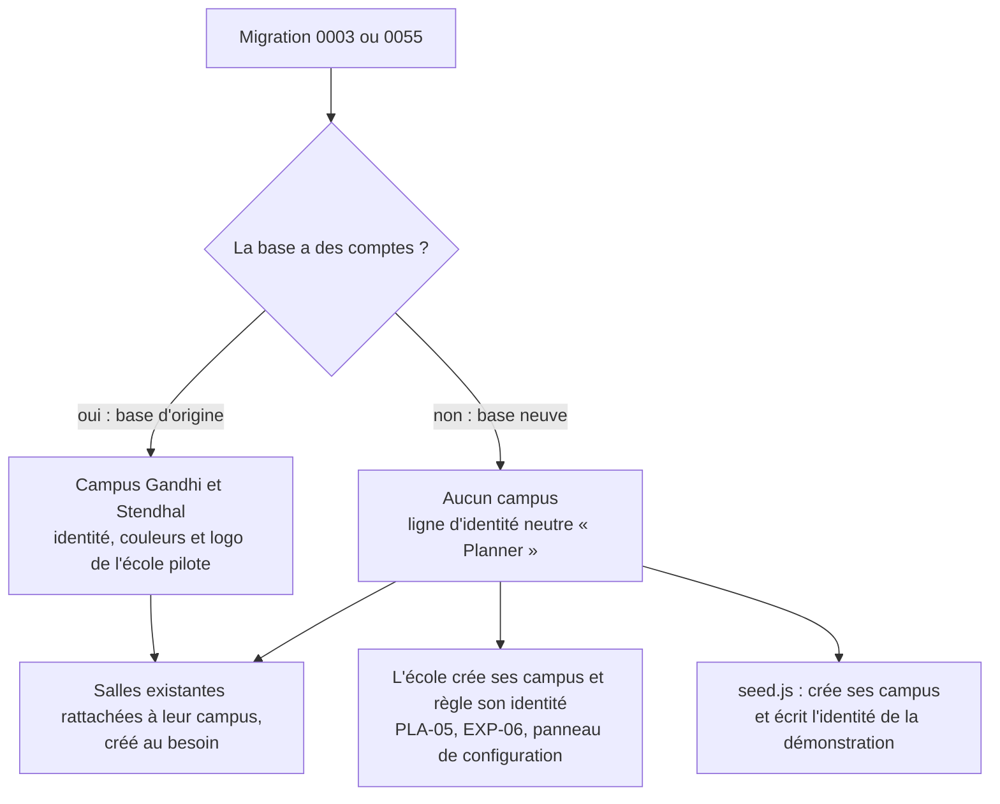

# PLA-03 · Base neuve sans données d'école — conception

| | |
|---|---|
| Module | [PLA](../../plan/modules/PLA-plateforme.md) · chantier ouvert le 2026-11-09 |
| Branche | `feat/pla-03-base-neuve` (étape PLA-03a) ; l'étape PLA-03b aura la sienne |
| Rédigé par | Claude Code (Fable 5.2), le 2026-11-15 |
| **Validé** | par Claude20022002 le 2026-11-15 |

## 1. Objet et critère de « terminé »

Une école neuve reçoit une base qui ne contient rien de l'école pilote. Aujourd'hui, toute base neuve reçoit ses deux campus (migration 0003) et son identité : nom, couleurs, logo, modèle d'emploi du temps (migration 0055).

La fonction se livre en **deux étapes** (réponse 3) :

| Étape | Contenu | Terminé quand |
|---|---|---|
| **PLA-03a** (ce plan) | Les migrations 0003 et 0055 n'écrivent plus les données de l'école pilote dans une base sans comptes | une base neuve n'a de lignes que dans `SequelizeMeta` et `ConfigurationEtablissement` (une ligne neutre) ; une base qui a des comptes garde tout, comme avec la migration 0057 ; la suite complète passe |
| **PLA-03b** (complément de plan à écrire) | Schéma de départ : une base neuve ne rejoue plus toutes les migrations | à préciser dans son plan, après PLA-03a |

Critère du module : « une base neuve ne contient aucun nom, campus ni salle d'HESTIM ; une base qui a des comptes garde tout ».

## 2. Ce qui existe

- **Moteur** : `backend/migrations/migrator.js` (Umzug). `migrateurPour(connexion)` applique les mêmes migrations à la base d'une autre école. Umzug ne rejoue jamais une migration notée dans `SequelizeMeta`.
- **Migration 0003** (`0003-campus-salles.js`, lignes 59 à 69) : crée « Gandhi » et « Stendhal » **sans condition**, à partir de `CAMPUS_HESTIM` (`backend/utils/campus.js`). Elle rattache ensuite chaque ancienne valeur de `Salles.batiment` à un campus, qu'elle crée au besoin (lignes 71 à 80).
- **Migration 0055** (`0055-identite-ecole.js`, lignes 34 à 54) : crée la ligne 1 de `ConfigurationEtablissement` avec le nom, les couleurs et le logo de l'école pilote, et le modèle `hestim`, **sans condition**.
- **Règle déjà en place** : les migrations 0057 (ClassQuiz) et 0061 (valeurs du moteur) ne donnent les données de l'école pilote qu'à une base qui a des comptes (`EXISTS (SELECT 1 FROM Users)`).
- **Valeurs neutres** : `backend/services/etablissement/identite.js`, constante `DEFAUT` (nom « Planner », `#1D4ED8`, `#0E7490`, modèle `planner`, pas de logo).
- **Aucune autre migration** n'écrit de ligne dans une base vide : 0006, 0007, 0008, 0009 et 0054 ne font que reprendre des lignes existantes.
- **Ce qui dépend des données de la migration** :
  - `backend/seed.js` (jeu de démonstration, 946 lignes) lit les campus créés par la migration (ligne 584) et **n'écrit pas l'identité** : la démonstration tient son nom et son logo de la migration 0055 ;
  - `backend/tests/integration/helpers/testApp.js` (ligne 135) et 11 fichiers de tests lisent les campus de codes `G` et `ST` ;
  - `identiteEcole.test.js` et `preparation.test.js` attendent l'identité de l'école pilote.
- **Production** : la dernière version en ligne (maj44) a déjà appliqué 0003 et 0055. Modifier ces fichiers ne la touche pas.
- **Mesure** (banc de PLA-06, essai sur ce PC) : une base neuve, 60 migrations, 15 s.

## 3. Questions et réponses

| N° | Question | Proposition | Réponse du chef | Bloque |
|---|---|---|---|---|
| 1 | Identité d'une base neuve | ligne neutre : « Planner », bleu du code, sans logo, modèle `planner` | **ligne neutre** (15 nov.) | — |
| 2 | Corriger 0003 et 0055 sur place, ou par une migration de nettoyage | sur place, avec la condition « la base a des comptes » | **sur place** (15 nov.) | — |
| 3 | Schéma de départ | deux étapes, deux PR | **deux étapes** (15 nov.) | — |
| 4 | Campus des tests | — | **campus fictifs** (15 nov.) | — |
| 5 | Noms et codes des campus fictifs | « Campus Nord » (N), « Campus Sud » (S) | **Nord (N) et Sud (S)** (15 nov.) | — |
| 6 | Tests de reprise d'une ancienne base, et `seed.js` | gardés ; le seed crée lui-même ses deux campus | **gardés tels quels** (15 nov.) | — |
| 7 | `Filiere.annees_a_hestim` et la valeur `hestim` du modèle d'emploi du temps | hors périmètre | **hors périmètre** (15 nov.) | — |
| 8 | Le jeu de démonstration tient son nom, ses couleurs et son logo de la migration 0055. Avec une ligne neutre, la démonstration et les parcours afficheraient « Planner » | `seed.js` écrit l'identité de l'école pilote, comme il crée ses campus : la démonstration et les parcours ne changent pas | **oui, le seed écrit l'identité** (15 nov.) | — |
| 9 | Nom de l'école fictive dans les tests qui ont besoin d'un nom d'école (préfixe des salles de l'emploi du temps mensuel) | « École Alpha », nom court « ALPHA », déjà employé dans `contexteEtablissement.test.js` avec « École Beta » | **« École Alpha », « ALPHA »** (15 nov.) | — |

## 4. Solution

Chaque migration pose la même question que la 0057 : **la base a-t-elle des comptes au moment où la migration s'applique ?**

- **0003** : les deux campus de l'école pilote ne sont créés que si la base a des comptes. Le rattachement des salles existantes ne change pas : il crée le campus dont une salle a besoin. Aucune salle n'est perdue, avec ou sans comptes.
- **0055** : la base qui a des comptes reçoit l'identité de l'école pilote, comme aujourd'hui. La base sans comptes reçoit la ligne neutre. Les valeurs neutres sont **recopiées dans la migration** : une migration ne dépend pas d'un fichier qui changera.
- **Seed** : il crée ses deux campus et écrit l'identité de l'école pilote (réponse 8). Ce code va dans un fichier à part, car `seed.js` dépasse déjà 300 lignes.
- **Tests** : l'aide commune crée « Campus Nord » (N) et « Campus Sud » (S) après les migrations. Un test neuf vérifie la base neuve ; un autre rejoue les migrations sur une base qui a des comptes.

## 5. Fichiers créés ou modifiés

| Fichier | Créé / modifié | Rôle | Taille visée |
|---|---|---|---|
| `backend/migrations/0003-campus-salles.js` | modifié | campus de l'école pilote seulement si la base a des comptes | environ 130 lignes |
| `backend/migrations/0055-identite-ecole.js` | modifié | identité pilote ou ligne neutre, selon les comptes | environ 75 lignes |
| `backend/demo/ecolePilote.js` | créé | campus et identité du jeu de démonstration, appelés par `seed.js` | moins de 60 lignes |
| `backend/seed.js` | modifié | appelle le fichier ci-dessus ; le fichier ne grossit pas | 3 lignes changées |
| `backend/tests/integration/helpers/testApp.js` | modifié | `resetDatabase` crée les campus N et S, sauf avec l'option `neuve` | environ 190 lignes |
| `backend/tests/integration/baseNeuve.test.js` | créé | base neuve vide ; base avec comptes qui garde tout | environ 120 lignes |
| 11 fichiers de `backend/tests/integration/` | modifiés | codes `N` et `S`, noms « Campus Nord » et « Campus Sud », noms de salles | — |
| `identiteEcole.test.js`, `preparation.test.js` | modifiés | identité neutre au départ ; école fictive de la réponse 9 | — |
| `frontend/tests/parcours/donneesGeneration.mjs`, `donneesIiia.mjs` | modifiés | trouvés pendant le code : les parcours préparent leur base avec l'aide des tests du serveur, et lisaient les campus G et ST ; ils passent aux codes N et S | — |
| `scripts/verifier-neutre.mjs` | modifié | exception ajoutée pour `backend/demo/ecolePilote.js` | 1 ligne |
| `DEPLOIEMENT.md`, `docs/plan/modules/PLA-plateforme.md`, `docs/plan/suivi.md`, `docs/conception/README.md` | modifiés | ce qu'une installation neuve contient ; état | — |

`backend/utils/campus.js` et `backend/tests/utils/referentiel.test.js` ne changent pas (réponse 6).

## 6. Données et migration

- **Aucune migration nouvelle, aucun numéro réservé.** Deux migrations existantes sont modifiées.
- Tables : `Campus`, `TrajetsCampus` (référentiel) et `ConfigurationEtablissement` (PLA). Aucun changement de schéma.
- **Base déjà migrée** (production, postes, sauvegardes) : rien ne change, Umzug ne rejoue pas 0003 ni 0055.
- **Ancienne sauvegarde d'avant 0003, avec des comptes** : même résultat qu'aujourd'hui.
- **Base neuve** : `Campus` vide. `Salles.id_campus` reste obligatoire : l'école crée un campus avant sa première salle.

## 7. Sécurité, isolation et exigences produit

- **EP-12** (les données restent à l'école) : une école neuve ne reçoit plus les données d'une autre.
- Condition du jalon de l'étape 2 (« une école neuve au vocabulaire scolaire »). Aucun canal I-1 à I-16 n'est fermé ici.
- Aucun droit, aucune route ne change.
- `verifier-neutre.mjs` reste vert ; l'exception des migrations demeure, puisqu'elles servent encore la base d'origine.

## 8. Tests

- **`baseNeuve.test.js`, base neuve** : après les migrations sur une base vide, toutes les tables sont vides sauf `SequelizeMeta` et `ConfigurationEtablissement` ; la ligne d'identité vaut les valeurs neutres, sans logo ; ClassQuiz est éteint.
- **`baseNeuve.test.js`, base qui a des comptes** : sur une seconde base (créée comme dans `contexteEtablissement.test.js`), migrations jusqu'à 0002, puis un compte et trois salles (« Gandhi », « Stendhal », un autre bâtiment), puis le reste des migrations. Attendu : les campus G et ST, un troisième campus pour l'autre bâtiment, les trois salles rattachées, l'identité et le logo de l'école pilote.
- **Seed** : après le seed sur une base neuve, les deux campus et l'identité de la démonstration existent.
- **Suite complète** du serveur en local, puis parcours dans la CI de la PR.

## 9. Étapes de livraison

1. Conception (ce document) et `suivi.md` à « en cours ».
2. Tests neufs de `baseNeuve.test.js`, d'abord en échec.
3. Migrations 0003 et 0055.
4. `backend/demo/ecolePilote.js` et `seed.js`.
5. Aide des tests, puis les 13 fichiers de tests.
6. Documentation, fiche de session, commandes pour le chef.
7. PLA-03b : complément de plan (forme du schéma de départ, moment où il est régénéré, test d'équivalence avec les migrations), validé avant son code, sur sa branche.

## 10. Risques et retour arrière

| Risque | Parade |
|---|---|
| Un test ou un parcours suppose encore les campus ou l'identité de la migration | suite complète en local ; parcours dans la CI avant la fusion |
| Une base de poste créée vide puis remplie à la main avant 0003 | la règle est celle de la 0057, écrite dans `DEPLOIEMENT.md` |
| Conflit de fusion sur `docs/conception/README.md` et `suivi.md` avec #164 et #171 | lignes ajoutées aux mêmes tableaux : garder toutes les lignes |

**Retour arrière** : annuler la PR. Aucune base existante n'a changé.

## 11. Hors périmètre

- Le schéma de départ : PLA-03b.
- `Filiere.annees_a_hestim` et la valeur `hestim` du modèle d'emploi du temps : à donner à EXP-07 ou à UIX-01 (réponse 7).
- Le registre des écoles et la commande `creer-ecole` : PLA-05. Le premier administrateur : EXP-06.
- Les noms `hestim_test` des bases de test et les adresses `@hestim.test` : EXP-07.
