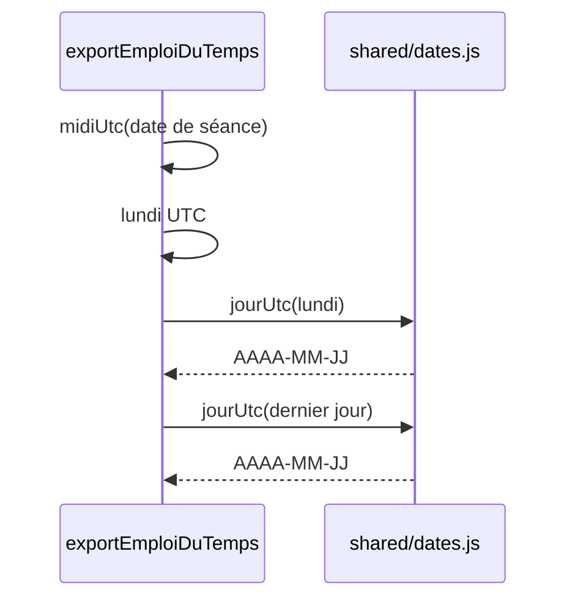

# QUA-04 · Reste des dates — conception

| | |
|---|---|
| Module | [QUA](../../plan/modules/QUA-qualite-docs.md) · fonction libre, hors chantier (les trois chantiers sont pleins ; le chef a demandé une fonction libre le 15 novembre 2026) |
| Branche | `refactor/qua-04-dates` |
| Rédigé par | Cursor Grok 4.7, le 2026-11-15 |
| **Validé** | Validé par Claude20022002 le 2026-11-15 |

## 1. Objet et critère de « terminé »

Le module dit : plus aucun `toISOString().slice(0, 10)` dans `frontend/src/utils/exportEmploiDuTemps.js`.

À la fin, vérifié ainsi :

- ce fichier ne contient plus cette expression ;
- une séance datée reste dans la même semaine qu'aujourd'hui (lundi UTC de sa date, dernier jour de la grille compris) ;
- `npm run test:unit` du site passe, avec un test nouveau sur le formatage du jour UTC.

## 2. Ce qui existe

`shared/dates.js` porte déjà `aujourdhui()`, `dansJours()` et `instantEcole()` (lot B-2). Le décalage de l'école est `DECALAGE_ECOLE_MINUTES = 0`. Le commentaire du fichier interdit de demander le fuseau au navigateur.

Dans `exportEmploiDuTemps.js`, les dates de séance passent par `midiUtc` (`T12:00:00Z`). Le lundi et le dernier jour de la semaine sont ensuite écrits avec `toISOString().slice(0, 10)` (lignes 75 et 77). À midi UTC, ce découpage donne le jour civil UTC. Ce n'est pas « aujourd'hui » : le remplacer par `aujourdhui()` changerait la semaine affichée.

Le même motif reste dans d'autres fichiers (services, tests, migrations, démos). La ligne du module ne cite que le PDF.

## 3. Questions et réponses

| N° | Question | Proposition | Réponse du chef | Bloque |
|---|---|---|---|---|
| 1 | Le « plus aucun » vise-t-il seulement `exportEmploiDuTemps.js` ? | oui : c'est le fichier nommé, et la taille est S. Les autres copies restent pour une fonction suivante | oui (15 nov.) | non |
| 2 | L'année universitaire (`getFullYear`) et « Généré le » (`toLocaleDateString` sans fuseau) entrent-ils dans QUA-04 ? | non : le module ne nomme que le motif `slice(0, 10)` | non (15 nov.) | non |

## 4. Solution

Ajouter `jourUtc(instant)` dans `shared/dates.js`. Elle lit l'année, le mois et le jour **en UTC** (`getUTCFullYear`, `getUTCMonth`, `getUTCDate`) et renvoie `AAAA-MM-JJ`. Elle ne appelle pas `toISOString`. `aujourdhui()` ne change pas.

`exportEmploiDuTemps.js` l'utilise pour la clé du lundi et pour le dernier jour. Le calcul du lundi (`getUTCDay`, midi UTC) reste dans ce fichier.

## 5. Fichiers créés ou modifiés

| Fichier | Créé / modifié | Rôle | Taille visée |
|---|---|---|---|
| `shared/dates.js` | modifié | `jourUtc` | inchangée, fonction courte |
| `frontend/src/utils/exportEmploiDuTemps.js` | modifié | deux appels | inchangée |
| `frontend/src/utils/aujourdhui.test.js` | modifié | un test de `jourUtc` | — |
| `docs/plan/suivi.md` | modifié | QUA-04 en cours | — |
| `docs/plan/modules/QUA-qualite-docs.md` | modifié | état | — |

## 6. Données et migration

Aucune.

## 7. Sécurité, isolation et exigences produit

Pas de fuseau lu au navigateur (règle déjà écrite dans `shared/dates.js`). Aucune donnée d'élève nouvelle. EP-9 : le jour affiché sur le PDF ne change pas pour une date déjà à midi UTC.

## 8. Tests

Dans `aujourdhui.test.js` :

- `jourUtc(new Date('2026-11-15T12:00:00Z'))` vaut `2026-11-15` (dimanche) ;
- `jourUtc(new Date('2026-11-15T23:30:00Z'))` vaut encore `2026-11-15` ;
- `jourUtc(new Date('2026-03-29T12:00:00Z'))` vaut `2026-03-29`.

Le groupement par semaine n'est pas exporté. Le test fige le formatage que le PDF appelle. `npm run test:unit` dans `frontend/`.

## 9. Étapes de livraison

1. Ce plan, commité seul, `suivi.md` à « en cours ». Aucun code avant le « validé ».
2. Deux agents, dans cet ordre, dossiers distincts, je relis avant le commit du code :
   - agent dates : `shared/dates.js` et `frontend/src/utils/aujourdhui.test.js` ;
   - agent export : `frontend/src/utils/exportEmploiDuTemps.js` seulement, en appelant `jourUtc`.
3. `npm run test:unit` dans `frontend/`.
4. Fiche de session.

## 10. Risques et retour arrière

Un `getUTC*` mal collé décalerait la semaine du PDF d'un jour. Le test du dimanche 15 novembre 2026 le voit. Retour : retirer `jourUtc` et les deux appels.

## 11. Hors périmètre

Les autres `toISOString().slice(0, 10)` du dépôt, les migrations, les scripts de démo, l'année universitaire et la ligne « Généré le ».
