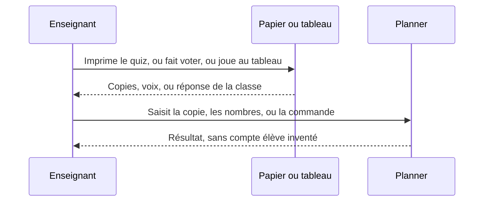

# EP-18 · Parcours sans appareil de l'élève — conception

| | |
|---|---|
| Module | [QUA](../../plan/modules/QUA-qualite-docs.md) · les trois fonctions touchent QJE, COU et les jeux |
| Branche | `etude/ep18-sans-appareil` |
| Rédigé par | agent de Cursor (Grok 4.7), le 2026-11-28 |
| **Validé** | en attente du chef (migration possible, et un choix de produit sur le sondage) |

Aucun code dans ce document. Les numéros de migration ne sont pas réservés.

## 1. Objet et critère de « terminé »

Un élève sans téléphone ni ordinateur peut quand même laisser une trace, saisie par l'enseignant :

1. un quiz imprimé, puis une copie saisie ;
2. un sondage répondu sur papier, puis dépouillé ;
3. un jeu joué au tableau avec la classe.

C'est fini quand chacun des trois a son chemin, ses tests, et que l'enseignant sait quoi faire en salle. L'étude des parcours (`docs/recette/parcours-par-role.md` sur `origin/etude/parcours-par-role`, pas encore sur `main`) le marque bloquant pour produire une réponse individuelle sans appareil : l. 173 pour le responsable, l. 69 et 87-88 pour l'enseignant et le vacataire, l. 103-105 pour l'étudiant.

## 2. Ce qui existe

Les lignes sont celles de `origin/main` au 28 nov. (`5df39283`).

### 2.1 Le quiz

| | |
|---|---|
| Ce qui existe | Une copie naît quand l'élève ouvre la passation. L'enseignant ne note à la main qu'une copie déjà là : `noterCopieAMain` (`backend/services/studio/sessions.js`, l. 213) prend un `idTentative`. |
| Ce qui manque | Aucune impression dans `frontend/src/pages/studio` ni `frontend/src/components/studio`. L'enseignant ne peut pas créer la copie d'un élève qui n'a pas d'appareil. |
| Déjà décidé | EP-18, réponse 8 (22 nov.) : imprimer sans les réponses (S), puis la copie saisie (M). La fiche `docs/plan/missions/ep18-correctifs.md` (M-2a) ne couvre que l'impression. Aucune branche `feat/qje-quiz-imprime` n'est ouverte. QJE-11 (photo d'un QCM) est une autre étape. |

### 2.2 Le sondage

| | |
|---|---|
| Ce qui existe | Une question, des choix, un compteur par choix (`SondagesChoix.reponses`, `backend/models/SondageChoix.js`, l. 12). L'étudiant incrémente ce compteur et laisse une participation sans lien avec son choix (`backend/services/cours/sondages.js`, l. 138-151). Seul un étudiant répond (l. 142). |
| Ce qui manque | L'enseignant ne peut pas reporter des voix ramassées sur papier. Le total affiché est la somme des compteurs (l. 69). |
| Déjà décidé | EP-18, M-16 : la limite était acceptée, un vote à main levée restait hors de Planner. Le chef, le 28 nov., demande le dépouillement saisi. C'est le point qui change un choix déjà écrit. |

### 2.3 Le jeu au tableau

| | |
|---|---|
| Ce qui existe | Le terminal se joue en `collectif` (`shared/jeux/catalogue.js`, l. 17). L'enseignant tape lui-même la commande, sans téléphone d'élève : `jouerCommande` prend `texte` (`backend/services/jeux/sessions.js`, l. 183-198). L'écran est `TableauCollectif.jsx`. |
| Ce qui manque | Les dix simulations ne déclarent pas de mode. Sans `modes`, le catalogue les joue seules (`shared/jeux/catalogue.js`, l. 33). Leurs réponses sont des vecteurs, pas des commandes. Aucune session de classe ne les rejoue. |
| Déjà décidé | QJE-18, question 9 : le rejeu au tableau des simulations est une fonction nouvelle, au chef. Le mode `collectif` du terminal ne se recopie pas tel quel. |

## 3. Questions et réponses

| N° | Question | Proposition | Réponse du chef | Bloque |
|---|---|---|---|---|
| 1 | La copie saisie est-elle une tentative de l'élève, marquée « saisie par l'enseignant » ? | Oui. Même passation, même élève, sans chronomètre. Une colonne `origine` (`eleve` ou `enseignant`) sur la tentative. Pas de deuxième copie si l'élève en a déjà une. | | oui |
| 2 | L'impression et la saisie se livrent-elles ensemble ? | Non. D'abord l'impression sans les réponses (S, sans migration). Ensuite la copie (M, migration). M-2a reprend l'impression. | | non |
| 3 | Le sondage papier revient-il sur la limite acceptée en M-16 ? | Oui, seulement le dépouillement. L'enseignant écrit un nombre par choix. Colonne `papier` sur `SondagesChoix`, total = réponses en ligne + papier. Aucune participation, donc aucun nom (S-6). | | oui |
| 4 | Le jeu au tableau enregistre-t-il une progression par élève ? | Non. Le résultat est celui de la classe. Le terminal le fait déjà. Pour les simulations, une seule d'abord (Robot Route), après ce visa. Les neuf autres attendent. | | oui |
| 5 | Une voix papier peut-elle dépasser l'effectif ? | Non. Le total des voix, en ligne et papier, ne dépasse pas l'effectif de la classe. Le serveur refuse. | | non |

## 4. Solution

L'enseignant est le seul à écrire. L'élève sans appareil ne se connecte pas.

**Quiz.** L'impression reprend les questions de la passation, sans les bonnes réponses, et s'ouvre par l'impression du navigateur. Plus tard, l'enseignant choisit l'élève et saisit ses réponses. La copie porte `origine = enseignant`. Elle entre dans les résultats, avec cette marque.

**Sondage.** Après la séance, l'enseignant remplit un nombre par choix. Ce nombre remplace le précédent papier, il ne s'additionne pas tout seul à chaque enregistrement. Les réponses en ligne ne bougent pas.

**Jeu.** En C1, le terminal projeté suffit : l'enseignant tape ce que la classe dit. Les simulations attendent la question 4. On ne marque pas un élève « réussi » parce que la classe a trouvé.

## 5. Fichiers créés ou modifiés

Aucun dans cette étude. Au moment du code, chaque fonction aura sa branche. Piste, à confirmer dans son plan court :

| Fichier | Fonction | Rôle |
|---|---|---|
| pages et composants du Studio | impression | la feuille sans réponses |
| `backend/services/studio/sessions.js` | copie saisie | créer la tentative, pas seulement la noter |
| modèle des tentatives | copie saisie | colonne `origine` |
| `backend/services/cours/sondages.js` et `SondageChoix.js` | papier | colonne `papier`, saisie enseignant |
| écran du sondage dans l'espace de classe | papier | les nombres |
| session de simulation, plus tard | tableau | un rejeu, pas les dix d'un coup |

## 6. Données et migration

| Fonction | Migration | Tables | À dire |
|---|---|---|---|
| Impression du quiz | non | — | — |
| Copie saisie | oui, probable | tentatives du Studio | une colonne `origine`, défaut `eleve`. Numéro non réservé. Étendre, puis les lectures qui supposent « toute copie vient de l'élève ». |
| Sondage papier | oui, probable | `SondagesChoix` | une colonne `papier`, entier, défaut 0. Numéro non réservé. Les sondages déjà là restent à 0. |
| Terminal collectif | non | — | le chemin `texte` existe |
| Simulation au tableau | à trancher avec la question 4 | session de jeu, si on garde le résultat de la classe | ne rien réserver tant que la question 4 n'est pas répondue |

## 7. Sécurité, isolation et exigences produit

L'enseignant n'écrit que pour une classe qu'il gère déjà (droits du Studio, du sondage, de la session de jeu). La copie nomme l'élève : c'est une donnée d'élève, comme une copie en ligne. Le sondage papier ne nomme personne. Le jeu au tableau ne crée pas de réussite individuelle.

EP-18 : contextes A et C2. EP-19 : l'impression est celle du navigateur, pas un nouveau paquet à télécharger.

## 7 bis. Ce que disent les études

| Ligne | Étude | Appliquée ou écartée | Comment, ou pourquoi |
|---|---|---|---|
| M-2, réponse 8 | EP-18, 22 nov. | appliquée | impression, puis copie saisie |
| M-14 | EP-18 | appliquée en partie | le terminal collectif existe ; les simulations restent à la question 4 |
| M-16 | EP-18 | écartée pour le seul dépouillement | la limite « vote à main levée, hors Planner » cède si le chef répond oui à la question 3 |
| Question 9 | QJE-18 | reprise | le rejeu des simulations reste une fonction nouvelle |
| Parcours bloquants | `parcours-par-role.md` | appliquée | quiz, jeu, sondage sans appareil |
| QJE-11 | module QJE | écartée | la photo du QCM n'est pas ce plan |

Public : l'enseignant en salle, pour un élève du supérieur qui n'a pas d'appareil. Rien dans les textes ne suppose un pays.

## 7 ter. EP-18 : tous les contextes

| Contexte | Ce que fait la fonction | Preuve ou test |
|---|---|---|
| **A. Au moins un élève sans téléphone ni ordinateur** | L'enseignant imprime, dépouille ou joue au tableau, puis saisit. L'élève ne se connecte pas. | les tests du § 8 |
| **B. Connexion lente ou coupée** | Rien de neuf hors ligne. La saisie attend le réseau. La feuille, elle, a été imprimée avant. | hors sujet de ce plan ; MOB-08 couvre l'appel |
| **C. Ordinateur et projecteur (C1), ou rien dans la salle (C2)** | C1 : terminal projeté, l'enseignant tape. C2 : impression à l'avance, saisie après la séance. | parcours enseignant, une fois le code là |

## 8. Tests

À écrire avec le code, pas maintenant.

- Impression : la feuille contient les questions et pas les bonnes réponses.
- Copie : elle échoue si on la crée sans le droit sur la classe ; elle passe avec `origine = enseignant` ; une deuxième copie du même élève est refusée.
- Sondage : un enseignant pose 3 et 1 ; le total vaut les voix en ligne plus 4 ; un étudiant ne peut pas écrire la colonne papier ; un total au-dessus de l'effectif est refusé.
- Terminal : une session `collectif` réussit un défi avec `texte` seul, sans proposition d'élève. Ce chemin existe ; le test le fige.

## 9. Étapes de livraison

1. Ce plan, visé par le chef (questions 1, 3 et 4).
2. Impression du quiz, branche à part, sans migration.
3. Copie saisie, après le numéro de migration demandé au coordinateur.
4. Dépouillement papier, même réserve.
5. Test du terminal sans téléphone d'élève.
6. Simulation au tableau, seulement si la question 4 est oui, et d'abord Robot Route.

## 10. Risques et retour arrière

La colonne `origine` ou `papier` se retire dans une migration plus tard si le chef revient en arrière. Les copies et les voix déjà saisies restent en base tant qu'on ne les efface pas. Le terminal collectif ne change pas dans les étapes 2 à 5.

## 11. Hors périmètre

L'appel hors ligne (MOB-08) et la liste d'appel imprimée (M-1, déjà livrée à part). La photo d'un QCM (QJE-11). L'annonce sur papier. Les neuf simulations autres que celle choisie à la question 4. Le quiz en direct : il reste un écran projeté, sans copie papier.
