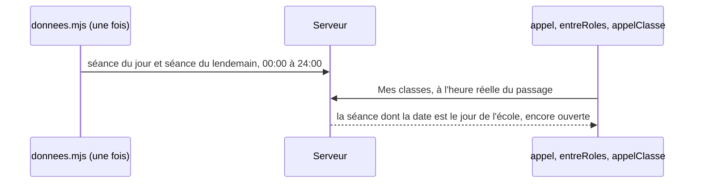

# Correctif : `entreRoles`, `appel` et `appelClasse` échouent vers minuit UTC · plan court

| | |
|---|---|
| Module | QUA · correctif de test, sans chantier. Suite de [fix-sondage-minuit.md](fix-sondage-minuit.md) (#202) |
| Branche | `fix/parcours-seance-en-cours`, depuis `origin/main` (`db0e3de7`) |
| Rédigé par | agent de Cursor (Grok 4.7), le 18 novembre 2026 |
| **Validé** | en attente du chef |

## 1. La cause

Ces trois parcours ont besoin d'une classe **en cours au moment où ils tournent**. #202 ne les a pas changés : la carte « Ouvrir … » ne remplace pas le bouton de la séance en cours, ni l'appel du jour.

La base est préparée **une fois**, au début du passage (`donnees.mjs`, lignes 47 à 61). La séance du jour va de **00 h 05 à 23 h 55**. Le serveur décide ensuite avec sa propre horloge (`mesClasses.js`, lignes 19, 86 et 96) :

- `fin <= heure` : à partir de 23 h 55, la séance est finie. « Supports de cours » et « Faire l'appel » disparaissent. C'est l'échec d'`entreRoles` (ligne 86) et d'`appelClasse` (lignes 24 et 47).
- dans les 5 dernières minutes, le rappel ajoute un second « Faire l'appel » (`MesClasses.jsx`, `RAPPEL_MINUTES = 5`). `appel.spec.cjs`, ligne 44, exige un seul bouton : il échoue de 23 h 50 à 23 h 55.
- si le passage a commencé avant minuit et qu'un test tourne après, la date préparée est devenue hier. Aucun élargissement d'horaire ne la rend « aujourd'hui ».

Les journaux du 15 nov. sont dans le plan de #202, § 2 (passages `43776765702` et `43776567449`). L'application fait ce qu'elle doit. Seuls les tests changent.

## 2. Le correctif

1. **Le créneau du jour passe de 00 h 05–23 h 55 à 00 h 00–24 h 00** (durée 1 440 minutes). La comparaison du serveur est sur `HH:MM` : `23:59` laisse tomber la minute 23 h 59, `24:00` reste après. `Date.parse` de `T24:00:00Z` est le minuit suivant, donc le calcul du rappel reste valable. `24:05` ne l'est pas (`NaN`) : on ne l'utilise pas.
2. **Une seconde séance, le lendemain**, même cours, même groupe, même enseignante, même salle, avec un créneau aux mêmes heures et au jour de cette date. Avant minuit, seule celle du jour est « en cours ». Après minuit, celle de la veille est passée et celle du lendemain prend le relais. Son mois est publié avec les autres.
3. **Garde.** Après la création, on relit `heure_fin`. Si les cinq premiers caractères ne sont pas `24:00`, la préparation s'arrête avec un message clair. On n'invente pas un autre codage.
4. **`edtPdf.spec.cjs`.** La séance hors grille est imprimée avec son horaire. Le texte attendu devient `00h00 - 24h00`. Les en-têtes de la grille de l'école ne changent pas : deux créneaux de plus ne deviennent pas l'horaire le plus fréquent d'un rang.
5. **`appel.spec.cjs`.**
   - Le test figé à 23 h 30 garde « aucun rappel » et un seul bouton : il reste 30 minutes. Le commentaire qui dit 23 h 55 est mis à jour.
   - Le test du QR clique le premier « Faire l'appel ». De 23 h 55 à 23 h 59 le rappel en ajoute un second ; les deux ouvrent le même appel.
   - L'identifiant n'est plus celui préparé au début du passage. On le lit dans l'adresse `/appel/<id>` après le clic, et le scan l'utilise. Après minuit, le bouton ouvre la séance du lendemain.

`entreRoles` et `appelClasse` ne changent pas : « Supports de cours » est là dès que la classe est en cours, et ils ne figent pas l'identifiant préparé.

On ne réécrit pas la réponse du serveur (contrairement au test de #202). Ces parcours doivent voir la décision réelle du serveur.

## 3. Fichiers

| Fichier | Changement |
|---|---|
| `frontend/tests/parcours/donnees.mjs` | horaires 00:00–24:00 ; séance du lendemain ; garde sur `24:00` ; son mois publié |
| `frontend/tests/parcours/edtPdf.spec.cjs` | le texte `00h05 - 23h55` devient `00h00 - 24h00` |
| `frontend/tests/parcours/appel.spec.cjs` | premier bouton ; identifiant lu dans l'adresse ; commentaire du test figé |
| fiche de session | à la fin. `docs/plan/suivi.md` n'est pas modifié (pause du coordinateur) |

Rien dans `frontend/src/` ni `backend/`. L'objet renvoyé par `preparerDonnees` ne gagne pas de champ : les autres parcours ne changent pas.

## 4. Vérifié par

Les parcours ne se lancent pas ici : ils demandent l'application. La preuve est la CI de la PR, à n'importe quelle heure, parce que la séance couvre l'heure réelle du serveur. Le test figé à 23 h 30 reste la preuve qu'un faux rappel ne s'affiche pas. Si la garde `24:00` arrête la préparation, on s'arrête et on le rapporte : pas d'autre codage sans un nouveau plan.

## 5. Question

| N° | Question | Proposition | Réponse du chef |
|---|---|---|---|
| 1 | Coder ce correctif tel quel (créneau 00 h 00–24 h 00, séance du lendemain, les trois fichiers du § 3, aucun code de l'application) ? | **oui** | |
