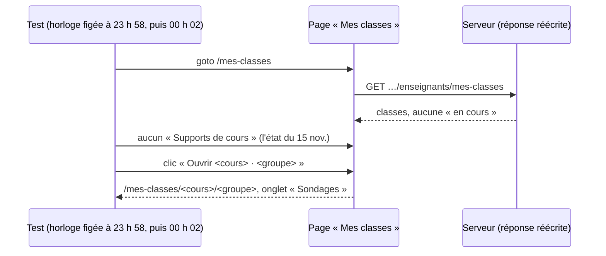

# Correctif : le parcours `sondage.spec.cjs` échoue vers minuit UTC · plan court

| | |
|---|---|
| Module | QUA · correctif de test, sans chantier ([fiche de mission](../../plan/missions/fix-sondage-minuit.md), sur `doc/coordination-equipe`) |
| Branche | `fix/sondage-minuit`, depuis `origin/main` (`bb8973c1`) |
| Rédigé par | Claude Code (Opus 5.5), le 18 novembre 2026 |
| **Validé** | en attente · par **le coordinateur** si seuls les tests changent (c'est le cas de ce plan) |

## 1. La cause

**Le parcours ne dépend pas de minuit. Il dépend de la fin de la séance du jour, à 23 h 55.**

- `frontend/tests/parcours/donnees.mjs` (lignes 47 à 61) crée **une seule fois**, à la préparation de la base, une séance « aujourd'hui » de **00 h 05 à 23 h 55**, à l'heure de l'école (UTC+0). La date est celle du moment de la préparation.
- Le **serveur** décide quelle classe est « en cours », avec sa propre horloge : `backend/services/planning/mesClasses.js`, lignes 19 et 96 (`en_cours: date === jour && minutes(debut) <= minutes(heure)`). Une séance finie (ligne 86) ou d'un jour passé (ligne 83) n'est plus « en cours ».
- Le bouton « Supports de cours » n'existe que dans le bloc de la classe en cours : `frontend/src/components/mesClasses/SeanceEnCours.jsx`, ligne 44.
- **La ligne du parcours qui dépend de l'heure** : `sondage.spec.cjs`, ligne 22, `getByRole("button", { name: "Supports de cours" }).first().click()`. Après 23 h 55, et toute la journée du lendemain, ce bouton n'existe pas : le test attend jusqu'à son délai de 3 minutes.

**L'application fait ce qu'elle doit** : une classe dont la séance est finie n'est plus « en cours ». Seuls les tests changent.

## 2. Ce que montrent les journaux de la CI du 15 nov.

| Run | Heures (UTC) | Échecs |
|---|---|---|
| `doc/qje-04-relecture`, `doc/diagramme-architecture`, `etude/odoo-essai`, 1re tentative | 23:46 → 00:03 | `sondage`, à 23:56–23:59 (après 23:55, avant minuit) ; la relance de 7 h 30 passe |
| `etude/failles-erp-scolaires` (43776765702) | 23:48 → 00:17 | `appel` QR à 23:51 ; `entreRoles` « Mes classes » de 23:55 à 23:59 ; `espaceCours` de 00:00 à 00:05 ; `sondage` de 00:10 à 00:16 |
| `feat/uix-06a-interface` (43775905844) | 23:38 → 23:52 | `personnes.spec` seulement : **sans rapport** avec l'heure |

Les échecs ont deux formes :
- de 23 h 55 au lendemain : **« Supports de cours » introuvable**. C'est la même ligne dans `entreRoles` (86), `espaceCours` (25) et `sondage` (22) ;
- de 23 h 50 à 23 h 55 : **deux boutons « Faire l'appel »** (`appel.spec.cjs`, ligne 44). Dans les 5 dernières minutes de la séance, le rappel ajoute le sien (`MesClasses.jsx`, `RAPPEL_MINUTES = 5`).

## 3. Le précédent de #162

#162 corrigeait un **vrai défaut de l'application** : le dimanche était masqué dans l'emploi du temps (`EnhancedTimetable.jsx`, `utils/semaine.js` et son test). Les parcours qui ont croisé minuit pendant sa CI ont seulement été **relancés** (`e648c02e`), sans correctif. Le précédent utile est ailleurs : `appel.spec.cjs`, ligne 22, fige déjà l'horloge du navigateur à 23 h 30 UTC (`page.clock.setFixedTime`) pour tester un cas d'heure sans attendre.

## 4. Le correctif

1. **Ouvrir la classe par sa carte**, au lieu du bloc « en cours ». Le bouton « Ouvrir {cours} · {groupe} » (`CarteClasse.jsx`, ligne 19) existe pour toute classe de l'enseignante, à toute heure : la liste couvre 120 jours en arrière et 180 en avant (`mesClasses.js`, lignes 21-22). Le nom de la classe vient de `lireDonnees().seance` (`cours`, `groupe`), sans rien écrire en dur. L'adresse attendue accepte `?onglet=…`, que la carte ajoute quand un appel est ouvert.
2. **Rien d'autre ne dépend du jour** dans le sondage. Un sondage sans date de fin reste ouvert (`shared/sondages.js`, ligne 44), et l'étudiante ouvre `/mes-cours/<cours>/<groupe>` directement.
3. **Test de régression**, dans `sondage.spec.cjs` : « ouvrir la classe après la séance du jour », joué à **23 h 58** (le jour de la séance) et à **00 h 02** (le lendemain), sans attendre :
   - l'horloge du navigateur est figée à cet instant (`page.clock.setFixedTime`), comme dans `appel.spec.cjs` ;
   - la réponse du serveur à `GET …/enseignants/mes-classes` (`enseignantAPI.mesClasses`, `services/api.js`, ligne 221) est **réécrite** (`page.route`) comme le serveur la rend à cette heure : aucune classe en cours (`en_cours: false`, `prochaine_seance: null`). On ne peut pas déplacer l'horloge du serveur depuis le test sans toucher `serveur.mjs` ou le serveur lui-même ;
   - le test vérifie d'abord l'état qui faisait échouer : **aucun** « Supports de cours ». Ensuite, l'ouverture par la carte mène à l'espace de la classe et à l'onglet « Sondages ».

   Ce test échoue avec l'ancienne façon d'ouvrir la classe et passe avec la nouvelle.

## 5. Les autres parcours de même cause : à trancher avant d'y toucher

| Parcours | Même cause ? | Correctif possible | Proposition |
|---|---|---|---|
| `espaceCours.spec.cjs`, ligne 25 | oui, même ligne | la carte, comme pour le sondage | **l'inclure** (question 1) |
| `entreRoles.spec.cjs`, ligne 86 | oui | aucun par la carte : ce test vérifie justement le bouton « Supports de cours » de la classe en cours | à part (question 2) |
| `appel.spec.cjs`, lignes 32 et 44 | oui (23 h 50 → 23 h 55 : rappel ; ensuite, plus de séance en cours) | aucun par la carte : l'appel n'existe que pour la séance **du jour**, en cours | à part (question 2) |
| `appelClasse.spec.cjs`, lignes 24 et 47 | oui, mêmes lignes (il est passé le 15 nov. parce qu'il a tourné à 23:52) | la carte ne suffit pas : l'appel de la classe est celui de la séance du jour | à part (question 2) |

Ces quatre derniers tests ont besoin d'une séance **en cours au moment où ils tournent**. La correction est dans les données des parcours (`donnees.mjs`), pas dans la façon de naviguer. Les pistes : une séance créée à l'heure du test, ou une séance du lendemain en plus. Mais `donnees.mjs` sert à tous les parcours (séances du jour, mois publiés, comptes), donc c'est un correctif à part, avec son propre plan.

## 6. Fichiers

| Fichier | Changement |
|---|---|
| `frontend/tests/parcours/sondage.spec.cjs` | ouverture par la carte (lignes 20 à 24) ; test de régression à 23 h 58 et à 00 h 02 |
| `frontend/tests/parcours/outils.cjs` | **si la question 1 est « oui »** : une fonction `ouvrirClasse(page, seance)`, partagée par `sondage` et `espaceCours`. Sinon, elle reste dans `sondage.spec.cjs` |
| `frontend/tests/parcours/espaceCours.spec.cjs` | **si la question 1 est « oui »** : ouverture par la carte (lignes 24 à 26) |
| `docs/plan/suivi.md`, fiche de session | à la fin |

Rien dans `frontend/src/`, `backend/`, `donnees.mjs` ni `serveur.mjs`.

## 7. Vérifié par

- Les parcours tournent dans la CI de la PR (aucun serveur lancé en local) : `sondage` (les deux tests) et, si la question 1 est « oui », `espaceCours`, verts.
- Le test de régression passe avec le correctif. Pour l'échec avant correctif, deux preuves possibles (question 3) : le journal du 15 nov., qui montre l'échec à cette ligne et à ces heures, ou un commit d'essai qui remet l'ancienne ligne 22 et que l'on retire ensuite.
- `npx eslint tests/parcours/sondage.spec.cjs` (et `espaceCours`, `outils.cjs`) sans erreur.

## 8. Questions

| N° | Question | Proposition | À qui |
|---|---|---|---|
| 1 | Corriger aussi `espaceCours.spec.cjs` (même ligne, même correctif) sur cette branche, avec `ouvrirClasse` dans `outils.cjs` ? | **oui** : sans lui, la CI reste rouge après 23 h 55 | coordinateur |
| 2 | `entreRoles` (ligne 86), `appel` et `appelClasse` : un correctif à part, dans les données des parcours (`donnees.mjs`), avec son propre plan ? | **oui**, mission séparée ; d'ici là, relancer leur CI quand elle a tourné entre 23 h 50 et minuit passé | coordinateur |
| 3 | La preuve « rouge avant le correctif » : un commit d'essai poussé puis retiré, ou seulement le raisonnement et le journal du 15 nov. ? | le journal du 15 nov. suffit : il montre déjà l'échec à cette ligne et à ces heures. Pas de commit d'essai | coordinateur |
