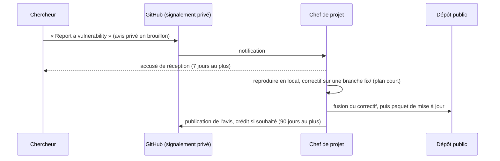

# QUA-08 · `SECURITY.md` et signalement privé des failles — conception

<!-- Plan court : un fichier de documentation et un réglage du dépôt, aucun code. -->

| | |
|---|---|
| Module | [QUA](../../plan/modules/QUA-qualite-docs.md) · chantier fermé le 2026-11-15 ; **hors chantier, accord du chef le 2026-11-16** |
| Branche | `doc/qua-08-security` |
| Rédigé par | Claude Code (Opus 5.5), le 2026-11-16 |
| **Validé** | par Claude20022002 le 2026-11-16 |

## 1. Objet et critère de « terminé »

Dire publiquement comment signaler une faille de Planner, et ce que l'équipe promet en retour. Décisions du chef du 15 novembre (inscrites dans `decisions.md` par la PR #186) : un `SECURITY.md`, le signalement privé de GitHub ouvert sur le dépôt, un accusé de réception sous **7 jours**, un correctif ou un avis publié sous **90 jours au plus**.

Critère du module : `SECURITY.md` est sur `main` et promet ces deux délais ; le chef a ouvert le signalement privé dans les réglages du dépôt.

On le vérifie ainsi :
- l'onglet *Security* du dépôt affiche la politique et le bouton « Report a vulnerability » ;
- `gh api repos/Claude20022002/Planner/private-vulnerability-reporting` répond `{"enabled":true}`. Le 16 nov., il répond `false`.

## 2. Ce qui existe

- Aucun `SECURITY.md` : ni à la racine, ni dans `.github/`, ni dans `docs/`.
- Signalement privé de GitHub **fermé** sur le dépôt (API, 16 nov.).
- `README.md`, § « Sécurité » : les protections en place (sessions, CSRF, comptes, droits, services internes, IA, secrets). Il ne dit pas comment signaler une faille.
- Ce que l'étude 09 a appris (§ 5, corrigé le 16 nov.) : ni OpenEduCat ni Frappe Education n'ont de `SECURITY.md`. Frappe renvoie à un courriel depuis `frappe/frappe` seulement, et promet une réponse sous 10 à 15 jours. Un chercheur qui trouve une faille dans Education ne sait pas où écrire. C'est ce manque que QUA-08 évite à Planner.
- Dépôts liés, chacun séparé : le fork de ClassQuiz (`Claude20022002/ClassQuiz`) et StudyLib.

## 3. Questions et réponses

| N° | Question | Proposition | Réponse du chef | Bloque |
|---|---|---|---|---|
| 1 | Quel canal de signalement ? | Le signalement privé de GitHub seul | **Le site du SaaS**, qui n'existe pas encore (VIT). En attendant, le signalement privé de GitHub ; quand le formulaire du site existe, `SECURITY.md` y renvoie, et GitHub **reste ouvert** à côté. Le formulaire est une catégorie « faille de sécurité » du contact de **VIT-02**, traitée en privé (chef, 16 nov.) | réglé |
| 2 | En quelle langue ? | En français, avec en tête un court résumé en anglais (canal et délais) | retenu (chef, 16 nov.) | réglé |
| 3 | Quelles versions sont couvertes ? | La branche `main` et le dernier paquet de mise à jour publié. Il n'y a pas encore de versions numérotées | retenu (chef, 16 nov.) | réglé |
| 4 | Quels dépôts ? | Ce dépôt seulement. Le fork de ClassQuiz et StudyLib auront leur propre fichier, plus tard, hors de QUA-08 | retenu (chef, 16 nov., à la validation) | réglé |
| 5 | Règles d'essai pour le chercheur ? | Essayer **seulement sur une installation à soi**, en local, avec des données fictives. Toute installation d'une école est hors périmètre. Pas de déni de service, pas d'ingénierie sociale. C'est la règle que Planner s'applique chez les autres (étude 09) | retenu (chef, 16 nov.) | réglé |
| 6 | Crédit public ? | Oui, dans l'avis publié, si la personne le souhaite | retenu (chef, 16 nov., à la validation) | réglé |
| 7 | Qui répond aux signalements ? | Le chef de projet, qui reçoit les notifications de GitHub. Un agent d'IA peut préparer l'analyse et le correctif, comme pour tout correctif | retenu (chef, 16 nov., à la validation) | réglé |

## 4. Solution

Un fichier `SECURITY.md` à la racine : GitHub l'affiche dans l'onglet *Security* et le propose à qui ouvre un ticket. Le chef ouvre ensuite le signalement privé dans les réglages du dépôt. Le `README.md` renvoie au fichier depuis son § « Sécurité ».

Contenu prévu de `SECURITY.md`, une page au plus :
1. résumé en anglais (question 2) ;
2. comment signaler : le bouton « Report a vulnerability » de GitHub, jamais un ticket public ; une phrase annonce le formulaire du site, à venir (question 1) ;
3. ce qu'on promet : accusé de réception sous 7 jours, correctif ou avis publié sous 90 jours au plus ;
4. versions et dépôt couverts (questions 3 et 4) ;
5. règles d'essai (question 5) ;
6. ce qu'il faut joindre : description, étapes pour reproduire, version ou commit, impact ;
7. crédit (question 6).



## 5. Fichiers créés ou modifiés

| Fichier | Créé / modifié | Rôle | Taille visée |
|---|---|---|---|
| `SECURITY.md` | créé | politique de signalement | 60 lignes au plus |
| `README.md` | modifié | une ligne dans le § « Sécurité » vers `SECURITY.md` | +1 ligne |
| `docs/plan/modules/QUA-qualite-docs.md` | modifié | QUA-08 dans « Ce qui existe » | +1 ligne |
| `docs/plan/suivi.md` | modifié | état de QUA-08, ligne hors chantier | — |

Réglage, fait par le chef seul : dans les réglages de sécurité du dépôt (*Settings*), la ligne *Private vulnerability reporting* → *Enable*. Ou, avec son compte :

```powershell
gh api -X PUT repos/Claude20022002/Planner/private-vulnerability-reporting
```

## 6. Données et migration

Aucune.

## 7. Sécurité, isolation et exigences produit

- Le fichier ne donne **aucune adresse de serveur, aucun nom d'école, aucun courriel personnel** (dépôt public, décision du 7 nov.).
- Il ne promet pas plus que ce que le chef a décidé : pas de prime, pas de délai plus court.
- Il complète EP-13 (« aucun envoi caché ») : les deux disent publiquement ce que Planner s'engage à faire.

## 8. Tests

Aucun test automatique : c'est de la documentation. Contrôles :
- `node scripts/verifier-neutre.mjs` ;
- relecture du rendu sur GitHub après le push ;
- l'appel d'API du § 1, après le réglage du chef.

## 9. Étapes de livraison

1. Ce plan, validé par le chef, commité seul ; `suivi.md` à « en cours ».
2. `SECURITY.md`, la ligne du `README.md`, le module et `suivi.md`, en un commit.
3. Le chef pousse la branche et ouvre la PR, puis ouvre le signalement privé dans les réglages.
4. Fusion par le chef : QUA-08 « fait ».

## 10. Risques et retour arrière

- **Promesse non tenue** : 7 jours suppose que le chef lise les notifications de GitHub. Si ce n'est pas tenable, on change le délai dans `decisions.md` et dans le fichier, avant de fusionner.
- **Signalement envoyé en ticket public** malgré tout : le chef le masque, ouvre un avis privé et prévient l'auteur.
- Retour arrière : supprimer le fichier et refermer le réglage. Aucun effet sur le code.

## 11. Hors périmètre

- `SECURITY.md` du fork de ClassQuiz et de StudyLib.
- Le formulaire de signalement du site : il est dans VIT-02. Quand il existe, une ligne de `SECURITY.md` change pour y renvoyer.
- Courriel de sécurité, prime aux chercheurs, numéro CVE propre.
- Le test d'intrusion (EXP-08) et les tests d'isolation (PLA-04).
