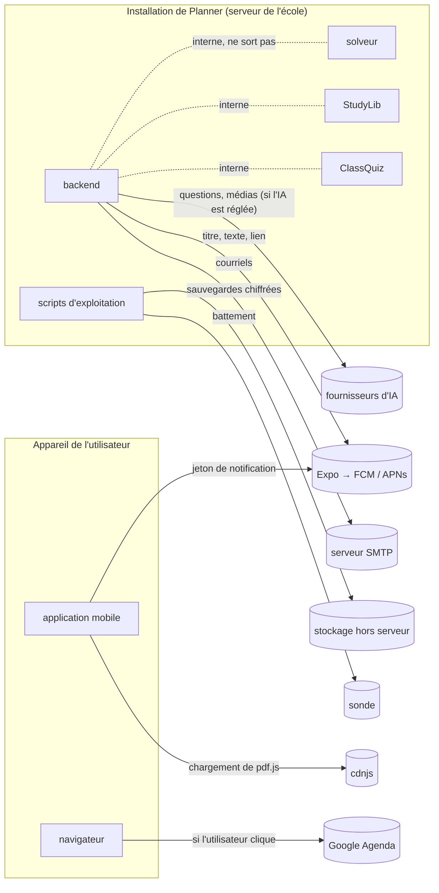

# QUA-09 · Liste publique des envois sortants — conception

| | |
|---|---|
| Module | [QUA](../../plan/modules/QUA-qualite-docs.md) · hors chantier, accord du chef le 16 nov. 2026 |
| Branche | `doc/qua-09-envois-sortants` (empilée sur `doc/qua-08-security`, elle-même empilée sur #186) |
| Rédigé par | Claude Code (Opus 5.5), le 2026-11-16 |
| **Validé** | par Claude20022002 le 2026-11-16 ; § 2 et question 8 corrigés le même jour, **revalidés** par lui le 2026-11-16 |

## 1. Objet et critère de « terminé »

Exigence **EP-13 « Aucun envoi caché »** (décision du 15 nov., [decisions.md](../../plan/decisions.md)) : une liste publique des envois sortants de Planner (destinataire, données envoyées, raison), tenue à jour ; toute PR qui ajoute un envoi sortant la met à jour. Elle répond à l'étude 09 : OpenEduCat envoie chaque jour des données de l'école à son éditeur, par une tâche masquée.

Critère du module : *chaque envoi sortant trouvé dans le code (clients HTTP, SMTP, SDK de services) figure dans la liste ; le modèle de PR demande si la PR en ajoute un.*

Précisé ici. À la fin :
- un fichier public liste **tous** les envois trouvés au § 2, chacun avec : ce qui le déclenche, le destinataire (et le réglage qui le change), les données qui partent, la raison, comment l'éteindre, le fichier du code ;
- il dit aussi ce qui **n'envoie rien** alors qu'on pourrait le croire (télémétrie coupée) et ce qui **n'a pas été relu** (les forks) ;
- le modèle de PR a une case « envoi sortant » ;
- le `README.md` et `SECURITY.md` pointent vers la liste.

Vérification : relecture du § 2 contre le code au moment du commit (recherche de `fetch(`, `nodemailer`, `Expo`, `curl`, `rclone`, adresses `https://` dans `backend/`, `frontend/src/`, `mobile/src/`, `solver/`, `deploy/`, `scripts/`) ; chaque résultat est dans la liste ou explicitement écarté (appel interne entre conteneurs).

## 2. Ce qui existe

Lu dans le code le 16 nov. 2026, branche `doc/qua-08-security`. Aucune liste n'existe ; le module QUA en donne un résumé (ligne « Envois sortants »).

**Depuis le serveur de Planner (`backend/`)**

| Envoi | Fichier | Actif quand | Destinataire par défaut | Données qui partent |
|---|---|---|---|---|
| Questions générées par l'IA (quiz et Studio) | `services/ia/client.js:13-34`, appelé par `services/ia/quiz.js` et `services/studio/iaGeneration.js` | seulement si `IA_CLE` et un modèle sont réglés (`estConfigure`, `:32`) ; sinon erreur 503, rien ne part | `api.deepseek.com` ; `api.anthropic.com` si `IA_FOURNISSEUR=anthropic` ; `IA_URL` le change | sujet, texte du support déposé par l'enseignant, transcription d'un média, énoncés déjà présents (50 au plus), étiquettes du quiz (`iaGeneration.js:84-101,137-138`) |
| Images, voix, transcription par l'IA (Studio) | `services/studio/iaFournisseurs.js:18-20,36-39,66-96` | seulement si clé, modèle et adresse sont réglés pour cette nature (`mediaConfigure`) | `api.openai.com` | consigne d'image ; texte à lire ; fichier audio ou vidéo de l'enseignant à transcrire |
| Notifications push de l'application | `services/push.js:25,92-110`, déclenché par **chaque** notification créée (`models/definitions.js:620`) | **toujours**, dès qu'un téléphone a enregistré son jeton ; seul `PUSH_DISABLED=true` coupe | service Expo, qui relaie à FCM (Google) et APNs (Apple) | jeton du téléphone, titre (120 caractères) et texte (240) de la notification, lien. Les textes peuvent nommer une personne et donner un motif : absence d'un enseignant avec son motif (`planning/imprevus.js:90-100`), demande de changement de téléphone avec son motif (`presences/changementTelephone.js:55`), titres d'annonces, cours, salles |
| Courriels | `utils/sendEmail.js:11-36,69-125` | seulement si `EMAIL_USER` ou `SMTP_USER` est réglé (`:83`) ; sinon le courriel est écrit dans le journal du serveur | `smtp.gmail.com` si `SMTP_HOST` est vide ; Gmail si `EMAIL_SERVICE=gmail` | adresse et nom du destinataire, liens secrets d'invitation et de réinitialisation du mot de passe (`services/comptes.js:13-23`, `controllers/authController.js:625-640`), corps des annonces et nom de leur auteur, emplois du temps, reports et annulations |

Appels **internes** à l'installation, à écarter de la liste avec une phrase : solveur (`services/generation/timefold/solveurClient.js`, `http://solver:8080`), StudyLib (`services/cours/studylib.js`, `http://studylib:8080/api`), ClassQuiz (`services/quiz/clientClassQuiz.js`, `services/studio/mediasClassQuiz.js`, `QUIZ_API_INTERNE`).

**Depuis l'appareil de l'utilisateur (navigateur, téléphone)**

| Envoi | Fichier | Destinataire |
|---|---|---|
| Jeton de notification du téléphone | `mobile/src/push.js:31-33` (`getExpoPushTokenAsync`) | Expo |
| Lecteur de PDF de l'application : script pdf.js chargé à l'ouverture d'un document | `mobile/src/documents/Lecteur.jsx:15,35` | `cdnjs.cloudflare.com` (avec contrôle d'intégrité), sur Android seulement ; le document reste sur le téléphone (`Lecteur.jsx:1-12,43-50`) |
| Bouton « Google Agenda » de l'abonnement à l'emploi du temps | `frontend/src/components/agenda/AbonnementAgenda.jsx:11-12` | `calendar.google.com` reçoit l'**adresse secrète** du flux ICS personnel (`/api/agenda/<jeton>.ics`, lisible sans connexion, `backend/routes/agendaRoutes.js:11`) ; Google lit ensuite l'emploi du temps. Seulement si l'utilisateur clique |

Aucune police ni script tiers dans `frontend/index.html` ni dans `frontend/src` (recherche de `fonts.googleapis`, `@import url`, adresses externes).

**Depuis l'exploitation (`deploy/vps/`)**

| Envoi | Fichier | Destinataire |
|---|---|---|
| Sauvegardes chiffrées (gpg à clé publique) : bases de Planner, de la bibliothèque et du quiz, documents de la bibliothèque, images des quiz | `sauvegarde-commun.sh:46-53`, `sauvegarder.sh:5-14` | destination rclone, Backblaze B2 aujourd'hui |
| Battement de la sonde après chaque sauvegarde | `sauvegarde-commun.sh:17-18,39-43` | adresse `BATTEMENT` du service de sonde (ME-21) ; rien si vide |

**Ce qui n'envoie rien** : télémétrie coupée dans `docker-compose.yml` (Meilisearch `MEILI_NO_ANALYTICS: "true"`, lignes 329 et 448 ; `quiz-api` `TELEMETRY_ENABLED: "false"`, ligne 355), reprise par la surcharge `deploy/vps/docker-compose.vps.yml`. Sentry n'est qu'un commentaire. Les images arrivent par `docker save | docker load` : le serveur ne tire rien.

**Non relu** : le code des forks de ClassQuiz et de StudyLib, et les images MinIO et Redis. Les certificats sont tenus par le Traefik de n8n, pas par Planner.

**Ce qui gêne** (constats, pas corrigés dans QUA-09 ; la liste les dit tels quels) :
- **Destinations implicites** : l'IA et le courriel n'envoient rien sans clé ou compte réglé. Mais une fois la clé ou le compte réglé, la destination par défaut est DeepSeek (texte de l'IA), OpenAI (médias) ou `smtp.gmail.com` (courriel), si personne n'a donné d'adresse. *Corrigé le 16 nov. : la première version de ce plan disait à tort que ces envois partaient sans réglage.*
- **Push actif sans réglage** : chaque notification part chez Expo, avec un texte qui peut nommer une personne et donner un motif d'absence.

## 3. Questions et réponses

| N° | Question | Proposition | Réponse du chef | Bloque |
|---|---|---|---|---|
| 1 | Où et sous quel nom ? | `docs/envois-sortants.md`, lié depuis le `README.md` et `SECURITY.md` | retenu (chef, 16 nov.) | réglé |
| 2 | En quelle langue ? | Comme `SECURITY.md` : en français, avec en tête un court résumé en anglais | retenu (chef, 16 nov.) | réglé |
| 3 | Quel périmètre ? | Le code de ce dépôt (serveur, site, mobile, solveur, exploitation) et les réglages de nos fichiers compose. Les forks de ClassQuiz et de StudyLib sont cités comme « non relus » ; leur relecture est une tâche à part | retenu (chef, 16 nov.) | réglé |
| 4 | Les envois depuis l'appareil (jeton Expo, pdf.js, bouton Google Agenda) entrent-ils dans la liste ? | Oui, dans une section à part : ils partent de chez l'utilisateur, pas du serveur, mais ils sortent de Planner | retenu (chef, 16 nov., avec le périmètre) | réglé |
| 5 | Les trois valeurs par défaut (Gmail, DeepSeek, OpenAI) | La liste les écrit telles quelles. Les changer est du code : une fonction à part, à inscrire (par exemple « aucun envoi sans réglage explicite »), hors de QUA-09 | retenu (chef, 16 nov.) : inscrite comme **QUA-10** | réglé ; portée précisée par la question 8 |
| 8 | Après correction du § 2 : que couvre QUA-10 ? | Deux points : (a) **aucune destination implicite** : une clé ou un compte sans adresse n'envoie rien, et le journal le dit ; (b) **push** : le contenu envoyé à Expo est réduit par défaut (titre générique, le détail s'ouvre dans l'application), ou le push devient à activer par l'école. Le choix entre les deux se fait dans le plan de QUA-10. La liste de QUA-09 décrit l'état d'aujourd'hui | retenu (chef, 16 nov.) : (a) et (b) | réglé |
| 6 | Un contrôle automatique (script qui signale un nouvel appel externe absent de la liste) ? | Pas dans QUA-09 : la case du modèle de PR suffit pour une S. Le script peut devenir une fonction QUA à part | retenu (chef, 16 nov.) | réglé |
| 7 | Qui valide ? | Le chef : le texte est public et sert l'argument de la loi 09-08 | le chef, qui a validé le plan le 16 nov. | réglé |

## 4. Solution

Un fichier de documentation, sans code. Il décrit les flux ; le modèle de PR oblige à le tenir à jour.

Forme d'une entrée de la liste : **Envoi** · **Déclenché par** · **Destinataire** (par défaut, et réglage) · **Données qui partent** (lues dans l'appelant, pas supposées) · **Raison** · **Comment l'éteindre** · **Code**.

## 5. Fichiers créés ou modifiés

| Fichier | Créé / modifié | Rôle | Taille visée |
|---|---|---|---|
| `docs/envois-sortants.md` | créé | la liste (§ 4) | 150 lignes au plus |
| `.github/pull_request_template.md` | modifié | une case : « Cette PR n'ajoute aucun envoi sortant, ou elle met à jour `docs/envois-sortants.md` » | + 1 ligne |
| `README.md` | modifié | un lien vers la liste, à côté de celui de `SECURITY.md` | + 1 ligne |
| `SECURITY.md` | modifié | une phrase et le lien | + 1 ligne |
| `docs/plan/modules/QUA-qualite-docs.md`, `docs/plan/suivi.md` | modifiés | état de QUA-09, « Ce qui existe » | — |

## 6. Données et migration

Aucune.

## 7. Sécurité, isolation et exigences produit

- **EP-13** : c'est l'objet.
- Le fichier ne contient ni secret, ni adresse de sonde, ni nom de compte : seulement les noms des réglages (`IA_URL`, `BATTEMENT`…). `node scripts/verifier-neutre.mjs` passe.
- Il ne promet rien que le code ne tienne : chaque ligne cite son fichier. Les valeurs par défaut qui envoient chez un tiers sont dites, pas cachées.
- Aucun canal d'isolation touché.

## 8. Tests

Pas de test automatique (documentation). Vérification à la main décrite au § 1, faite juste avant le commit, et notée dans la fiche de session.

## 9. Étapes de livraison

1. Conception (ce document) validée ; `suivi.md` et le module : QUA-09 « en cours ».
2. Lire chaque appelant pour écrire la colonne « données qui partent » ; écrire `docs/envois-sortants.md`.
3. Modèle de PR, `README.md`, `SECURITY.md`.
4. Relecture contre le code (§ 1), `verifier-neutre`, fiche de session.

## 10. Risques et retour arrière

- **La liste vieillit** : la case du modèle de PR est le seul garde-fou (question 6).
- **Une donnée oubliée** dans un envoi (par exemple un nom d'élève dans le texte d'une notification) : la colonne « données » se lit dans les appelants, pas dans le client seul.
- Retour arrière : supprimer le fichier et les trois lignes.

## 11. Hors périmètre

- Supprimer les destinations implicites (Gmail, DeepSeek, OpenAI) et réduire le contenu du push : **QUA-10** (questions 5 et 8). Héberger pdf.js dans l'application : à décider avec QUA-10.
- Relire le code des forks de ClassQuiz et de StudyLib.
- Le contrôle automatique (question 6).
- La page publique du site (VIT) qui reprendrait la liste.
