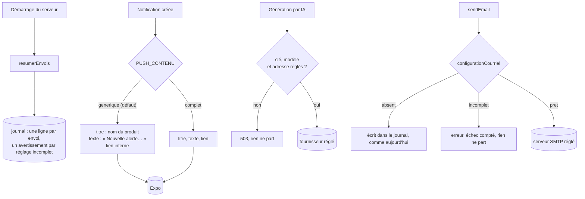

# QUA-10 · Aucun envoi implicite chez un tiers — conception

| | |
|---|---|
| Module | [QUA](../../plan/modules/QUA-qualite-docs.md) · hors chantier, accord du chef le 16 nov. 2026 (plan seulement) |
| Branche | `feat/qua-10-envois-explicites` (part de `main`) |
| Rédigé par | Claude Code (Opus 5.5), le 2026-11-16 |
| **Validé** | en attente |

## 1. Objet et critère de « terminé »

Exigence **EP-13 « Aucun envoi caché »**. La liste publique des envois sortants (QUA-09, `docs/envois-sortants.md`) décrit deux défauts, que QUA-10 corrige (décision du 16 nov., question 8 du plan de QUA-09) :
- (a) **destinations implicites** : une clé d'IA ou un compte de courriel réglé **sans adresse** envoie chez DeepSeek, OpenAI ou `smtp.gmail.com` ;
- (b) **push** : chaque notification part chez Expo avec son titre et son texte, qui peuvent nommer une personne et donner un motif d'absence.

Critère du module : *une clé ou un compte sans adresse n'envoie rien, et le journal le dit ; aucun nom de personne ni motif ne part chez Expo sans que l'école l'ait choisi ; un test fige chaque point ; la liste des envois sortants est à jour.*

Précisé ici. À la fin :
- avec `IA_CLE` réglée et `IA_URL` vide (famille « compatible OpenAI »), `estConfigure()` est faux, la route répond 503 comme sans clé, et le démarrage du serveur écrit un avertissement qui nomme le réglage manquant ;
- même chose pour l'image, la voix et la transcription (`IA_<NATURE>_URL`) ;
- avec `SMTP_USER` (ou `EMAIL_USER`) réglé, `SMTP_HOST` vide et `EMAIL_SERVICE` différent de `gmail`, aucun transporteur n'est créé, rien ne part, et le journal le dit (au démarrage et à chaque courriel refusé) ;
- par défaut, ce qui part chez Expo est un texte **générique**, le même pour toutes les notifications ; le lien interne reste, pour ouvrir le bon écran ; le texte complet se lit dans l'application, servi par Planner ;
- le texte complet ne part chez Expo que si l'installation le demande par un réglage (question 3) ;
- `docs/envois-sortants.md` et `backend/.env.example` décrivent le nouvel état.

## 2. Ce qui existe

Lu dans le code le 16 nov. 2026, sur `main` (`bd934eb`).

**IA, texte** : `backend/services/ia/client.js:12-16` donne une adresse par défaut à chaque famille : `https://api.deepseek.com/v1` et le modèle `deepseek-chat` pour « openai-compatible » (la famille par défaut, `:19`), `https://api.anthropic.com/v1` sans modèle pour « anthropic ». `configuration()` (`:18-29`) prend `IA_URL || defauts.url`. `estConfigure()` (`:32-35`) n'exige que la clé, le modèle et une adresse, que le défaut fournit toujours. Le test `backend/tests/utils/iaClient.test.js:34` fige le défaut DeepSeek.

**IA, médias** : `backend/services/studio/iaFournisseurs.js:17-21` donne `https://api.openai.com/v1` aux trois natures ; `configurationMedia()` (`:23-34`) prend `IA_<NATURE>_URL || d.url`. Pas de modèle par défaut : la clé **et** le modèle sont exigés (`mediaConfigure`, `:36-39`), l'adresse ne l'est pas.

**Courriel** : `backend/utils/sendEmail.js` (396 lignes).
- `:83` : sans `EMAIL_USER` ni `SMTP_USER`, rien ne part ; le courriel est écrit dans le journal, contenu compris (`:84-88`).
- `:17-25` : `EMAIL_SERVICE=gmail` choisit Gmail **explicitement** (le réglage nomme la destination).
- `:28-36` : sinon, `host: process.env.SMTP_HOST || "smtp.gmail.com"` : c'est le défaut implicite.
- `:78-80` : en test (`NODE_ENV=test`), `sendEmail` rend la main avant toute configuration : le choix du transporteur n'est pas testable tel quel.

**Push** : `backend/services/push.js`.
- `:26` : actif sauf si `PUSH_DISABLED=true`.
- `:92-107` : `envoyerPush` envoie `title` (120 caractères), `body` (240) et `data: { lien }`.
- Déclenché par **chaque** notification créée (`backend/models/definitions.js:617-623`, `afterCreate`) ; les créations en lot passent `individualHooks: true` (`services/annonces/annonces.js:244,391`, `services/calendrier/envoiEdt.js:105`, `services/presences/rappelAppel.js:101`), donc elles partent aussi.
- Textes sensibles, par exemple : `services/planning/imprevus.js:91-92` (« X sera absent du … (motif) »), `services/presences/changementTelephone.js:55` (« X demande … Motif : … »), `services/annonces/annonces.js:243` (« Annonce : <titre> » et l'aperçu du corps).
- Le test `backend/tests/integration/push.test.js` (127 lignes) remplace le client Expo par un faux (`definirClientPush`) et lit ce qu'il reçoit : il servira.

**Application mobile** : un appui sur le push ouvre `ecranDeLien(data.lien)` (`mobile/src/app/_layout.jsx:57-58`, `mobile/src/alertes/liens.js:20-30`) ; l'écran des alertes lit le titre et le texte depuis Planner (`mobile/src/app/alertes.jsx:95`). Un push au texte générique ouvre donc toujours le bon écran, **sans changer l'application**.

**Nom affiché** : `nomProduit()` (`services/etablissement/identite.js`) rend « Planner » ou « <nom court> Planner », déjà utilisé par les courriels.

**Modèle de réglages** : `backend/.env.example:40-62` **préremplit** `IA_URL=https://api.deepseek.com/v1`, `IA_MODELE=deepseek-chat` et `SMTP_HOST=smtp.gmail.com`. Une installation qui copie ce fichier choisit donc ces destinations sans le voir.

**Démarrage** : `backend/server.js:40-56` applique les migrations, puis écoute ; c'est là qu'iront les avertissements.

**pdf.js** : `mobile/src/documents/Lecteur.jsx:15-41` charge pdf.js depuis cdnjs, avec contrôle d'intégrité, sur Android. Le document ne part pas ; cdnjs voit l'adresse IP et l'appareil.

## 3. Questions et réponses

| N° | Question | Proposition | Réponse du chef | Bloque |
|---|---|---|---|---|
| 1 | IA « anthropic » : choisir `IA_FOURNISSEUR=anthropic` désigne déjà la destination. Garde-t-on son adresse par défaut ? | Oui : le réglage nomme le fournisseur, l'envoi n'est pas implicite. Seule la famille « compatible OpenAI » (qui regroupe DeepSeek, Mistral, OpenAI, Groq…) exige `IA_URL`, et perd aussi son modèle par défaut `deepseek-chat` | | oui |
| 2 | Push : contenu réduit par défaut, ou push éteint tant que l'école ne l'a pas activé ? | **Contenu réduit par défaut.** Le push garde son rôle (prévenir d'un report), sans rien dire à Expo. L'éteindre priverait les élèves des alertes tant que personne n'y pense | | oui |
| 3 | Qui choisit le texte complet, et où ? | Un réglage de l'installation, `PUSH_CONTENU=complet` (défaut : `generique`), sans migration. Une seule école par installation aujourd'hui : l'école le demande, l'exploitant le règle. Un réglage dans le panneau de l'école viendra avec l'administration (ADM), s'il est demandé | | oui |
| 4 | Quel texte générique ? | Titre : le nom du produit (`nomProduit()`, par exemple « Planner ») ; texte : « Nouvelle alerte. Ouvrez l'application pour la lire. » Le lien interne reste (`/annonces/12`, `/gestion/imprevus`) : il ne contient qu'un numéro et le nom d'un écran | | oui |
| 5 | Courriel mal réglé (compte sans `SMTP_HOST`) : silence comme « non configuré », ou échec ? | **Échec** : `sendEmail` lève une erreur et compte l'échec (`noterEchecCourriel`, ME-21), comme un envoi qui ne passe pas. L'appelant le sait, la supervision aussi. Le contenu du courriel n'est **pas** écrit dans le journal (il peut contenir un lien secret) | | oui |
| 6 | `backend/.env.example` : vider `IA_URL`, `IA_MODELE` et `SMTP_HOST` ? | Oui : laissés vides, avec en commentaire des exemples d'adresses. Copier le modèle ne doit choisir aucun fournisseur | | non |
| 7 | pdf.js chargé depuis cdnjs : dans QUA-10 ? | **Non.** Le servir depuis l'application change l'application mobile (nouvelle version à publier) ; c'est une fonction MOB à part, à inscrire si vous le voulez. La liste des envois le dit déjà | | non |
| 8 | Avertissement au démarrage : seulement les réglages incomplets, ou un résumé de tous les envois actifs ? | Un résumé court : une ligne par envoi (« IA : DeepSeek », « courriel : désactivé », « push : texte générique »), plus une ligne d'avertissement par réglage incomplet. L'exploitant voit d'un coup d'œil ce qui sort | | non |

## 4. Solution

Trois changements, chacun avec son test.

1. **IA** : la famille « compatible OpenAI » n'a plus d'adresse ni de modèle par défaut ; les trois natures de médias n'ont plus d'adresse par défaut. `estConfigure()` et `mediaConfigure()` restent la seule porte : une adresse vide les rend faux, donc 503, comme aujourd'hui sans clé.
2. **Courriel** : le choix du transporteur sort de `sendEmail.js` dans une fonction pure, `configurationCourriel(env)`, qui rend `{ etat: "absent" | "incomplet" | "pret", options, manque }`. `sendEmail` s'en sert : « absent », comportement d'aujourd'hui ; « incomplet », erreur et échec compté ; « pret », envoi. La fonction pure se teste sans `NODE_ENV` ni nodemailer.
3. **Push** : `envoyerPush` passe par `contenuPush({ titre, message }, mode, produit)`, qui rend le texte générique ou le texte complet selon `PUSH_CONTENU`.

Enfin, une fonction `resumerEnvois()` lit les trois configurations et écrit le résumé au démarrage (question 8).

## 5. Fichiers créés ou modifiés

| Fichier | Créé / modifié | Rôle | Taille visée |
|---|---|---|---|
| `backend/services/ia/client.js` | modifié | plus d'adresse ni de modèle par défaut pour « openai-compatible » | ± 3 lignes |
| `backend/services/studio/iaFournisseurs.js` | modifié | plus d'adresse par défaut ; `mediaConfigure` exige l'adresse | ± 4 lignes |
| `backend/utils/configurationCourriel.js` | créé | choix du transporteur, fonction pure | 50 lignes au plus |
| `backend/utils/sendEmail.js` | modifié | utilise `configurationCourriel` ; `createTransporter` raccourci | net négatif (le fichier dépasse déjà 300 lignes ; on ne l'allonge pas) |
| `backend/services/push.js` | modifié | `contenuPush`, réglage `PUSH_CONTENU` | + 20 lignes |
| `backend/services/envois/resumeEnvois.js` | créé | résumé au démarrage (question 8) | 60 lignes au plus |
| `backend/server.js` | modifié | appelle `resumerEnvois()` | + 2 lignes |
| `backend/.env.example` | modifié | champs vidés, exemples en commentaire, `PUSH_CONTENU` | ± 10 lignes |
| `backend/tests/utils/iaClient.test.js` | modifié | le défaut DeepSeek disparaît ; adresse vide → non configuré | ± 10 lignes |
| `backend/tests/utils/configurationCourriel.test.js` | créé | les trois états, Gmail explicite | 80 lignes au plus |
| `backend/tests/utils/iaFournisseurs.test.js` | créé (il n'existe pas ; `studioQuiz.test.js` remplace les fournisseurs sans tester leur configuration) | adresse vide → non configuré | 40 lignes au plus |
| `backend/tests/integration/push.test.js` | modifié | Expo reçoit le texte générique par défaut, le texte complet avec `PUSH_CONTENU=complet` ; une absence avec motif ne laisse partir ni le nom ni le motif | + 30 lignes |
| `docs/envois-sortants.md` | modifié | nouvel état : plus de destination implicite, push générique | ± 10 lignes |
| `docs/plan/modules/QUA-qualite-docs.md`, `docs/plan/suivi.md` | modifiés | état de QUA-10 | — |

`docs/envois-sortants.md` n'est pas encore sur `main` (QUA-09 attend la fusion de #186 et #188). L'étape 6 se fait **après** la fusion de QUA-09, par une fusion de `main` dans cette branche.

## 6. Données et migration

Aucune. Les réglages sont des variables d'environnement.

**Effet sur une installation qui existe** : une installation qui comptait sur un défaut (clé d'IA sans `IA_URL`, compte SMTP sans `SMTP_HOST`) **cesse d'envoyer** après la mise à jour, et le journal dit pourquoi au démarrage. La note du paquet de mise à jour devra le dire, avec les deux lignes à ajouter au `.env`. Le push passe au texte générique sans action de l'exploitant.

## 7. Sécurité, isolation et exigences produit

- **EP-13** : c'est l'objet. Après QUA-10, chaque envoi chez un tiers vient d'un réglage qui nomme sa destination.
- **Données de mineurs** : les textes des notifications peuvent concerner des élèves (annonces, rappels). Par défaut, plus rien de ces textes ne part chez Expo.
- Le journal ne contient ni clé, ni mot de passe, ni contenu de courriel pour l'état « incomplet ». L'état « absent » garde son comportement d'aujourd'hui (le courriel entier est journalisé) : voir § 11.
- Aucun canal d'isolation touché ; aucun droit par rôle changé.

## 8. Tests

- `iaClient.test.js` : sans `IA_URL` (famille par défaut), `configuration().url` est vide et `estConfigure()` faux même avec une clé et un modèle ; `anthropic` garde son adresse (selon la question 1).
- `iaFournisseurs.test.js` : clé et modèle sans adresse → `mediaConfigure("image")` faux.
- `configurationCourriel.test.js` : rien de réglé → « absent » ; `SMTP_USER` sans `SMTP_HOST` → « incomplet », `manque: ["SMTP_HOST"]` ; `EMAIL_SERVICE=gmail` avec compte → « pret », service Gmail ; `SMTP_HOST` réglé → « pret », cet hôte.
- `push.test.js` : par défaut, le faux client Expo reçoit le titre générique, le texte générique et le lien ; une notification d'absence (nom et motif) ne laisse partir ni l'un ni l'autre ; avec `PUSH_CONTENU=complet`, il reçoit le titre et le texte.
- Suite serveur complète et parcours avant d'annoncer (règle du 29 octobre).

## 9. Étapes de livraison

1. Conception (ce document) validée par le chef ; `suivi.md` et le module : QUA-10 « en cours ».
2. IA : `client.js`, `iaFournisseurs.js` et leurs tests.
3. Courriel : `configurationCourriel.js`, `sendEmail.js` et le test.
4. Push : `contenuPush`, `PUSH_CONTENU` et le test.
5. `resumeEnvois.js`, `server.js`, `.env.example`.
6. Après la fusion de QUA-09 : fusion de `main`, mise à jour de `docs/envois-sortants.md`, suivi, fiche de session.

## 10. Risques et retour arrière

- **Une installation cesse d'envoyer des courriels ou de générer des questions** après la mise à jour : voulu, et annoncé au démarrage et dans la note du paquet. Retour : ajouter `SMTP_HOST` ou `IA_URL` au `.env`.
- **Le push générique est moins utile** (on ne lit plus « Séance reportée : Maths » sur l'écran verrouillé). Retour : `PUSH_CONTENU=complet`, si l'école le demande.
- **Le résumé au démarrage oublie un envoi** ajouté plus tard : la case du modèle de PR (QUA-09) demande déjà de mettre la liste à jour ; on y ajoute « et le résumé du démarrage ».
- Retour arrière complet : annuler les commits. Aucune donnée touchée.

## 11. Hors périmètre

- **pdf.js** servi depuis l'application (question 7) : fonction MOB à part.
- **Courriel « absent »** : aujourd'hui, sans compte réglé, `sendEmail` écrit le courriel entier dans le journal (`sendEmail.js:84-88`), liens secrets d'invitation et de réinitialisation compris. Ce n'est pas un envoi chez un tiers, mais un secret dans les journaux. Constat à traiter à part (QUA ou EXP), sur décision du chef.
- `EXPO_ACCESS_TOKEN` (sécurité renforcée d'Expo, `push.js:9-10`) : inchangé.
- Le réglage du push dans le panneau de l'école (question 3).
- Les forks de ClassQuiz et de StudyLib (non relus, voir QUA-09).
