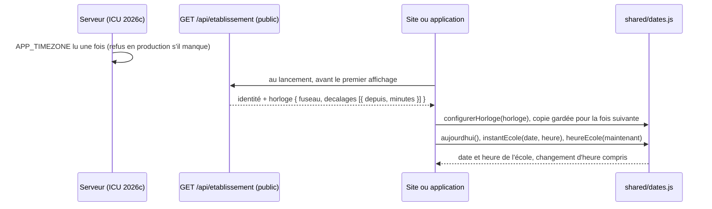

# M-10 · Le décalage horaire de l'école, rendu par le serveur — plan court

| | |
|---|---|
| Module | QUA · correctif hors chantier, décidé par le chef dans l'[étude EP-18](etude-ep18-faible-equipement.md) (branche `etude/ep18-faible-equipement` jusqu'à sa fusion) (§ 8, M-10 ; § 9.1, rang 1). Fiche : `docs/plan/missions/ep18-correctifs.md` (branche `doc/coordination-equipe`) |
| Branche | `fix/qua-decalage-ecole`, depuis `origin/main` (`b57753e9`) |
| Rédigé par | Claude Code (Opus 5.5), le 2026-11-22 |
| Taille | M, sans migration ni dépense |
| **Validé** | par le coordinateur, le 22 nov., avec les réponses 4 à 6 et les précisions 1 à 3 (§ 3) ; les réponses 1 à 3 sont celles du chef |

## 1. Objet et critère de « terminé »

**Le défaut** : le site et l'application calculent la date et l'heure de l'école avec un décalage **écrit en dur**, `DECALAGE_ECOLE_MINUTES = 0` (`shared/dates.js:13`). Dans une école à UTC+1, de minuit à 1 h, le site donne la date de la veille. Cela touche l'appel du jour, les échéances, « aujourd'hui » et la fin d'une séance. De son côté, le serveur prend `Africa/Casablanca` par défaut, recopié dans 13 fichiers, car `APP_TIMEZONE` n'est réglée nulle part (ni la CI, ni le Dockerfile, ni `.env.example`).

**Le principe** : **le serveur est la seule source de l'heure de l'école.** Il lit le fuseau de l'installation en un seul endroit, sans défaut de pays. Il calcule la table des décalages de ce fuseau, changements d'heure compris, avec sa propre base de fuseaux (`backend/tzdata/`, ICU 2026c). Il la rend dans la réponse publique `GET /api/etablissement`, que le site et l'application lisent déjà avant leur premier affichage. Ils ne demandent jamais le fuseau au navigateur ni au téléphone, dont la base peut être ancienne (raison écrite dans `shared/dates.js:6-9`).

**Critère de « terminé »** (fixé par la fiche) :
1. **Aucun fuseau ni pays en dur** dans `backend/`, `frontend/src`, `mobile/src` et `shared/` : plus de `"Africa/Casablanca"`, plus de `DECALAGE_ECOLE_MINUTES = 0`. Un test le vérifie (T-6).
2. **Un test de régression échoue à 23 h 30 UTC dans une école à UTC+1** sans le correctif (date de la veille), et passe avec lui (T-1). Le même test existe côté application (T-5).
3. **Le changement d'heure légale est tenu par le serveur** : la table rendue a la bonne transition au bon instant pour un fuseau à heure d'été (T-2). Le site et l'application placent une séance de part et d'autre de ce changement à la bonne heure (T-1).
4. En production, **le serveur refuse de démarrer sans `APP_TIMEZONE`**, avec un message clair (réponse 2, T-3).
5. La CI reste verte, les parcours compris, sans toucher au créneau du jour décidé le 18 nov. (#210).

## 2. Ce qui existe

| Quoi | Où | Pour M-10 |
|---|---|---|
| Le décalage figé, et les fonctions qui le lisent : `aujourdhui`, `dansJours`, `instantEcole` | `shared/dates.js:13`, `:18-19`, `:37-38` | **remplacé** par une table configurée au démarrage |
| 29 fichiers du site qui importent `shared/dates.js` | `frontend/src/…` (relevé de l'étude, § 7) | **inchangés** : les fonctions gardent leur nom et leur signature |
| L'heure du **téléphone** pour « aujourd'hui » et pour l'instant d'une séance | `shared/session.js:22-23` (`toLocalISODate`), `:25-30` (`combine`) ; `mobile/src/app/(onglets)/index.jsx:87` ; `mobile/src/semaine/GrilleSemaine.jsx:64` et `:139` ; `mobile/src/semaine/VueMois.jsx:53` ; `mobile/src/app/(onglets)/semaine.jsx` (début de semaine) | **corrigé** : « aujourd'hui » et l'instant d'une séance passent à l'heure de l'école. Le calcul de calendrier sur les dates reste tel quel |
| 13 lectures de `process.env.APP_TIMEZONE \|\| "Africa/Casablanca"` dans le serveur | `services/presences/appel.js:27`, `moteur/valeurs/lecture.js:11`, `calendrier/ics.js:30`, `calendrier/envoiEdt.js:22`, `planning/affectationRules.js:42`, `planning/mesClasses.js:18`, `planning/suivi.js:31`, `presences/rappelAppel.js:12`, `quiz/devoirs.js:240`, `quiz/parties.js:21`, `jeux/historique.js:16`, `generation/timefold/deploiement.js:21`, `controllers/statistiquesController.js:40` ; plus `tests/integration/helpers/heureLocale.js:7` | **une seule** lecture, dans `backend/config/fuseau.js` |
| La base de fuseaux du serveur | `backend/tzdata/LISEZMOI.md`, `backend/Dockerfile:44` | réutilisée : c'est elle qui calcule la table |
| L'identité publique, lue avant le premier affichage | `backend/services/etablissement/identite.js:41-53` ; site : `frontend/src/main.jsx:16`, `frontend/src/services/etablissement.js` (copie dans le navigateur) ; application : `mobile/src/ecole.js:43-50` (copie dans `AsyncStorage`) | **étendue** : un champ `horloge` |
| Les parcours supposent une école à UTC+0 | `frontend/tests/parcours/donnees.mjs:21` (`FUSEAU = "Africa/Casablanca"`) ; créneau 00 h 00–24 h 00 et séance du lendemain (#210) | la CI pose `APP_TIMEZONE=UTC`, et les données lisent la même variable. Le créneau ne bouge pas |
| Le test existant de la date de l'école | `frontend/src/utils/aujourdhui.test.js` (`node:test`) | **étendu** |

## 3. Questions et réponses

| N° | Question | Proposition | Réponse | Bloque |
|---|---|---|---|---|
| 1 | D'où vient le fuseau de l'école ? | de l'installation (`APP_TIMEZONE`), lu en un seul endroit, sans défaut de pays ; le fuseau choisi par chaque école vient plus tard (PLA-13 ou le panneau d'ADM-02) | **chef, 22 nov. : oui** | tout |
| 2 | Sans `APP_TIMEZONE` | en production, refuser de démarrer avec un message clair ; la CI et les tests la posent (UTC) ; le chef la pose sur le serveur avant le déploiement | **chef, 22 nov. : oui** | 1 |
| 3 | Le transport, par une route publique | dans la réponse publique existante `GET /api/etablissement` : le nom du fuseau et la table de ses décalages sur environ 13 mois ; aucune route nouvelle | **chef, 22 nov. : oui** | 2, 3 |
| 4 | Avant toute table (premier lancement sans réseau, sans copie) | le décalage du navigateur ou du téléphone, faute de mieux, plutôt que 0 ; la table remplace ce décalage dès qu'elle arrive. *(au coordinateur)* | **coordinateur, 22 nov. : oui**, jamais 0 | 3 |
| 5 | Hors production, sans `APP_TIMEZONE` | UTC, avec un avertissement au démarrage, pour qu'un poste de développement démarre sans fichier d'environnement. *(au coordinateur)* | **coordinateur, 22 nov. : oui** | 1 |
| 6 | Un parcours de régression dans le navigateur | oui, court : l'horloge figée à 23 h 30 UTC (`page.clock.setFixedTime`, comme `appel.spec.cjs`) et la réponse de `GET /api/etablissement` réécrite à UTC+1 ; la page de l'enseignant affiche alors la date du lendemain. Il ne change pas le fuseau de la CI. *(au coordinateur)* | **coordinateur, 22 nov. : oui**, sans toucher au créneau de #210 | 4 |
| 7 | *(ajoutée pendant le code)* Le **tableau de bord du site** a le même modèle mural : `frontend/src/components/dashboard/periodes.js:19-31` calcule « les jours suivants » et « la semaine en cours » à partir de `new Date()`, l'heure du navigateur | ajouter dans M-10 une seule ligne : la valeur par défaut `maintenant = maintenantEcole()` dans `periodes.js`, sans toucher aux blocs du tableau de bord (UIX-11). Sinon, une limite écrite et une suite, M-10b. *(au coordinateur)* | | 4 |

**Précisions du coordinateur (22 nov.)** :
1. `deploy/vps/generer-env.sh` écrit `.env.docker` : il demande le fuseau (un quatrième argument obligatoire) et pose `APP_TIMEZONE`. Le correctif de Meilisearch touche aussi ce script : celui qui fusionne en second fait d'abord `git merge origin/main`.
2. `DEPLOIEMENT.md` dit que `APP_TIMEZONE` fait partie de ce que le serveur doit avoir avant de déployer `main`, à côté des variables de QUA-10.
3. Les bâtiments « Stendhal » et « Gandhi » de `shared/session.js:33-40` vont à M-12 : M-10 n'y touche pas. Le commentaire de `calendrier/ics.js:46` est corrigé, puisque la ligne voisine change.

## 4. Solution

### 4.1 Le serveur

- **`backend/config/fuseau.js`** lit `APP_TIMEZONE` une fois et vérifie que c'est un nom de fuseau connu (`Intl.DateTimeFormat` lève une erreur sinon).
  - En production, une variable absente ou inconnue arrête le démarrage (`server.js`, comme les autres erreurs de démarrage, `:91-93`). Le message est : « APP_TIMEZONE manque : donnez le fuseau de l'école, par exemple Africa/Kinshasa ».
  - Hors production, voir la question 5.
  - Le module exporte `FUSEAU_ECOLE`, que lisent les 13 fichiers à la place de leur ligne.
- **`backend/services/etablissement/horloge.js`** est une fonction pure : `decalagesDe(fuseau, autour, jours)`. Elle rend `[{ depuis, minutes }]` : le décalage en vigueur à partir de chaque instant `depuis`, sur `jours` jours de part et d'autre de `autour` (400 par défaut).
  - Elle lit le décalage à chaque jour (`timeZoneName: "longOffset"` de `Intl`).
  - Elle cherche chaque changement à la minute, par dichotomie.
  - Un fuseau sans heure d'été rend une seule ligne. Un fuseau à heure d'été en rend trois ou quatre.
- **`identitePublique()`** gagne `horloge: { fuseau, decalages, calcule_le }`. La réponse reste publique et en cache 60 s (`etablissementRoutes.js:21`). Ce qu'elle ajoute se voit déjà à l'écran : l'heure de l'école. Elle pèse quelques centaines d'octets.

### 4.2 Le site et l'application

**`shared/dates.js`** :

| Fonction | Rôle |
|---|---|
| `configurerHorloge(horloge)` (nouvelle) | reçoit la table |
| `decalageA(instant)` (nouvelle) | le décalage en vigueur à cet instant : la dernière ligne dont `depuis` est passé, ou la première ligne pour un instant d'avant la table |
| `aujourdhui` | devient `instant + decalageA(instant)`, en UTC |
| `instantEcole(date, heure)` | se cale en deux pas : un instant d'essai, puis le décalage à cet instant. Il tient ainsi l'heure qui suit un changement |
| `heureEcole(instant)` (nouvelle) | rend `{ heures, minutes }` à l'école, pour l'application |

- **Le site** : `main.jsx` appelle `configurerHorloge(identite.horloge)` juste après `chargerIdentite()`. La copie du navigateur porte la table : un rechargement sans réseau garde la bonne date.
- **L'application** : `ecole.js` fait de même, au lancement, avec sa copie d'`AsyncStorage`.
  - **Amendement du 22 nov., écrit pendant le code et à revalider.** `combine()` de `shared/session.js` **ne change pas**. L'application et le tableau du site rangent les séances en dates « murales » : des `Date` construites dans le fuseau de l'appareil avec les chiffres de l'école (`shared/session.js:25-30`). Leurs heures se lisent par `getHours()` (`GrilleSemaine.jsx:66-67`), et leurs jours par `toLocalISODate(s.start)` (`VueMois.jsx:58`). Passer `combine()` à un instant réel, comme le prévoyait la première version, déplacerait toutes ces positions sur un téléphone d'un autre fuseau. **Seul « maintenant » est faux dans ce modèle.**
  - Une fonction de plus dans `shared/dates.js` : `maintenantEcole(instant)` rend « maintenant » dans le même modèle mural, c'est-à-dire une `Date` de l'appareil qui porte les chiffres de l'heure de l'école. Les sources de « maintenant » de l'application l'utilisent à la place de `new Date()` : le tableau (`app/(onglets)/index.jsx`), la grille et son minuteur (`GrilleSemaine.jsx:57-60`), le mois (`VueMois.jsx:53`) et le début de la semaine (`app/(onglets)/semaine.jsx`). Le reste des calculs ne change pas : ils comparent des dates murales entre elles.
  - `toLocalISODate` garde son rôle (une date de calendrier écrite en chiffres) et son nom.

## 5. Fichiers créés ou modifiés

| Fichier | Créé / modifié | Rôle | Taille |
|---|---|---|---|
| `backend/config/fuseau.js` | créé | `APP_TIMEZONE` lu et vérifié, `FUSEAU_ECOLE` | 40 |
| `backend/services/etablissement/horloge.js` | créé | table des décalages (fonction pure) | 70 |
| `backend/services/etablissement/identite.js` | modifié | `horloge` dans l'identité publique | +4 |
| `backend/server.js` | modifié | vérification du fuseau au démarrage | +3 |
| les 13 fichiers du serveur relevés au § 2, et `tests/integration/helpers/heureLocale.js` | modifiés | une ligne chacun : `FUSEAU_ECOLE` au lieu du défaut. Dans `calendrier/ics.js:46`, le commentaire ne nomme plus de pays | ±1 chacun |
| `backend/.env.example`, `.env.docker.example` | modifiés | `APP_TIMEZONE=` avec son commentaire (obligatoire en production, nom de fuseau) ; la ligne `TZ=Africa/Casablanca` de `backend/.env.example:13` est retirée | ±3 |
| `backend/jest.config.js` | modifié | `APP_TIMEZONE: 'UTC'` dans l'environnement des tests | +1 |
| `.github/workflows/ci-cd.yml` | modifié | `APP_TIMEZONE: UTC` dans l'environnement des tâches du serveur et des parcours | +2 |
| `frontend/tests/parcours/serveur.mjs`, `donnees.mjs:21` | modifiés | la variable posée à `UTC` si absente ; les données lisent la même variable | +1, ±1 |
| `shared/dates.js` | modifié | table au lieu de la constante ; `configurerHorloge`, `decalageA`, `heureEcole` | 55 → 90 |
| `shared/session.js` | **inchangé** (amendement du § 4.2) | — | — |
| `frontend/src/main.jsx` | modifié | `configurerHorloge` après `chargerIdentite` | +2 |
| `mobile/src/ecole.js` | modifié | `configurerHorloge` au lancement | +2 |
| `mobile/src/app/(onglets)/index.jsx`, `(onglets)/semaine.jsx`, `semaine/GrilleSemaine.jsx`, `semaine/VueMois.jsx` | modifiés | « maintenant » à l'heure de l'école, par `maintenantEcole()` (amendement du § 4.2) | ±1 à 3 chacun |
| `frontend/src/utils/aujourdhui.test.js` | modifié | T-1 | +60 |
| `backend/tests/utils/horloge.test.js` | créé | T-2, T-3, T-6 | 120 |
| `backend/tests/integration/identiteEcole.test.js` | modifié | T-4 | +15 |
| `mobile/__tests__/heureEcole.test.js` | créé | T-5 | 60 |
| `frontend/tests/parcours/horlogeEcole.spec.cjs` | créé si la question 6 est acceptée | P-1 | 50 |
| `docs/plan/modules/QUA-qualite-docs.md`, `PLA-plateforme.md` | modifiés | ligne de M-10 ; PLA-13 reprend le fuseau choisi par chaque école | +2 |
| `DEPLOIEMENT.md` | modifié | `APP_TIMEZONE` obligatoire | +2 |
| `deploy/vps/generer-env.sh`, `README.md:331` | modifiés | le fuseau en quatrième argument, obligatoire, écrit dans `.env.docker` ; l'usage mis à jour (précision 1) | +4, ±1 |
| `backend/tests/integration/setupEnv.js` | modifié | `APP_TIMEZONE: "UTC"` dans les valeurs des tests d'intégration | +2 |

Aucun fichier d'une mission ouverte n'est touché : ADM-02, QJE-14, BIB-06, UIX-10e, VIT-13, VIT-15. **Deux fichiers sont à surveiller au moment de la fusion**, parce que M-12 et ADM-02 pourraient les toucher : `mobile/src/ecole.js` et `services/etablissement/identite.js`.

## 6. Données et migration

**Aucune migration**, aucune table. Le fuseau vient de l'environnement. Le paramètre du catalogue « Fuseau horaire » (`catalogue/parametres/01-etablissement.json:14`, `ref: APP_TIMEZONE`) reste ce qu'il est : son passage à la main de l'école est PLA-13.

Pour une base qui a déjà des données, rien ne change à l'école pilote **à condition que le chef pose `APP_TIMEZONE=Africa/Casablanca`** sur son serveur avant le déploiement. Sinon, le serveur ne démarre pas (réponse 2) : c'est voulu.

## 7. Sécurité, isolation et exigences produit

- **Route publique** : rien de nouveau n'est ouvert. La réponse existante gagne le fuseau de l'installation et ses décalages. Ce n'est ni une donnée personnelle ni un secret (réponse 3). Le cache public de 60 s ne change pas.
- **Le serveur ne croit pas le client** : les décisions qui comptent (appel du jour, échéances, « date passée ») restent prises au serveur, avec `FUSEAU_ECOLE`. Le site et l'application n'affichent qu'à partir de la table.
- **Pas de fuseau du navigateur**, sauf en dernier recours, avant toute table (question 4).
- **EP-5 et EP-18** : aucun fuseau ni pays en dur (T-6).
- **EP-9** : la CI reste à UTC+0, les parcours ne bougent pas, et le retour arrière est un `git revert`, sans migration.

## 7 ter. EP-18 : tous les contextes

| Contexte | Ce que fait la fonction | Preuve ou test |
|---|---|---|
| **A. Au moins un élève sans téléphone ni ordinateur** | sans objet : le correctif ne demande aucun appareil. Il rend juste les dates imprimées (emploi du temps, liste d'appel de M-1) et affichées | T-1 |
| **B. Connexion lente ou coupée** | quelques centaines d'octets de plus dans une réponse déjà chargée, sans requête de plus (EP-19 : le premier chargement ne change pas). Sans réseau, la table vient de la copie gardée dans le navigateur ou le téléphone, valable environ 13 mois | T-1, T-5 (table venue de la copie) |
| **C. Ce qu'a l'école** | sans objet : rien ne se projette ni ne s'imprime de nouveau | — |

Aucun pays supposé : le fuseau vient de la configuration de l'installation, puis de celle de l'école (PLA-13).

## 8. Tests

- **T-1, régression** (site, `aujourdhui.test.js`) :
  - avec une table à UTC+1, `aujourdhui()` à 23 h 30 UTC rend le lendemain ; avec la constante 0, ce test échoue ;
  - avec une table à heure d'été, `instantEcole()` place une séance de part et d'autre du changement à la bonne heure ;
  - sans table, la question 4 s'applique.
- **T-2** (serveur) : `decalagesDe("Europe/Paris")` autour de mars 2026 rend +60, puis +120 à partir de `2026-03-29T01:00:00Z`. `decalagesDe("Africa/Lagos")` rend une seule ligne, +60, et `decalagesDe("UTC")` une seule ligne, 0. Le test n'utilise pas le Maroc, dont la règle dépend de la version de la base de fuseaux.
- **T-3** (serveur) : en production, sans variable ou avec un nom inconnu, le démarrage échoue avec le message ; hors production, UTC et un avertissement (question 5).
- **T-4** (intégration) : `GET /api/etablissement` rend `horloge.fuseau = "UTC"` et une table d'une ligne à 0.
- **T-5** (application, Jest) : avec une table à UTC+1 et l'horloge à 23 h 30 UTC, « aujourd'hui » du tableau et la fin d'une séance suivent l'école, pas le téléphone.
- **T-6, garde** : aucun `Africa/Casablanca` ni `DECALAGE_ECOLE_MINUTES = 0` dans `backend/` (hors `tests/`, `tzdata/` et le catalogue), `frontend/src`, `mobile/src` et `shared/`.
- **P-1** (si la question 6 est acceptée) : le parcours du § 3.
- **Suites relancées** : serveur, site (`npm run test:unit`, lint), application (Jest). Les parcours tournent dans la CI de la PR.

## 9. Étapes de livraison

1. Ce plan, validé par le coordinateur, puis commité seul.
2. Le serveur : `fuseau.js`, `horloge.js`, l'identité publique, les 13 lignes, les fichiers d'environnement ; T-2, T-3, T-4, T-6.
3. `shared/dates.js` et le site ; T-1.
4. L'application ; T-5.
5. La CI et les parcours (variable, `donnees.mjs`, P-1 si accepté).
6. La vérification : suites, lint, `verifier-neutre`. Puis le fichier du module, la fiche de session et les commandes pour le chef, dont la pose d'`APP_TIMEZONE` sur le serveur **avant** le déploiement.

## 10. Risques et retour arrière

| Risque | Parade |
|---|---|
| Le serveur de production ne démarre plus après le déploiement | c'est le comportement demandé (réponse 2). La fiche de session donne la ligne à ajouter **avant** de déployer, et le message dit quoi faire |
| Une copie de la table trop vieille (téléphone resté hors ligne plus d'un an) | la dernière ligne de la table reste valable, comme avant. La table se renouvelle à chaque lancement avec réseau |
| La base de fuseaux du serveur est vieille | c'est déjà la règle du dépôt (`backend/tzdata/LISEZMOI.md`) : mise à jour de la base, et vérification par `node -p process.versions.tz` |
| La semaine de l'application glisse d'un jour près de minuit | le début de la semaine part de la date de l'école, à midi UTC ; T-5 couvre minuit |
| Le site ou l'application en cours de fusion avec M-12 ou ADM-02 | deux lignes à garder de chaque côté (§ 5) |
| **Retour arrière** | `git revert` ; aucune migration. La variable `APP_TIMEZONE` posée sur le serveur reste sans effet sur l'ancien code, qui la lisait déjà |

## 11. Hors périmètre

- **Le fuseau choisi par chaque école**, quand une installation sert des écoles de fuseaux différents : PLA-13, ou le panneau d'ADM-02 (réponse 1).
- **Les bâtiments de l'école pilote écrits en dur** dans le code partagé (`shared/session.js:33-40`, « Stendhal », « Gandhi ») : relevé ici ; ils vont à M-12 (précision 3).
- **Les fériés par pays** : fonction d'ADM après ADM-02.
- **La forme des dates et des heures** (`fr-FR`, `en-GB`) : c'est une question de langue, pas de fuseau.
