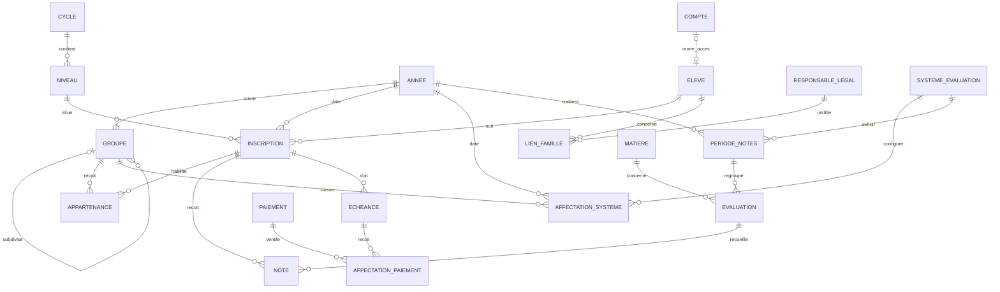
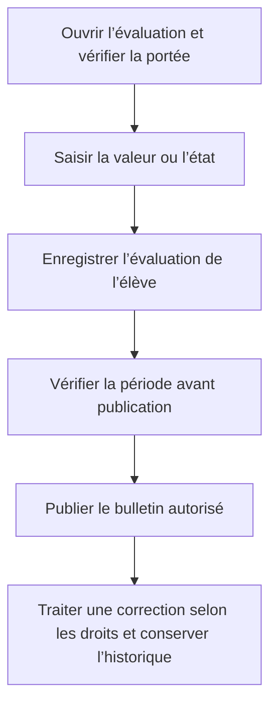

# Conception C-5 : modèle de données du scolaire

**Validé par Claude20022002 le 18 novembre 2026.** Le chef valide la reprise du plan de conception. Les décisions déjà actées sont reprises et les choix encore ouverts lui sont soumis. Groupes A et B, lot C-5, vague V1 (`04-plan-fusionne.md`). Conception seulement, sans code.

Le tableau consigne les propositions du groupe A (P-xx du registre). Le § 11 donne les arbitrages en vigueur.

## Questions à trancher avant de remplir

| N° | Question | Proposition du groupe A | Pourquoi cela compte |
|---|---|---|---|
| Q-1 | **Doubler les tables ou réutiliser celles du supérieur ?** | **Réutiliser** : une classe est un `Groupe`, un élève un `Etudiant`, une matière un `Cours`. Le sens reste dans le code, le vocabulaire dans la base (D-06) | Doubler coûterait toute la planification, le solveur, l'appel et l'application. Réutiliser oblige à desserrer plusieurs colonnes (§ 2) |
| Q-2 | **`Groupe.id_filiere` et `Cours.id_filiere` sont obligatoires ; que met-on pour un collège sans filière ?** | **Un cycle ou une filière implicite** créés d'office, plutôt que rendre ces colonnes facultatives | Rendre ces colonnes facultatives toucherait des dizaines de requêtes. À vérifier fichier par fichier avant de trancher |
| Q-3 | **Groupes de langue ou d'option, formés d'élèves de plusieurs classes ?** D-06 limite à trois niveaux emboîtés, et le solveur ne connaît pas les conflits par élève (écart F-5) | **Une nature de groupe « transversal »**, hors de la hiérarchie, avec ses inscriptions ; sa prise en compte par le solveur reste à F-11 | Au collège et au lycée, c'est le cas courant. D-06 en serait amendée |
| Q-4 | **Un parent : un rôle dans `Users`, ou une table à part ?** | **`ResponsableLegal` à part, avec un compte facultatif** ; `Users.role` gagne `parent` seulement si le compte existe | Beaucoup de parents n'auront pas de compte ; le lien de famille existe sans lui. Touche `role`, un ENUM, et D-05 |
| Q-5 | **Un parent avec des enfants dans deux écoles** | Un seul compte plateforme, une appartenance par école (D-05) ; **chaque école ne voit que sa propre fiche** | Une école ne doit pas apprendre où sont scolarisés les autres enfants |
| Q-6 | **`Appartenir` (élève et groupe) n'a pas d'année ni d'état. Où vit l'inscription ?** | **Une table `Inscription`** (élève, année, niveau, état). `Appartenir` reste le lien aux groupes, année lue par `Groupe.id_annee` (ME-18) | La réinscription, les frais et l'historique en dépendent |
| Q-7 | **Le numéro de CIN et les données de santé** | **Aucun champ de CIN obligatoire, pas de santé** dans le socle. L’identifiant de l’élève sur la plateforme nationale de son pays est facultatif (au Maroc, le code Massar ou CNE) | D'après la loi 09-08 lue, la CIN et la santé imposent une autorisation préalable de la CNDP. À confirmer par la CNDP |
| Q-8 | **Note absente, dispensé, à rattraper** | **Un état à part de la valeur** : une absence n'est pas un zéro | Sinon les moyennes sont fausses ; condition du bulletin partiel (F-13) |
| Q-9 | **Une note ou un paiement peut-il se modifier ?** | **Note** : modifiable jusqu'au verrouillage de la période, ensuite avec une raison, historisée. **Paiement et reçu** : jamais modifiés, on annule par une écriture inverse, reçus numérotés sans trou | Les règles de EC-3 restent à valider par la scolarité et le juriste. La numérotation des reçus est à confirmer avec l'expert-comptable |
| Q-10 | **Le supérieur reçoit-il aussi les notes et les frais ?** | **Oui en tables, éteints par le registre des modules** (F-02) : HESTIM ne voit rien changer, et pourra les allumer | Évite de construire deux fois |
| Q-11 | **Sur quelle pile écrire ?** L'étude est ouverte | **MySQL et Sequelize, comme aujourd'hui**, sans fonction propre à MySQL hors des tables existantes | Le document ne doit pas attendre l'étude, ni la gêner |
| Q-12 | **Numéros de migration** : `05-suivi.md` n'existe pas encore (C-1). 0059 EC-9, 0060 socle neutre, 0061 MP-1 | **Réserver 0062 à 0079 pour C-5** dans `05-suivi.md`, au plus tard à la relecture | Le plan impose la réservation avant d'écrire une migration |
| Q-13 | **MP-1 (`a/mp1-valeurs`) est-il un prérequis ?** | **Oui pour le profil par niveau** : une école de la maternelle au lycée suit plusieurs profils, ce que MP-1 résout. À fusionner avant F-04 | Sans lui, le § 3 n'a pas où ranger le profil d'un niveau |
| Q-14 | **Un élève doit-il avoir un compte ?** `Users.email` et `password_hash` sont obligatoires, et `Etudiant` a pour clé `id_user` : un enfant de 6 ans devrait avoir une adresse et un mot de passe | **Séparer la personne du compte**, avec une étude d'impact fichier par fichier ; pas d'adresse factice | `Users` est lu partout. C'est la décision la plus lourde de C-5 (revue, B-2) |

## 1. Objet et limites

Décrire les données du scolaire en réutilisant les contrats de l’enseignement supérieur. Les lots VSC-02, VSC-04,
VSC-07, ADM-05, MOT-05, MOT-06 et FIN écriront les migrations et les écrans de leurs fonctions. L’admission, les
bourses, la comptabilité, la paie, la santé, le transport et la cantine sont hors du socle C-5.

Le registre en tête conserve les propositions d’origine. Les décisions plus récentes priment, notamment Q-20
sur le compte élève et l’ordre des chantiers. Le § 11 reprend les arbitrages du chef et les points de relecture des futurs lots.

## 2. Entités et règles

| Entité | Clés et données métier | Règle |
|---|---|---|
| Année scolaire | Identifiant, libellé, dates | Référence commune aux groupes et aux inscriptions. ADM-06 pilote la clôture. |
| Cycle et niveau | Codes stables et libellés, niveau rattaché au cycle | Le niveau d’études et le profil du moteur sont distincts. |
| Classe et demi-groupe | Identifiant de groupe, année, niveau, filière, parent du demi-groupe | Les groupes hiérarchiques gardent le contrat que le moteur utilise déjà. |
| Groupe transversal | Identifiant de groupe, année, langue ou option, capacité | Chaque inscription active a une seule classe et au plus un groupe par langue. La classe et le groupe transverse appartiennent à la même année. |
| Matière et composante | Identifiants existants de cours et de composante | Le volume et les besoins de salle restent sur la composante. Le coefficient scolaire est défini par matière, niveau et filière. |
| Professeur principal | Classe, enseignant, année | Le rattachement suit la classe annuelle. Son mode de remplacement reste à préciser avec VSC-02. |
| Élève | Identifiant local de dossier, numéro local, nom, prénom, référence de compte facultative, `identifiant_plateforme_nationale` facultatif | Le dossier peut être inscrit et affecté à une classe dès sa création. L’école crée ensuite le compte, dont l’adresse peut être absente. |
| Responsable légal et lien de famille | Dossier propre à l’école, relation avec l’élève, compte éventuel | L’autorisation de voir le dossier d’un enfant passe par le lien actif dans l’école courante. Plusieurs liens permettent la fratrie. |
| Inscription | Élève, année, niveau, état | Une réinscription crée une ligne pour l’année suivante et préserve l’historique. L’appartenance à un groupe reste distincte. |
| Évaluation et note | Période, matière, barème, inscription, état et valeur de la note | Une absence ou une dispense ne compte pas comme zéro. Une valeur égale à zéro reste une note. |
| Appréciation et bulletin | Inscription, période, contenu attribué, version publiée | Chaque classe utilise pour l’année le système d’évaluation qui lui est affecté (§ 2.1). VSC-04 couvre aussi conseil de classe, décision de passage et correction autorisée avec motif et historique après verrouillage. |
| Grille de frais et échéance | Année, prestation, montant et date, inscription pour la dette de l’élève | Les montants dus se rattachent au dossier de l’école. |
| Paiement et reçu | Référence de règlement, date, montant, lien vers les échéances et référence de reçu | Un règlement peut couvrir plusieurs enfants. Chaque affectation précise l’échéance et le montant. FIN conçoit l’annulation par écriture inverse et confirme le contrat de reçu avec l’expert-comptable. |

Pour les groupes de langue à participation obligatoire, VSC-07 vérifie la complétude lors de la validation du
jeu scolaire. Une affectation en cours de préparation peut encore manquer. La capacité se vérifie dans la
transaction d’affectation afin que deux inscriptions simultanées ne dépassent pas le plafond. MOT-06 reçoit
les appartenances nécessaires aux conflits par élève, avec des identifiants techniques.

### 2.1. N7 · Plusieurs systèmes d’évaluation dans une école

Pour la même année et le même cycle, une classe peut évaluer par séquences et la classe voisine par trimestres. L’établissement définit ses systèmes et choisit celui de chaque classe pour l’année. Plusieurs classes peuvent partager une définition. Chaque évaluation garde la référence à la période de son système et à la classe concernée. Une modification de l’affectation pour l’année suivante préserve les notes, les périodes closes et les bulletins déjà publiés.

| Commun à VSC-04 et VSC-08 | Propre à chaque parcours |
|---|---|
| Inscription annuelle, matière ou enseignement, évaluation, période applicable, barème, valeur et état de la note. | VSC-04 construit le bulletin et porte le conseil de classe et la décision de passage. VSC-08 rattache les évaluations aux unités d’enseignement, traite les crédits et enregistre la décision du jury. |
| Portée des droits, verrouillage, correction motivée et historique. Les deux parcours relisent le résultat autorisé à sa source. | Les règles de calcul et d’attribution des crédits relèvent du plan de VSC-08. Les coefficients scolaires et la présentation du bulletin relèvent de VSC-04. |

**Preuve à demander aux deux lots.** Dans une école fictive, affecter deux systèmes à deux classes du même cycle et de la même année. Saisir un zéro et une absence, puis verrouiller une période de la première classe. Vérifier que la seconde peut toujours saisir ses résultats dans sa propre période, qu’une période étrangère à la classe est refusée et qu’un changement d’année conserve les résultats publiés. Pour le supérieur, un jury doit pouvoir relire la même note et son historique pour rendre sa décision.

#### Ce que disent les études

L’étude sur l’enseignement supérieur rapporte que la publication tardive des notes peut retarder une candidature ou une soutenance. Pour la recette de VSC-08, le jury doit donc pouvoir distinguer une note disponible, une note attendue et un résultat publié. Le choix d’affecter le système par classe est la décision N7 du chef du 21 novembre. [Étude sur l’enseignement supérieur](<../../etude-marche/research_notes/Problèmes des établissements scolaires/enseignement_superieur.md>)

## 3. Correspondance avec l’existant

| Modèle sur la base de départ | Conception |
|---|---|
| `Filiere` | Réutiliser la clé et le code. Examiner les ENUM `cycle`, `ecole` et `regime`, qui alimentent les profils et la grille horaire. Quand l’école n’utilise pas de filière, créer une filière interne par cycle. |
| `Groupe` | Réutiliser `id_groupe`, `id_filiere`, `id_annee` et le parent actuel. Ajouter la nature transversale et garantir une année résolue pour les nouveaux groupes scolaires. Aujourd’hui `id_annee` est nullable et le crochet part de `annee_scolaire`. |
| `Cours`, `CoursComposante` | Réutiliser les identifiants et la filière obligatoire du cours. Garder le contrat actuel de volume et de type de composante jusqu’à la reprise des nomenclatures par MOT-05. |
| `AnneeUniversitaire` | Garder le nom technique, la clé annuelle et les dates. Le vocabulaire scolaire est présenté selon le profil. |
| `Periode` | Garder les codes S1/S2 pour la planification. Le système affecté à la classe pour l’année détermine ses périodes de notes (§ 2.1). |
| `Etudiant` | Réutiliser le dossier et `numero_etudiant`. Introduire une clé de dossier `id_etudiant` indépendante. Déplacer le nom et le prénom scolaires dans le dossier, avec reprise depuis `Users`. Préserver une référence de compte unique et facultative. |
| `Appartenir` | Préserver la paire actuelle `id_user_etudiant`, `id_groupe` pendant la transition. Chaque lien scolaire référence l’inscription et le groupe. L’inscription porte l’élève et l’année, ce qui permet l’appartenance avant la création du compte. |
| `Users` | Conserver la clé et le hash obligatoires d’un compte actif, ajouter le mode identifiant scolaire et permettre l’absence d’adresse dans ce mode. L’extension du rôle parent relève d’ADM-05. |
| `ConfigurationEtablissement` | Réutiliser la configuration locale de l’école et le registre des modules. Les valeurs datées du moteur suivent MOT-01. |

Le chef confirme l’inscription et la visibilité dans la classe avant création ou activation du compte. Q-20 décrit la connexion après création par l’école. Les clés physiques et contraintes finales seront relues dans les plans de migration. Aujourd’hui la base lie `Appartenir.id_user_etudiant` à `Etudiants.id_user`, qui référence `Users` avec suppression en cascade. Les lecteurs historiques incluent `models/definitions.js`, `routes/appartenirRoutes.js`, `services/annees/annees.js`, `services/planning/monEmploiDuTemps.js`, et les services de cours, annonces, calendrier, désactivation, quiz et jeux. Les parcours centrés sur un compte continueront de résoudre le dossier via ce compte. Les listes de classe et la planification liront les dossiers à partir des inscriptions.

## 4. Profils et nomenclatures

MOT-01 fournit la résolution des valeurs datées, dont `ETA.ID.PROFIL`. La migration 0061 place le profil
université à la portée établissement sur la base historique. MOT-05 utilisera les codes stables du niveau
et du cycle comme cibles du catalogue. Les nouveaux référentiels rendront ces cibles vérifiables lors
de la configuration, comme le demande R-8 de la relecture MP-1. MOT-05 porte le passage des listes de
`backend/config/referentiel.js` aux nomenclatures en base. D-06 impose des codes dont le sens est compris par le
moteur et autorise des libellés locaux. Les trois niveaux emboîtés continuent de servir la hiérarchie. Les
groupes transversaux issus de VSC-07 traversent les classes et sont fournis séparément à MOT-06.

L’entrée du solveur comporte les groupes, les effectifs, les contraintes de salle fixe et les disponibilités
des enseignants et vacataires. Les noms, adresses et dossiers familiaux sont inutiles au calcul. Pour
les profils du catalogue, la maternelle relève toujours de Q-08.

## 5. Plusieurs écoles et droits

D-01 et D-03 placent les dossiers, inscriptions, liens de famille et notes dans la base de leur école. Le
contexte résolu par la plateforme détermine la connexion à la base et l’autorisation. Un identifiant local,
fourni par un client, ne détermine jamais l’école. Les références techniques exportées suivent BIB-01 lorsque
le contrat requiert des identifiants stables. D-05 fixe le principe d’un compte plateforme avec des
appartenances par école. Le premier accès parent est mono-école avec ADM-05 et PLA-01. PLA-11 porte le compte partagé entre écoles.

| Canal concerné | Contrôle à prévoir |
|---|---|
| I-1, I-6 | Transactions prises dans le contexte courant. Deux écoles avec les mêmes identifiants locaux ne lisent ou modifient que leurs dossiers et calculs. |
| I-2, I-3, I-7, I-8 | Envois et tâches exécutés dans la bonne école. Tester deux écoles, un identifiant local identique et des liens remis dans le bon contexte. |
| I-4, I-5, I-9, I-10 | Vérifier le contexte de session et des limites de connexion. Préserver les contrats existants des intégrations tant que leur usage par un compte sans adresse est indisponible. |
| I-11, I-12, I-13, I-14 | Une restauration et un export sont propres à l’école. Le mobile, les domaines et les journaux suivent leurs contrats PLA, EXP et MOB. |
| I-16 | Lire fuseau et activation par école. Tester deux écoles qui diffèrent sur ces réglages et vérifier leurs périodes, parcours et envois. |

Le personnel n’accède qu’aux dossiers autorisés par sa portée. Le parent ne voit que les enfants liés à son
dossier dans l’école active et les données publiées pour eux. L’élève ne peut ouvrir un dossier familial.
Prévoir des cas de test avec deux écoles, des identifiants locaux identiques et un parent dont les enfants
sont dans deux écoles. EP-12 s’applique à chaque route des futurs lots.

## 6. Séquence de migrations

La plage 0062 à 0079 est réservée dans le suivi. L’attribution précise par lot relève du coordinateur,
avec le chef pour la validation de la migration et du schéma partagé. Répartition indicative, cycle de
l’inscription, fratrie et risques : [complément du 25 novembre](vsc-01-inscription-et-migrations.md).

| Étape | Extension et vérification | Retour arrière |
|---|---|---|
| 1. Référentiels | Ajouter les références de cycle, niveau et année requises par les parcours scolaires. Reprendre uniquement les valeurs confirmées pour les installations existantes. Base neuve neutre, données de démonstration à part. | Revenir aux lecteurs précédents tant que les anciennes colonnes restent écrites. |
| 2. Compte et inscription | Ajouter une clé de dossier et les champs d’identité, puis effectuer une reprise vérifiable des dossiers existants. Ajouter les clés des inscriptions et des appartenances, maintenir le contrat historique et aménager les contraintes après inventaire des FK. Activer les dossiers sans compte après déploiement des lecteurs compatibles, et les comptes sans adresse après vérification de Q-20. | Désactiver la création scolaire avec le registre des modules et conserver un lecteur qui sait gérer les lignes déjà écrites. |
| 3. Groupes | Ajouter les liens scolaires et comparer l’effectif et les appartenances lus par les deux contrats sur un jeu historique. Pour les dossiers sans compte, vérifier la présence dans les listes de classe et la planification. Les groupes transversaux sont activés avec VSC-07 et MOT-06. | Désactiver l’activation et conserver les liens scolaires pour reprise. |
| 4. Familles, notes et frais | Étendre en lots séparés sous les propriétaires du § 7. Vérifier les droits et les parcours avant d’activer chaque module. | Revenir à une version compatible avec les colonnes ajoutées et garder les écritures publiées. Les notes et les frais du supérieur sont désactivés par défaut, puis activables par école après recette. |
| 5. Retrait des anciens champs | Retirer une colonne uniquement après inventaire des lecteurs, comparaison des données et revue de la restauration par école. | Prévoir un correctif en avant ou une restauration vérifiée selon le risque de perdre des écritures récentes. |

Pour le profil supérieur de référence, comparer le problème sérialisé envoyé au solveur avant et après,
les résultats des parcours existants et les applications activées. Inclure dans la recette une base neuve et
une base déjà migrée. La preuve et la compatibilité des retours arrière seront exigées dans les PR des lots.

### Points à vérifier dans les plans de reprise

- La clé primaire historique d’`Appartenir` inclut `id_user_etudiant`. Ajouter la référence à l’inscription
  ne suffit donc pas à enregistrer une appartenance sans compte. Le plan de migration doit expliciter
  la coexistence des deux représentations, la contrainte d’unicité et le moment où l’écriture scolaire
  devient possible. La création d’un compte après affectation doit conserver le dossier et le lien
  existants, y compris après une reprise interrompue.
- `services/annees/annees.js` conserve aujourd’hui les groupes dont `id_annee` est absent et ajoute les
  ancêtres des groupes retenus. Le plan de reprise doit chiffrer les liens dont l’année est indéterminée
  ou dont la hiérarchie est incohérente. Proposer de conserver ces liens lisibles par le chemin historique
  jusqu’à résolution. Vérifier une promotion, ses groupes de TD et de TP, ainsi que deux années d’un
  même dossier. Comparer les groupes accessibles et les effectifs, en comptant chaque élève une fois.
- Les écritures passent notamment par `routes/appartenirRoutes.js`, `controllers/etudiantController.js`
  et `services/comptes.js`. Le plan doit couvrir création, remplacement, suppression et import répété,
  puis vérifier leur convergence avec la reprise. La cascade depuis `Users` et l’anonymisation sont à
  relire avec ADM avant le déplacement de l’identité dans le dossier.
- L’appel actuel sélectionne les comptes étudiants actifs et `Presence.id_user` est obligatoire.
  L’apparition du dossier sans compte dans la liste de classe doit être vérifiée séparément.
  EDT et VSC-03 doivent préciser comment l’appel et son historique prendront en charge cet élève.

## 7. Propriétaires et contrats

| Propriétaire | Tables ou contrat |
|---|---|
| Plateforme | Registre et appartenances à l’école, résolution du contexte et contrat de compte commun. |
| Administration | `Users`, `AuthSession`, réinitialisation, `AnneeUniversitaire`, `Periode`, `ResponsableFiliere`, `Filiere`, `Groupe`, `Cours` et `CoursComposante`. ADM-02 porte le contrat des référentiels à faire relire par MOT et EDT. ADM-05 introduit les droits parent. |
| Vie scolaire | `Etudiant`, `Appartenir`, inscription, responsables et liens de famille, périodes de notes, évaluations, notes et bulletins. |
| Moteur / EDT | MOT conserve ses profils, paramètres et générations. MOT et EDT lisent les référentiels auprès d’ADM. MOT-06 lit les appartenances via le contrat VSC-07. EDT conserve les tables d’appel et de présence. |
| Finance | Grilles de frais, échéances, paiements, liens d’affectation et reçus. FIN lit l’inscription identifiée, via le contrat de VSC. |

Les écrans consomment les contrats relus des modules propriétaires. L’annuaire et l’import réutilisent les
références existantes. Les connexions et les droits sur la famille ne se déduisent jamais d’une adresse partagée.
Les contrats d’ADM sur les filières, groupes et matières seront relus par MOT et EDT.

## 8. Diagrammes

## 9. Règles et preuves attendues

| Règle | Preuve attendue dans le lot |
|---|---|
| C5-1 · L’élève garde son dossier d’une année à l’autre | Réinscrire un élève dans l’année suivante et relire la classe et les notes de l’ancienne année. |
| C5-2 · Les groupes scolaires restent cohérents avec l’inscription | Refuser une seconde classe, un second groupe d’une même langue et un groupe d’une autre année. Tester deux inscriptions concurrentes sur la dernière place. |
| C5-3 · Le dossier précède le compte si nécessaire et le compte peut fonctionner sans adresse | Inscrire et affecter un élève sans compte, vérifier la liste de classe et la planification, puis créer son compte et retrouver le même dossier. Connexion web et mobile dans la bonne école, vérification des chemins de récupération et d’envoi, test de compatibilité par adresse sur le profil supérieur. |
| C5-4 · Les liens familiaux ont une portée locale | Faire lire à un parent sa fratrie autorisée. Refuser le dossier d’un autre enfant, y compris dans une seconde école aux identifiants identiques. |
| C5-5 · L’état d’une note est distinct de la valeur | Vérifier qu’un zéro compte pour la moyenne et qu’une absence en est exclue. Exercer le verrouillage et la correction historisée avec VSC-04. |
| C5-6 · Le profil supérieur conserve ses parcours | Comparer la sérialisation solveur et vérifier la connexion, les emplois du temps, l’appel et les modules activés. |
| C5-7 · Les modules relisent la donnée à sa source | Démontrer une inscription partagée par l’import, la classe, le bulletin et l’échéance, sans nouvelle saisie. |

## 10. Besoins des écrans

- Administration : chercher un dossier par identité ou numéro local, inscrire la fratrie, contrôler les capacités,
  afficher les choix d’import en erreurs lisibles. EP-5 s’applique à l’annuaire et aux exports.
- Enseignant : retrouver les élèves de sa classe, saisir l’état d’une note avec la valeur lorsque applicable.
  Pour EP-6, VSC-04 mesure le parcours avant et après sur la même classe fictive.
- Parent : sélectionner un enfant autorisé dans l’école active, lire les bulletins publiés et les frais selon
  les modules activés. COM applique ses règles de notification et de synthèse pour EP-7.
- Élève : utiliser l’identifiant que l’école lui remet et accéder à ses propres cours et groupes. Les données
  visibles de son compte restent limitées aux besoins de l’écran.

### EP-18 · Accès sans téléphone ni connexion à la maison

- Le secrétariat ouvre le dossier, inscrit l’élève et l’affecte à sa classe depuis le poste de l’école.
  Dès cette étape, l’élève figure dans la liste de classe. L’école peut lui remettre son emploi du temps
  sur papier et l’afficher en classe.
- Si l’école crée un compte, elle remet à l’élève un identifiant scolaire utilisable sans adresse
  e-mail. L’élève peut consulter ses cours et son emploi du temps depuis un poste connecté à l’école.
  Sans connexion en classe, l’enseignant peut communiquer l’emploi du temps et les consignes sur papier.
- L’enseignant doit pouvoir faire l’appel à la main. En cas de coupure, il utilise une feuille de classe
  imprimée, puis reporte l’appel au retour de la connexion. Le bulletin publié peut être remis sur papier.
  Les lots EDT/VSC-03 et VSC-04 vérifieront ces parcours avec un élève sans compte ni téléphone.

## 11. Décisions et questions de relecture

| Questions du plan | Décision ou suite |
|---|---|
| Q-1, Q-3 | Réutiliser les entités selon D-06. Les groupes transversaux VSC-07 traversent la hiérarchie. |
| Q-2 | Filière interne par cycle pour les écoles sans filière. |
| Q-4, Q-5 | Dossier du responsable par école, compte facultatif, premier accès mono-école avec ADM-05 et PLA-01. Le compte commun et les appartenances de D-05 sont le contrat cible de PLA-11. |
| Q-6 | Inscription annuelle distincte de l’appartenance. VSC-07 et ADM-06 relisent la contrainte entre inscription, groupe et année. |
| Q-7 | L’identifiant de l’élève sur la plateforme nationale de son pays est facultatif (au Maroc, le code Massar ou CNE). La CIN et la santé sont hors du socle. Le contrat d’échange et la conformité relèvent d’ETA et d’EXP-08, avec le connecteur du pays de l’école. |
| Q-8, Q-9 | État séparé de la note, saisie jusqu’au verrouillage puis correction autorisée avec motif et historique. VSC-04 précise les droits avec la scolarité. FIN conserve l’écriture inverse et fait confirmer les règles de reçu par l’expert-comptable. |
| Q-10 | Notes et frais désactivés par défaut dans le supérieur. Activation par école après la recette des lots concernés. |
| Q-11, Q-12, Q-13 | Pile confirmée par QUA-03 sous la condition D-01. Plage 0062 à 0079 réservée. MOT-01 serveur livré via #156. |
| Q-14 et Q-20 | Inscription et classe possibles avant création du compte. L’école crée le compte, avec identifiant scolaire et adresse facultative. Voir [l’étude d’impact](vsc-01-impact-adresse-compte.md). |
| Périmètre VSC-04 | Système d’évaluation affecté par classe et année (N7), coefficient par matière, niveau et filière, conseil de classe et décision de passage dans VSC-04. |
| Vocabulaire et finance | Nom technique `AnneeUniversitaire` conservé, catégories communes dans le code, libellés locaux. Un règlement est ventilable sur plusieurs échéances d’une fratrie. |
| Propriétaires | ADM possède les référentiels de filières, groupes, cours et composantes. VSC possède le dossier et l’appartenance. |

Le 25 novembre, le chef a choisi ce document comme référence de VSC-01, plutôt que la PR #268 ; ses apports
concrets sont repris dans le [complément](vsc-01-inscription-et-migrations.md) et dans
[l’étude d’impact](vsc-01-impact-adresse-compte.md).

Les choix ont été confirmés par le chef le 18 novembre. La relecture projet couvre l’étude d’impact, le découpage
de migrations, la granularité des droits sur les notes et la compatibilité du supérieur. Les lots de mise en
œuvre doivent encore attribuer leurs numéros de migration dans la plage réservée et obtenir leurs validations.
