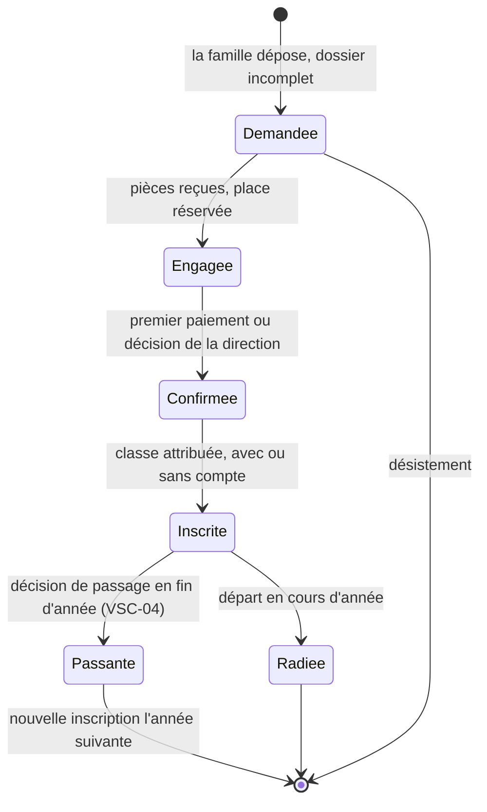
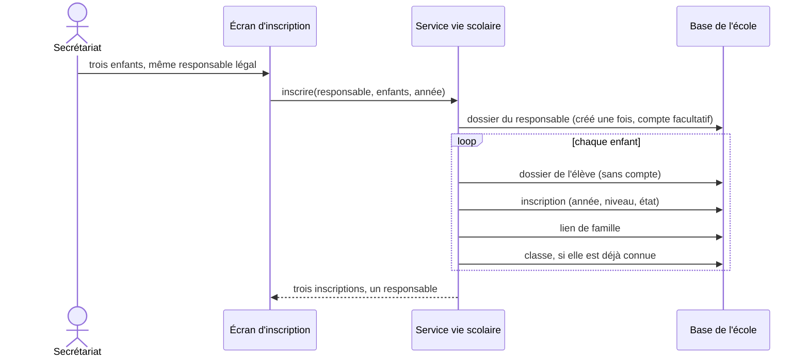

# VSC-01 · Inscription, fratrie, migrations et risques

Complément de la [conception C-5](conception-c5-modele-donnees-scolaire.md). Il reprend ce que la PR #268
(agent Qoder, 25 novembre) apportait de concret, quand le chef a choisi #215 comme référence le 25 novembre.
Chaque reprise est **alignée sur les décisions de C-5** (§ 11) : là où #268 divergeait, c'est C-5 qui tient,
et l'écart est dit.

## 1. Frictions mesurées

Mesure du 25 nov. sur `origin/main` `561fad19`. Elle justifie le principe de C-5 : on étend, on n'arrache pas.

| Friction | Mesure |
|---|---|
| `id_filiere` obligatoire sur `Groupe` et `Cours` | 413 occurrences dans 113 fichiers : rendre la colonne facultative est écarté, d'où la filière interne par cycle (Q-2) |
| `type_groupe` fermé à trois valeurs | 99 occurrences dans 44 fichiers : la nature transversale s'ajoute sans toucher l'emboîtement (Q-3) |
| `Users.email` lu | 182 lectures dans 65 fichiers ([étude d'impact](vsc-01-impact-adresse-compte.md)) |
| `Etudiant` sans compte | impossible aujourd'hui : la clé primaire est `id_user` |
| `Appartenir` sans compte | impossible aujourd'hui : la clé contient `id_user_etudiant`, qui référence `Users` |

## 2. La vie d'une inscription

Proposition de #268, à confirmer par la conception de VSC-02. Une inscription appartient à une année et à un
niveau. Selon C-5, **l'affectation à la classe se rattache à l'inscription** et reste possible sans compte.

Règles : une seule inscription par élève et par année (doublon refusé en nommant l'existante) ; une
réinscription crée une ligne nouvelle et garde l'historique (C5-1) ; la décision de passage vient du conseil
de classe, dans VSC-04 (décision du 18 nov.).

## 3. L'inscription d'une fratrie

Une seule saisie pour le responsable (EP-5), une transaction : tout ou rien.

Le règlement de la fratrie se répartit ensuite sur les échéances de chaque enfant (FIN, décision du 18 nov.).

## 4. Numéros de migration

Plage `0062` à `0079` réservée. Répartition **indicative**, confirmée par le coordinateur à l'ouverture de
chaque lot, avec la validation du chef pour la migration. Elle tient compte du lot Q-20 séparé (sur `Users`,
table d'ADM) et de N7.

| Numéro | Lot | Contenu |
|---|---|---|
| 0062 | VSC-02 | dossiers des élèves et des responsables légaux, liens de famille |
| 0063 | VSC-02 | inscriptions annuelles, appartenances rattachées à l'inscription (élève sans compte) |
| 0064 | lot Q-20 (ADM) | `Users.identifiant`, adresse facultative, en trois temps |
| 0065 | VSC-07 | nature transversale des groupes (`langue`, `option`) |
| 0066 | VSC-04 | systèmes d'évaluation et leur affectation par classe et par année (N7), périodes de notes |
| 0067 | VSC-04 | évaluations, notes (état distinct de la valeur), appréciations |
| 0068 | VSC-04 | bulletins figés et versionnés |
| 0069 à 0079 | FIN et suivants | frais, échéances, paiements, reçus ; à confirmer par les modules concernés |

`0083` est réservée à STA-01 (décision du 25 nov.) et sort de cette plage.

## 5. Risques

| Risque | Effet | Parade |
|---|---|---|
| `Users.email` facultatif trop tôt | connexion, réinitialisation et OIDC cassent | lot Q-20 en trois temps, les quatre lectures qui cassent d'abord ([étude](vsc-01-impact-adresse-compte.md)) |
| `Etudiant` change de clé | tout ce qui joint sur `id_user` casse | clé de dossier ajoutée, `id_user` gardé comme référence facultative jusqu'au retrait (C-5, § 6, étape 5) |
| Appartenance sans compte mal posée | élève absent de sa liste de classe ou de l'appel | coexistence des deux représentations dans `Appartenir`, prouvée par le test C5-3 ; `Presence.id_user` relu avec EDT |
| La filière interne surprend la scolarité | trois filières de plus dans les listes | nommées et masquées dans les écrans qui n'ont pas à les montrer |
| Groupes transversaux mal lus par le solveur | conflits d'élève invisibles (écart F-5) | VSC-07 n'ouvre le placement qu'avec MOT-06 |
| Trop de tables d'un coup | revue impossible | une migration par sujet, un lot par PR |

## 6. Écarts de #268 non repris

Pour mémoire, ce que #268 proposait et que les décisions du chef écartent : appartenance liée au seul compte ;
périodes de notes par niveau au lieu du système par classe (N7) ; coefficient, conseil de classe et paiement
de fratrie laissés ouverts ; colonne `cne` propre au Maroc au lieu d'un identifiant national générique ; rôle
`parent` ajouté par VSC au lieu d'ADM-05.
