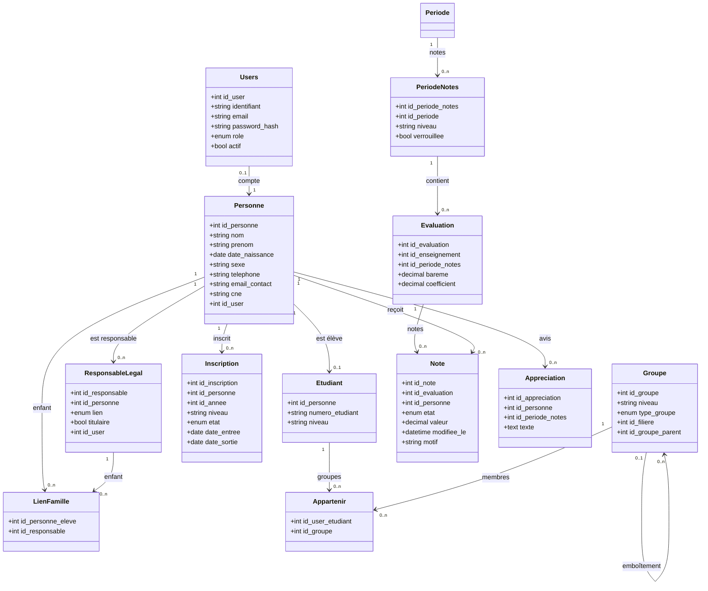
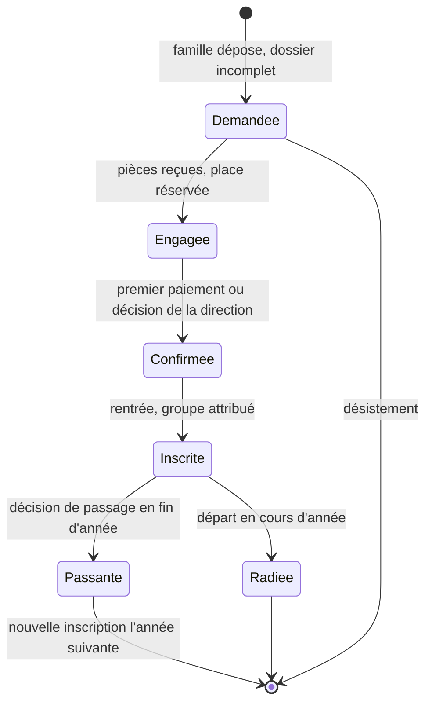
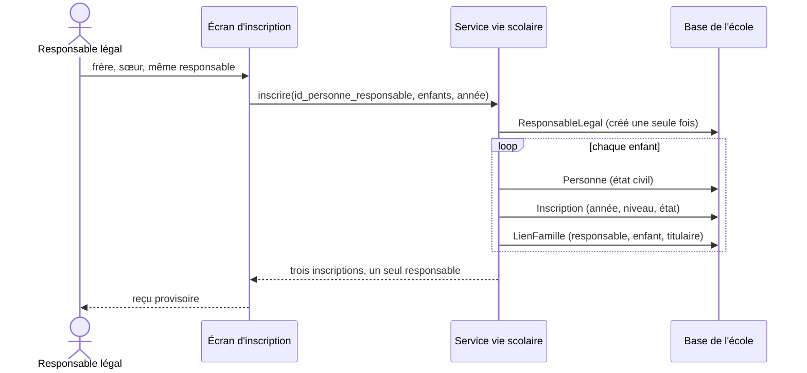

# VSC-01 · Modèle de données du scolaire — conception

| | |
|---|---|
| Module | [VSC](../../plan/modules/VSC-vie-scolaire.md) · chantier ouvert le 2026-11-18 |
| Branche | `doc/vsc-01-modele-donnees-scolaire` |
| Rédigé par | Qoder (agent), le 2026-11-25 |
| **Validé** | en attente — les 14 réponses de § 3 sont à signer dans [decisions.md](../../plan/decisions.md) |

Ce document remplace le plan d'écriture [conception-c5](conception-c5-modele-donnees-scolaire.md) : il en garde l'ordre et les 14 questions, et le remplit. Il ne crée aucun code ; VSC-02 et les lots suivants l'appliquent.

## 1. Objet et critère de « terminé »

**Ce que ce document décide**, pour une école privée de la maternelle au lycée comme pour un centre de formation professionnelle :

- les entités du scolaire et leurs champs ;
- ce qui est réutilisé du supérieur, ce qui est étendu, ce qui est ajouté ;
- le passage d'un profil d'école à l'autre (niveau → profil du moteur) ;
- ce qui reste vrai avec une base par école ;
- l'ordre des migrations, « étendre puis contracter » ;
- le propriétaire de chaque table ;
- avec quoi un élève se connecte (Q-20) ;
- les groupes transversaux (langues, options), hors de la limite de trois niveaux de D-06.

**Critère de « terminé »**, recopié de la fiche du module, avec son état au 25 novembre 2026 :

| Condition | État |
|---|---|
| Les 14 questions sont tranchées et écrites dans `decisions.md` | réponses proposées ici, **signature du chef à faire** |
| L'étude d'impact de Q-20 couvre chaque fichier qui lit `Users.email` | faite : [vsc-01-etude-impact-q20](vsc-01-etude-impact-q20.md), 65 fichiers (182 lectures) |
| Les numéros 0062 à 0079 sont réservés dans `suivi.md` | réservés ; **vérifié libres** le 25 nov. (voir § 6) |
| Le document est relu par les deux groupes | à faire |

## 2. Ce qui existe

Lu dans le code de `origin/main` (561fad19), pas dans une copie de branche.

### 2.1 Les tables réutilisées

| Table | Champs qui comptent ici | Ce qui gêne |
|---|---|---|
| `Users` | `id_user`, `nom`, `prenom`, `email` **obligatoire et unique**, `role` ENUM(`admin`, `enseignant`, `etudiant`), `password_hash` **obligatoire**, `must_change_password`, `actif`, `anonymise_le` ; `defaultScope` qui cache le hash et le secret MFA | un élève de 6 ans devrait avoir une adresse et un mot de passe |
| `Etudiant` | clé primaire = `id_user` (1:1 `Users`), `numero_etudiant` unique, `niveau`, `date_inscription` | pas d'élève sans compte |
| `Appartenir` | clé (`id_user_etudiant`, `id_groupe`), rien d'autre | ni année ni état : l'inscription n'a pas de table |
| `Groupe` | `nom_groupe`, `niveau`, `effectif`, `annee_scolaire` obligatoire, `id_annee` rempli par crochet, `id_filiere` **obligatoire**, `type_groupe` ENUM(`promotion`, `td`, `tp`), `id_groupe_parent`, `annee` | pas de classe hors filière ; pas de groupe transversal |
| `Cours` | `code_cours` unique, `nom_cours`, `niveau`, `volume_horaire` **obligatoire**, `type_cours` **obligatoire**, `semestre` **obligatoire**, `coefficient` `DECIMAL(3,2)`, `ects`, `id_filiere` **obligatoire** | une matière de primaire n'a ni semestre S1/S2 ni volume horaire au sens LMD |
| `Filiere` | `code_filiere`, `nom_filiere`, `regime` ENUM(`initiale`, `continue`, `executive`), `ecole` ENUM(`engineering`, `business`), `cycle` ENUM(`prepa`…`executive`), `intitule_cycle`, `premiere_annee_cycle` | `ecole` et `cycle` fermés sur l'offre d'ingénierie |
| `AnneeUniversitaire` | `libelle` unique (« 2025-2026 »), `date_debut`, `date_fin`, `active` | le nom technique reste, l'écran dit « année scolaire » |
| `Periode` | `id_annee`, `code` ENUM(**`S1`, `S2`**), `libelle`, `date_debut`, `date_fin`, `nb_semaines`, unique (`id_annee`, `code`) | deux périodes seulement, imposées à tous les cycles |
| `CoursComposante` → `Enseignement` → `EnseignementGroupe` → `Affectation` | la chaîne que lisent le solveur, l'appel et l'emploi du temps | elle part du groupe : un groupe transversal doit y entrer sans casser l'emboîtement |
| `ConfigurationEtablissement` | une ligne (`id = 1`), `classquiz_actif`, `sondages_actifs` | c'est déjà l'amorce du registre des modules (F-02) |

### 2.2 Les listes fermées

`backend/config/referentiel.js` (121 lignes) est la source unique des listes, importée par les modèles, les validations et les migrations : `TYPES_SALLE`, `REGIMES`, `VARIANTES_GRILLE`, `JOURS_SEMAINE`, `TYPES_EVENEMENT`, `PORTEES_EVENEMENT`, `CODES_PERIODE`, `ECOLES`, `CYCLES`, `TYPES_COMPOSANTE`, `NIVEAUX_GROUPE` (= `TYPES_GROUPE`), `MODALITES`, `STATUTS_ENSEIGNANT`, `ROLES_SERVICE`, `STATUTS_SERVICE`, `PREFERENCES_CRENEAU`, `TYPES_RESERVATION`, `STATUTS_RESERVATION`, `ROLES_PARTICIPANT`, plus `RANG_TYPE_GROUPE` qui porte l'emboîtement promotion ⊃ TD ⊃ TP.

Toute extension de liste se fait **ici**, jamais dans une migration seule : c'est la règle D-06 (« le code garde le sens, l'école nomme ») appliquée au vocabulaire.

### 2.3 L'état des migrations

Fichiers présents sur `main` : `0001` à `0059`, `0061`, `0080`, `0081`, `0082`, `0087`. Le migrateur est Umzug avec `SequelizeStorage` (table `SequelizeMeta`) : une migration absente de l'historique s'exécute à la prochaine montée, même si son numéro est antérieur à la dernière appliquée. La réservation `0062` à `0079` est donc **tenable**, et `0060` est libre.

`0083` est déjà pris par la PR #230 (STA-01, non fusionnée) : ne pas le réserver.

### 2.4 Ce qui est déjà acquis

- **MOT-01 (MP-1) est fusionné** (#156, 10 nov.) : `VersionParametres`, `ValeurParametre` et `ContrainteDeclaree` existent, avec la migration `0061`. La question Q-13 du plan d'écriture est donc réglée : il n'y a plus de prérequis à attendre. Il reste les écrans, portés par ADM-02.
- **Q-20 est tranchée** (`decisions.md`, ligne 159) : « un **identifiant donné par l'école**, adresse facultative, mot de passe initial remis par l'école (ou par le parent) ; pas d'adresse factice ». L'étude d'impact est explicitement du lot VSC-01 ; elle est dans [vsc-01-etude-impact-q20](vsc-01-etude-impact-q20.md).

### 2.5 Les points de friction, mesurés

| Friction | Mesure du 25 nov. 2026 |
|---|---|
| `id_filiere` obligatoire sur `Groupe` et `Cours` | 413 occurrences dans 113 fichiers |
| `type_groupe` fermé à trois valeurs | 99 occurrences dans 44 fichiers |
| `Users.email` lu quelque part | 182 lectures dans 65 fichiers : 44 de production, 21 de test |
| `Etudiant` sans compte impossible | 1 clé primaire : `id_user` |

C'est ce qui justifie les réponses de § 3 : on étend, on n'arrache pas.

## 3. Questions et réponses

Colonne « Réponse du chef » : vide tant que `decisions.md` n'est pas signé. Une proposition acceptée y est recopiée telle quelle.

| N° | Question | Proposition | Réponse du chef | Bloque |
|---|---|---|---|---|
| Q-1 | Doubler les tables ou réutiliser celles du supérieur ? | **Réutiliser** : une classe est un `Groupe`, un élève une `Personne` + `Etudiant`, une matière un `Cours`. Le sens reste dans le code, le vocabulaire dans la base (D-06) | | tout |
| Q-2 | `Groupe.id_filiere` et `Cours.id_filiere` sont obligatoires ; que met-on sans filière ? | **Une filière implicite par cycle**, créée d'office (`FIL-PRIMAIRE`, `FIL-COLLEGE`, `FIL-LYCEE`) ; les colonnes restent obligatoires (413 lectures préservées) | | VSC-02 |
| Q-3 | Groupes de langue ou d'option réunissant des élèves de plusieurs classes ? | **Nature de groupe « transversal »** : `type_groupe` gagne `langue` et `option`, sans parent, hors de l'emboîtement ; l'effectif plafonné est porté par `Groupe.effectif`. D-06 amendée sur ce point | | VSC-07 |
| Q-4 | Un parent : un rôle dans `Users`, ou une table à part ? | **`ResponsableLegal` à part, compte facultatif** ; `Users.role` gagne `parent` seulement si le compte existe | | VSC-02 |
| Q-5 | Un parent avec des enfants dans deux écoles | **Un seul compte plateforme**, une appartenance par école (D-05) ; chaque école ne voit que sa propre fiche | | VSC-02 |
| Q-6 | Où vit l'inscription, `Appartenir` n'ayant ni année ni état ? | **Table `Inscription`** (personne, année, niveau, état, dates) ; `Appartenir` reste le seul lien aux groupes, l'année se lit par `Groupe.id_annee` (ME-18) | | VSC-02, FIN |
| Q-7 | Numéro de CIN et données de santé | **Ni CIN obligatoire ni santé dans le socle** ; le code Massar (CNE) est facultatif. La santé est le module VSC-08, éteint par défaut | | VSC-02, VSC-08 |
| Q-8 | Note absente, dispensé, à rattraper | **Un état à part de la valeur** (`non_notee`, `absente`, `dispensee`, `rattrapage`) : une absence n'est pas un zéro | | VSC-04 |
| Q-9 | Une note ou un paiement peuvent-ils se modifier ? | **Note** : modifiable jusqu'au verrouillage de la période, ensuite avec motif et historique. **Paiement et reçu** : jamais modifiés, annulation par écriture inverse, reçus numérotés sans trou | | VSC-04, FIN |
| Q-10 | Le supérieur reçoit-il aussi les notes et les frais ? | **Oui, mêmes tables, éteintes par le registre des modules** ; la maquette HESTIM ne voit rien changer | | VSC-04, FIN |
| Q-11 | Sur quelle pile écrire ? | **MySQL et Sequelize**, comme aujourd'hui, sans fonction propre à MySQL hors des tables existantes ; l'étude QUA-03 ne bloque pas | | tout |
| Q-12 | Numéros de migration | **Garder 0062 à 0079** : vérifiés libres sur `main` le 25 nov. ; `0060` libre aussi, `0083` pris par la PR #230 | | VSC-02 |
| Q-13 | MP-1 est-il un prérequis ? | **Non plus** : MOT-01 est fusionné (#156, migration `0061`) depuis le 10 nov. ; seul l'écran ADM-02 reste | | — |
| Q-14 | Un élève doit-il avoir un compte ? (voir Q-20) | **Séparer la personne du compte** : `Personne` porte l'état civil, `Users` le compte (identifiant, mot de passe facultatif) ; étude d'impact jointe | | VSC-02 |

## 4. Solution

### 4.1 Le principe

Trois natures de changement, jamais mélangées dans une même migration :

1. **Étendre des listes fermées** (Q-2, Q-3, Q-4) : `TYPES_GROUPE` + `langue`, `option` ; `ROLES` + `parent` ; `CODES_PERIODE` ouvert à `T1`…`T3` et `semestre` devenu facultatif sur `Cours`. Aucune table nouvelle, aucun écran ne casse.
2. **Ajouter les tables du scolaire** (Q-6, Q-8, Q-9) : `Personne`, `ResponsableLegal`, `LienFamille`, `Inscription`, `PeriodeNotes`, `Evaluation`, `Note`, `Appreciation`, `GrilleFrais`, `Echeance`, `Paiement`, `Recu`.
3. **Résoudre Q-20** (§ 6 et étude d'impact) : `Personne.id_user` facultatif, `Users.identifiant` unique et obligatoire, `Users.email` facultatif.

Ce qui n'est **pas** fait : aucune colonne d'établissement (D-01 : une base par école), aucun changement de la chaîne `Enseignement` → `Affectation`, aucun renommage de `Groupe`, `Cours`, `Filiere`, `Etudiant`.

### 4.2 Le modèle

Les tables de frais (`GrilleFrais`, `Echeance`, `Paiement`, `Recu`) ne sont pas dessinées ici : elles appartiennent à FIN et ce document ne fixe que leur point d'accroche, `Personne` et `Inscription`.

### 4.3 La vie d'une inscription

Une inscription appartient à une **année** et à un **niveau** ; elle ne porte pas le groupe. Le groupe vit dans `Appartenir`, ce qui permet à un élève de changer de classe sans réécrire son histoire.

### 4.4 L'inscription d'une fratrie

## 5. Fichiers créés ou modifiés

VSC-01 ne livre que des documents ; les autres lots complètent la liste au moment de leur conception.

| Fichier | Créé / modifié | Rôle | Taille visée |
|---|---|---|---|
| `docs/conception/vie-scolaire/vsc-01-modele-donnees-scolaire.md` | créé (ce document) | la conception | 330 lignes |
| `docs/conception/vie-scolaire/vsc-01-etude-impact-q20.md` | créé | l'étude d'impact de Q-20 | 150 lignes |
| `docs/conception/vie-scolaire/conception-c5-modele-donnees-scolaire.md` | laissé tel quel | le plan d'écriture d'origine, cité par la fiche du module | — |
| `backend/config/referentiel.js` | VSC-02 / VSC-07 | listes ouvertes (`TYPES_GROUPE`, `ROLES`, `LIENS_FAMILLE`, `ETATS_INSCRIPTION`) | +40 lignes |
| `backend/models/definitions.js` + `models/index.js` | VSC-02 | relations des tables nouvelles | +80 lignes |
| `backend/migrations/0062` à `0066` | VSC-02 | § 6 | 5 fichiers |
| `backend/services/vie-scolaire/*.js` | VSC-02 | droits et règles, sans contrôleur séparé (comme `routes/annonceRoutes.js`) | 3 fichiers |
| `backend/routes/vieScolaireRoutes.js` | VSC-02 | routeur monté dans `app.js` | 1 fichier |
| `frontend/src/pages/gestion/*` et `mobile/src/app/*` | VSC-02 | écrans d'inscription et de dossier | 2 écrans par étage |

## 6. Données et migration

### 6.1 Réservation

Numéros réservés `0062` à `0079` dans `suivi.md`, vérifiés libres. Proposition d'emploi, stable tant que le lot n'est pas ouvert :

| Numéro | Lot | Contenu |
|---|---|---|
| 0062 | VSC-02 | `Personne`, `ResponsableLegal`, `LienFamille` |
| 0063 | VSC-02 | `Inscription` |
| 0064 | VSC-02 | `Users.identifiant`, `Users.email` facultatif (Q-20) |
| 0065 | VSC-02 | `Etudiant` : clé vers `Personne`, `id_user` conservé |
| 0066 | VSC-07 | `TYPES_GROUPE` : `langue`, `option` |
| 0067 | VSC-04 | `PeriodeNotes`, `Evaluation`, `Note`, `Appreciation` |
| 0068 | VSC-04 | `Bulletin` (figé, versionné) |
| 0069 à 0079 | FIN, VSC-10 | frais, reçus, crédits LMD ; à confirmer par les modules concernés |

Chaque migration écrit `up` **et** `down`, sans `ALTER` multiple sur une table déjà chargée plus d'une fois.

### 6.2 Étendre puis contracter

Le schéma ne change de forme qu'en deux temps, jamais dans le même lot :

1. **Étendre** : colonne ajoutée facultative, table nouvelle, liste fermée agrandie. L'ancien code continue de lire sans le savoir.
2. **Basculer** : les lectures passent par le nouveau champ, l'écriture alimente les deux.
3. **Contracter** : seulement quand aucun écran ni requête ne lit l'ancien champ — et pour `Etudiant.id_user`, seulement après VSC-02 en production.

`Users.email` devient facultatif sans jamais être factice : aucune adresse d'office, aucune adresse jetable ; c'est la règle Q-20 et elle se teste (§ 8).

### 6.3 La preuve que HESTIM ne voit rien changer

Quatre vérifications, refaites à chaque lot :

1. même schéma lu : `npm test` du backend, 537 tests au 25 nov., sans retouche de test existant ;
2. mêmes parcours verts : le parcours Playwright de démonstration passe sans nouvelle étape ;
3. problème envoyé au solveur identique : le snapshot de génération produit le même JSON pour le même jeu d'essai ;
4. modules éteints : une base HESTIM neuve a des tables de notes et de frais **vides**, et aucune ligne de `ConfigurationEtablissement` ne change.

### 6.4 Données créées d'office

Sur une base neuve comme sur celle de HESTIM : les filières implicites de Q-2 (`FIL-PRIMAIRE`, `FIL-COLLEGE`, `FIL-LYCEE`) seulement si l'école déclare le cycle correspondant ; aucune période de notes, aucune note, aucune grille de frais. Les périodes S1 et S2 existantes restent, et `T1`…`T3` ne sont créées que par une école primaire.

### 6.5 Retour arrière

Chaque `down` reconstruit l'état de la migration précédente : suppression des tables ajoutées (aucune donnée d'école n'est reprise), retour de `Users.email` en obligatoire seulement si aucune ligne n'a d'adresse nulle, retour de `Etudiant.id_user` si la table `Personne` a été vidée. Un `down` qui échouerait laisse la base dans l'état `up` : il est testé sur une base de démonstration avant fusion.

## 7. Sécurité, isolation et exigences produit

- **Une base par école (D-01)** : aucune colonne d'établissement sur les tables nouvelles. `Personne` et `Inscription` vivent dans la base de l'école ; seuls le compte (`Users`) et les appartenances passent par la plateforme (D-05).
- **Contexte obligatoire (D-03)** : les routes nouvelles passent par le même middleware que l'existant ; aucun accès direct à `sequelize.models` sans contexte.
- **Données de mineurs** : aucun écran ne montre un élève d'une autre école ; un responsable légal ne voit que ses enfants dans l'école courante (Q-5).
- **Aucune donnée réelle avant** le contrat de sous-traitance, le dossier CNDP de l'école et le test d'intrusion (EXP-08). Ni CIN obligatoire ni santé dans le socle (VSC-08 seulement).
- **Droits** : création et modification du dossier — direction et scolarité ; lecture de son enfant — responsable légal ; lecture de sa classe — enseignant ; l'élève ne modifie rien de son état civil.
- **Effacement** : la loi 09-08 se traduit par `Users.anonymise_le`, déjà présent, étendu à `Personne` ; l'historique scolaire reste, l'identité part.
- **Exigences produit** : EP-5 (une seule saisie), EP-6 (l'enseignant saisit moins), EP-7 (notifications maîtrisées), EP-8 (l'école garde la main sur ses données).

## 8. Tests

Chaque règle porte son test ; un lot n'est pas terminé sans eux.

| Règle | Ce qu'elle dit | Test |
|---|---|---|
| C5-1 | un élève existe sans compte | création d'une `Personne` seule, puis lecture dans l'emploi du temps de sa classe |
| C5-2 | un compte sans adresse est possible, un identifiant ne l'est pas | contrainte `identifiant` unique et obligatoire, `email` nul accepté |
| C5-3 | une fratrie a un seul responsable | trois `LienFamille`, un `ResponsableLegal` |
| C5-4 | une inscription est unique par personne et par année | doublon refusé en nommant l'inscription existante |
| C5-5 | une classe hors filière passe par la filière implicite | création d'un groupe de collège sans filière fournie |
| C5-6 | un groupe transversal ne casse pas l'emboîtement | groupe `langue` sans parent, effectif plafonné, refus nommant le groupe |
| C5-7 | l'absence n'est pas un zéro | moyenne calculée sans la note `absente` |
| C5-8 | une note verrouillée garde son histoire | modification après verrouillage : ancienne valeur conservée |
| C5-9 | un reçu ne se modifie jamais | annulation par écriture inverse, numérotation sans trou |
| C5-10 | le supérieur ne voit rien changer | 537 tests backend + parcours de démonstration |
| C5-11 | une école ne voit que ses élèves | test d'isolation à deux bases |
| C5-12 | aucune adresse factice | base de démonstration sans adresse inventée |
| C5-13 | un `down` ramène l'état précédent | montée puis descente sur base de démonstration |
| C5-14 | l'effacement garde l'histoire | anonymisation : nom vidé, notes intactes |

## 9. Étapes de livraison

1. Conception (ce document) et `suivi.md` à « en cours » — par le coordinateur.
2. Signature des 14 réponses dans `decisions.md` — par le chef.
3. VSC-02 : `Personne`, `ResponsableLegal`, `LienFamille`, `Inscription` (0062, 0063), écrans, tests C5-1 à C5-4.
4. Q-20 appliquée (0064, 0065) : `identifiant` de connexion, adresse facultative, écrans de connexion et de réinitialisation.
5. VSC-07 : groupes transversaux (0066), puis VSC-04 (0067, 0068).

Chaque étape est une branche et une PR distinctes : une tâche, une branche, une revue.

## 10. Risques et retour arrière

| Risque | Effet | Parade |
|---|---|---|
| `Users.email` devient facultatif trop tôt | connexion, réinitialisation et OIDC cassent | bascule en 3 temps (§ 6.2), garde sur chaque lecture, tests C5-2 |
| `Etudiant` change de clé | tout ce qui joint sur `id_user` casse | ajout de `id_personne`, `id_user` conservé jusqu'à VSC-02 en production |
| La filière implicite surprend la scolarité | écrans qui listent les filières affichent trois lignes de plus | elles sont nommées et masquées dans les écrans qui n'ont pas à les montrer |
| Groupes transversaux mal compris par le solveur | conflits d'élève invisibles (écart F-5) | VSC-07 n'ouvre le placement qu'avec la garde de MOT-06 |
| Trop de tables d'un coup | revue impossible | une migration par sujet, un lot par table |

Retour arrière : `down` de chaque migration (§ 6.5) ; les branches sont fusionnées lot par lot, donc un lot se retire sans toucher les autres.

## 11. Hors périmètre et questions ouvertes

**Hors périmètre** : l'admission et les bourses, la comptabilité et la paie, le transport et la cantine ; l'appel lui-même (déjà livré, propriétaire EDT) ; l'espace parents dans l'application (MOB-05) ; les notes du supérieur en crédits LMD (VSC-10) ; l'infirmerie (VSC-08, conditionnée au dossier CNDP).

**Questions ouvertes**, avec qui peut répondre :

| Question | Qui répond | Quand |
|---|---|---|
| Le conseil de classe et la décision de passage entrent-ils dans le modèle ou dans VSC-04 ? | scolarité | avant VSC-04 |
| Le coefficient dépend-il de la matière seule, ou aussi du niveau et de la filière ? | scolarité | avant VSC-04 |
| Un paiement couvre-t-il un élève ou une famille ? | expert-comptable | avant FIN |
| Combien de périodes de notes, et sont-elles les mêmes pour tous les cycles ? | scolarité | avant VSC-04 |
| La CIN et la santé : autorisation CNDP préalable confirmée ? | juriste, CNDP | avant toute donnée réelle |
| Le code Massar (CNE) est-il obligatoire dans l'enseignement privé ? | AREF | avant ETA-02 |
| Un responsable légal peut-il se connecter avant la réduction de ME-8 ? | chef de projet | avant VSC-02 mise en ligne |
| Les filières implicites de Q-2 doivent-elles apparaître dans les écrans d'offre de formation ? | chef de projet | avant VSC-02 |
