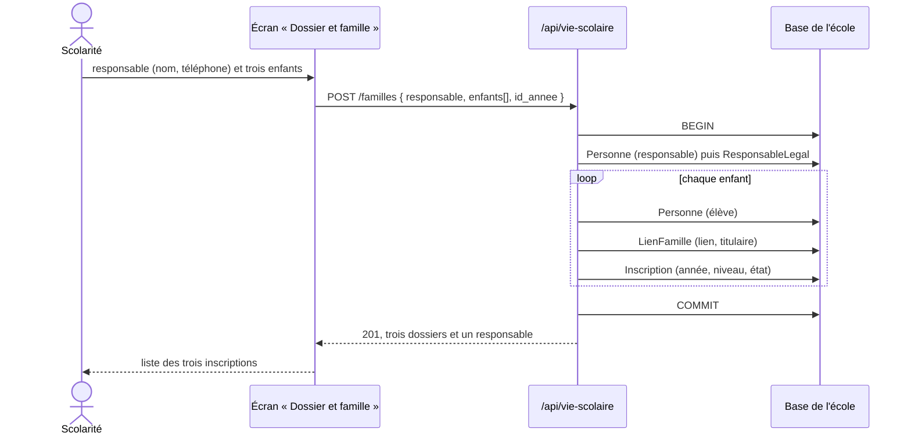

# VSC-02 · Élèves et familles — conception

| | |
|---|---|
| Module | [VSC](../../plan/modules/VSC-vie-scolaire.md) · chantier ouvert le 2026-11-18 |
| Branche | `feat/vsc-02-eleves-familles` |
| Rédigé par | Qoder (agent), le 2026-11-25 |
| **Validé** | le modèle par [VSC-01](../vie-scolaire/vsc-01-modele-donnees-scolaire.md), validé le 2026-11-25 (14 réponses retenues). Ce document-ci précise les écrans, les droits et les tests : à valider par le chef |
| Précédent | [VSC-01 · modèle de données du scolaire](../vie-scolaire/vsc-01-modele-donnees-scolaire.md) |

## 1. Objet et critère de « terminé »

VSC-02 livre **les dossiers** : une personne (élève ou responsable), sa famille, son inscription d'une année, et la réinscription.

Recopié de la fiche du module : « une fratrie de trois enfants est inscrite par un seul responsable légal ; un enfant sans compte apparaît dans l'emploi du temps de sa classe ».

Le second point dépend du rebranchement de `Etudiant` et de `Appartenir` sur `Personne` (migration `0065`), qui est une étape à part dans la conception VSC-01 (§ 9). Ce lot livre donc :

1. les tables `Personne`, `ResponsableLegal`, `LienFamille`, `Inscription` (migrations `0062`, `0063`) ;
2. l'API des dossiers et des inscriptions, y compris l'inscription d'une fratrie en une transaction ;
3. les écrans de dossier et d'inscription (web, puis application) ;
4. les tests C5-1, C5-3, C5-4, C5-11.

L'élève sans compte visible dans l'emploi du temps reste l'étape suivante (`0064`, `0065`), comme l'ordonne VSC-01 § 9.

## 2. Ce qui existe

- `Users` : compte obligatoire (adresse et mot de passe), `role` fermé à `admin`, `enseignant`, `etudiant`.
- `Etudiant` : clé `id_user` ; un élève ne peut pas exister sans compte.
- `Appartenir` : (`id_user_etudiant`, `id_groupe`), sans année ni état.
- `AnneeUniversitaire` (`libelle` unique) et `Groupe` (`annee_scolaire`, `id_annee` rempli par crochet) : l'année existe déjà, elle n'est pas à réinventer.
- Le gabarit d'une fonctionnalité verticale : `shared/` pour les règles pures, `models/` et `models/definitions.js`, `migrations/NNNN-nom.js`, `services/<domaine>/`, `routes/<domaine>Routes.js`, montage dans `app.js` — sans contrôleur séparé (comme `routes/annonceRoutes.js`).
- `ErreurMetier(message, statut, code)` et l'enveloppe `planification()` : les erreurs métier sortent au format commun.

## 3. Questions et réponses

Le modèle est tranché par VSC-01. Ce qui reste, et que ce lot doit décider :

| N° | Question | Proposition | Réponse du chef | Bloque |
|---|---|---|---|---|
| 1 | L'identifiant de connexion de l'élève arrive-t-il dans ce lot ? | **non** : étape suivante (`0064`), le dossier n'en dépend pas | | — |
| 2 | Une personne peut-elle être à la fois élève et responsable (élève majeur, parent d'un autre élève) ? | **oui**, les deux rôles sont deux tables séparées, pas un attribut | | API |
| 3 | Combien de responsables par enfant, et combien de titulaires ? | **autant que la famille en déclare**, **un seul titulaire** (celui qui reçoit les courriers) ; le remplacement est une modification, pas une seconde ligne | | API |
| 4 | Que fait-on des élèves déjà en base ? | **aucune reprise automatique** : ils restent dans `Etudiant` et `Users` tant que `0065` n'est pas passé ; un écran de reprise sera écrit avec `0065` | | — |
| 5 | L'inscription porte-t-elle le groupe ? | **non** : le groupe reste dans `Appartenir` (VSC-01, Q-6) | | — |
| 6 | Peut-on radier sans trace ? | **non** : `etat` passe à `radiee` avec sa date, la ligne reste ; la suppression physique n'est pas offerte | | API |
| 7 | Une réinscription est-elle une nouvelle ligne ? | **oui**, une ligne par année, reliée à la précédente (`id_inscription_precedente`), ce qui donne l'historique sans table d'archive | | API |

## 4. Solution

Le dossier est la seule porte d'entrée : un écran par rôle, une API, une transaction par famille.

Règles portées par `shared/vieScolaire.js`, donc les mêmes au serveur, au site et à l'application :

- états d'inscription : `demandee` → `engagee` → `confirmee` → `inscrite` → `passante` ou `radiee` ; aucune autre transition ;
- un seul titulaire par enfant ;
- une inscription par personne et par année ;
- un lien de famille valide (`pere`, `mere`, `tuteur`, `autre`) ;
- une personne sans compte est normale, une personne sans nom ne l'est pas.

## 5. Fichiers créés ou modifiés

| Fichier | Créé / modifié | Rôle | Taille visée |
|---|---|---|---|
| `docs/conception/vie-scolaire/vsc-02-eleves-familles.md` | créé | ce document | 100 lignes |
| `shared/vieScolaire.js` | créé | listes fermées, transitions, contrôle d'une personne | 90 lignes |
| `backend/models/Personne.js`, `ResponsableLegal.js`, `LienFamille.js`, `Inscription.js` | créés | les quatre tables | 4 × 40 |
| `backend/models/definitions.js`, `models/index.js` | modifiés | relations et résolveurs | +30 |
| `backend/migrations/0062-personnes-familles.js`, `0063-inscriptions.js` | créés | schéma, `down` complet | 2 × 90 |
| `backend/services/vie-scolaire/dossiers.js` | créé | personnes, responsables, liens, fratrie | 220 |
| `backend/services/vie-scolaire/inscriptions.js` | créé | inscriptions, états, réinscription | 130 |
| `backend/routes/vieScolaireRoutes.js` | créé | routeur `/api/vie-scolaire` | 110 |
| `backend/app.js` | modifié | montage | +2 |
| `backend/tests/vieScolaire.test.js` | créé | règles de `shared/vieScolaire.js` | 90 |
| `backend/tests/integration/vieScolaire.test.js` | créé | dossier, fratrie, états, isolation | 220 |
| `frontend/src/pages/gestion/DossiersEleves.jsx` + i18n | créés | liste, recherche, dossier, inscription | 320 |
| `mobile/src/app/dossiers/*` | créés | consultation du dossier et des enfants (étape suivante si le lot déborde) | 200 |

## 6. Données et migration

- `0062-personnes-familles` : `Personnes`, `ResponsablesLegaux`, `LiensFamille`. `down` supprime les trois tables, dans l'ordre inverse des clés.
- `0063-inscriptions` : `Inscriptions`, unique (`id_personne`, `id_annee`), `id_inscription_precedente` unique et facultatif.
- Aucune donnée créée d'office : une base HESTIM reste avec quatre tables vides, et la maquette ne change pas.
- Aucune reprise des élèves existants (question 4) : `0065` la portera, avec son écran.

## 7. Sécurité, isolation et exigences produit

- **Droits** : création et modification d'un dossier — `admin` ; lecture — `admin`, et plus tard le responsable légal pour ses enfants (VSC-02a, à l'ouverture de l'espace parents).
- **Isolation (D-01)** : aucune colonne d'établissement ; les tables vivent dans la base de l'école ; aucune route publique.
- **Mineurs** : ni CIN obligatoire ni donnée de santé (VSC-01, Q-7) ; l'adresse est facultative (Q-20), le dossier reste complet sans elle.
- **Suppression** : pas de suppression physique d'une inscription ; radiation avec date. Une personne sans inscription peut être supprimée si aucun lien de famille ne la retient.
- **Exigences** : EP-5 (une seule saisie : le responsable est saisi une fois pour la fratrie), EP-7 (pas de courriel sans adresse), EP-8 (l'école garde ses données).

## 8. Tests

| Règle | Test |
|---|---|
| C5-1 | une personne se crée sans compte : `POST /personnes` sans `id_user`, puis lecture |
| C5-3 | fratrie : un responsable, trois enfants, trois liens, une seule transaction ; échec au troisième enfant = rien en base |
| C5-4 | doublon d'inscription refusé, avec le numéro de l'inscription existante dans le message |
| C5-11 | deux bases : une personne de l'une n'apparaît pas dans l'autre |
| C5-états | `demandee` → `inscrite` accepté ; `radiee` → `confirmee` refusé |
| C5-titulaire | un second titulaire est refusé tant que le premier n'est pas changé |

## 9. Étapes de livraison

1. Ce document, commité seul.
2. `shared/vieScolaire.js` et ses tests.
3. Migrations `0062`, `0063`, modèles et relations.
4. Services et routes, montage dans `app.js`.
5. Tests d'intégration.
6. Écran web, puis écran de l'application.
7. Ensuite : `0064` et `0065` (identifiant de connexion, `Etudiant` et `Appartenir` sur `Personne`), qui remplissent le second critère de la fiche.

## 10. Risques et retour arrière

| Risque | Effet | Parade |
|---|---|---|
| `LiensFamille` sans garde | deux titulaires pour un enfant | contrôle dans le service + test C5-titulaire |
| Transaction de fratrie partielle | un responsable sans enfant, ou l'inverse | une seule transaction, test d'échec |
| Doublon d'inscription | deux inscriptions pour la même année | index unique et message explicite |
| Noms de tables au pluriel | incohérence avec l'existant (`Users`, `Groupes`, `Periodes`) | suivre l'existant : `Personnes`, `ResponsablesLegaux`, `LiensFamille`, `Inscriptions` |

Retour arrière : `down` de `0063` puis de `0062` ; aucune donnée existante n'est touchée.

## 11. Hors périmètre

L'identifiant de connexion (`0064`), le rebranchement de `Etudiant` et `Appartenir` (`0065`), l'import d'un fichier d'élèves (VSC-02b), les frais (FIN), l'espace parents dans l'application (MOB-05), les absences (VSC-03), les notes (VSC-04), la santé (VSC-08).
