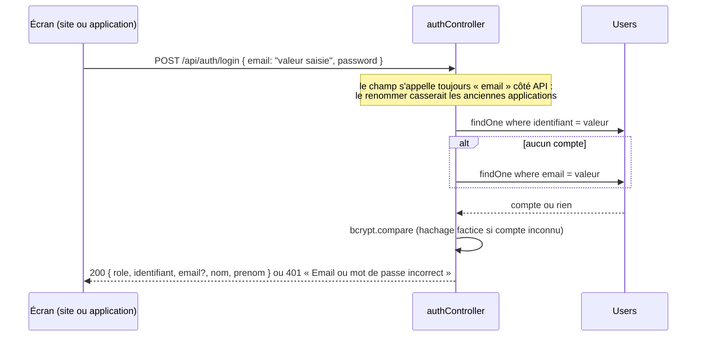

# VSC-03 · L'identifiant de connexion et l'adresse facultative

| | |
|---|---|
| Module | [VSC](../../plan/modules/VSC-vie-scolaire.md) · lot VSC-03, qui reprend les migrations `0064` et `0065` réservées par [VSC-01](vsc-01-modele-donnees-scolaire.md) |
| Branche | `feat/vsc-03-comptes-eleves`, coupée de `origin/main` `561fad19` |
| Rédigé par | Qoder (agent), le 2026-11-25 |
| **Validé** | à valider par le chef : les neuf questions du § 3 |
| Source mesurée | `origin/main` `561fad19`, plus [l'étude d'impact de Q-20](vsc-01-etude-impact-q20.md) (branche de VSC-01, PR #268) : 182 lectures de `.email` dans 65 fichiers |
| Précédent | [VSC-02 : élèves et familles](vsc-02-eleves-familles.md) (PR #269) |

## 1. Objectif et ce que le lot livre

Q-20 est tranchée : **l'identifiant est donné par l'école, l'adresse est facultative, aucune adresse
factice**. Ce lot rend cette décision vraie dans le logiciel, sans casser la connexion de ceux qui
utilisent aujourd'hui leur adresse.

Il livre quatre choses :

1. `Users.identifiant` : obligatoire, unique, c'est lui qui sert à se connecter.
2. `Users.email` : facultatif, unicité conservée (MySQL accepte plusieurs valeurs nulles).
3. La connexion, la réinitialisation, la double authentification, le journal et le jeton OIDC lisent
   l'identifiant ; l'adresse n'est qu'un complément.
4. La création et l'import d'un élève n'exigent plus d'adresse : l'identifiant suffit.

Il **ne livre pas** `0065` (`Etudiant` et `Appartenir` sur `Personne`) : c'est la deuxième PR du lot
(question 1), parce qu'elle dépend des tables de VSC-02 et touche 54 fichiers serveur.

## 2. Ce qui existe, mesuré

| Fait | Valeur |
|---|---|
| `Users.email` | `STRING`, **obligatoire**, unique |
| Connexion | `authController.js` L168-178 : `const { email, password }`, `findOne({ where: { email } })` |
| Site | `Connexion.jsx` : un seul champ, libellé « email », `autoComplete="username"` |
| Application | `mobile/src/app/connexion.jsx` : même champ |
| Limitation de débit | clé `compte:${req.body.email}` (`rateLimiterMiddleware.js` L185) |
| Double authentification | compte TOTP = `user.email` (`services/mfa.js` L136) |
| Jeton OIDC | `preferred_username: user.email.split("@")[0]`, `email: user.email` (`services/oidc/provider.js` L68-70) |
| Journal de sécurité | `user?.email ?? email` |
| Création d'un élève | `etudiantController.js` : refuse la création sans adresse — **blocage direct** |
| Migrations | `0060` et `0062` à `0079` sont libres ; la plus haute sur `main` est `0087` |

Les 182 lectures d'adresse sont classées dans l'étude d'impact : 14 fichiers doivent lire
l'identifiant (classe A), 18 doivent tolérer son absence (classe B), 12 restent intacts (personnel et
amorce de démonstration), 21 fichiers de test s'adaptent.

## 3. Questions et réponses

| N° | Question | Proposition | Réponse du chef |
|---|---|---|---|
| Q-1 | `0064` et `0065` dans la même PR ? | **Non** : cette PR ne fait que `0064`. `0065` suit, après fusion de #269, parce qu'elle joint `Personne` et touche 100 usages de `id_user_etudiant` dans 54 fichiers | à valider |
| Q-2 | Format et unicité de l'identifiant | **Saisi par l'école**, coupé de ses espaces, 1 à 190 caractères sans espace, unique sur toute la base de l'école (collation insensible à la casse). 190 pour absorber la reprise (une adresse peut servir d'identifiant). **Aucune fabrication automatique** | à valider |
| Q-3 | Connexion : identifiant seul, ou aussi l'adresse ? | **Les deux** : on cherche d'abord par identifiant, puis par adresse si aucune correspondance. Ceux qui se connectent aujourd'hui par adresse continuent sans rien faire | à valider |
| Q-4 | Reprise des comptes existants | `identifiant = email` existant : valeur réelle, unique, aucune ligne perdue. Aucune adresse inventée, aucune adresse effacée | à valider |
| Q-5 | Compte sans adresse : mot de passe et réinitialisation | Mot de passe initial **remis par l'école** (aucun courriel) ; réinitialisation demandée par identifiant, et si le compte n'a pas d'adresse, réponse neutre « demandez à l'école ». La réponse ne révèle jamais l'existence d'un compte | à valider |
| Q-6 | Double authentification, journal, OIDC | Compte TOTP = identifiant ; journal = identifiant, adresse en plus si elle existe ; OIDC `preferred_username` = identifiant, claim `email` **omis** quand l'adresse est nulle, `email_verified` absent alors | à valider |
| Q-7 | Mot de passe contenant l'identifiant | Refusé, comme aujourd'hui avec la partie locale de l'adresse : `passwordHelper.js` refuse identifiant et nom | à valider |
| Q-8 | Création et import d'un élève | `identifiant` obligatoire, `email` facultative ; le CSV gagne une colonne `identifiant` obligatoire et garde `email` facultative ; l'appariement des erreurs d'import se fait par identifiant. **Une ligne sans adresse et sans mot de passe est refusée** : le compte serait inaccessible, faute d'invitation | à valider |
| Q-9 | Ce qui est retiré | **Rien.** Connexion par adresse conservée, `Etudiant.id_user` intact, `password_hash` toujours exclu des réponses. La contraction viendra quand aucun écran ne lira l'ancien champ | à valider |

## 4. Solution

### 4.1 Le modèle

`Users` gagne une colonne et en perd une contrainte :

```text
Users
  id_user      int, clé
  identifiant  varchar(190), unique, obligatoire   ← nouveau
  email        varchar(190), unique, facultatif    ← était obligatoire
  password_hash, role, actif, must_change_password, mfa_*, anonymise_le  (inchangés)
```

### 4.2 La connexion



Le corps de requête garde le nom `email` : c'est le contrat de l'API existante et des applications
déjà installées. Seuls les **libellés** changent : « Identifiant » avec l'aide « ou adresse e-mail ».

### 4.3 Les lectures d'adresse

| Zone | Nouvelle règle |
|---|---|
| Limitation de débit | clé sur la valeur saisie, coupée et en minuscules |
| Mot de passe | refus si le mot de passe contient l'identifiant ou le nom |
| MFA | compte TOTP = identifiant |
| Journal | identifiant, adresse en plus si présente |
| OIDC | `preferred_username` = identifiant ; `email` seulement si l'adresse existe |
| Invitations, préavis, annonces, emploi du temps | garde `if (!email)` déjà en place : rien à ajouter, un test suffit |
| Exports et listes | colonne « identifiant » et colonne « adresse » ; l'adresse vide s'affiche « — » |

## 5. Fichiers touchés

**Serveur** : `models/Users.js`, `migrations/0064-identifiant-connexion.js`, `controllers/authController.js`,
`controllers/userController.js`, `controllers/etudiantController.js`,
`middleware/rateLimiterMiddleware.js`, `utils/passwordHelper.js`, `services/mfa.js`,
`services/oidc/provider.js`, `services/journalSecurite.js`, `services/comptes.js`,
`services/desactivation/programmation.js`, `services/studio/sessions.js`, `seed.js`.

**Site** : `pages/Connexion.jsx`, `pages/ForgotPassword.jsx`, `pages/Parametres.jsx`,
`components/comptes/*`, `components/etudiants/*`, `components/layouts/PiedDuMenu.jsx`,
`utils/exportColumns.js`, `utils/exportExcel.js`, `utils/fileImport.js`, `pages/gestion/JournalSecurite.jsx`,
`pages/Annonces.jsx`, `components/presences/DemandesTelephone.jsx`, `i18n/fr.js`, `i18n/en.js`.

**Application** : `src/app/connexion.jsx`, `src/app/(onglets)/compte.jsx`, `src/i18n.js`.

**Tests** : les 21 fichiers de l'étude d'impact, dont `auth.test.js`, `sso.test.js`, `mfa.test.js`,
`journalSecurite.test.js`, `users.test.js` et `helpers/testApp.js`.

## 6. Migration `0064`, en deux temps dans la même migration

| Étape | Contenu | Ce qui reste vrai |
|---|---|---|
| 1 | Ajout de `identifiant` **facultatif**, index unique | aucune ligne perdue, aucune lecture ne change |
| 2 | Reprise : `UPDATE Users SET identifiant = email WHERE identifiant IS NULL` | chaque compte a un identifiant réel, unique |
| 3 | `identifiant` devient **obligatoire** ; `email` devient **facultatif**, index unique conservé | la connexion par adresse marche encore |

`down` : `email` redevient obligatoire **seulement si aucune ligne n'a d'adresse nulle** ; sinon la
descente refuse et laisse la base en état `up`, plutôt que d'inventer des adresses. Puis la colonne
`identifiant` est retirée.

Le changement `email` obligatoire → facultatif est une modification de colonne `MODIFY` ; aucun index
n'est recréé, et la table `Users` d'une école de démonstration fait quelques dizaines de lignes : la
migration est instantanée.

## 7. Sécurité, isolation et vie privée

- **Une base par école (D-01)** : l'unicité de l'identifiant est celle de la base de l'école ; la
  question « unique par école ou sur la plateforme » (PLA-01) ne change pas ce lot.
- **Aucune révélation** : l'échec de connexion et la demande de réinitialisation renvoient le même
  message, que le compte existe ou non, avec ou sans adresse.
- **Journaux** : l'identifiant remplace l'adresse ; aucune adresse n'est écrite dans un journal public.
- **Données de mineurs** : l'identifiant d'un élève n'est lisible que par l'administration, l'élève
  lui-même et son responsable (Q-5 de VSC-01) ; il n'apparaît ni dans les annonces ni dans les exports
  destinés aux autres élèves.
- **Mots de passe** : le mot de passe initial remis par l'école reste marqué `must_change_password`,
  comme aujourd'hui.

## 8. Tests

| Règle | Test |
|---|---|
| C5-2 : un compte sans adresse est possible, un identifiant ne l'est pas | création avec identifiant seul, puis connexion par identifiant |
| La connexion par adresse marche encore | test existant de `auth.test.js` conservé tel quel |
| Deux comptes ne partagent pas un identifiant | doublon refusé, message qui nomme le compte |
| Un compte sans adresse ne reçoit aucun courriel et ne casse rien | annonce, emploi du temps, préavis, réinitialisation |
| La réinitialisation ne révèle rien | réponse identique avec et sans adresse |
| Le QR de double authentification porte l'identifiant | `mfa.test.js` |
| Le jeton OIDC porte l'identifiant et omet l'adresse nulle | `sso.test.js` |
| Le journal porte l'identifiant | `journalSecurite.test.js` |
| L'import d'élèves accepte l'absence d'adresse | `etudiants` : CSV sans colonne `email`, appariement par identifiant |
| La reprise ne perd aucun compte | après `0064`, chaque compte a un identifiant non nul et unique |
| La descente refuse plutôt que d'inventer | `down` avec une adresse nulle : refus explicite |

Les tests du backend restent verts ; les 21 fichiers de l'étude d'impact sont adaptés, aucun n'est
supprimé.

## 9. Étapes de livraison

1. Cette conception, commitée seule.
2. `0064` et le modèle `Users` : ajout, reprise, contrainte.
3. La bascule serveur : connexion, limitation, mot de passe, MFA, journal, OIDC, comptes.
4. Le site : connexion, mot de passe oublié, profil, comptes, listes, exports, import.
5. L'application : connexion et écran compte.
6. Les tests adaptés et les nouveaux.
7. Fiche de session, PR, puis **`0065`** dans une PR suivante.

## 10. Risques et retour arrière

| Risque | Effet | Parade |
|---|---|---|
| `email` facultatif lu sans garde | plantage d'un envoi ou du jeton OIDC | les 14 fichiers de classe A sont traités dans le même commit ; test C5-2 |
| La connexion par adresse est perdue | tous les comptes actuels sont bloqués | recherche par identifiant **puis** par adresse ; test existant conservé |
| Deux comptes se retrouvent avec le même identifiant | migration impossible | reprendre l'adresse, unique par construction ; l'index unique échoue plutôt que de dupliquer |
| Une application mobile ancienne envoie `email` | rien : le contrat de l'API ne change pas | libellés seuls modifiés |
| `down` avec des adresses nulles | perte de données si on forçait | la descente refuse, documenté |

## 11. Hors périmètre

`0065` (`Etudiant` et `Appartenir` sur `Personne`, en trois temps : étendre, basculer, contracter),
l'espace parents dans l'application, la fabrication automatique d'identifiants, l'adresse d'un élève
mineur (question au juriste et à la CNDP, non bloquante pour ce lot).
